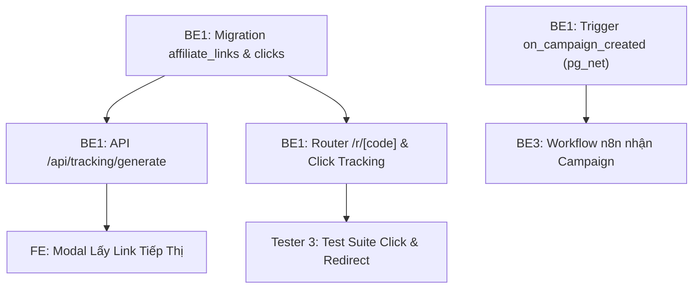

# MY WORK PLAN — BE1_W2
**Project:** AI Travel Reseller MVP (TravelLink AI)  
**Week:** Tuần 2 (12/10/2026 – 16/10/2026) — Sprint 2  
**Member:** Nguyễn Minh Tuệ (Backend 1 Lead)  
**Role:** Backend Developer 1 (Supabase DB, Edge Functions, Tracking Link & RLS)  
**Current Milestone:** AI CONTENT FACTORY & DISTRIBUTION (Sinh nội dung & Phân phối)  
**Deadline:** 12:00 PM Thứ Sáu (16/10/2026); Cross-testing & Demo: 13:30 – 17:30 ngày 16/10/2026  
**Branch:** `feature/be1-tracking-redirect` (tách từ `dev`)  

---

## 1. Context
- Kế thừa thành quả Tuần 1: Schema 8 bảng gốc, RLS policies, Auth trigger, pgvector `product_embeddings`, seed data đã hoàn thiện và chạy ổn định.
- Trọng tâm Tuần 2: Xây dựng hệ thống cấp Affiliate Tracking Link định danh, router chuyển hướng ghi nhận click an toàn, thiết lập Database Trigger `on_campaign_created` bắn webhook sang n8n và cấu hình RLS cho các bảng chiến dịch.
- Nguồn tham chiếu: PRD v1.0, [Roadmap.md](file:///E:/Tue/MyProject/AITravelReseller/ai-travel-reseller/.ai/process/Roadmap.md), [Week2.md](file:///E:/Tue/MyProject/AITravelReseller/ai-travel-reseller/.ai/process/Week2/Week2.md), [WEEK1_SUMMARY.md](file:///E:/Tue/MyProject/AITravelReseller/ai-travel-reseller/.ai/process/Week1/WEEK1_SUMMARY.md).

---

## 2. Executive Summary
Trong Tuần 2, BE1 tập trung hoàn thiện hạ tầng dữ liệu và phân phối liên kết tiếp thị:
1. Phát triển Supabase Edge Function / API cấp Tracking Link định danh `[domain]/r/[tracking_id]` hoặc tham số query.
2. Triển khai Redirect Service bắt sự kiện click, ghi nhận IP/User Agent vào bảng `clicks`, giải mã URL đích và 302 redirect an toàn đến trang thanh toán của Merchant.
3. Thiết lập Database Trigger `on_campaign_created` qua `pg_net` gọi Webhook n8n khi có chiến dịch mới.
4. Rà soát bảo mật RLS và tối ưu truy vấn Supabase đảm bảo tải trang Feed < 500ms.

---

## 3. TODAY — MUST DO (Thứ Hai 12/10/2026)
| Priority | Task | Why | Dependency | Output | Estimated Effort |
|---|---|---|---|---|---|
| P0 | Họp Kick-off Sprint 2 & Thống nhất API Contract Tracking Link | Chốt hợp đồng dữ liệu cho FE và QA | Team Dev | `api_contracts_w2.md` | 1h |
| P1 | Thiết kế Migration bổ sung cho `affiliate_links` & `clicks` | Đảm bảo trường dữ liệu lưu trữ click tracking | None | File migration SQL | 2h |
| P1 | Thiết kế cấu trúc API cấp link tracking và router redirect | Định hình logic giải mã và 302 redirect | None | Specs & Route handler prototype | 3h |

---

## 4. THIS WEEK — MY TASKS
| ID | Task | Priority | Status | Dependency | Owner | Deliverable | Deadline |
|---|---|---|---|---|---|---|---|
| BE1-W2-01 | Migration chuẩn hóa bảng `affiliate_links` và `clicks` | P0 | DONE | Tuần 1 schema | BE1 | File migration SQL (`20261013140000_affiliate_links_and_clicks.sql`) | 12/10 17:00 |
| BE1-W2-02 | Supabase Edge Function / API tạo Tracking Link cá nhân hóa | P1 | DONE | BE1-W2-01 | BE1 | Route `/api/tracking/generate` & `/api/tracking-links/generate` | 13/10 17:00 |
| BE1-W2-03 | Database Trigger `on_campaign_created` kích hoạt Webhook n8n | P0 | DONE | Schema campaigns | BE1 | Trigger SQL (`pg_net` async HTTP POST) | 13/10 17:00 |
| BE1-W2-04 | Triển khai Redirect Router `/r/[tracking_id]` & Ghi nhận Click | P0 | DONE | BE1-W2-01, 02 | BE1 | Next.js route `app/r/[code]/route.ts` | 14/10 17:00 |
| BE1-W2-05 | Cấu hình RLS Policies cho `campaigns`, `affiliate_links`, `clicks` | P1 | DONE | BE1-W2-01 | BE1 | Migration RLS SQL (bảo vệ link, cho phép public redirect) | 15/10 12:00 |
| BE1-W2-06 | Tối ưu hóa truy vấn Feed & Hỗ trợ tích hợp kỹ thuật E2E | P2 | IN_PROGRESS | BE1-W2-04 | BE1 | Query indexes + test suite `test_tracking.ps1` | 16/10 12:00 |

---

## 5. TASK BREAKDOWN

### TASK BE1-W2-02 — Xây dựng API Cấp Tracking Link Cá Nhân Hóa
**Goal:** Cung cấp endpoint nhận `reseller_id`, `campaign_id`, `product_id` và sinh ra mã tracking duy nhất kèm URL rút gọn.  
**Prerequisites:** Bảng `affiliate_links` đã được cấu hình các trường `unique_code`, `short_link`.  
**Steps:**
- [ ] Viết Route Handler `POST /api/tracking/generate` (hoặc Supabase Edge Function).
- [ ] Kiểm tra tính hợp lệ của bộ 3 UUID: `reseller_id`, `campaign_id`, `product_id`.
- [ ] Sinh `unique_code` ngẫu nhiên chuẩn nanoid/cuid (8-10 ký tự, không trùng lặp).
- [ ] Lưu bản ghi vào bảng `affiliate_links` (nếu đã có link cùng reseller và campaign thì trả về link cũ - Idempotent).
- [ ] Trả về JSON `{ success: true, tracking_id, short_url, destination_url }`.  
**Definition of Done:** API trả HTTP 200/201 kèm URL tracking hợp lệ; kiểm tra DB xuất hiện bản ghi; Unit test pass.  
**Handoff To:** FE (gọi trong modal nhận link), Tester 3 (viết test suite API).

---

### TASK BE1-W2-03 — Database Trigger on_campaign_created Kích Hoạt n8n Webhook
**Goal:** Tự động gửi HTTP POST sang n8n Webhook ngay khi Merchant tạo một chiến dịch mới trong bảng `campaigns`.  
**Prerequisites:** Extension `pg_net` đã kích hoạt từ Tuần 1; n8n webhook URL do BE3 cung cấp.  
**Steps:**
- [ ] Viết hàm PL/pgSQL `public.trigger_campaign_to_n8n()`.
- [ ] Cấu hình gọi `net.http_post` với payload chứa `campaign_id`, `product_id`, `merchant_id`, `title`, `commission_rate`.
- [ ] Gắn Trigger `AFTER INSERT ON public.campaigns FOR EACH ROW`.
- [ ] Thêm biến cấu hình URL webhook linh hoạt để tránh hardcode IP nội bộ.  
**Definition of Done:** Tạo campaign mới trong bảng `campaigns`, n8n nhận được request HTTP POST tức thì; không làm chậm transaction của database.  
**Handoff To:** BE3 (tiếp nhận trigger n8n).

---

### TASK BE1-W2-04 — Triển Khai Redirect Service & Click Tracking Router
**Goal:** Xây dựng endpoint tiếp nhận lượt click của khách hàng `/r/[tracking_id]`, ghi nhận dữ liệu vào bảng `clicks` và redirect 302 an toàn.  
**Prerequisites:** Bảng `clicks` và `affiliate_links` đã liên kết khóa ngoại.  
**Steps:**
- [ ] Tạo Next.js Route Handler tại `app/r/[code]/route.ts`.
- [ ] Trích xuất `unique_code` từ URL params.
- [ ] Truy vấn bảng `affiliate_links` lấy link gốc và thông tin sản phẩm.
- [ ] Lấy IP (qua header `x-forwarded-for`), User Agent, Referrer từ HTTP Request.
- [ ] Thực hiện ghi bất đồng bộ (non-blocking) vào bảng `clicks` và tăng `clicks_count` trong `affiliate_links`.
- [ ] Trả về HTTP 302 Redirect đến `official_booking_url` kèm tham số tracking.
- [ ] Xử lý fallback: Nếu mã code không tồn tại, redirect về trang chủ kèm thông báo lỗi thân thiện.  
**Definition of Done:** Bấm vào short link chuyển hướng đúng trang thanh toán của Merchant; bảng `clicks` tăng đúng 1 dòng dữ liệu hợp lệ.  
**Handoff To:** Tester 3 (kiểm thử redirect & DB clicks), FE.

---

## 6. DEPENDENCY MAP


---

## 7. BLOCKERS
| Blocker | Tôi cần gì | Người phụ trách | Deadline | Impact |
|---|---|---|---|---|
| Webhook URL của n8n | Webhook URL chính thức của n8n trên môi trường local/staging | BE3 | 12/10 15:00 | Chưa test trigger thực tế |
| Domain chính thức cho short link | Định dạng prefix domain (`http://localhost:3000/r/` hoặc domain custom) | PM / FE | 12/10 12:00 | Chưa chốt format short URL |

---

## 8. TEAM HANDOFF
| From | To | Deliverable | Format | Deadline | Status |
|---|---|---|---|---|---|
| BE1 | FE | API Contract tạo Tracking Link & Định dạng link | Markdown specs | 12/10 17:00 | READY |
| BE1 | BE3 | Trigger database `on_campaign_created` & Payload specs | SQL snippet | 13/10 17:00 | READY |
| BE1 | Tester 3 | Redirect Router `/r/[code]` & Database schema `clicks` | Endpoint + Migration | 14/10 17:00 | PLANNED |
| BE1 | Toàn team | RLS Policies cho các bảng Tuần 2 | Migration SQL | 15/10 12:00 | PLANNED |

---

## 9. TEAM CONFLICT CHECK
- 🔴 **Conflict:** Không có xung đột. BE1 là Primary Owner của toàn bộ Database Schema, Edge Functions và Routing Redirect.
- 🟡 **Potential Conflict:** Route `/r/[code]` đặt tại root `app/r/[code]/route.ts`. Cần lưu ý cấu hình `proxy.ts` không chặn route `/r/*` để khách hàng chưa đăng nhập vẫn click bình thường.
- 🟢 **No Conflict:** Đã thống nhất với BE2/BE3: BE1 phụ trách lưu trữ DB và cấp link; BE2 phụ trách prompt/schema; BE3 phụ trách pipeline workflow.

---

## 10. INTERFACE CHECK
| Interface | Tôi | Người liên quan | Cần chốt | Status |
|---|---|---|---|---|
| `POST /api/tracking/generate` | Owner | FE (Consumer) | Body `{ campaign_id, product_id }` lấy reseller từ session | PROPOSED |
| `GET /r/[code]` | Owner | End Customer / QA | Mã 302 redirect và params tracking chuyển tiếp | PROPOSED |
| Webhook `on_campaign_created` | Owner | BE3 (Consumer) | JSON payload bắn sang n8n: `{ campaign_id, title, product_id... }` | PROPOSED |

---

## 11. OUT OF SCOPE
- Tự động thanh toán hoa hồng trực tiếp qua cổng ngân hàng (để Tuần 4/Phase sau).
- Hệ thống phát hiện gian lận phức tạp bằng Machine Learning (Tuần 2 chỉ kiểm tra IP/User-agent cơ bản).
- Rút gọn link tùy biến tên miền riêng (Custom branded domains).

---

## 12. END-OF-DAY UPDATE (Mẫu nhật ký)
```text
DONE:
- ...
IN PROGRESS:
- ...
BLOCKED:
- ...
HANDOFF:
- ...
NEXT:
- ...
```

---

## 13. END-OF-WEEK CHECKLIST
- [ ] Tất cả các migration SQL được commit và chạy test pass qua `supabase db reset`
- [ ] API cấp tracking link hoạt động ổn định và có unit/integration test
- [ ] Router `/r/[code]` ghi nhận lượt click vào bảng `clicks` và 302 redirect thành công
- [ ] Trigger database kích hoạt n8n thành công
- [ ] 100% PR được merge an toàn vào `dev` trước 12:00 PM Thứ Sáu (16/10/2026)
