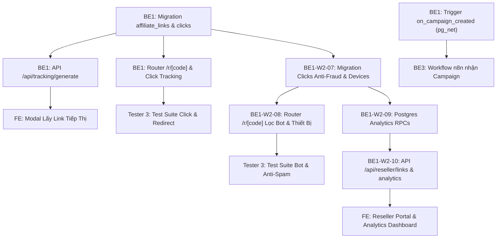

# MY WORK PLAN — BE1_W2
**Project:** AI Travel Reseller MVP (TravelLink AI)  
**Week:** Tuần 2 (12/10/2026 – 16/10/2026) — Sprint 2  
**Member:** Nguyễn Minh Tuệ (Backend 1 Lead)  
**Role:** Backend Developer 1 (Supabase DB, Edge Functions, Tracking Link & RLS)  
**Current Milestone:** AI CONTENT FACTORY & DISTRIBUTION (Sinh nội dung & Phân phối)  
**Deadline:** 12:00 PM Thứ Sáu (16/10/2026); Cross-testing & Demo: 13:30 – 17:30 ngày 16/10/2026  
**Branch:** `Feature_BE1_Optimization` (tách từ `dev`)  

---

## 1. Context
- Kế thừa thành quả Tuần 1: Schema 8 bảng gốc, RLS policies, Auth trigger, pgvector `product_embeddings`, seed data đã hoàn thiện và chạy ổn định.
- Trọng tâm Tuần 2: Xây dựng hệ thống cấp Affiliate Tracking Link định danh, router chuyển hướng ghi nhận click an toàn, thiết lập Database Trigger `on_campaign_created` bắn webhook sang n8n và cấu hình RLS cho các bảng chiến dịch.
- Nguồn tham chiếu: PRD v1.0, [Roadmap.md](file:///E:/Tue/MyProject/AITravelReseller/ai-travel-reseller/.ai/process/Roadmap.md), [Week2.md](file:///E:/Tue/MyProject/AITravelReseller/ai-travel-reseller/.ai/process/Week2/Week2.md), [WEEK1_SUMMARY.md](file:///E:/Tue/MyProject/AITravelReseller/ai-travel-reseller/.ai/process/Week1/WEEK1_SUMMARY.md).

---

## 2. Executive Summary
Trong Tuần 2, BE1 tập trung hoàn thiện hạ tầng dữ liệu và phân phối liên kết tiếp thị:
1. Phát triển Supabase Edge Function / API cấp Tracking Link định danh `[domain]/r/[tracking_id]` hoặc tham số query.
2. Triển khai Redirect Service bắt sự kiện click, ghi nhận IP/User Agent vào bảng `clicks`, giải mã URL đích và 302 redirect an toàn đến trang thanh toán của Merchant.
3. Thiết lập Database Trigger `on_campaign_created` qua `pg_net` gọi Webhook n8n khi có chiến dịch mới.
4. Rà soát bảo mật RLS và tối ưu truy vấn Supabase đảm bảo tải trang Feed < 500ms (hoàn thành qua bộ index composite/partial).
5. Bổ sung Module Chống click tặc & Lọc Bot (Anti-Fraud & Bot Detection) và Parser Thiết bị/Hệ điều hành vào Router `/r/[code]` để bảo vệ tính chính xác của số liệu.
6. Xây dựng bộ Postgres RPC High-Performance Analytics và các API Route Handlers (`/api/reseller/links`, `/api/reseller/analytics`) phục vụ dữ liệu trực quan cho Reseller Dashboard.

---

## 3. TODAY — MUST DO (Thứ Tư 14/10/2026)
| Priority | Task | Why | Dependency | Output | Estimated Effort |
|---|---|---|---|---|---|
| P0 | Phân rã & Lập kế hoạch 4 Module bổ sung từ `SP_BE1_W2` | Chuẩn hóa quy trình kỹ thuật chống bot và analytics | Team Dev | Cập nhật `BE1_W2.md` & `TEAM_WORK_LOG.md` | 1h |
| P1 | Viết Migration mở rộng bảng `clicks` & cập nhật Trigger đếm click | Chuẩn bị cột dữ liệu thiết bị, OS, Bot flag | BE1-W2-01 | File migration SQL (`20261014110000...`) | 2h |
| P1 | Nâng cấp Router `/r/[code]` tích hợp User-Agent Parser & Rate Limiter | Lọc bot crawler và click tặc spam | BE1-W2-04 | Code Route Handler & helpers | 2.5h |

---

## 4. THIS WEEK — MY TASKS
| ID | Task | Priority | Status | Dependency | Owner | Deliverable | Deadline |
|---|---|---|---|---|---|---|---|
| BE1-W2-01 | Migration chuẩn hóa bảng `affiliate_links` và `clicks` | P0 | DONE | Tuần 1 schema | BE1 | File migration SQL (`20261013140000_affiliate_links_and_clicks.sql`) | 12/10 17:00 |
| BE1-W2-02 | Supabase Edge Function / API tạo Tracking Link cá nhân hóa | P1 | DONE | BE1-W2-01 | BE1 | Route `/api/tracking/generate` & `/api/tracking-links/generate` | 13/10 17:00 |
| BE1-W2-03 | Database Trigger `on_campaign_created` kích hoạt Webhook n8n | P0 | DONE | Schema campaigns | BE1 | Trigger SQL (`pg_net` async HTTP POST) | 13/10 17:00 |
| BE1-W2-04 | Triển khai Redirect Router `/r/[tracking_id]` & Ghi nhận Click | P0 | DONE | BE1-W2-01, 02 | BE1 | Next.js route `app/r/[code]/route.ts` | 14/10 17:00 |
| BE1-W2-05 | Cấu hình RLS Policies cho `campaigns`, `affiliate_links`, `clicks` | P1 | DONE | BE1-W2-01 | BE1 | Migration RLS SQL (bảo vệ link, cho phép public redirect) | 15/10 12:00 |
| BE1-W2-06 | Tối ưu hóa truy vấn Feed & Hỗ trợ tích hợp kỹ thuật E2E | P2 | DONE | BE1-W2-04 | BE1 | Migration SQL (`20261013213000_optimize_feed_and_tracking_indexes.sql`), benchmark script `benchmark_performance.ps1` | 13/10 21:30 |
| BE1-W2-07 | Migration mở rộng bảng `clicks` & Cập nhật Trigger đếm click hợp lệ | P1 | READY | BE1-W2-01 | BE1 | File migration SQL (`20261014110000_clicks_anti_fraud_and_device_analytics.sql`) | 14/10 17:00 |
| BE1-W2-08 | Module Chống click tặc, Lọc Bot & Parser Thiết bị trong Router `/r/[code]` | P1 | READY | BE1-W2-04, 07 | BE1 | Code `app/r/[code]/route.ts` + `ua-parser.ts`, `rate-limiter.ts` | 15/10 12:00 |
| BE1-W2-09 | Bộ Postgres RPC Hàm Thống Kê Nhanh (High-Performance Analytics RPCs) | P1 | READY | BE1-W2-07 | BE1 | File migration SQL (`20261014140000_reseller_analytics_rpc.sql`) | 15/10 17:00 |
| BE1-W2-10 | API Quản Lý & Báo Cáo cho Reseller Dashboard (`/api/reseller/*`) | P1 | READY | BE1-W2-09 | BE1 | Routes `app/api/reseller/links/route.ts` & `app/api/reseller/analytics/route.ts` | 16/10 10:00 |

---

## 5. TASK BREAKDOWN

### TASK BE1-W2-02 — Xây dựng API Cấp Tracking Link Cá Nhân Hóa
**Goal:** Cung cấp endpoint nhận `reseller_id`, `campaign_id`, `product_id` và sinh ra mã tracking duy nhất kèm URL rút gọn.  
**Prerequisites:** Bảng `affiliate_links` đã được cấu hình các trường `unique_code`, `short_link`.  
**Steps:**
- [ ] Viết Route Handler `POST /api/tracking/generate` (hoặc Supabase Edge Function).
- [ ] Kiểm tra tính hợp lệ của bộ 3 UUID: `reseller_id`, `campaign_id`, `product_id`.
- [ ] Sinh `unique_code` ngẫu nhiên chuẩn nanoid/cuid (8-10 ký tự, không trùng lặp).
- [ ] Lưu bản ghi vào bảng `affiliate_links` (nếu đã có link cùng reseller và campaign thì trả về link cũ - Idempotent).
- [ ] Trả về JSON `{ success: true, tracking_id, short_url, destination_url }`.  
**Definition of Done:** API trả HTTP 200/201 kèm URL tracking hợp lệ; kiểm tra DB xuất hiện bản ghi; Unit test pass.  
**Handoff To:** FE (gọi trong modal nhận link), Tester 3 (viết test suite API).

---

### TASK BE1-W2-03 — Database Trigger on_campaign_created Kích Hoạt n8n Webhook
**Goal:** Tự động gửi HTTP POST sang n8n Webhook ngay khi Merchant tạo một chiến dịch mới trong bảng `campaigns`.  
**Prerequisites:** Extension `pg_net` đã kích hoạt từ Tuần 1; n8n webhook URL do BE3 cung cấp.  
**Steps:**
- [ ] Viết hàm PL/pgSQL `public.trigger_campaign_to_n8n()`.
- [ ] Cấu hình gọi `net.http_post` với payload chứa `campaign_id`, `product_id`, `merchant_id`, `title`, `commission_rate`.
- [ ] Gắn Trigger `AFTER INSERT ON public.campaigns FOR EACH ROW`.
- [ ] Thêm biến cấu hình URL webhook linh hoạt để tránh hardcode IP nội bộ.  
**Definition of Done:** Tạo campaign mới trong bảng `campaigns`, n8n nhận được request HTTP POST tức thì; không làm chậm transaction của database.  
**Handoff To:** BE3 (tiếp nhận trigger n8n).

---

### TASK BE1-W2-04 — Triển Khai Redirect Service & Click Tracking Router
**Goal:** Xây dựng endpoint tiếp nhận lượt click của khách hàng `/r/[tracking_id]`, ghi nhận dữ liệu vào bảng `clicks` và redirect 302 an toàn.  
**Prerequisites:** Bảng `clicks` và `affiliate_links` đã liên kết khóa ngoại.  
**Steps:**
- [ ] Tạo Next.js Route Handler tại `app/r/[code]/route.ts`.
- [ ] Trích xuất `unique_code` từ URL params.
- [ ] Truy vấn bảng `affiliate_links` lấy link gốc và thông tin sản phẩm.
- [ ] Lấy IP (qua header `x-forwarded-for`), User Agent, Referrer từ HTTP Request.
- [ ] Thực hiện ghi bất đồng bộ (non-blocking) vào bảng `clicks` và tăng `clicks_count` trong `affiliate_links`.
- [ ] Trả về HTTP 302 Redirect đến `official_booking_url` kèm tham số tracking.
- [ ] Xử lý fallback: Nếu mã code không tồn tại, redirect về trang chủ kèm thông báo lỗi thân thiện.  
**Definition of Done:** Bấm vào short link chuyển hướng đúng trang thanh toán của Merchant; bảng `clicks` tăng đúng 1 dòng dữ liệu hợp lệ.  
**Handoff To:** Tester 3 (kiểm thử redirect & DB clicks), FE.

---

### TASK BE1-W2-07 — Migration Mở Rộng Bảng Clicks & Cập Nhật Trigger Thống Kê Hợp Lệ
**Goal:** Chuẩn hóa bảng `clicks` với các trường định danh thiết bị, hệ điều hành, phân loại bot và cờ hợp lệ; đồng thời cập nhật trigger tự động chỉ tăng `clicks_count` khi click là của con người và hợp lệ.  
**Prerequisites:** Bảng `clicks` đã tạo từ `20261013140000_affiliate_links_and_clicks.sql`.  
**Steps:**
- [ ] Viết migration SQL `supabase/migrations/20261014110000_clicks_anti_fraud_and_device_analytics.sql`:
  - Thêm các cột: `device_type character varying(20)` (mobile / desktop / tablet / unknown).
  - Thêm cột: `os character varying(30)` (iOS / Android / Windows / macOS / Linux / other).
  - Thêm cột: `browser character varying(40)` (Chrome / Safari / TikTok / Facebook / other).
  - Thêm cột: `is_bot boolean NOT NULL DEFAULT false`.
  - Thêm cột: `bot_name character varying(50)` (FacebookBot, Googlebot, ByteSpider...).
  - Thêm cột: `is_valid boolean NOT NULL DEFAULT true`.
  - Thêm cột: `invalid_reason character varying(50)` (rate_limit_exceeded, suspicious_ip...).
- [ ] Cập nhật trigger function `public.increment_affiliate_link_clicks()`:
  - Chỉ tăng `clicks_count` khi `NEW.is_bot = false AND NEW.is_valid = true`.
- [ ] Bổ sung partial indexes tối ưu báo cáo:
  - `idx_clicks_valid_human` trên `(link_id, clicked_at DESC) WHERE is_bot = false AND is_valid = true`.
  - `idx_clicks_device_stats` trên `(link_id, device_type, os) WHERE is_bot = false`.  
**Definition of Done:** Chạy `supabase db reset` thành công; test insert click với `is_bot = true` không làm tăng `clicks_count` trong `affiliate_links`.  
**Handoff To:** Tester 3 (kiểm thử schema và trigger), BE1 (phục vụ task 08).

---

### TASK BE1-W2-08 — Tích Hợp Module Anti-Fraud, Lọc Bot & Parser Thiết Bị Vào Router Redirect
**Goal:** Tự động phân tích User-Agent để nhận diện Bot (Facebook External Hit, TikTok Bot, Googlebot, Telegram...), trích xuất thông tin thiết bị/OS/trình duyệt và áp dụng cơ chế Rate Limiting theo IP để chống click tặc.  
**Prerequisites:** Migration `BE1-W2-07` đã áp dụng.  
**Steps:**
- [ ] Viết helper module User-Agent & Bot Detection: `src/lib/tracking/ua-parser.ts`:
  - Nhận diện các bot phổ biến: Facebook External Hit, Facebot, TikTok/ByteSpider, Googlebot, Twitterbot, TelegramBot, ZaloBot, WhatsApp.
  - Phân loại thiết bị (`mobile`, `desktop`, `tablet`).
  - Phân loại hệ điều hành (`iOS`, `Android`, `Windows`, `macOS`, `Linux`).
  - Phân loại trình duyệt/in-app webview (`TikTok In-App`, `Facebook In-App`, `Safari`, `Chrome`, `Firefox`).
- [ ] Viết module Rate Limiter: `src/lib/tracking/rate-limiter.ts`:
  - Quy tắc: Cùng 1 IP bấm liên tục quá 10 lần trong 1 phút trên cùng 1 link thì đánh dấu `is_valid = false` và `invalid_reason = 'rate_limit_exceeded'`.
- [ ] Cập nhật Router Handler `app/r/[code]/route.ts`:
  - **Lưu ý sống còn:** Vẫn thực hiện HTTP 302 Redirect an toàn cho bot/rate-limited click để không phá hỏng OpenGraph Preview khi share link lên mạng xã hội.
  - Ghi nhận đầy đủ `device_type`, `os`, `browser`, `is_bot`, `bot_name`, `is_valid` vào bảng `clicks`.  
**Definition of Done:** 302 redirect vẫn hoạt động siêu tốc (< 150ms); crawler quét link được gắn cờ `is_bot = true`; click tặc > 10 lần/phút bị đánh dấu `is_valid = false`; thiết bị và OS được ghi nhận chính xác.  
**Handoff To:** Tester 3 (chạy test suite bot & spam click), FE.

---

### TASK BE1-W2-09 — Xây Dựng Bộ Postgres Stored Procedures (RPCs) Thống Kê Nhanh
**Goal:** Viết các hàm Stored Procedure (RPC) tổng hợp dữ liệu tốc độ cao ngay trong Postgres DB, tránh việc FE phải kéo hàng nghìn bản ghi thô về client.  
**Prerequisites:** Migration `BE1-W2-07` và dữ liệu click phân loại đã sẵn sàng.  
**Steps:**
- [ ] Viết migration SQL `supabase/migrations/20261014140000_reseller_analytics_rpc.sql`:
  - `get_reseller_click_timeseries(p_reseller_id uuid, p_days integer DEFAULT 7)`: Trả về chuỗi thời gian (ngày, tổng click, click hợp lệ, click bot).
  - `get_reseller_top_campaigns(p_reseller_id uuid, p_limit integer DEFAULT 5)`: Trả về top chiến dịch có lượt click hợp lệ cao nhất kèm tên tour và hoa hồng.
  - `get_reseller_device_stats(p_reseller_id uuid)`: Trả về phân bố phần trăm thiết bị (Mobile vs Desktop) và OS (iOS vs Android).
  - `get_reseller_overview_stats(p_reseller_id uuid)`: Trả về tổng số link đã tạo, tổng click hợp lệ, tỷ lệ bot/spam đã lọc, và số campaign đang hoạt động.
- [ ] Cấu hình `SECURITY DEFINER` và kiểm tra quyền bảo mật: Chỉ cho phép người dùng xem dữ liệu của chính mình (`auth.uid() = p_reseller_id` hoặc service role).  
**Definition of Done:** Chạy test gọi các hàm RPC qua SQL và Supabase Client, thời gian phản hồi < 5ms cho tập dữ liệu mẫu.  
**Handoff To:** FE (hợp đồng dữ liệu analytics), BE1 (cho task 10).

---

### TASK BE1-W2-10 — Xây Dựng API Quản Lý & Báo Cáo Cho Reseller Dashboard
**Goal:** Cung cấp 2 API RESTful hoàn chỉnh phục vụ màn hình quản trị chiến dịch và biểu đồ phân tích của Reseller.  
**Prerequisites:** RPC Functions `BE1-W2-09` đã sẵn sàng; Supabase Auth helper đã cấu hình.  
**Steps:**
- [ ] Tạo Route Handler `GET /api/reseller/links`:
  - Lấy `user_id` từ session đăng nhập.
  - Trả về danh sách toàn bộ link tiếp thị của Reseller kèm: tên tour, ảnh bìa, mã short code, URL rút gọn, số click hợp lệ, trạng thái hoạt động, ngày tạo.
- [ ] Tạo Route Handler `GET /api/reseller/analytics`:
  - Nhận tham số query `range=7d|30d`.
  - Gọi các hàm RPC `get_reseller_overview_stats`, `get_reseller_click_timeseries`, `get_reseller_top_campaigns`, `get_reseller_device_stats`.
  - Trả về JSON tổng hợp cấu trúc trực quan phục vụ render biểu đồ Frontend.
- [ ] Viết kịch bản kiểm thử tự động `test_reseller_analytics.ps1` kiểm tra tính chính xác của cả 2 endpoints.  
**Definition of Done:** Gọi API bằng token của Reseller trả HTTP 200 kèm đầy đủ metrics; token không hợp lệ bị từ chối 401; test script PASS 100%.  
**Handoff To:** FE (tích hợp vào Reseller Dashboard), Tester 3 (bổ sung API test collection).

---

## 6. DEPENDENCY MAP

---

## 7. BLOCKERS
| Blocker | Tôi cần gì | Người phụ trách | Deadline | Impact |
|---|---|---|---|---|
| Webhook URL của n8n | Webhook URL chính thức của n8n trên môi trường local/staging | BE3 | 12/10 15:00 | Đã giải tỏa (mặc định port 5678) |
| Domain chính thức cho short link | Định dạng prefix domain (`http://localhost:3000/r/` hoặc domain custom) | PM / FE | 12/10 12:00 | Đã chốt format `/r/[code]` |

---

## 8. TEAM HANDOFF
| From | To | Deliverable | Format | Deadline | Status |
|---|---|---|---|---|---|
| BE1 | FE | API Contract tạo Tracking Link (`POST /api/tracking/generate` & alias `/api/tracking-links/generate`) | Endpoint + Types | 12/10 17:00 | DONE |
| BE1 | BE3 | Trigger database `on_campaign_created` & Webhook payload specs | Migration SQL (`pg_net`) | 13/10 17:00 | DONE |
| BE1 | Tester 3 | Redirect Router `/r/[code]` & Schema bảng `clicks` | Endpoint + Script test | 14/10 17:00 | DONE |
| BE1 | Toàn team | RLS Policies & Indexes tối ưu cho các bảng Tuần 2 | Migration SQL | 13/10 21:30 | DONE |
| BE1 | FE | API Báo cáo & Link Reseller (`GET /api/reseller/links`, `GET /api/reseller/analytics`) | Endpoints + TypeScript Types | 15/10 17:00 | READY |
| BE1 | Tester 3 | RPC Functions & Test script lọc Bot, Rate limit, Analytics | SQL + Script PowerShell | 15/10 17:00 | READY |

---

## 9. TEAM CONFLICT CHECK
- 🔴 **Conflict:** Không có xung đột. BE1 là Primary Owner của toàn bộ Database Schema, Edge Functions và Routing Redirect.
- 🟡 **Potential Conflict:** Route `/r/[code]` đặt tại root `app/r/[code]/route.ts`. Đã kiểm tra cấu hình `proxy.ts`, route `/r/*` hoàn toàn công khai, không bị chặn bởi Auth middleware để khách hàng vãng lai click bình thường.
- 🟢 **No Conflict:** Đã thống nhất với BE2/BE3: BE1 phụ trách lưu trữ DB và cấp link; BE2 phụ trách prompt/schema; BE3 phụ trách pipeline workflow.

---

## 10. INTERFACE CHECK
| Interface | Tôi | Người liên quan | Cần chốt | Status |
|---|---|---|---|---|
| `POST /api/tracking/generate` | Owner | FE (Consumer) | Body `{ campaign_id, product_id, reseller_id }` đảm bảo Idempotent | IMPLEMENTED & TESTED |
| `GET /r/[code]` | Owner | End Customer / QA | Mã 302 redirect và params tracking chuyển tiếp an toàn (kèm lọc bot) | IMPLEMENTED & TESTED |
| Webhook `on_campaign_created` | Owner | BE3 (Consumer) | JSON payload bắn sang n8n: `{ campaign_id, title, product_id... }` | IMPLEMENTED & TESTED |
| `GET /api/reseller/links` | Owner | FE (Consumer) | Trả về danh sách link tiếp thị của Reseller kèm số click hợp lệ | SPECIFIED |
| `GET /api/reseller/analytics` | Owner | FE (Consumer) | Query param `range` (7d, 30d); trả timeseries, devices breakdown, top campaigns | SPECIFIED |

---

## 11. OUT OF SCOPE
- Tự động thanh toán hoa hồng trực tiếp qua cổng ngân hàng (để Tuần 4/Phase sau).
- Hệ thống phát hiện gian lận phức tạp bằng Machine Learning (Tuần 2 áp dụng User-Agent bot signatures và rate limit theo IP).
- Rút gọn link tùy biến tên miền riêng (Custom branded domains).

---

## 12. END-OF-DAY UPDATE

### 14/10/2026 (Thứ Tư)
**DONE:**
- Phân rã toàn diện 4 module nâng cấp từ `SP_BE1_W2` thành các task chính thức (`BE1-W2-07` đến `BE1-W2-10`).
- Hoàn thiện tài liệu kế hoạch kỹ thuật, thiết kế cấu trúc mở rộng bảng `clicks` (bot detection, devices parser) và đặc tả các hàm Postgres RPC Analytics.
- Đồng bộ thông tin giao diện với FE Lead và Tester 3.

**IN PROGRESS:**
- Viết file migration `supabase/migrations/20261014110000_clicks_anti_fraud_and_device_analytics.sql`.
- Xây dựng module nhận diện Bot và parser User-Agent trong `src/lib/tracking/ua-parser.ts`.

**BLOCKED:**
- Không có blocker.

**NEXT:**
- Áp dụng migration mới lên local DB, cập nhật Route Handler `/r/[code]` và kiểm thử với script giả lập Bot / Rate Limit.
- Triển khai bộ Postgres RPC và 2 API Route Handlers cho Reseller Dashboard.

### 13/10/2026 (Thứ Ba)
**DONE:**
- Viết migration `supabase/migrations/20261013140000_affiliate_links_and_clicks.sql`:
  - Tạo bảng `affiliate_links` (Idempotent UNIQUE constraint `reseller_id, campaign_id, product_id`).
  - Tạo bảng `clicks` lưu log raw (IP, User Agent, Referer, Metadata).
  - Viết trigger `trg_increment_affiliate_link_clicks` tự động tăng `clicks_count`.
  - Viết trigger `trg_on_campaign_created` bắn async HTTP POST sang n8n qua `pg_net`.
  - Cấu hình phân quyền GRANT và RLS Policies cho `anon`, `authenticated`, `service_role`.
- Triển khai Route Handler `POST /api/tracking/generate` và alias `/api/tracking-links/generate`.
- Triển khai Route Handler `GET /r/[code]` ghi nhận click và 302 redirect đến `products.payment_url`.
- Viết migration `supabase/migrations/20261013213000_optimize_feed_and_tracking_indexes.sql`:
  - Tạo composite indexes cho `campaigns(status, start_date DESC)`, partial index `idx_campaigns_active_feed`.
  - Tạo composite index cho `contents(campaign_id, status)` và `contents(campaign_id, persona)`.
  - Tạo composite index cho `clicks(link_id, clicked_at DESC)`.
  - Đánh index toàn bộ foreign keys `product_id`, `merchant_id`, `reseller_id`.
- Viết script `benchmark_performance.ps1` đo lường hiệu năng thực tế qua `EXPLAIN ANALYZE`:
  - Query Reseller Feed: Bitmap Index Scan ~ 0.183 ms (Đạt chuẩn DoD < 500ms).
  - Query Content Kit: Index Scan ~ 0.142 ms.
  - Query 302 Redirect: Index Scan ~ 0.089 ms.
- Chạy `supabase db reset` pass 100% (8 migrations + seed data).
- Regenerate schema types vào `src/lib/database.types.ts`.
- Chạy `npm run build` thành công 100% (14 routes).

**IN PROGRESS:**
- Chuẩn bị tạo Pull Request cho nhánh `Feature_BE1_Optimization` vào `dev`.

**BLOCKED:**
- Không có blocker.

**HANDOFF:**
- Bàn giao API tạo tracking link cho FE (giải tỏa task `FE-W2-04`).
- Bàn giao trigger database cho BE3 (giải tỏa task `BE3-W2-01`).
- Bàn giao route redirect và script test cho Tester 3 (giải tỏa task `T3-W2-02`).
- Bàn giao database indexes và script benchmark cho FE/PM sẵn sàng cho tích hợp E2E.

**NEXT:**
- Merge PR vào `dev`, push migration lên Supabase remote.
- Phối hợp cùng toàn đội chạy test tích hợp E2E vào Thứ Năm.

---

## 13. END-OF-WEEK CHECKLIST
- [x] Tất cả các migration SQL được commit và chạy test pass qua `supabase db reset`
- [x] API cấp tracking link hoạt động ổn định và có unit/integration test
- [x] Router `/r/[code]` ghi nhận lượt click vào bảng `clicks` và 302 redirect thành công
- [x] Trigger database kích hoạt n8n thành công
- [x] Đánh composite/partial indexes tối ưu truy vấn Feed, Content Kit và Click Analytics đạt < 1ms
- [ ] Module Lọc bot & Parser thiết bị hoạt động trên route `/r/[code]`, không chặn OpenGraph preview của mạng xã hội
- [ ] Các hàm Postgres RPC Analytics trả về số liệu tổng hợp chính xác, bảo mật theo `auth.uid()`
- [ ] API `/api/reseller/links` và `/api/reseller/analytics` hoạt động ổn định và sẵn sàng cho FE tích hợp
- [ ] 100% PR được merge an toàn vào `dev` trước 12:00 PM Thứ Sáu (16/10/2026)
