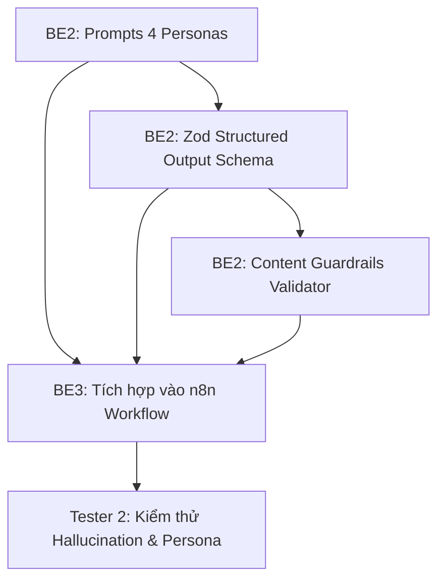

# MY WORK PLAN — BE2_W2
**Project:** AI Travel Reseller MVP (TravelLink AI)  
**Week:** Tuần 2 (12/10/2026 – 16/10/2026) — Sprint 2  
**Member:** Nguyễn Huỳnh (Leps-72 — Backend 2 Lead)  
**Role:** Backend Developer 2 (AI Content Engine, Structured Output & Guardrails)  
**Current Milestone:** AI CONTENT FACTORY & DISTRIBUTION (Sinh nội dung & Phân phối)  
**Deadline:** 12:00 PM Thứ Sáu (16/10/2026); Cross-testing & Demo: 13:30 – 17:30 ngày 16/10/2026  
**Branch:** `feature/be2-ai-content-engine` (tách từ `dev`)  

---

## 1. Context
- Kế thừa thành quả Tuần 1: Pipeline Gemini Embedding 1536 chiều, RAG query semantic search và AI Sales Agent (`POST /api/chat`) đã hoàn thành và merge vào `dev`.
- Trọng tâm Tuần 2: Chuyển dịch từ hỏi đáp (Chatbot RAG) sang **Nhà máy sinh nội dung hàng loạt (AI Content Factory)**. Xây dựng bộ Prompt Engineering chuyên sâu phân chia theo các Personas du lịch, định nghĩa Zod Schema cho Structured Output và thiết lập Guardrails bảo vệ tính toàn vẹn của nội dung.
- Nguồn tham chiếu: PRD v1.0, [Roadmap.md](file:///E:/Tue/MyProject/AITravelReseller/ai-travel-reseller/.ai/process/Roadmap.md), [Week2.md](file:///E:/Tue/MyProject/AITravelReseller/ai-travel-reseller/.ai/process/Week2/Week2.md), [WEEK1_SUMMARY.md](file:///E:/Tue/MyProject/AITravelReseller/ai-travel-reseller/.ai/process/Week1/WEEK1_SUMMARY.md).

---

## 2. Executive Summary
Trong Tuần 2, BE2 đóng vai trò "Kiến trúc sư nội dung AI":
1. Chuẩn hóa bộ Prompt Engineering đa biến thể: Tự động sinh 10 Hooks, 5 Scripts, 5 Captions, 5 CTAs theo 4 Personas du lịch cốt lõi (Local Guide, Family, Foodie, Budget Traveler).
2. Xây dựng Zod Structured Output Schema đảm bảo LLM trả về JSON cấu trúc chuẩn 100%, sẵn sàng lưu vào bảng `contents`.
3. Thiết lập Guardrails chống sai lệch giá, chống bịa đặt ưu đãi ảo, đảm bảo bài viết trung thực với dữ liệu Merchant.
4. Bàn giao bộ Prompt, Schema và tài liệu hướng dẫn cho BE3 tích hợp vào workflow n8n.

---

## 3. TODAY — MUST DO (Thứ Hai 12/10/2026)
| Priority | Task | Why | Dependency | Output | Estimated Effort |
|---|---|---|---|---|---|
| P0 | Họp Kick-off Sprint 2 & Thống nhất cấu trúc bảng `contents` | Đồng bộ trường dữ liệu với BE1/BE3 | Team Dev | Hợp đồng JSON đầu ra | 1h |
| P1 | Thiết kế 4 bộ System Prompts phân theo Personas du lịch | Chuẩn bị prompt cốt lõi cho Content Factory | None | File prompt markdown | 3h |
| P1 | Xây dựng Zod Schema sơ bộ cho Structured Output | Định hình contract chặt chẽ cho LLM | None | TypeScript Zod Schema | 2h |

---

## 4. THIS WEEK — MY TASKS
| ID | Task | Priority | Status | Dependency | Owner | Deliverable | Deadline |
|---|---|---|---|---|---|---|---|
| BE2-W2-01 | Chuẩn hóa Prompt System phân theo 4 Personas du lịch | P0 | DONE | Dữ liệu tour Tuần 1 | BE2 | `src/lib/ai/prompts/content-factory.ts` | 12/10 17:00 |
| BE2-W2-02 | Xây dựng Zod Schema cho Structured Output | P0 | DONE | BE2-W2-01 | BE2 | `src/lib/ai/schemas/content-schema.ts` | 13/10 12:00 |
| BE2-W2-03 | Xây dựng Module kiểm duyệt tự động (Content Guardrails) | P1 | DONE | BE2-W2-02 | BE2 | `src/lib/ai/guardrails/content-validator.ts` | 13/10 17:00 |
| BE2-W2-04 | Handoff Prompt & Schema cho BE3 nhúng vào n8n workflow | P0 | WAITING_REVIEW | BE2-W2-02, 03 | BE2 | `docs/be2/content-factory-handoff.md` + JSON Schema | 13/10 18:00 |
| BE2-W2-05 | Phối hợp BE3 test luồng sinh bài mẫu cho Bà Nà Hills & VinWonders | P1 | READY | BE3-W2-01 | BE2 + BE3 | Báo cáo sinh nội dung mẫu | 14/10 17:00 |
| BE2-W2-06 | Phối hợp Tester 2 rà soát Hallucination & Tối ưu Prompt | P1 | READY | BE2-W2-05 | BE2 + Tester 2 | Bộ prompt tối ưu | 15/10 17:00 |

---

## 5. TASK BREAKDOWN

### TASK BE2-W2-01 — Chuẩn Hóa Prompt Engineering Phân Theo 4 Personas
**Goal:** Viết prompt có khả năng hướng dẫn LLM sinh các biến thể nội dung mang phong cách khác nhau tùy theo đối tượng mục tiêu.  
**Prerequisites:** Dữ liệu sản phẩm mẫu (Bà Nà Hills, VinWonders, Cù Lao Chàm).  
**Personas định nghĩa:**
1. **Local Guide (Chuyên gia bản địa):** Giọng văn am hiểu, chia sẻ kinh nghiệm thực tế, mẹo check-in tránh đông người, giờ đi cáp treo đẹp nhất.
2. **Family (Gia đình):** Giọng văn ấm áp, an tâm, nhấn mạnh an toàn, tiện ích cho trẻ nhỏ và người già, dịch vụ ăn uống thuận tiện.
3. **Foodie & Check-in (Tín đồ sống ảo):** Giọng văn thời thượng, bắt trend, làm nổi bật góc chụp triệu view, ẩm thực đặc sản, âm nhạc, lễ hội.
4. **Budget Traveler (Săn deal thông thái):** Giọng văn thực tế, phân tích giá trị nhận được, so sánh giá niêm yết và giá ưu đãi, kêu gọi hành động nhanh.  
**Steps:**
- [x] Soạn thảo System Prompt cốt lõi kèm quy tắc an toàn (Zero-hallucination).
- [x] Thêm hướng dẫn sinh cấu trúc: 10 Hooks (mở đầu ấn tượng < 3 giây), 5 Scripts (kịch bản video 30-45s), 5 Captions (bài viết mạng xã hội), 5 CTAs (lời kêu gọi hành động kèm link tiếp thị).
- [x] Xác minh live với Google Gemini `gemini-3.5-flash-lite`; Groq là fallback thuộc workflow BE3 và chưa chạy trong repo TypeScript.
**Definition of Done:** Chạy test sinh thử ra ít nhất 4 kịch bản rõ nét về tone of voice cho 4 personas; không vi phạm sự thật của tour.  
**Handoff To:** BE3 (đưa vào n8n), Tester 2 (đánh giá phong văn).

---

### TASK BE2-W2-02 — Xây Dựng Zod Structured Output Schema
**Goal:** Bắt buộc LLM trả về cấu trúc JSON đúng chuẩn để n8n và backend có thể parse trực tiếp lưu vào database mà không bị lỗi cú pháp.  
**Prerequisites:** Bảng `contents` đã có các trường `persona`, `hook`, `script`, `caption`, `cta`.  
**Steps:**
- [x] Định nghĩa `campaignContentOutputSchema` bằng Zod.
- [x] Quy định các mảng dữ liệu có ràng buộc độ dài tối thiểu/tối đa:
  * `hooks`: Array 10 items (string, 20-100 ký tự).
  * `scripts`: Array 5 items (object gồm `title`, `duration`, `scenes`).
  * `captions`: Array 5 items (string, bao gồm hashtags phù hợp).
  * `ctas`: Array 5 items (string, có chỗ điền `[LINK_MUA_VE]`).
- [x] Viết hàm parse và format JSON tự động sửa các lỗi cú pháp markdown (như loại bỏ ` ```json ` bao quanh).
**Definition of Done:** Kiểm tra với 10 lần sinh ngẫu nhiên, 10/10 lần đều parse JSON thành công qua Zod Schema.  
**Handoff To:** BE3 (cấu hình trong HTTP Request/Code node n8n).

---

### TASK BE2-W2-03 — Xây Dựng Module Kiểm Duyệt Nội Dung Tự Động (Guardrails)
**Goal:** Kiểm tra dữ liệu đầu ra của LLM trước khi lưu vào database, loại bỏ nội dung vi phạm sự thật hoặc bịa đặt khuyến mãi.  
**Prerequisites:** Dữ liệu `confirmed_price_offer` và `verified_facts` từ Merchant.  
**Steps:**
- [x] Viết hàm `validateContentGuardrails(generatedText, verifiedProduct)`:
  * Kiểm tra số tiền xuất hiện trong bài viết: Nếu có số tiền nhưng khác với giá cam kết của tour -> Đánh dấu vi phạm giá.
  * Kiểm tra mã giảm giá ảo: Quét regex các cụm như `GIAM[0-9]+`, `SALE[0-9]+`, `FREE` -> Đánh dấu vi phạm mã ảo.
  * Kiểm tra cam kết sai: Quét các từ cấm bịa đặt như "miễn phí khách sạn", "bao ăn trọn đời".
- [x] Trả về kết quả đánh giá: `isValid: boolean`, `flags: string[]`, `recommended_status: 'APPROVED' | 'NEEDS_REVIEW'`.
**Definition of Done:** Chạy bài test với 5 mẫu nội dung vi phạm giả lập, module bắt chính xác 5/5 trường hợp vi phạm.  
**Handoff To:** BE3 (nhúng vào bước hậu xử lý n8n), Tester 2 (kiểm thử an toàn).

---

## 6. DEPENDENCY MAP


---

## 7. BLOCKERS
| Blocker | Tôi cần gì | Người phụ trách | Deadline | Impact |
|---|---|---|---|---|
| Hạn mức Gemini/Groq API | API Key dự phòng có quota ổn định để test sinh nội dung số lượng lớn | PM / Người quản lý môi trường | 12/10 12:00 | Có thể bị chạm giới hạn rate limit khi test |

---

## 8. TEAM HANDOFF
| From | To | Deliverable | Format | Deadline | Status |
|---|---|---|---|---|---|
| BE2 | BE3 | Bộ Prompt Templates + Zod Schema + Guardrails logic | TypeScript / JSON / Markdown | 13/10 18:00 | READY |
| BE2 | Tester 2 | Tiêu chí đánh giá văn phong Persona & Danh sách từ cấm | Rubric Markdown | 13/10 18:00 | READY |
| BE2 | Toàn team | Báo cáo thử nghiệm sinh nội dung cho 2 sản phẩm mẫu | Markdown report | 14/10 17:00 | PLANNED |

---

## 9. TEAM CONFLICT CHECK
- 🔴 **Conflict:** Không có. BE2 sở hữu tầng logic AI và Prompt Engineering; BE3 sở hữu hạ tầng thực thi workflow n8n.
- 🟡 **Potential Conflict:** Mô hình AI sử dụng trên n8n: Thống nhất ưu tiên Gemini Interactions API (`gemini-3.5-flash-lite`) vì đã có retry logic từ Tuần 1; Groq API đóng vai trò dự phòng tốc độ cao.
- 🟢 **No Conflict:** Không can thiệp vào schema DB của BE1 hay giao diện của FE.

---

## 10. INTERFACE CHECK
| Interface | Tôi | Người liên quan | Cần chốt | Status |
|---|---|---|---|---|
| LLM Output JSON Schema | Owner | BE3 (Consumer) | Khóa JSON: `persona`, `hooks`, `scripts`, `captions`, `ctas` | PROPOSED |
| Guardrail Validation Rules | Owner | Tester 2 & BE3 | Quy tắc đối chiếu giá và phân loại trạng thái bài viết | PROPOSED |

---

## 11. OUT OF SCOPE
- Tự động sinh video bằng AI Avatar (HeyGen/D-ID) — PRD & Roadmap đã loại khỏi phạm vi MVP.
- Đăng tải tự động lên mạng xã hội qua API riêng tư.
- Fine-tuning model LLM riêng.

---

## 12. END-OF-DAY UPDATE (Mẫu nhật ký)
```text
DONE:
- BE2-W2-01: Prompt System cho 4 Personas; live smoke test 4/4 PASS.
- BE2-W2-02: Zod + portable JSON Schema; 10/10 live generation parse PASS.
- BE2-W2-03: Guardrails; 5/5 mẫu vi phạm bị phát hiện.
IN PROGRESS:
- BE2-W2-04: Handoff artifact đã sẵn sàng, chờ BE3 review.
BLOCKED:
- Cần BE2 + BE3 + FE chốt mapping 10 hooks với 5 scripts/captions/CTAs sang từng row `contents`.
HANDOFF:
- `docs/be2/content-factory-handoff.md`
- `docs/be2/content-factory.schema.json`
- `docs/be2/content-factory-test-report.md`
NEXT:
- Review contract với BE3, sau đó test Bà Nà Hills và VinWonders qua workflow n8n.
```

---

## 13. END-OF-WEEK CHECKLIST
- [x] 4 bộ Prompt phân Personas hoàn thành và đạt tiêu chuẩn văn phong
- [x] Zod Schema parse 100% hợp lệ 10/10 phản hồi live từ mô hình LLM
- [x] Module Guardrails phát hiện và chặn các lỗi bịa giá / ưu đãi ảo
- [ ] Bàn giao thành công cho BE3 và hoàn thành bài test sinh nội dung tự động
- [ ] 100% code được review và merge vào nhánh `dev` trước 12:00 PM Thứ Sáu (16/10/2026)
