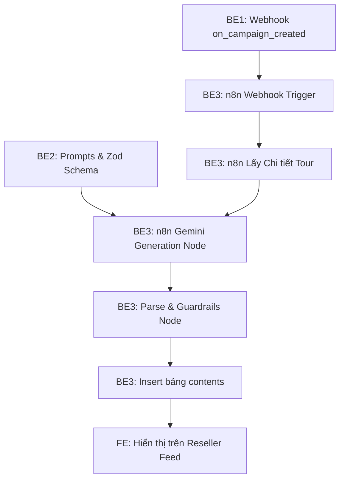

# MY WORK PLAN — BE3_W2
**Project:** AI Travel Reseller MVP (TravelLink AI)  
**Week:** Tuần 2 (12/10/2026 – 16/10/2026) — Sprint 2  
**Member:** Thái Thanh Tú (ThaiThanhTu0212 — Backend 3 Lead)  
**Role:** Backend Developer 3 (Automation / n8n Developer)  
**Current Milestone:** AI CONTENT FACTORY & DISTRIBUTION (Sinh nội dung & Phân phối)  
**Deadline:** 12:00 PM Thứ Sáu (16/10/2026); Cross-testing & Demo: 13:30 – 17:30 ngày 16/10/2026  
**Branch:** `feat/be3-n8n-content-pipeline` (tách từ `dev`)  

---

## 1. Context
- Kế thừa thành quả Tuần 1: Task [N8N-001](file:///E:/Tue/MyProject/AITravelReseller/ai-travel-reseller/.ai/process/Week1/BE3_W1.md) đã chứng minh thành công luồng Form-to-Sheets với Gemini Interactions API, có cơ chế retry 5 lần xử lý lỗi 503 và dịch vụ Python [`services/llm-service`](file:///E:/Tue/MyProject/AITravelReseller/ai-travel-reseller/services/llm-service/) đã chuẩn hóa.
- Trọng tâm Tuần 2: Nâng cấp từ form thử nghiệm sang **Tự động hóa toàn phần (End-to-End Campaign Automation)**: Tự động bắt sự kiện từ Supabase khi Merchant tạo chiến dịch mới → Truy vấn chi tiết sản phẩm → Gọi AI sinh 10 Hooks, 5 Scripts, 5 Captions, 5 CTAs theo 4 Personas → Phân loại kiểm duyệt → Lưu tự động vào bảng `contents` trong Supabase để Reseller thấy ngay trên Feed.
- Nguồn tham chiếu: PRD v1.0, [Roadmap.md](file:///E:/Tue/MyProject/AITravelReseller/ai-travel-reseller/.ai/process/Roadmap.md), [Week2.md](file:///E:/Tue/MyProject/AITravelReseller/ai-travel-reseller/.ai/process/Week2/Week2.md), [WEEK1_SUMMARY.md](file:///E:/Tue/MyProject/AITravelReseller/ai-travel-reseller/.ai/process/Week1/WEEK1_SUMMARY.md).

---

## 2. Executive Summary
Trong Tuần 2, BE3 chịu trách nhiệm vận hành "Dây chuyền sản xuất nội dung tự động":
1. Xây dựng workflow n8n hoàn chỉnh `Campaign-to-AI-Content-Pipeline` nhận Webhook từ Supabase DB.
2. Nhúng bộ Prompt và Zod Schema chuẩn của BE2 vào n8n, tự động sinh hàng loạt bài đăng đa dạng Personas.
3. Tích hợp node Supabase ghi trực tiếp các biến thể vào bảng `contents` bằng Service Role Key.
4. Duy trì cơ chế kiểm duyệt bán tự động (`APPROVED` / `NEEDS_REVIEW`) và thiết lập microservice Python làm bộ sinh dự phòng khi n8n bị quá tải.

---

## 3. TODAY — MUST DO (Thứ Hai 12/10/2026)
| Priority | Task | Why | Dependency | Output | Estimated Effort |
|---|---|---|---|---|---|
| P0 | Họp Kick-off Sprint 2 & Thống nhất Webhook Payload với BE1 | Đảm bảo payload từ DB khớp với n8n node | BE1 | Webhook JSON Contract | 1h |
| P1 | Khởi tạo Node Webhook Trigger tiếp nhận Campaign trên n8n | Đón sẵn sự kiện tạo chiến dịch từ DB | None | n8n Webhook node live | 2h |
| P1 | Cấu hình Node truy vấn Supabase Product trong n8n | Lấy thông tin giá và mô tả tour để làm context | BE1 DB | Supabase node verified | 2h |

---

## 4. THIS WEEK — MY TASKS
| ID | Task | Priority | Status | Dependency | Owner | Deliverable | Deadline |
|---|---|---|---|---|---|---|---|
| BE3-W2-01 | Cấu hình Webhook & Luồng n8n nhận sự kiện tạo Campaign | P0 | READY | BE1-W2-03 | BE3 | Webhook Trigger live | 12/10 17:00 |
| BE3-W2-02 | Nhúng Prompt & Schema của BE2 vào Node gọi Gemini API | P0 | READY | BE2-W2-04 | BE3 | LLM Generation node | 13/10 17:00 |
| BE3-W2-03 | Xây dựng Node kiểm duyệt & Parse kết quả sang Supabase | P0 | READY | BE3-W2-02 | BE3 | Node parse & insert DB | 14/10 17:00 |
| BE3-W2-04 | Tối ưu cơ chế Retry on Fail (5 lần) và xử lý Rate Limit 429/503 | P1 | READY | BE3-W2-03 | BE3 | Retry policy n8n | 14/10 18:00 |
| BE3-W2-05 | Nâng cấp `services/llm-service` làm Fallback Generator tự động | P2 | READY | BE3-W2-03 | BE3 | Python backup script | 15/10 17:00 |
| BE3-W2-06 | Kiểm thử thông luồng E2E & Xuất file n8n workflow JSON | P0 | READY | BE3-W2-04, 05 | BE3 | `workflow_campaign_content.json` | 16/10 12:00 |

---

## 5. TASK BREAKDOWN

### TASK BE3-W2-01 & 02 — Xây Dựng Workflow n8n Campaign-to-AI-Content
**Goal:** Khi có campaign mới được tạo trên Supabase, n8n tự động tiếp nhận, lấy dữ liệu tour và gọi LLM sinh nội dung trong vòng dưới 30 giây.  
**Prerequisites:** Database Trigger từ BE1 (`on_campaign_created`); Prompt & Schema từ BE2.  
**Workflow Nodes:**
```text
Webhook Trigger (POST /webhook/campaign-created)
    ↓
Supabase Node: Lấy thông tin chi tiết Tour (bảng products)
    ↓
HTTP Request: Gọi Gemini Interactions API (kèm Prompt 4 Personas & Retry 5 lần)
    ↓
Code Node: Kiểm duyệt Guardrails & Parse mảng JSON thành từng bản ghi
    ↓
Supabase Node: Insert hàng loạt (Batch Insert) vào bảng contents (service_role)
```
**Steps:**
- [ ] Tạo Webhook Trigger Node với phương thức POST, xác thực qua Secret Header.
- [ ] Kết nối Supabase node lấy bản ghi `products` dựa vào `product_id` trong payload.
- [ ] Cấu hình HTTP Request gọi Gemini API với prompt từ BE2: sinh 10 Hooks, 5 Scripts, 5 Captions, 5 CTAs.
- [ ] Bật Retry On Fail: 5 lần thử lại, mỗi lần cách nhau 10 giây (Exponential Backoff).  
**Definition of Done:** Bắn giả lập một sự kiện campaign, n8n thực thi toàn bộ luồng thành công trong vòng < 30s.  
**Handoff To:** FE (kiểm tra nội dung xuất hiện trên Feed), Tester 2 (kiểm tra văn phong).

---

### TASK BE3-W2-03 — Chuẩn Hóa Dữ Liệu & Insert Tự Động Vào Supabase
**Goal:** Tách cấu trúc JSON phức tạp từ LLM thành các dòng độc lập tương ứng với các cột của bảng `contents`.  
**Prerequisites:** Bảng `contents` đã có `product_id`, `persona`, `hook`, `script`, `caption`, `cta`, `status`.  
**Steps:**
- [ ] Viết JavaScript trong Code Node n8n:
  * Lặp qua từng Persona (Local Guide, Family, Foodie, Budget Traveler).
  * Ghép cặp Hook + Script/Caption + CTA tương ứng thành các bản ghi nội dung hoàn chỉnh.
  * Gán trường `status`: `APPROVED` nếu vượt qua kiểm duyệt, hoặc `NEEDS_REVIEW` nếu có cảnh báo.
- [ ] Gọi Supabase Node để ghi các dòng mới vào bảng `public.contents`.  
**Definition of Done:** Kiểm tra trực tiếp trên Supabase Database thấy ít nhất 10-20 dòng nội dung mới thuộc về `campaign_id` vừa tạo.  
**Handoff To:** FE (hiển thị lên `/reseller/campaigns/[id]`).

---

### TASK BE3-W2-05 — Triển Khai Python LLM Backup Generator
**Goal:** Dự phòng trường hợp instance n8n gặp sự cố hoặc Gemini API bị nghẽn quota, hệ thống có thể chuyển sang dùng script Python với Groq API.  
**Prerequisites:** Thư mục [`services/llm-service`](file:///E:/Tue/MyProject/AITravelReseller/ai-travel-reseller/services/llm-service/) từ Tuần 1.  
**Steps:**
- [ ] Nâng cấp [`content_generator.py`](file:///E:/Tue/MyProject/AITravelReseller/ai-travel-reseller/services/llm-service/content_generator.py) hỗ trợ sinh theo 4 Personas của Tuần 2.
- [ ] Tích hợp hàm `auto_generate_campaign_contents(campaign_id)` đọc từ Supabase và ghi lại vào bảng `contents`.
- [ ] Viết file script kích hoạt tự động qua dòng lệnh PowerShell `run_content_factory.ps1`.  
**Definition of Done:** Chạy script Python tạo ra đầy đủ 20 bản ghi nội dung vào database độc lập với n8n.  
**Handoff To:** Team Lead, PM.

---

## 6. DEPENDENCY MAP


---

## 7. BLOCKERS
| Blocker | Tôi cần gì | Người phụ trách | Deadline | Impact |
|---|---|---|---|---|
| Trigger DB từ BE1 | Database trigger `on_campaign_created` bắn payload sang n8n | BE1 | 13/10 17:00 | Phải dùng Webhook test thủ công trước |
| Prompt & Schema từ BE2 | Prompt Templates và JSON Schema chính thức cho 4 Personas | BE2 | 13/10 18:00 | Chưa hoàn thiện prompt trong HTTP Request node |

---

## 8. TEAM HANDOFF
| From | To | Deliverable | Format | Deadline | Status |
|---|---|---|---|---|---|
| BE3 | BE1 | Webhook URL chính thức của n8n | Webhook URL | 12/10 15:00 | READY |
| BE3 | FE | Cấu trúc dữ liệu bản ghi `contents` sinh ra từ n8n | JSON sample | 14/10 12:00 | READY |
| BE3 | Toàn team | Export file JSON của n8n Workflow hoàn chỉnh | `workflow_campaign_content.json` | 16/10 12:00 | PLANNED |
| BE3 | Tester 2 | Bộ dữ liệu bài đăng sinh tự động của 2 chiến dịch mẫu | Supabase records | 14/10 17:00 | PLANNED |

---

## 9. TEAM CONFLICT CHECK
- 🔴 **Conflict:** Không có. BE3 làm chủ hạ tầng n8n và pipeline tự động hóa; BE2 cung cấp trí tuệ AI (prompts/guardrails); BE1 cung cấp DB.
- 🟡 **Potential Conflict:** Quota Gemini API: Nếu gọi nhiều lần cho 4 Personas có thể bị chạm 15 RPM của Free Tier. Giải pháp: Thêm delay 2 giây giữa các persona hoặc gọi batch trong 1 request duy nhất.
- 🟢 **No Conflict:** Giữ nguyên quy định: Không tự ý đăng bài lên TikTok/Facebook qua API; chỉ sinh nội dung để Reseller tự copy.

---

## 10. INTERFACE CHECK
| Interface | Tôi | Người liên quan | Cần chốt | Status |
|---|---|---|---|---|
| Webhook Campaign Input | Consumer | BE1 (Owner) | Cấu trúc JSON nhận từ Trigger `pg_net` | PROPOSED |
| LLM Interaction Node | Consumer | BE2 (Owner) | Prompt System & Output Schema | PROPOSED |
| Supabase `contents` Insert | Producer | FE (Consumer) | Dữ liệu các trường `persona`, `hook`, `script`, `caption`, `cta` | AGREED |

---

## 11. OUT OF SCOPE
- Đăng tải trực tiếp lên TikTok / Facebook API tự động.
- AI sinh video cá nhân hóa bằng khuôn mặt ảo.
- Tự động duyệt bài mà không thông qua bộ quy tắc Guardrails.

---

## 12. END-OF-DAY UPDATE (Mẫu nhật ký)
```text
DONE:
- ...
IN PROGRESS:
- ...
BLOCKED:
- ...
HANDOFF:
- ...
NEXT:
- ...
```

---

## 13. END-OF-WEEK CHECKLIST
- [ ] Workflow n8n tự động tiếp nhận webhook tạo Campaign và chạy thông luồng
- [ ] Bản ghi bài đăng sinh ra xuất hiện đầy đủ trong bảng `contents` trên Supabase
- [ ] Cơ chế Retry On Fail xử lý thành công khi có lỗi mạng / lỗi 503
- [ ] Python fallback script sẵn sàng hoạt động độc lập
- [ ] Export file `workflow_campaign_content.json` và commit vào repo
- [ ] 100% PR và tài liệu hoàn thành trước 12:00 PM Thứ Sáu (16/10/2026)
