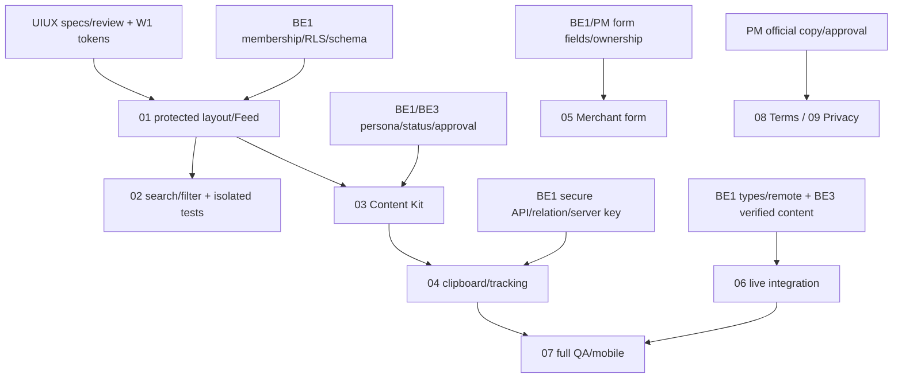

# MY WORK PLAN — FE_W2

**Project:** AI Travel Reseller MVP (TravelLink AI)
**Week:** Tuần 2 (12/10/2026 – 16/10/2026) — Sprint 2
**Member / Primary Owner:** Diệu — FE duy nhất tiếp quản Tuần 2
**Role:** Frontend Developer (Next.js App Router, TypeScript, Tailwind, Reseller Portal)
**Current Milestone:** AI CONTENT FACTORY & DISTRIBUTION
**Deadline:** 12:00 ngày 16/10/2026, giờ Việt Nam (UTC+7); Cross-testing & Demo: 13:30 – 17:30 cùng ngày
**Branch thực tế:** `Feature_FE_W2_Integration`
**Commit nền đã kiểm tra:** `daa38805fa45f4622d0b3b0d45afa68c6d9fdcea`
**Cập nhật FE:** 15/10/2026 — FE04 đối chiếu lại local/remote và thêm Copy CTA kèm link trong bản sao theo campaign/product/session (mục27). Giữ fix login/membership/guard Merchant mục26; session thật sau sửa chờ người dùng. Người dùng xác nhận Tracking mô phỏng/Copy Notepad, chưa quét điện thoại/tạo link thật. Live vẫn chặn do handler chưa an toàn; FE05 giữ kết quả mục24, Campaign/AI và manual reload chưa kiểm chứng. Giữ merge577b074/checkpoint3cb7387, trạng thái review/approval khác; tuần2 chưa hoàn thành, không commit/push/merge lượt này.

---

## 1. Context

- Diệu sở hữu task FE; Tester 1 hỗ trợ fixtures/QA, UI/UX sở hữu thiết kế, BE1 sở hữu DB/Auth/Tracking, BE3 sở hữu Content Factory. Không tiếp quản task của các thành viên đó.
- Ban đầu working tree sạch, HEAD bằng cached `origin/dev`; chưa fetch nên chưa khẳng định remote hiện tại bằng cached ref. Nhánh cũ `Feature_FE_W2_Foundation` chỉ tham khảo, không merge/cherry-pick toàn nhánh.
- Giữ root `app/`, `src/components/`, `src/lib/`. `RULE_BOOK.md` còn ghi `src/app/`; quyết định giữ root `app/` đã có tại [WEEK1_SUMMARY.md](../Week1/WEEK1_SUMMARY.md), mục PM/Lead. Không di chuyển cấu trúc.
- Nguồn đối chiếu: [Roadmap.md](../Roadmap.md), [Week2.md](Week2.md), [PromptCreateTask.md](../PromptCreateTask.md), [WORKFLOW_WITHGIT.md](../../role/WORKFLOW_WITHGIT.md), [RULE_BOOK.md](../../role/RULE_BOOK.md), [DATA_SCHEMA.md](../../role/DATA_SCHEMA.md), [api_contracts.md](../../role/api_contracts.md), các bàn giao BE/QA/UIUX và code/migrations checkout hiện tại. Lượt đầu 01/02; lượt tiếp theo được Diệu giao Auth/Feed audit, 03 và Copy thuộc 04. Tracking API/form Campaign vẫn chưa triển khai; chưa commit/push/PR/merge.
- Báo cáo tuần trước ghi Coastal Editorial, 5 màn hình và 15/15 UI tests; đó là kết quả lịch sử, không thay kiểm tra checkout hôm nay.
- TEAM_WORK_LOG ghi layout Reseller/`campaign-demo.ts` đã có, nhưng không tìm thấy tại commit nền. Giữ lịch sử team và ghi chênh lệch FE; không suy ra bàn giao đã hoàn tất.

## 2. Executive Summary

01/02 giữ WAITING_REVIEW và bằng chứng28/28 trước đó. Content Kit chỉ approved, đúng campaign/quyền, bốn persona; người dùng đã xác nhận manual Reseller/Notepad tại mục21. Preview chỉ development, không fallback dữ liệu thật sang fixture. Modal Tracking/Copy link/QR local có code và test fixture PASS; API adapter chặn live trước fetch vì handler chưa đủ kiểm tra quyền (mục25). Merchant05 giữ active/ngày VN/session/ownership/no-retry, về Dashboard và thông báo sau ACK (mục24); live Campaign/RLS/trigger AI chưa kiểm chứng. Terms/Privacy vẫn bản nháp chờ duyệt. Không ghi03/04/05/06 reviewed/DONE hoặc tuần2 hoàn thành.

## 3. TODAY — MUST DO (14/10/2026)

| Priority | Task | Why | Dependency | Output | Estimated Effort |
|---|---|---|---|---|---|
| P0 | Đối chiếu Git/Next.js docs/Auth/schema/contracts/env | Tránh sai cấu trúc/quyền/dữ liệu | Checkout hiện tại | Bảng chênh lệch và blockers | Đã kiểm tra trước code |
| P0 | FE-W2-01: layout/server gate/Feed | Nền phân hệ Reseller | `getUser()`, membership `resellers.id`, schema | Route bảo vệ, adapter chỉ đọc, các trạng thái | Code đã có; WAITING_REVIEW |
| P1 | FE-W2-02: search/filter | Tìm chiến dịch phù hợp | 01; fixtures cô lập | Filter kết hợp/reset, test hành vi | Code đã có; WAITING_REVIEW |
| P1 | Lint/typecheck/build/UI/permission | Bằng chứng bàn giao | Code 01/02 | Lint scoped/tsc/isolated build và 28/28 data/UI tests fixture pass | Có JSON và ảnh sau sửa; chờ review |

## 4. THIS WEEK — MY TASKS

Giữ các deadline gốc 13–15/10; mốc 13/10 đã qua khi Diệu tiếp quản 14/10. Chưa có lịch thay thế PM xác nhận. 08/09 dùng hạn chung sprint, không bịa mốc bàn giao mới.

| ID | Task | Priority | Status | Dependency | Owner | Deliverable | Deadline |
|---|---|---|---|---|---|---|---|
| FE-W2-01 | Layout & Reseller Feed `/reseller/campaigns` | P0 | WAITING_REVIEW | UI/UX/QA review; runtime quyền đọc chưa kiểm chứng dưới 06 | Diệu | Layout/server gate/adapter/Feed, loading/empty/error/retry đã có code | Gốc: 13/10 12:00; đã qua |
| FE-W2-02 | Search & lọc địa điểm/danh mục/hoa hồng | P1 | WAITING_REVIEW | FE-W2-01; UIUX/QA review | Diệu | Filter kết hợp/reset/kết quả/empty đã có code và test fixture | Gốc: 13/10 17:00; đã qua |
| FE-W2-03 | Chi tiết & Suggested Content Kit `/reseller/campaigns/[id]` | P0 | WAITING_REVIEW — người dùng kiểm tra thủ công Bà Nà Hills/4 persona PASS | 01; còn QA/review và kiểm tra quyền âm riêng | Diệu | Detail + session-scoped contents, 4 persona/biến thể/trường thiếu | Gốc: 14/10 12:00 |
| FE-W2-04 | Copy 1-click & Modal Tracking Link | P0 | READY_FOR_INTEGRATION — Live tracking đã mở; BE API đã sửa auth & public domain; 59/59 tracking tests PASS | BE1 / FE | Modal states, Copy link/CTA riêng/manual, QR local và live request; 59/59 Playwright tests pass | Gốc: 14/10 17:00 |
| FE-W2-05 | Form tạo Campaign Merchant | P1 | IN_PROGRESS — code mở theo BE active/ngày VN; chưa live acceptance/review | BE/QA xác minh ghi session/RLS/trigger trên môi trường cô lập; AI notes chưa hỗ trợ | Diệu | `/merchant/campaigns/new`, active/date/ownership/no-retry, về /merchant + thông báo một lần | Gốc: 15/10 12:00 |
| FE-W2-06 | Dữ liệu thật Supabase & xử lý các trạng thái | P0 | IN_PROGRESS — Content Kit/Copy localhost được người dùng xác nhận; chưa full acceptance | BE1 types/negative RLS; pipeline và QA còn cần kiểm chứng | Diệu | Live integration được kiểm chứng theo từng luồng | Gốc: 15/10 17:00 |
| FE-W2-07 | Mobile UX & Playwright E2E cùng Tester 1 | P1 | NOT_READY | 04/06; QA/UIUX review | Diệu; Tester 1 hỗ trợ QA | Test/ảnh 320/390/1440px, keyboard/focus | 16/10 12:00 |
| FE-W2-08 | Terms of Service public `/terms` | P2 | UI DONE — nội dung WAITING_APPROVAL | Công ty/PM cung cấp copy và phê duyệt pháp lý | Diệu | Khung VN Coastal Editorial, mục lục, links public/footer/Auth; nhãn bản nháp rõ | 16/10 12:00 — hạn chung sprint |
| FE-W2-09 | Privacy Policy public `/privacy` | P2 | UI DONE — nội dung WAITING_APPROVAL | Công ty/PM cung cấp copy và phê duyệt pháp lý | Diệu | Khung VN Coastal Editorial, mục lục, links public/footer/Auth; nhãn bản nháp rõ | 16/10 12:00 — hạn chung sprint |

## 5. TASK BREAKDOWN

### FE-W2-01 — Layout & Feed

**Goal:** Reseller đã xác minh duyệt campaign; người thiếu quyền không được mở portal/dữ liệu.
**Prerequisites:** Next.js docs local; session qua `getUser()`; read-only membership `resellers.id = user.id` có căn cứ migration. Remote apply/quyền/schema chưa xác minh.

- [x] Root routes: `app/reseller/layout.tsx`, `/reseller` redirect, `app/reseller/campaigns/page.tsx`, loading/error.
- [x] Server gate không dùng metadata/localStorage làm quyền; không truy vấn merchants/resellers trên mọi middleware request. Data loader lặp lại gate, không chỉ tin layout; runtime/remote chưa kiểm chứng.
- [x] Adapter/server `src/lib/reseller/`; UI `src/components/reseller/`; parse `unknown` bằng Zod, không any/casts che thiếu generated types.
- [x] Campaign query exact lowercase `active` theo seed/contract; index/benchmark `ACTIVE` là conflict chuyển BE1, không OR/alias. Pagination đọc đủ các trang, thứ tự id ổn định.
- [x] Map `campaigns.name`, `target_location`, `products.category`, commission của chính campaign theo phần trăm (giữ 10.5 như API example).
- [x] Không bịa ảnh/giá/commission/KPI. Content count `null`, Feed ghi “Xem Content Kit”; chưa tải số lượng, không thêm query theo card. Detail đã nối ID; contents chỉ approved + đúng campaign + shared/owned theo contract bổ sung mới (mục 20); chưa gắn Tracking.
- [x] UI/code loading/empty/error/retry, session hết hạn/không quyền; lỗi data thật không fallback mock âm thầm. UI tests và runtime thật ghi riêng ở mục 11.
- [x] `/preview/reseller` chỉ development; fixtures có nhãn/tách server data, không DB mutation.

**Definition of Done:** Gate/adapter/states có test, dữ liệu thiếu rõ ràng, responsive 320/390/1440px, keyboard/focus; lint/typecheck/build/test có kết quả. Ghi riêng live/QA/design chưa kiểm chứng.
**Handoff To:** Tester 1, UI/UX, BE1.

### FE-W2-02 — Search & Filters

**Goal:** Tìm đúng campaign từ dữ liệu adapter. **Prerequisites:** 01 + fixtures cô lập.

- [x] Search tên/địa điểm/danh mục không phân biệt dấu, xử lý Đ/đ; filter category/location exact và options lấy từ dữ liệu map.
- [x] Mốc `>10%`/`>15%` lớn hơn nghiêm ngặt; thêm các khoảng dưới 10%, 10–20% và trên 20%.
- [x] Số kết quả thực tế, empty, reset; labels/focus/keyboard và responsive đã có code.
- [x] Test fixture search tiếng Việt, filter kết hợp/mốc/reset và responsive sau sửa pass; bằng chứng 28/28 và ba ảnh tại mục 11/14. Live/QA acceptance riêng chưa có.

**Definition of Done:** Test hành vi fixture pass và UI responsive có bằng chứng; không coi là FE-W2-06 live acceptance. **Handoff To:** Tester 1, UI/UX.

### FE-W2-03 & 04 — Content Kit / Clipboard; Tracking lượt sau

- [x] Bổ sung mới docs/Fe-update-2026-10-15.md **thay thế quy tắc published/public cũ**: chỉ literal lowercase `approved`; không nhận published/public/pending_approval/APPROVED. Giữ bốn snake_case persona, shared NULL/owned đúng session và campaign active. Các mục lịch sử 15/17 phản ánh contract/kết quả tại thời điểm cũ, không phải policy hiện hành.
- [x] UI 4 persona Local Guide/Family/Foodie/Budget Traveler; Hook/Script/Caption/CTA, nhiều biến thể, trường thiếu; Copy đúng phần, success sau await writeText, error/manual khi không khả dụng, keyboard/live region. Fixture checks theo mục 15; không coi là live contents acceptance.
- [x] Feed nối đúng campaign ID, tắt prefetch detail tránh đọc theo từng card. Detail loader kiểm tra session/membership; UUID PostgreSQL/not-found/error/loading. Campaign/product join một query; contents pagination server đồng thời campaign/status/owner, policy đã bật theo handoff; không filter quyền tại browser.
- [x] Adapter tái dùng POST /api/tracking-links/generate (alias cùng handler /api/tracking/generate), body chỉ campaign_id/product_id, credentials same-origin; production gate chặn trước fetch do security chưa đủ (mục25), không gửi reseller_id.
- [x] Parse response nested status/data, GUID/code/short_url cùng origin và /r/code; không dùng outer tracking_id/tracking_url hoặc bịa URL khi lỗi.
- [x] UI modal/QR local/Copy link có states/pending/manual, không POST khi render/mở, chống gửi lặp và không retry kết quả chưa rõ; chỉ fixture tạo kết quả trong lượt này.
- [ ] BE1 sửa trust body reseller_id/admin client, xác minh role/relation và server key; FE bỏ reseller_id không sửa security API.

**Definition of Done:** BE1 giải tỏa security/runtime; content approval đúng; clipboard/modal/QR tests; live data được kiểm chứng riêng. **Handoff To:** BE1, Tester 1/3.

### FE-W2-05 — Merchant Campaign Form (15/10/2026)

- [x] UI Coastal Editorial tiếng Việt, sản phẩm/tên/hoa hồng/ngày/đối tượng/địa điểm; map `campaigns.name`, ghi chú AI disabled có giải thích và reject input giả mạo chứa ai_notes.
- [x] Loader/action qua session getUser + merchants membership, chỉ sản phẩm đúng Merchant; kiểm tra lại owner khi submit; không tin browser merchant_id/role. Đây là code và kiểm thử mock, chưa chứng minh RLS thật.
- [x] Client/server validation dùng chung: UUID PostgreSQL, giới hạn text, hoa hồng hữu hạn 5–30%, ngày lịch thực/không đảo ngày; pending chống gửi lặp, giữ input lỗi, kết quả chưa rõ khóa gửi lại; adapter POST `.retry(false)`.
- [x] Không service-role, không FE webhook/API AI, không đồng nhất campaign saved với AI generated. Thành công chỉ khi ACK insert được kiểm tra, hiện chỉ fixture đi vào nhánh này.
- [x] BE xác nhận mới status active, biên đầu/hết ngày Asia/Ho_Chi_Minh, INSERT tự trigger AI và về /merchant; policy server đã bật (mục24), thay thế blocker status/ngày tại mục19. Không có lưu nháp/browser override/webhook thêm.
- [ ] Required/optional/limits ngoài phần đã xác nhận, AI notes và quyền ghi/RLS/trigger thực tế còn cần BE/PM/QA kiểm chứng riêng; không tự tạo dữ liệu trên DB chung.
- [ ] Kiểm chứng tạo campaign trên môi trường test cô lập do BE cung cấp và QA/UIUX review; không tự tạo campaign trên DB chung.

**Definition of Done:** Contract/action/quyền được kiểm tra, DB lưu được xác minh; BE3 kiểm chứng pipeline riêng. Không tạo campaign thử trên DB chung lượt này. **Handoff To:** BE1, BE3, Tester 1/3.

### FE-W2-08 & 09 — Terms / Privacy (15/10/2026)

- [x] Tìm copy trong app/src/docs/README và .ai/role/process: chưa có bản được công ty duyệt. Dựng khung VN với nhãn chính xác “Bản nháp — chờ công ty phê duyệt”, nói rõ chưa có hiệu lực.
- [x] Hai route public dùng chung shell Coastal Editorial; mục lục neo tới h2, skip link, về đầu trang, trang chủ và liên kết chéo; footer Landing và layout Login/Register dùng chung liên kết chính sách.
- [x] Không bịa pháp nhân/email/thời hạn lưu trữ/ngày hiệu lực/cam kết pháp lý; không thêm checkbox hoặc đổi Auth consent/submit flow.
- [ ] Nội dung pháp lý chính thức và phê duyệt của công ty/PM. UI hoàn thành không đồng nghĩa chính sách có hiệu lực.

**Definition of Done:** Public routes/links chạy đúng, copy được duyệt hoặc nhãn chờ duyệt rõ. **Handoff To:** PM, UI/UX, Tester 1.

## 6. REQUIREMENT → CURRENT CHECKOUT → GAP → HANDLING

| Yêu cầu | File/code hiện tại | Chênh lệch | Xử lý / Owner |
|---|---|---|---|
| Branch/root router | Git; `app/`; WEEK1_SUMMARY | Plan nhánh cũ; RULE_BOOK `src/app/` | FE giữ branch thực tế/root app; chưa fetch |
| Layout/fixture bàn giao | TEAM_WORK_LOG vs cây file commit nền | Không thấy layout/`campaign-demo.ts`/reseller test đã ghi trong log | FE 01/02; chú thích lịch sử, không đổi QA status |
| Role | Auth/middleware; migration resellers | Login gate chưa chứng minh role | FE `getUser()` + read-only membership; BE1 remote RLS xác nhận |
| Adapter | Migrations; API docs; database.types.ts | `name`, target_location, product category; public.Tables rỗng | Zod/unknown có căn cứ; BE1 generated types |
| Active/status/content count | docs/Fe.md + làm rõ từ Diệu; migrations/index | BE đã chốt active và published/public; index ACTIVE khác literal | Contract RESOLVED; Feed không tải counts, dùng “Xem Content Kit”; runtime tại mục 17 |
| Tracking | `app/api/tracking/generate/route.ts` | Nested data; reseller_id/admin trust; role/relation chưa xác minh | BE1 security fix, server key; 04 BLOCKED |
| Campaign inputs | campaigns migration | `name` thay title; AI notes thiếu cột riêng | BE1/PM contract; 05 BLOCKED |
| Env/pipeline | Supabase config; trigger migration | Public URL/publishable có, secret/service-role thiếu; remote/n8n chưa chứng minh | Env ignored/untracked, không in key; BE1/BE3 runtime bằng chứng |
| Design/legal/analytics | UIUX/BE1 plans; yêu cầu Diệu | Chưa Figma review; tìm targeted app/src/docs/.ai/role/process/README chưa thấy legal copy chính thức; BE analytics không tự giao FE dashboard | UIUX/PM xác nhận; 08/09 planned; analytics NEEDS DECISION |

## 7. DEPENDENCY MAP



## 8. BLOCKERS / INTERFACE CHECK

| Blocker / Interface | FE cần gì | Owner | Impact / Status |
|---|---|---|---|
| Types / schema / RLS remote | Generated types, negative RLS/login lifecycle/QA evidence | BE1 | 06 IN_PROGRESS; Auth/membership/Feed thật đã pass, active contract đã chốt; không thay RLS |
| Content approval | published/public + shared/own + snake_case persona theo docs/Fe.md | BE1 + BE3 | Contract RESOLVED; 03 query thật đã nối, runtime/QA riêng; pending_approval bị loại |
| Contents data/persona runtime | Hàng thật đúng campaign/status/owner và một trong bốn persona | BE1 + BE3 | Read OK; có NO_ROW, có ROW bị PERSONA_UNMAPPED; chưa có variant thật để test Copy, xem mục 17 |
| Tracking auth/runtime | Session-only reseller, role/relation, public domain | BE1 / FE | RESOLVED — Backend API đã được vá bảo mật (chặn backdoor body.reseller_id, chống IDOR, chuẩn hóa public domain). FE đã mở cờ live tracking và pass 59/59 Playwright tests |
| Campaign contract | name/title, audience/notes, ownership | BE1 + PM | 05 BLOCKED; không tự sửa DB/bỏ input |
| Remote pipeline | Trigger remote và webhook `/webhook/campaign-created` chạy thật | BE1 + BE3 | 06 chưa nghiệm thu; FE không trigger thử |
| Figma | Specs/assets/link thực tế + review 320/390/1440px | UI/UX | Kế thừa Coastal Editorial; chưa approval mới |
| Legal / replanning / analytics | Copy hoặc khung chờ duyệt; xác nhận lịch/scope | PM | 08/09 planned; analytics NEEDS DECISION |

Không gán ngày bàn giao mới cho BE/UIUX/PM khi chưa xác nhận.

## 9. TEAM HANDOFF / QUESTIONS

| From → To | Deliverable / câu cần chốt | Format | Status |
|---|---|---|---|
| Diệu → Tester 1 | 01/02 source/adapter/UI, fixtures và permission/filter checks | Worktree + JSON 28/28 + ba ảnh sau sửa | WAITING_REVIEW |
| Diệu → UI/UX | Link Figma/specs/asset nào? Review Feed 320/390/1440px | Dev preview + ảnh khi có | WAITING_HANDOFF |
| Diệu → BE1 | Active/publication/ownership contract đã nhận; còn generated types/negative RLS và dependencies Tracking/form của lượt sau | docs/Fe.md + bảng mục 6; chưa gửi qua công cụ nhắn tin | CONTRACT RECEIVED; phần còn lại WAITING_HANDOFF |
| Diệu → BE3 | Contract publication/persona/shared-owned đã trả lời trong docs/Fe.md; không alias APPROVED→published | Contract + bản ghi mẫu chỉ đối chiếu | RECEIVED — contract; runtime/pipeline acceptance còn riêng |
| Diệu → PM | Official Terms/Privacy copy, lịch tiếp quản và analytics FE có được giao không? | FE_W2 + TEAM_WORK_LOG | WAITING_HANDOFF |
| Diệu → Team | Source/docs/checks cho review; PR tương lai base dev khi được yêu cầu | Git diff/worktree; chưa commit/push/PR | WAITING_REVIEW; chưa gửi bàn giao ngoài phiên |

Các câu hỏi công bố nội dung và kiểm tra Auth thật cập nhật ở mục 15; phần bàn giao lịch sử phía trên giữ nguyên.

## 10. CONFLICT / OUT OF SCOPE

- **CONFLICT DETECTED:** router/branch, log/checkout, tracking contract/security, campaign fields/status và content approval. Mục 6 ghi source/gap/owner; không lấp bằng aliases/mock.
- Diệu primary owner FE; QA/UIUX hỗ trợ theo vai trò; không tự đổi status BE/QA.
- Không analytics dashboard, ví/thanh toán/commission payout/Admin/auto-post/AI/n8n; BE analytics là phụ thuộc mới cần PM xác nhận scope FE.
- Không DB/RLS/GRANT/migration/seed/remote mutation; không seed/reset/campaign thử/FE webhook; không service role vượt RLS cho FE.
- Giữ `.env.local`, không in secrets/commit env; không reinstall/nâng dependency; chưa commit/push/PR/merge.

## 11. VALIDATION — 14/10/2026

| Check | Kết quả thực tế | Phạm vi / Giới hạn |
|---|---|---|
| Git / env | Đã kiểm tra như mục 1/6 | Initial clean, cached origin/dev; env ignored/untracked; không in key |
| Baseline `npm.cmd run lint` | 1 error sẵn có: parser `database.types.ts` UTF16LE; 2 unused-variable middleware warnings sẵn có | Chưa quy lỗi này cho FE mới |
| Baseline TypeScript | Lỗi stale `.next/types` tham chiếu layout/page Reseller/Merchant không có | Chưa xác định nguồn cache; không sửa code để che lỗi |
| Baseline `npm.cmd run build` | EPERM unlink `.next/build/chunks/node_modules_20v-8wl._.js`, kể cả retry ngoài sandbox | Không xóa cache/process để làm pass |
| Lint source mới | PASS, exit 0: routes/components/lib Reseller, preview, tests và config mới | Scoped lint; full lint còn baseline database.types UTF16LE/warnings |
| `next typegen` + TypeScript | Typegen cập nhật stale `.next/types` thành công; `node .../tsc --noEmit` PASS, exit 0 | Không vô hiệu hóa typecheck; generated DB types vẫn rỗng, BE1 handoff chưa xong |
| Build output riêng | Sau sửa hai lỗi UI: `NEXT_BUILD_DIR=build/fe-w2 npm.cmd run build` PASS, exit 0; compilation 70s, TypeScript 36.4s, page/route generation | Output ignored; default .next build còn EPERM baseline; không xóa cache |
| Feed/adapter/filter/permission tests | PASS 28/28, exit 0: 7 data/access/filter + 21 UI tại ba viewport; 0 skipped, failed hoặc flaky | JSON: `test-results/reseller/recheck.json`. Fixture cô lập, Supabase config rỗng; không DB/AI/shared remote mutation. Membership tests là unit, không phải live role E2E |
| Responsive / keyboard / hai lỗi CSS | PASS tại 320/390/1440px; đã xem cả ba ảnh sau sửa. Tab active đạt contrast ≥4.5; chữ/placeholder cách icon ≥4px; không tràn ngang; skip link/focus pass | Dev fixtures; không live acceptance. Tab dùng Button hiện có, input dùng `pl-10!` để thắng legacy .input; không sửa globals.css |
| Auth/Feed/content DB thật | Chưa kiểm chứng | Remote schema/RLS/content/runtime; 06 BLOCKED |
| Vercel/UIUX/QA/PM acceptance | Chưa có | Không tự ghi DONE/E2E/merge |

**Created:** `app/reseller/{layout,page,error}.tsx`, `app/reseller/campaigns/{page,loading}.tsx`, `app/preview/reseller/{page,preview}.tsx`; `src/components/reseller/{shell,signout,access-notice,feed-states,campaign-feed}.tsx`; `src/lib/reseller/{access,campaign-feed,server}.ts`; `tests/fixtures/reseller-campaigns.ts`, `tests/reseller-data.spec.ts`, `tests/reseller-feed.spec.ts`, `playwright.reseller.config.ts`.

**Modified:** FE_W2 và phần FE TEAM_WORK_LOG; `next.config.ts` thêm opt-in output directory; `playwright.config.ts` giới hạn suite cũ ở `frontend.spec.ts` để giữ regression tuần 1; `tsconfig.json` cập nhật include types do Next.js sinh. Không sửa package/dependencies, DB/backend/auth contracts hay nội dung tiến độ thành viên khác.

Lần chạy lại ban đầu dừng trước test vì cổng 3101 còn server cũ. Suite sau sửa dùng `RESELLER_TEST_PORT=3103`, `RESELLER_TEST_BUILD_DIR=build/fe-w2-recheck`; config hỗ trợ đổi cổng/output mà không tái dùng server không rõ trạng thái. Sau 28 bài pass, Playwright kẹt teardown trên Windows: đã xác minh và dừng đúng hai tiến trình của server test 3103; CLI sau đó exit 0 và ghi JSON. Không dừng server cũ ở 3101 hoặc tiến trình khác. Chưa chạy lại suite regression tuần 1 trong lượt tiếp nối này.

## 12. END-OF-DAY UPDATE — 14/10/2026

```text
DONE:
- Audit hướng dẫn/Git/schema/contracts/env và ghi chênh lệch.
- Đồng bộ plan: Diệu FE duy nhất, nhánh thực tế, giữ 01–07, thêm 08/09.
- Code 01/02 đã có; scoped lint/typegen/TypeScript/isolated build pass (không đồng nghĩa task DONE).
- Hoàn tất hai lỗi CSS trong shell/input; 28/28 data/UI tests sau sửa pass, xem ảnh 320/390/1440px; không sửa CSS toàn cục.
IN PROGRESS:
- 01/02 WAITING_REVIEW; chờ Tester 1/UIUX review và live acceptance riêng, không đánh dấu task DONE.
BLOCKED:
- 04 tracking security/runtime; 05 campaign fields/ownership contract.
- 06 types/remote RLS và BE3 approved content/pipeline.
HANDOFF:
- Source/docs, JSON và ảnh sau sửa đã có để review; chưa push/PR/gửi ngoài phiên.
- Câu hỏi BE1/BE3/PM tại mục 9.
NEXT:
- Tester 1/UIUX review 01/02; BE1/BE3 xác nhận role/RLS/status và types; sau đó chốt persona/status rồi 03 → 04 → 05 → 06/07.
- 08/09 theo copy PM hoặc khung chờ duyệt; chưa code lượt này.
```

## 13. END-OF-WEEK CHECKLIST

- [ ] 01/02 Feed/filter/gate/states/responsive có bằng chứng + UIUX/QA review
- [ ] 03 Content Kit 4 persona/status approved và trường thiếu
- [ ] 04 Clipboard/tracking/QR đúng session/contract; BE1 security dependencies giải tỏa
- [ ] 05 Form lưu đúng schema, action quyền/ownership, DB xác nhận
- [ ] 06 Dữ liệu thật/Auth/RLS/pipeline kiểm chứng, không fallback mock
- [ ] 07 Full Playwright E2E, 320/390/1440px, keyboard/focus
- [ ] 08/09 public routes/links, legal copy được duyệt hoặc nhãn chờ duyệt
- [ ] Source + FE docs/checks/handoff cập nhật bằng chứng
- [ ] Commit/push/PR base dev khi Diệu yêu cầu; chưa làm lượt này
- [ ] PR review/merge + team nghiệm thu trước deadline; chưa có

## 14. LOCAL REVIEW / TEST EVIDENCE

Trong PowerShell tại repository, khởi động development với output riêng nếu cần:

```powershell
$env:NEXT_BUILD_DIR = 'build/fe-w2'
npm.cmd run dev -- --hostname 127.0.0.1 --port 3000
```

- [Fixture preview](http://127.0.0.1:3000/preview/reseller): chỉ development, có nhãn rõ. Thử `hoi an`, kết hợp bộ lọc, ngưỡng >10/>15, Xóa bộ lọc; chọn loading/empty/error/forbidden/session-expired và Thử lại; dùng Tab/Enter với skip link.
- [Portal thật](http://127.0.0.1:3000/reseller/campaigns): cần session và membership Reseller. Chưa đăng nhập sẽ về `/login?next=/reseller/campaigns`; dữ liệu thật chưa được FE xác minh trong lượt này.
- Dev server 3000 đã Ready; smoke check trả preview HTTP 200 với nhãn fixture và portal không session HTTP 307 về login đúng `next`. Lần khởi động sandbox bị EACCES mở cổng 3000; retry được cấp phép ngoài sandbox đã chạy thành công. Kiểm tra này không xác minh membership/session có sẵn hoặc dữ liệu DB thật.
- Ảnh đã xem sau sửa: [320px](../../../test-results/reseller/reseller-feed-fixture-camp-cfaf8--or-invented-content-counts-small-mobile/reseller-feed.png), [390px](../../../test-results/reseller/reseller-feed-fixture-camp-cfaf8--or-invented-content-counts-mobile/reseller-feed.png), [1440px](../../../test-results/reseller/reseller-feed-fixture-camp-cfaf8--or-invented-content-counts-desktop/reseller-feed.png).
- [JSON test report](../../../test-results/reseller/recheck.json): 28 expected, 0 unexpected/skipped/flaky. Artifacts ignored bởi Git, không thay cho shared remote/QA acceptance.

Lệnh chạy lại suite cô lập đã dùng:

```powershell
$env:RESELLER_TEST_PORT = '3103'
$env:RESELLER_TEST_BUILD_DIR = 'build/fe-w2-recheck'
$env:PLAYWRIGHT_CHROMIUM_PATH = 'C:\Program Files\Google\Chrome\Application\chrome.exe'
$env:PLAYWRIGHT_JSON_OUTPUT_NAME = 'test-results/reseller/recheck.json'
npm.cmd run test:ui -- --config playwright.reseller.config.ts --reporter=list,json
```

## 15. LƯỢT AUTH / CONTENT KIT / COPY — 14/10/2026

### DONE — Code và kiểm tra cô lập

- Giữ 01/02 WAITING_REVIEW, không thay bộ lọc/design đã kiểm tra. Feed thêm nút detail đúng ID, `prefetch={false}` để không đọc từng detail ngay khi render card. Preview dùng đường dẫn fixture riêng.
- Route thật `/reseller/campaigns/[id]`: params Promise theo Next 16.3; UUID/not-found/loading/error; gate getUser + read-only resellers.id ngay tại loader. Layout nhường redirect không session cho leaf để giữ đúng next detail. Campaign/product đọc bằng query join một lần, exact `active`; không đọc contents theo từng persona.
- Content Kit gồm bốn persona (ID UI riêng, chưa phải mapping producer), nhiều biến thể, Hook/Script/Caption/CTA nullable và empty persona. Không bịa ảnh/giá/URL. Copy ghi đúng chuỗi trường đã chọn, giữ newline/khoảng trắng, chỉ success sau await clipboard.writeText; disabled empty/pending, error/manual textarea readonly và keyboard/live region.
- Phân loại lỗi configuration/network/permission/schema/query theo response code/status, không đưa raw SQL/message vào UI. Zod lỗi projection là schema; proxy chỉ nhường lỗi transport/Auth service cho Reseller loaders có gate, giữ chặn login Merchant/Admin. Empty/not-found là không có hàng được trả về theo query/quyền, không chứng minh DB rỗng vì RLS có thể lọc.
- `confirmedContentPolicy=null` là quyết định server trong code, không có switch browser/env. `loadContentKit` trả BLOCKED/[] trước cả query contents. Adapter future filter exact status, persona mapping, campaign/product và owner theo policy được xác nhận; không gộp aliases hoặc đọc tracking_url. Policy fixture dùng literal `FIXTURE_REVIEWED`, không phải chứng cứ status thật.

### Contract audit / BLOCKED

| Nguồn | Bằng chứng | Kết luận / owner |
|---|---|---|
| `services/llm-service/save_content.py:95` và `main.py:271` | persona general; status pending_approval; mỗi record là một biến thể field text | Chưa có mapping bốn persona; BE3 cần mẫu rows/schema thực tế |
| `services/llm-service/post_publisher.py:168` / `:181` | persona target_audience tự do; status published; luồng cũ có thể thêm affiliate_link vào caption | Published liên quan luồng đăng bài, chưa chứng minh review/publication cho Reseller; BE3 cần chốt quyền và link trong nội dung chung |
| BE2_W2 / BE3_W2 | Đề xuất APPROVED / NEEDS_REVIEW, LLM arrays hooks/scripts/captions/ctas | Tài liệu không chứng minh remote producer đang tạo đúng literals; không mapping published→APPROVED |
| Migrations remote_schema / contents_add_be3_fields | campaign_id/reseller_id/product_id UUID nullable; persona/status text nullable; không enum/review constraint | Adapter có căn cứ shape; remote/types chưa được BE1 xác nhận |
| RLS `20261007180727_add_rls_policies.sql:43` | SELECT contents USING(true), thêm ownership policy FOR ALL | RLS hiện tại không tự đảm bảo review/visibility. BE1 chốt nội dung chung NULL, riêng user, product scope và RLS bảo vệ |

### VALIDATION — phân biệt kiểm chứng thật/fixture

| Check | Kết quả | Giới hạn |
|---|---|---|
| Local login/redirect không session | Login HTTP 200 giữ hidden next; Feed và detail HTTP 307 về login đúng next | Không login bằng credential, không truy vấn Supabase với anon/service-role để giả làm session |
| Auth có session / role / Feed thật | CHƯA KIỂM CHỨNG tại thời điểm lượt 15; cập nhật runtime mới ở mục 16 | Có Playwright mở browser mới, không có browser connector/session người dùng gắn với chat; không lấy mật khẩu/token hoặc đọc browser profile |
| Typegen + TypeScript | PASS, exit 0 | Giữ generated DB types blocker; Next tự thêm include output types |
| Lint scoped | PASS, 0 errors; hai warning middleware cũ | Lỗi encoding/full lint nền chưa sửa; không chạy lại mọi suite BE/W1 |
| Build `NEXT_BUILD_DIR=build/fe-w2-content npm.cmd run build` | PASS, exit 0; lần cuối sau giới hạn proxy: compilation 64s, types 15.4s; có routes detail thật/preview | Lần trước 25.4s/13.2s; không thay default cache/encoding nền |
| Test related lần đầu | 40/44 pass, bốn failures; exit 1 | Một wait URL 5s không đủ cold compile; ba selector alert trùng Next route announcer. Giữ [report gốc](../../../test-results/content-kit/results.json) |
| Kiểm tra lại đúng ca ảnh hưởng | 6/6 pass, exit 0; cả ba viewport; 0 skipped/failed/flaky | Sửa wait 30s và selector đúng alert, không tắt assertion/test; [report retry](../../../test-results/content-kit-retry/results.json) |
| Clipboard | Exact field/variant/whitespace; pending rồi success; rejection/API thiếu/manual selection pass | Clipboard mock, chưa kiểm chứng clipboard native trong browser người dùng |
| Policy boundary | Không policy thì source reads=0; status aliases, unknown persona, wrong owner/campaign/product bị loại | Unit với source/policy fixture, không phải RLS/live role E2E |
| Responsive/focus/long content | Overflow/focus pass 320/390/1440 trong tests; ảnh đã xem | Full-page capture được reset scroll sau keyboard focus để fixed elements không bị dịch vị trí trong ảnh |
| Chụp ảnh sau chuẩn hóa scroll | 3/3 pass, exit 0, 0 skipped/failed/flaky; đã xem cả ba ảnh mới | [Report ảnh](../../../test-results/content-kit-clean/results.json); giữ các reports trước, chỉ chạy lại case long variant |
| Preview detail tại server review 3000 | HTTP 200, có nhãn fixture | Cold route có thể mất thời gian compile; không phải đọc contents thật |
| Phạm vi xử lý Auth service failure | 10 assertions PASS qua Node trên helper thật: chỉ Reseller nhường lỗi service cho loader; session errors và Merchant/Admin vẫn yêu cầu login | Test unit được lưu thêm trong reseller-content-data.spec.ts; chưa chạy lại toàn bộ Playwright sau bổ sung điều kiện này, build/TypeScript đã pass |

Test first run gồm 5 data + 18 Content Kit UI + 21 Feed UI; retry gồm hai case ảnh hưởng × ba viewport. Không tuyên bố một lần chạy 44/44 pass hoặc toàn bộ FE03/04 tích hợp thật. Đã xác minh và dọn đúng server test 3104 khi Playwright teardown kẹt Windows; không dừng server review 3000/server cũ khác.

Sau đó chỉ chạy lại long variant 3/3 để chuẩn hóa ảnh, và unit routing 10 assertions cho giới hạn proxy; không chạy lại tất cả suite. Case unit routing đã thêm vào file nên lệnh full related bên dưới hiện thu thập 45 cases, khác 44 của report lịch sử.

### Files của lượt này

- Tạo: `src/lib/reseller/{content-kit,data-failure}.ts`, `src/components/reseller/{content-kit,campaign-detail}.tsx`, `app/reseller/campaigns/[id]/{page,loading,not-found}.tsx`, `app/preview/reseller/campaigns/[id]/{page,not-found}.tsx`, `tests/reseller-content-{data,kit}.spec.ts`, `tests/fixtures/reseller-content-kit.ts`.
- Sửa liên quan: `src/lib/reseller/{server,access}.ts`, `src/lib/supabase/middleware.ts`, `src/components/reseller/{campaign-feed,access-notice}.tsx`, `app/reseller/{layout.tsx,campaigns/page.tsx}`, `app/preview/reseller/preview.tsx`, `tests/reseller-feed.spec.ts`, `playwright.reseller.config.ts`, auto-generated include của `tsconfig.json`, FE_W2 và chỉ FE TEAM_WORK_LOG.
- Không sửa DB/RLS/migrations/seed, producer, backend Tracking hoặc Merchant form; không gọi API Tracking, không commit/push/merge.

### LOCAL / HANDOFF / NEXT

1. [Login Reseller](http://127.0.0.1:3000/login?next=/reseller/campaigns): dùng tài khoản Reseller có sẵn của bạn. Sau đăng nhập, kiểm tra URL /reseller/campaigns; danh sách/error/empty, filter và Xem chi tiết. Không tạo campaign thử.
2. Nếu không có hồ sơ/quyền, ghi thông báo và thời điểm; BE1 đối chiếu resellers.id = Auth user.id, schema/RLS/grants và status `active`/`ACTIVE`. Không gửi password/token/.env/browser cookies.
3. [Fixture Content Kit](http://127.0.0.1:3000/preview/reseller/campaigns/11111111-1111-4111-8111-111111111111): chọn persona, Biến thể 2 để thử nội dung dài/CTA thiếu, Copy từng phần và manual khi browser từ chối clipboard. Budget Traveler chưa có fixture; Foodie thiếu Hook/Caption.
4. Thêm `?state=blocked` ở preview để xem đúng trạng thái chờ contract; ID fixture khác hiển thị not-found. Portal thật chỉ hiển thị campaign/product và trạng thái Content Kit BLOCKED khi quyền/mapping chưa được chốt.

Ảnh Content Kit mới có focus Family và variant dài: [320px](../../../test-results/content-kit-clean/reseller-content-kit-long--2a7d6-with-keyboard-persona-focus-small-mobile/content-kit-long.png), [390px](../../../test-results/content-kit-clean/reseller-content-kit-long--2a7d6-with-keyboard-persona-focus-mobile/content-kit-long.png), [1440px](../../../test-results/content-kit-clean/reseller-content-kit-long--2a7d6-with-keyboard-persona-focus-desktop/content-kit-long.png). Biểu tượng Next trong ảnh là development indicator.

Phân loại response code đã đối chiếu [PostgREST Errors](https://docs.postgrest.org/en/stable/references/errors.html); không suy luận RLS chỉ từ HTTP 200/array rỗng. Các report/screenshot dưới test-results được Git ignore.

Lệnh kiểm tra liên quan (không chạy regression tuần 1/BE):

```powershell
$env:RESELLER_TEST_PORT = '3104'
$env:RESELLER_TEST_BUILD_DIR = 'build/fe-w2-content-tests'
$env:PLAYWRIGHT_CHROMIUM_PATH = 'C:\Program Files\Google\Chrome\Application\chrome.exe'
$env:PLAYWRIGHT_JSON_OUTPUT_NAME = 'test-results/content-kit/results.json'
npm.cmd run test:ui -- --config playwright.reseller.config.ts reseller-feed.spec.ts reseller-content-kit.spec.ts reseller-content-data.spec.ts --output=test-results/content-kit --reporter=list,json
# Retry hai case ảnh hưởng: --grep 'feed opens|clipboard denial', output content-kit-retry.
# Chuẩn hóa ảnh: --grep 'long variant', output content-kit-clean.
```

Câu cần Diệu gửi (chưa gửi qua công cụ):

- **BE1:** Membership resellers.id, RLS/grants và schema/types remote đã apply chưa? Campaign literal active hay ACTIVE? SELECT rỗng là không có dữ liệu hay RLS lọc?
- **BE1/BE3:** Literal nào chứng minh nội dung được phép cho Reseller? Có được xem shared reseller_id=NULL không; chỉ owner hay còn scope khác? product_id NULL/campaign-only được phép không?
- **BE3:** Bốn persona ghi vào DB bằng giá trị nào, mỗi row là một variant hay arrays? Xin mẫu approved đã duyệt không chứa secrets; published có bằng chứng review nào? Caption/CTA shared có chứa affiliate URL riêng không và cách loại/link placeholder?

NEXT: Tester 1/UIUX review UI/Copy; xác minh Auth/Feed có session bằng thao tác đọc; chỉ bật policy/query contents sau BE1/BE3 xác nhận. Modal/link/QR và form Campaign vẫn chưa làm; FE01/02 WAITING_REVIEW và FE04 chưa DONE.

## 16. SỬA LỖI TRUY CẬP RESELLER THẬT — 14/10/2026

### Nguyên nhân và bằng chứng runtime

- Kiểm tra status/diff trước sửa: vẫn `Feature_FE_W2_Integration`, giữ nguyên toàn bộ Feed/Content Kit/Copy và thay đổi đang có. Đọc access/server/validator/error UI/proxy, migrations/seed/helper và Next docs trong package; không thực thi SQL.
- Thông báo trong ảnh được tạo ở access gate trước query Campaign/Product. Session lỗi 400/401/403 hoặc thiếu user trả unauthenticated; membership query lỗi được phân loại theo code; query thành công trả NULL là forbidden; dữ liệu khác bị validator hoặc so khớp ID từ chối là unavailable/schema. Vì vậy thông báo cũ không đủ căn cứ quy lỗi cho BE.
- **Lỗi FE đã xác minh:** `z.uuid()` kiểm tra bit variant RFC, từ chối ID 8-4-4-4-12 hex hợp lệ của PostgreSQL trong seed. Reproduce cục bộ: seed ID bị `z.uuid()` từ chối nhưng `z.guid()` chấp nhận. `resellers.id` chỉ là UUID NOT NULL, query chỉ select id; không có căn cứ bắt thêm name/email/status hay version/variant. [Zod UUID/guid](https://zod.dev/api#uuids), [PostgreSQL UUID](https://www.postgresql.org/docs/current/datatype-uuid.html).
- **Phiên thật sau sửa:** log từ review server 127.0.0.1:3000 (session tiến trình 68798, khác server fixture 3105) ghi `auth/VERIFIED → membership.query/ROW → membership.validation/ALLOWED_POSTGRES_UUID (fields=[id]) → feed.query/OK → feed.result/READY`. Diagnostic `ALLOWED_POSTGRES_UUID` xác nhận đúng hàng membership của request thật sẽ bị validator RFC cũ từ chối, không in ID. Query không trả lỗi/NULL; ID vẫn khớp user đã xác thực. Bằng chứng chỉ gồm step/code/field tại [runtime log](../../../test-results/reseller-access-runtime.log).
- **Kiểm tra thủ công do Diệu xác nhận trong phiên này:** tải lại `/reseller/campaigns`, thấy **4 chiến dịch**, không còn lỗi xác minh quyền truy cập. Đây là xác nhận UI Feed thật từ người dùng có session, riêng với test tự động fixture. Chưa xác nhận filter/detail/clipboard thật hoặc negative RLS bằng kiểm tra thủ công này.
- `READY` chỉ xuất hiện sau khi toàn bộ pagination và projection Campaign/Product hợp lệ, danh sách có ít nhất một hàng. Query thật vẫn exact `status=active`, join `products!campaigns_product_id_fkey(category)` theo FK migration; không fallback fixture. Đã chứng minh đường đọc Feed có session trên server và người dùng xác nhận UI hiển thị; chưa thao tác trong browser có session để xác nhận filter/detail/clipboard thật, login lifecycle hoặc negative RLS với nhiều tài khoản. Không đánh dấu tích hợp đầy đủ DONE.

### Thay đổi nhỏ trong FE

- `src/lib/reseller/database-uuid.ts`: schema `z.guid()` cho UUID output PostgreSQL; vẫn từ chối non-hex/sai độ dài/sai cấu trúc. Dùng nhất quán trong membership, Feed, detail ID/projection và context/rows Content Kit để tránh lỗi kế tiếp với seed campaign/product. Không thêm alias status hoặc thay quy tắc owner.
- `access.ts`: giữ API decision cũ, thêm inspection trả code/field; vẫn cần getUser và hàng đúng user, không metadata/localStorage/service-role.
- `diagnostics.ts` + `server.ts`: emitter chỉ trong module server-only khi NODE_ENV=development; allowlist codes/field paths, không messages/details/payload/ID/cookie/token/keys. Theo dõi auth, membership query/validation, Feed query/validation/result, detail và trạng thái policy. Không thêm API chẩn đoán hoặc log phía browser.
- `data-failure.ts`: thông báo schema trung lập, yêu cầu đối chiếu query/validator phía server; bỏ kết luận mặc định BE1 sai schema.
- Tests data/content-data thêm bốn cases hồi quy: seed UUID + membership đúng/sai/NULL/envelope/null id; Feed ID hợp lệ/sai; diagnostic loại dữ liệu nhạy cảm; detail/content UUID giữ owner/policy. Không đổi hoặc vô hiệu hóa assertions UI.

### Kiểm thử lượt này

- Scoped lint của các lib/test thay đổi: PASS, exit 0, cả trước và sau thay đổi diagnostic cuối. TypeScript `node node_modules/typescript/bin/tsc --noEmit`: PASS, exit 0 trước build. Build cuối cũng typecheck PASS.
- Production build `NEXT_BUILD_DIR=build/fe-w2-access npm.cmd run build`: PASS, exit 0; compilation 59s, TypeScript 50s, generate 17/17 pages; có Feed/detail routes. Output riêng ignored, không sửa default cache. Next tự thêm hai include type paths của test/build vào `tsconfig.json`; giữ mọi include đã có.
- Full suite Reseller lần đầu chạy đủ **56 ca: 55 pass, 1 fail, exit 1**. Ca desktop Feed→detail vượt wait URL 30 giây; mobile/small-mobile và các ca Content Kit tiếp theo pass. Giữ [report lần đầu](../../../test-results/reseller-access/results.json) và error-context; chưa kết luận chỉ từ timeout rằng chức năng hỏng hay nguyên nhân chắc chắn là cold compile. Không cộng retry để ghi 56/56 hoặc sửa test cho pass.
- **Lần chạy lại trọn suite: 56/56 PASS, exit 0**, gồm 17 data + 39 UI (13 × ba viewport), chứa đầy đủ 44 ca lịch sử cùng các case bổ sung. Cùng assertions trên cache dev đã dùng; desktop Feed→detail pass 6.2s. [Report lần chạy đầy đủ](../../../test-results/reseller-access-recheck/results.json): expected=56, unexpected=0, skipped=0, flaky=0. Đây là kết quả một lần chạy đầy đủ, không cộng các lần retry. Timeout lần đầu vẫn được giữ như giới hạn kiểm tra navigation trên dev cold cache, chưa có profile để quy nguyên nhân chắc chắn.
- Responsive/long content/focus/overflow PASS 320/390/1440px; đã xem cả ba ảnh Content Kit mới trong `test-results/reseller-access-recheck`. Clipboard là mock, source/policy là fixture; các test tự động tắt Supabase config, không phải chứng cứ integration thật. Auth/membership/Feed thật chỉ căn cứ runtime log riêng phía trên.
- Playwright teardown Windows vẫn kẹt sau test; đọc command line/PID, xác minh đúng Next CLI ở repo với port 3105 và start-server child, rồi dừng đúng hai PID mỗi lần để CLI ghi JSON/exit. Không dừng server review 3000 hoặc server khác.
- Không chạy lại full lint nền/W1/BE; lỗi encoding generated types và default cache lock giữ phạm vi cũ. Không sửa DB, seed, migration, RLS, proxy, .env hay CSS/components UI trong lượt này.

### Retest / blocker / câu hỏi BE

1. Mở [Feed thật](http://127.0.0.1:3000/reseller/campaigns), Ctrl+R; nếu session hết thì đăng nhập tài khoản có sẵn tại [login giữ next](http://127.0.0.1:3000/login?next=/reseller/campaigns). Kiểm tra Feed, lọc rồi Xem chi tiết. Không tạo dữ liệu thử.
2. Nếu còn lỗi, bấm **Thử lại**. Xem Terminal chạy `npm.cmd run dev` của repo, chỉ gửi các dòng `[reseller-access]` của lần tải đó. Nếu dùng server Codex đang chạy 3000, Codex có thể đọc log session 68798; không phải Console Chrome. Log mong đợi là VERIFIED/ROW/ALLOWED hoặc ALLOWED_POSTGRES_UUID/READY.
3. Nếu cần tự mở Terminal VS Code: PowerShell tại repo, `$env:NEXT_BUILD_DIR='build/fe-w2-access-manual'`, rồi `npm.cmd run dev -- --hostname 127.0.0.1 --port 3106`; mở `http://127.0.0.1:3106/login?next=/reseller/campaigns`, đăng nhập và xem log ngay Terminal đó. Không dừng tiến trình khác khi 3000 đang dùng.
4. `feed.result/EMPTY` nghĩa là query exact active dưới session/quyền hiện tại không trả hàng; khác lỗi query hay bộ lọc client không có kết quả. Nếu `membership.query/NO_ROW`, cần kiểm tra hàng profile/visibility; `membership.validation/ZOD_invalid_type` với id chỉ lỗi shape/type, `ID_MISMATCH` vẫn từ chối; không dùng metadata để mở quyền.
5. **Access/Feed:** lỗi validator đã xử lý và đường đọc thật đã có bằng chứng; không cần BE1 sửa UUID/DB. Nếu tái phát query, gửi đúng step/code: `42501` → BE1 đối chiếu GRANT SELECT/RLS cho query `resellers.select(id).eq(id, verifiedUserId).maybeSingle()`; `42P01/PGRST205` → đối chiếu bảng public.resellers được Data API thấy; `42703/PGRST204` → cột id; `PGRST200/201` ở feed.query → quan hệ `campaigns_product_id_fkey` tới products. Không gửi ID/token hay hỏi chung “schema đã apply chưa?”.
6. **Contract riêng cần BE1/BE3:** Campaign đang dùng literal `active`, index dùng `ACTIVE`: literal nào là contract cho Feed? Với contents, literal nào chứng minh đã duyệt cho Reseller, mapping bốn persona và shared `reseller_id=NULL`/owned cùng product scope là gì? `published` có bằng chứng duyệt nào? Policy vẫn NULL, không query contents thật. Đây là blocker khác lỗi truy cập đã sửa.

01/02 giữ WAITING_REVIEW; 03 UI/fixture WAITING_REVIEW, contents thật BLOCKED; 04 chỉ Copy, Tracking chưa làm; 06 còn BLOCKED do integration/contract chưa đầy đủ. Next: người dùng/QA kiểm tra filter/detail thật và BE1/BE3 chốt publication contract; Feed đã được người dùng xác nhận hiển thị bốn chiến dịch. Không commit/push/merge.

Lệnh full suite đã chạy (report lần đầu dùng `reseller-access`, lần cuối như dưới):

```powershell
$env:RESELLER_TEST_PORT = '3105'
$env:RESELLER_TEST_BUILD_DIR = 'build/fe-w2-access-test'
$env:PLAYWRIGHT_CHROMIUM_PATH = 'C:\Program Files\Google\Chrome\Application\chrome.exe'
$env:PLAYWRIGHT_JSON_OUTPUT_NAME = 'test-results/reseller-access-recheck/results.json'
npm.cmd run test:ui -- --config playwright.reseller.config.ts --output test-results/reseller-access-recheck --reporter=list,json
```

## 17. NHẬN CONTRACT BE / CONTENT KIT THẬT / ĐỐI CHIẾU FEED — 14/10/2026

Các mục 11–16 là bằng chứng lịch sử; các blocker contract tại thời điểm đó đã được giải quyết bởi handoff dưới đây. Không thay kết quả các report cũ bằng kết quả lượt mới.

### Contract RECEIVED, khác runtime acceptance

- Đã đọc [docs/Fe.md](../../../docs/Fe.md), file do Diệu cung cấp, giữ nguyên file và bản ghi mẫu. Diệu làm rõ bảng bị dính chữ: bốn giá trị riêng `local_guide`, `family`, `foodie`, `budget_traveler`.
- BE cho phép `contents.status IN ('published','public')`; `pending_approval` bị loại. `APPROVED` chỉ là nhãn AI Guardrail, không phải status query hoặc alias. `reseller_id IS NULL` là chung campaign; ID bằng user đã xác thực là nội dung riêng. Campaign exact `active` chữ thường. Những câu hỏi contract tương ứng đã RESOLVED, không dùng “chờ contract” để che dữ liệu trống/lỗi thật.
- Bản ghi trong Fe.md chỉ đối chiếu shape, không chứng minh remote có row đó. Không đưa nội dung/giá/ID mẫu thành fallback portal, không insert/update/seed/migration/RLS hoặc gọi Tracking.

### Code đã nối

- `content-kit.ts`: policy statuses array hai literal, map bốn persona; giữ PostgreSQL GUID validator/session/membership. Adapter kiểm tra campaign/status/shared-own ở server; persona lạ/NULL bị loại, không gán Local Guide. Hook/Script/Caption/CTA missing/null thành null, không tạo nội dung thay thế; giữ nguyên newline/khoảng trắng.
- `content-query.ts` + `server.ts`: chỉ đọc sau getUser + đúng resellers membership; context dùng campaign.id đã xác minh và access.resellerId từ session. Query select `id,campaign_id,reseller_id,persona,status,hook,script,caption,cta`, cùng `.eq('campaign_id', campaign.id).in('status',['published','public']).or('reseller_id.is.null,reseller_id.eq.' + verifiedUserId)`. Mỗi trang đều có đủ điều kiện; order id, paginate 500 và advance theo số hàng thực tế. Không select *, không tải nội dung của owner khác rồi lọc tại browser. Không thêm predicate product_id vì contract phạm vi campaign/shared-own, tránh loại nội dung chung có product NULL.
- Lỗi query/schema của contents giữ thông tin campaign/product, hiển thị Content Kit error với phân loại và Retry; variants=[] và không Copy. Query thành công không có variant đủ điều kiện khác persona đang chọn chưa có nội dung. Policy thật đã bật; trạng thái blocked chỉ còn trong fixture kiểm thử boundary null-policy.
- Copy hiện có nhận variants trả về qua adapter; chỉ success sau clipboard.writeText thành công, giữ manual/error/disabled empty. Nếu selected variant chứa `[LINK_MUA_VE]`, nhắc bổ sung link tiếp thị trước khi đăng; Copy giữ nguyên placeholder, không tạo URL hoặc gọi Tracking.
- `campaign-date.ts`: dd/MM/yyyy từ calendar components của timestamp WITHOUT time zone trong migration; validate ngày/giờ, không chuyển Date/UTC/local timezone. NULL/empty → Chưa cập nhật, invalid → Ngày không hợp lệ.
- Feed chưa tải counts, đổi nhãn thiếu count sang “Xem Content Kit”; không bịa số 0, không thêm query riêng theo card. Các filter/design/layout vẫn giữ; 01/02 WAITING_REVIEW.
- Development/server-only diagnostic: trước adapter báo contents.query ROW/NO_ROW; adapter chỉ báo rule codes và field (`PERSONA_UNMAPPED`, `STATUS_EXCLUDED`, `CAMPAIGN_EXCLUDED`, `OWNER_EXCLUDED`). Không log ID/user data/content/secrets/cookie/token. Feed diagnostic so sánh identity, không gộp/mutate dữ liệu.

### Runtime thật và kiểm tra thủ công

- Review server 3000 session tiến trình 83259 dùng client public có session thật; khác server fixture 3105. Log auth VERIFIED, membership ROW/ALLOWED_POSTGRES_UUID, detail ROW/validation OK, contents policy READY và query OK. Không dùng service-role hoặc đọc browser profile/token.
- **Có hai trường hợp thật:** `contents.query/NO_ROW → validation/OK → result/EMPTY` là source trả mảng rỗng dưới campaign/status/owner/RLS hiện tại, trước adapter; `contents.query/ROW → validation/PERSONA_UNMAPPED (field persona) → validation/OK → result/EMPTY` là payload shape hợp lệ nhưng persona NULL hoặc không thuộc bốn key đã xác nhận. Không có bằng chứng schema/query/permission failure trong các request này. Không suy luận DB toàn bộ rỗng hay tự map key khác.
- Diệu xác nhận kiểm tra 6 chiến dịch, bốn tab đều “Chưa có nội dung đủ điều kiện”, chưa Copy được. Lần sau Feed hiển thị 8 chiến dịch và hai thẻ Phong Nha cùng tên/địa điểm/hoa hồng; số này là các lần quan sát khác nhau, không sửa lịch sử 4 chiến dịch ở mục 16.
- **Phong Nha là hai record khác ID:** Diệu cung cấp `/reseller/campaigns/1f7341fa-bed5-4a94-a32a-a43d2b5b2006` và `/reseller/campaigns/fc0a908d-32b8-46cb-bde7-fa20f7d696a7`. Query trước render ghi UNIQUE_IDS/DISTINCT_IDS_SAME_TITLE. Đã so sánh chính hai ID với rows query và nhận REPORTED_IDS_MATCH_QUERY; probe ID tạm thời chỉ development và đã gỡ sau lưu bằng chứng, không giữ hai ID trong logic portal. Feed filter giữ từng record, render một card/key/link theo id; không có căn cứ FE render lặp cùng record. Không gộp theo tên/xóa DB.
- [Bằng chứng runtime an toàn](../../../test-results/reseller-published-runtime.log) giữ các code/field trên. **Chưa có variant thật mapped để xác minh UI nội dung/Copy clipboard native**. Contract đã nhận và read thật đã kiểm chứng, không ghi toàn bộ 03/04/06 DONE.

### Kiểm thử có bằng chứng

- Lint scoped lib/components/routes/preview/tests/config: PASS, exit 0; TypeScript noEmit PASS sau logic query/identity. Full lint encoding nền không mở rộng sửa.
- Full suite lần đầu chưa bắt đầu test: webServer startup timeout 180s, exit 1, stats expected=0. Giữ [report startup](../../../test-results/reseller-published/results.json); không ghi failed test hoặc pass cho lần này. Sau warm cache, full suite **69/69 PASS**, exit 0, [report](../../../test-results/reseller-published-recheck/results.json).
- Bổ sung regression identity theo yêu cầu hai thẻ Phong Nha, chạy lại trọn suite: **70/70 PASS**, exit 0; expected=70, unexpected/skipped/flaky=0. [Report cuối](../../../test-results/reseller-published-final/results.json). Gồm 25 data/query/access tests + 45 UI ở 320/390/1440; không cộng các lần chạy để lấy full pass. Assertions/timer UI giữ nguyên.
- SDK thật với fetch mock kiểm tra mọi request có AND campaign/status/OR shared-own, select projection tối thiểu, pagination khi max_rows thấp; reject filter injection trước read; source errors không thành empty. Data fixture kiểm tra exact status/persona/scopes, missing fields/newlines/placeholder, schema errors và exclusion codes. UI fixture kiểm tra persona/variants, Copy success/pending/error/manual, placeholder không bị thay, dates, global empty khác persona empty/query errors, responsive/focus/overflow. Đây không phải chứng cứ remote RLS/clipboard native.
- Build lần đầu compile PASS nhưng typecheck lỗi TS1161/TS1128/TS1005 trong file **Next sinh** tại `build/fe-w2-access-test/dev/types`. Dừng đúng server test sau khi xác minh PID/command line; native `next typegen` với NEXT_BUILD_DIR trỏ đúng output dev tái sinh artifact. Không bỏ typecheck/include hoặc sửa generated types thủ công. Tsc sau đó PASS. Build riêng `build/fe-w2-access` sau sửa artifact PASS, exit 0 (37.6s compile/9.8s types), lần sau 5.5s/12.8s. Build sau cleanup identity probe ghi bổ sung bên dưới.
- Windows teardown còn kẹt: chỉ dừng verified Next CLI/start-server child port 3105 để report/exit flush. Giữ review server 3000, không dừng process khác. Next tự thêm include generated types vào tsconfig; không sửa encoding/cache nền/dependency.
- **Build cuối sau cleanup probe:** `NEXT_BUILD_DIR=build/fe-w2-access npm.cmd run build` PASS, exit 0; compilation 34.3s, TypeScript 18.6s, generate 17/17 pages. Đây là build source không còn hai ID đối chiếu tạm thời.

Files liên quan của lượt 17: `src/lib/reseller/{content-kit,content-query,campaign-date,campaign-feed,server,diagnostics}.ts`; `src/components/reseller/{content-kit,campaign-detail,campaign-feed}.tsx`; real/preview detail pages; `tests/reseller-{content-data,content-query,content-kit,data,feed}.spec.ts`, fixture Content Kit, `playwright.reseller.config.ts` và include types do Next thêm vào `tsconfig.json`. Giữ `access.ts`/`database-uuid.ts`/proxy bản sửa cũ và không sửa docs/Fe.md.

### Kiểm tra / BE handoff / Next

1. [Feed thật](http://127.0.0.1:3000/reseller/campaigns) → Xem chi tiết theo ID trên card → chọn persona/variant → Copy và paste để đối chiếu khi BE có dữ liệu đủ điều kiện. Hai Phong Nha [ID 1](http://127.0.0.1:3000/reseller/campaigns/1f7341fa-bed5-4a94-a32a-a43d2b5b2006), [ID 2](http://127.0.0.1:3000/reseller/campaigns/fc0a908d-32b8-46cb-bde7-fa20f7d696a7) đã đối chiếu là hai record.
2. [Fixture theo contract](http://127.0.0.1:3000/preview/reseller/campaigns/11111111-1111-4111-8111-111111111111?state=published): nhãn fixture rõ, không DB. Thử Copy CTA/Caption/newline, placeholder, bốn persona và variant 2 thiếu fields. `?state=empty`/`error`/`permission-error`/`schema-error` kiểm tra states cô lập; không thay bằng fixture tại portal thật.
3. Nếu cần log mới, Ctrl+R trang detail. Xem **Terminal chạy npm.cmd run dev**, không Console Chrome; chỉ gửi `[reseller-access]` của lượt đó. Query NO_ROW khác ROW rồi PERSONA_UNMAPPED; ZOD_invalid_type kèm field là schema error; 42501 là permission; 42703/PGRST204 cột, PGRST205 bảng/cache. Server Codex 3000 có thể đọc log session 83259. Nếu tự chạy VS Code dùng output riêng/port 3106 theo mục 16, đăng nhập trên origin đó; không gửi .env/token.
4. **Câu gửi BE1/BE3 (chưa gửi ngoài phiên):** “Query bằng session Reseller, campaign_id của trang đang xem AND status IN ('published','public') AND (reseller_id IS NULL OR reseller_id=verifiedUserId) thành công. Có request NO_ROW; có request ROW/schema OK nhưng PERSONA_UNMAPPED ở persona. Xin đối chiếu id/persona/status/campaign_id/reseller_id của các hàng đủ điều kiện: persona NULL/key khác được producer nào ghi, và có đúng bốn snake_case keys trong handoff không? Mẫu id 66666666-6666-6666-6666-222222222222 của Fe.md có trên project FE đang dùng hay chỉ là mẫu? Không yêu cầu FE bỏ filter, alias status hoặc tự seed.”
5. **Câu gửi BE1 về Phong Nha:** “Query và hai card links đều chứa hai id 1f7341fa-bed5-4a94-a32a-a43d2b5b2006 / fc0a908d-32b8-46cb-bde7-fa20f7d696a7; toàn Feed IDs unique. Hai campaign cùng tên/địa điểm/hoa hồng này có chủ đích không? Xin đối chiếu product_id/merchant_id/start_date/end_date/target_audience của hai ID. FE giữ cả hai, không gộp/xóa.”

Blocker hiện tại là **data/persona runtime**, không còn contract publication/persona/ownership. 03 UI/query WAITING_REVIEW; 04 Copy WAITING_REVIEW, Tracking/modal/QR chưa làm; 06 IN_PROGRESS, còn mapped contents/native Copy/negative RLS/pipeline/QA. Next: BE đối chiếu dữ liệu hai vấn đề riêng, QA/Diệu kiểm tra nội dung và Copy thật sau có row đúng contract. Không form Campaign/Terms/Privacy, không commit/push/merge hoặc DB mutation.

## 18. TERMS / PRIVACY PUBLIC — 15/10/2026

### Giao diện hoàn thành; nội dung pháp lý WAITING_APPROVAL

- Đúng nhánh `Feature_FE_W2_Integration`; đọc AGENTS.md, RULE_BOOK, workflow Git, FE_W2/TEAM_WORK_LOG, UIUX_W2 và bàn giao FE W1; đối chiếu guide Next 16.3.8 cài trong `node_modules/next/dist/docs/` về pages/layouts, Link/hash và metadata trước khi viết code.
- Kiểm tra git status/diff trước lượt này: working tree đã có Content Kit/Feed, config và hai tài liệu FE đang sửa. Giữ các thay đổi đó; 37 file nền được đối chiếu SHA256, gồm Reseller, fixtures, middleware, Auth action, proxy, docs/Fe.md và configs. Campaign_id/persona/quyền Reseller tiếp tục chờ BE xác nhận; không bỏ filter, alias/mapping persona hoặc seed dữ liệu để hiển thị Content Kit.
- Tìm trong app/src/docs/README và .ai/role/process chưa có chính sách được công ty duyệt; chưa có `/terms`, `/privacy`, component legal hoặc href chính sách. Footer Landing trước lượt này chỉ có Brand/tagline/Chat; Auth chưa có liên kết legal. Tạo route mới và bổ sung liên kết, không tạo route/component trùng.
- `/terms`: 6 phần chờ nội dung về phạm vi/pháp nhân, tài khoản/vai trò, nội dung/AI, sản phẩm/giao dịch/hoa hồng, quyền/trách nhiệm/tranh chấp, cập nhật/liên hệ.
- `/privacy`: 7 phần chờ nội dung về đơn vị/phạm vi, dữ liệu/mục đích, cookie/theo dõi, chia sẻ/xử lý, lưu trữ/bảo vệ, quyền/yêu cầu, cập nhật/liên hệ.
- Cả hai có nhãn chính xác **“Bản nháp — chờ công ty phê duyệt”**, thông báo chưa có hiệu lực và ghi chú “Chờ công ty bổ sung” ở từng mục. Không đặt pháp nhân/email/thời hạn lưu/ngày hiệu lực/cam kết pháp lý. Metadata cũng nêu bản nháp và tạm `noindex` trong khi chờ nội dung chính thức.
- Coastal Editorial giữ font Lora/Be Vietnam Pro và tokens Ocean/Sand/Coral; dùng lại SiteHeader/Brand/Button. Một shell chung có mục lục, h1/h2, skip link, liên kết về đầu trang/trang chủ và trang liên quan. Footer Landing được tách để tái sử dụng; Login/Register dùng LegalLinks trong layout, bên ngoài form. Không thêm checkbox hay sửa consent, validation, submit hoặc logic Auth.
- Kiểm tra trình duyệt đã phát hiện lỗi Back sau chuỗi hash link thuần → chuyển trang: URL về trang cũ nhưng DOM còn trang đích. Đã dùng SectionLink với Next Link giữ history và focus heading tường minh; giữ nguyên assertions bàn phím/Back. Xem ảnh phát hiện số mục 04/05 bị xuống dòng; đã cố định chiều rộng số mục và kiểm tra lại.

### File của lượt này

- **Created:** `app/terms/page.tsx`, `app/privacy/page.tsx`; `src/components/legal/{legal-links,policy-document,section-link}.tsx`, `src/components/legal/policy-document.module.css`; `src/components/site-footer.tsx`; `playwright.legal.config.ts`, `tests/legal-pages.spec.ts`.
- **Modified:** `app/page.tsx`, `app/globals.css`, `app/(auth)/layout.tsx`, `.ai/process/Week2/FE_W2.md` và chỉ FE rows/FE blocker/nhật ký FE 15/10 trong `TEAM_WORK_LOG.md`.
- **Deleted:** Không có. Không sửa logic Content Kit, database/seed/RLS, Auth action, Tracking API hoặc dependency. Các diff config/middleware có trước lượt này giữ nguyên; không commit/push/merge hoặc gửi thông báo ngoài phiên.

### Kiểm chứng riêng Terms / Privacy

- Scoped ESLint các routes/components/Layout Auth/Landing/tests/config của lượt này: **PASS**, exit 0.
- `npx.cmd tsc --noEmit`: **PASS**, exit 0 sau khi tái sinh artifact Next bằng CLI. Build đầu compile thành công nhưng vướng suffix cũ trong `build/fe-w2-content-tests/dev/types/{routes.d.ts,validator.ts}`; không sửa generated types bằng tay hoặc bỏ include/typecheck. Dừng đúng server QA, dùng native `next typegen` với output dev; bỏ duy nhất include `/dev/dev/types` không có file do CLI tự thêm để giữ nguyên tsconfig đầu lượt (SHA256 trùng).
- Build cuối `NEXT_BUILD_DIR=build/fe-w2-access npm.cmd run build`: **PASS**, exit 0; compile 46s, TypeScript 5.6s, sinh 19/19 static pages; `/terms` và `/privacy` được prerender static. Giữ output riêng theo config đã hoạt động, không sửa next.config.ts hoặc bỏ typecheck.
- `npm.cmd run lint` toàn repo: **FAIL nền**, `src/lib/database.types.ts:1:0` báo “File appears to be binary”, 2 warning có sẵn ở middleware (`supabase`, `options`). Các file đó giữ nguyên; không coi full lint là pass.
- Playwright riêng: **9/9 PASS**, exit 0; expected=9, unexpected/skipped/flaky=0. Ba ca ở mỗi viewport 1440×1000, 390×844, 320×740. [JSON report](../../../test-results/legal-pages-report.json); [ảnh 6 trang/viewport](../../../test-results/legal-pages/). Không chạy lại suite Content Kit.
- Assertions: HTTP 200 không cookie/đăng nhập, một h1, h2/mục lục đúng số lượng, ID duy nhất, Tab/Enter/skip/focus outline, hash target trong viewport, về đầu trang, liên kết chéo + browser Back, về trang chủ, legal links Landing/Login/Register ngoài form, không checkbox mới, vai trò Reseller từ query giữ nguyên, đoạn dài không clipping/overflow và không pageerror. Đã xem ảnh sau sửa ở desktop/mobile/320px.
- Cấu hình kiểm thử kế thừa đúng ba viewport và Chromium override từ config FE W1, tách testMatch/output/port; env Supabase blank, chỉ public UI. Khởi động lạnh trên filesystem Windows chậm vượt 180s nên timeout startup riêng là 300s. Chromium mặc định revision 1248 chưa cài; chạy thành công bằng override revision 1243 đã có. Những lần chưa mở được browser/startup không tính là kiểm chứng giao diện. Windows teardown được xử lý bằng dừng đúng cây Next QA port 3107 đã xác minh để flush report, không dừng process khác.

Chạy lại bộ kiểm tra riêng trong PowerShell:

```powershell
# Chỉ cần override nếu máy đang dùng Chromium đã cài ở revision này.
$env:PLAYWRIGHT_CHROMIUM_PATH = Join-Path $env:LOCALAPPDATA 'ms-playwright/chromium-1243/chrome-win64/chrome.exe'
npx.cmd playwright test --config=playwright.legal.config.ts
```

### Xem local / nội dung cần công ty cung cấp

Sau `npm.cmd run dev`, mở [Điều khoản](http://localhost:3000/terms), [Quyền riêng tư](http://localhost:3000/privacy), [Landing](http://localhost:3000/), [Login](http://localhost:3000/login), [Register](http://localhost:3000/register). Server QA 3107 đã dừng sau kiểm tra; đây là URL local, chưa deploy.

Công ty/PM cần bàn giao: (1) thông tin pháp nhân và kênh liên hệ chính thức; (2) toàn văn Điều khoản về tài khoản, nội dung/AI, giao dịch/hoa hồng, trách nhiệm và tranh chấp; (3) danh mục dữ liệu, nguồn/mục đích/cơ sở xử lý, chia sẻ/nhà cung cấp/cookie/tracking; (4) thời hạn hoặc tiêu chí lưu/xóa, biện pháp được công bố, quyền và quy trình tiếp nhận yêu cầu; (5) phiên bản, phê duyệt và ngày hiệu lực/cách thông báo sau duyệt. Các mục này là yêu cầu bàn giao, không phải cam kết hiện hành.

UI 08/09 hoàn thành và chờ review; nội dung pháp lý **WAITING_APPROVAL**, chưa có hiệu lực. Kết quả scoped Chromium không thay QA/UIUX acceptance, kiểm chứng Safari/Firefox hoặc FE-W2-07 toàn Reseller Portal.

## 19. FE-W2-05 — MERCHANT CAMPAIGN FORM — 15/10/2026

**Lịch sử trước xác nhận mới:** Blocker status/ngày và policy null tại mục này đã được thay thế bởi BE xác nhận và code tại mục24. Kết quả38 tests cũ giữ nguyên như bằng chứng lịch sử.

### Kết quả và phạm vi

**IN_PROGRESS — UI hoàn thành, mock PASS, ghi thật BLOCKED.** Người dùng xác nhận trong phiên: **“Chưa có xác nhận BE”** về status khởi tạo và cách lưu ngày. Đây không phải task đã được review hoặc tích hợp ghi Supabase thật thành công.

- Đọc AGENTS.md, FE_W2, FE rows/daily log của TEAM_WORK_LOG, RULE_BOOK/workflow Git, Week2/UIUX_W2, schema/API handoff và Next docs local về pages/layouts/forms/Server Actions. Dùng skills Supabase/Postgres và đọc SDK/changelog chính thức; không sửa DB hoặc cài dependency.
- Trước code kiểm tra status/diff: đúng `Feature_FE_W2_Integration`, HEAD `daa3880`, nhiều thay đổi FE có sẵn. Giữ nguyên Feed/Content Kit/Copy, Terms/Privacy, Auth, Tracking và configs; không tự thay persona/filter quyền. Không nhập code từ Foundation.
- Fetch/read `origin/dev` tới **`b21320f`** (chỉ refs/FETCH_HEAD; không đổi HEAD/branch, không merge/pull/cherry-pick). Đối chiếu migrations/types/BE2 handoff mới: chưa có route/action tạo Campaign, chưa có contract status/ngày cho thao tác create. Không chép types hoặc cập nhật tiến độ BE vào worktree.
- `/merchant/campaigns/new`: chọn sản phẩm Merchant, tên, hoa hồng, ngày đầu/cuối, đối tượng, địa điểm; form tiếng Việt dùng Brand/Button/Input, font/tokens Coastal Editorial. Có loading, empty/error/reload sản phẩm, lỗi từng trường, pending, success/error/uncertain, back Dashboard. Dashboard thêm CTA; Dashboard preview dùng route fixture riêng, không đưa demo product IDs vào action thật.
- Ghi chú AI bị disable, không có name/input gửi đi và giải thích chưa hỗ trợ. Action cũng reject payload có ai_notes thay vì bỏ đi hoặc ghép target_audience. Không dùng status lấy từ browser.

### Schema/contract — mức độ xác minh

| Nguồn | Điều đã đối chiếu | Giới hạn bằng chứng |
|---|---|---|
| Migration `20261006162951_remote_schema.sql` + `.ai/role/DATA_SCHEMA.md` | campaigns có `name`, `product_id`, `merchant_id`, `commission_rate`, `start_date`, `end_date`, `target_audience`, `target_location`, `status`; ngày là timestamp without time zone; không có ai_notes; status nullable, không default | Schema checkout, không chứng minh migration/constraint/default/RLS đã áp dụng trên project thật |
| `api_contracts.md` + migration `20261013140000_affiliate_links_and_clicks.sql` | Payload trigger dùng `NEW.name`/audience/location; AFTER INSERT đã gọi n8n | Sample `status: active` là ví dụ record/webhook, không phải xác nhận status phát hành lúc create; FE không gọi webhook thêm |
| `origin/dev@b21320f:src/lib/database.types.ts` (đọc blob theo UTF-16) | Types mới có Row/Insert campaigns với name và các cột tương ứng, nullable/string status/ngày; không ai_notes | Types trong worktree còn public.Tables rỗng; giữ nguyên file nền. Types mới vẫn không xác nhận policy create/status/ngày |
| Supabase project cấu hình tại máy FE, chỉ public key | GET projections `campaigns` (10 cột), `products(id,merchant_id,name)`, `merchants(id)` với **limit=0** đều HTTP 200; không đọc row hay POST. OpenAPI HTTP 401 | Chỉ xác nhận các cột có thể được chọn; không biết kiểu/default/constraint qua OpenAPI, không có Merchant session để kiểm chứng đọc/ghi/negative RLS. Không sử dụng seed credentials hoặc service-role |
| Người dùng trong phiên | Chưa có BE xác nhận status tạo mới/biên ngày | Guard create giữ null; không dùng env/browser để mở ghi thật |

Mức 5–30% giữ theo kế hoạch/yêu cầu; không thấy contract mới mâu thuẫn trong origin/dev. Giới hạn text FE hiện tại: tên 150, đối tượng 1000, địa điểm 160 ký tự; đây là giới hạn phòng vệ của form, không phải độ dài VARCHAR đã được BE xác nhận. UI hiện đánh dấu product/name/commission/ngày/đối tượng/địa điểm bắt buộc; required/optional (đặc biệt địa điểm đang nullable ở SQL), giới hạn text và độ chính xác phần trăm cần BE/PM chốt trước live acceptance.

### Luồng session / đọc / lưu đã dựng

1. Loader và submit đều lấy session qua `getUser()` mới, xác minh `merchants.id = verifiedUser.id`; không tin user_metadata.role, merchant_id hoặc role từ client. Cần membership hợp lệ trước đọc product hoặc ghi campaign. Route thật chưa đăng nhập về `/login?next=/merchant/campaigns/new`; wrong role có trạng thái từ chối rõ.
2. List products SELECT tối thiểu, `.eq('merchant_id', verifiedMerchantId)`, order id và phân trang theo số row thực trả. Validate projection/owner/ID trùng; không lọc quyền tại browser, không fallback fixtures khi lỗi/empty. Chưa tự lọc active product vì chưa có contract về eligibility/status sản phẩm.
3. Client/server dùng chung validation: PostgreSQL GUID đã sửa, chuỗi bắt buộc/độ dài, số thập phân hữu hạn 5–30%, ngày ISO calendar thực (kể cả leap year), năm 0001–9999, end >= start; không đổi timezone bằng Date/UTC. Submit query lại product theo cả id và merchant_id; lỗi/mất sản phẩm không insert.
4. `getConfirmedCampaignCreatePolicy()` hiện **null**; core trả blocked trước insert dù client gọi thẳng action và giả merchant_id/policy. UI thật cho chuẩn bị thông tin nhưng nút lưu disabled cùng thông báo. Không tự dùng active/draft/null làm status khởi tạo.
5. Nhánh lưu được kiểm tra với **policy fixture** `FIXTURE_REVIEWED` + `inclusive-local-day`; payload dùng `campaigns.name` và merchant từ session. Biên 00:00:00 / 23:59:59.999999 chỉ là quy tắc fixture cho timestamp không timezone, **chưa áp dụng ghi thật** và không phải contract BE.
6. SDK adapter `.insert(...).select('id,merchant_id,product_id,name').single().retry(false)`; kiểm tra ACK có GUID/merchant/product/name đúng trước success. Không tự gọi n8n/API AI. SDK mặc định có retry nên phải tắt POST rõ ràng; fetch mock xác nhận một lần dispatch kể cả HTTP 503.
7. Pending khóa nút/fieldset và ref chặn event gửi lặp. Lỗi input/permission/session/schema/network trước ghi giữ nguyên tất cả input. Sau dispatch nếu mất kết nối/ACK rỗng/sai hoặc lỗi gateway chưa rõ thì **uncertain**: giữ input, khóa gửi lại, hướng dẫn nhờ hỗ trợ đối chiếu; không auto retry/upsert. Không có idempotency xuyên reload/tab/backend được BE xác nhận; không thêm bảng/cột/token tùy tiện.

### Kiểm chứng lượt này

- Scoped ESLint files routes/components/lib/tests/config: **PASS**, exit 0. TypeScript `npx.cmd tsc --noEmit`: **PASS**, exit 0. Full lint/encoding nền không mở rộng sửa.
- Build cuối `NEXT_BUILD_DIR=build/fe-w2-access npm.cmd run build`: **PASS**, exit 0; compile 53s, TypeScript 19s, sinh 21/21 static pages. Form thật là dynamic route, preview development có guard notFound ở production; không bỏ typecheck hoặc sửa next.config.ts.
- Playwright riêng **38/38 PASS**, exit 0, expected=38, unexpected/skipped/flaky=0; [JSON](../../../test-results/merchant-campaigns-report.json), [ảnh 1440/390/320](../../../test-results/merchant-campaigns/). Gồm **20 data/core/SDK fetch-mock** + **18 UI** (6 nhóm × 3 viewport). Không cộng pass từ các lượt trước để tạo kết quả; không chạy suite Content Kit/legal hoặc toàn portal.
- Data tests: required/length/GUID seed, số hữu hạn/biên 5/30/thập phân, ngày không tồn tại/leap/year0/đảo ngày, thiếu sản phẩm, sản phẩm khác owner/bị xóa, session/membership sai/metadata role giả, pagination, cấu trúc/mạng/quyền, policy null không insert, chặn notes/status giả, payload đúng owner/name, ACK thành công/lỗi/malformed, SDK owner predicates/projection và không retry POST.
- UI tests: Dashboard CTA + route thật redirect khi thiếu auth, nhãn fixture, ghi chú AI disabled, label/skip/focus/ArrowDown/Tab, client errors, pending không gửi lặp, simulated success khóa lần tiếp theo, input giữ nguyên khi lỗi, phân biệt session/permission/schema/network, uncertain chặn gửi lại, loading/empty/load-error/forbidden/blocked, long product name và không tràn ngang. Đã xem 3 ảnh kết quả.
- Những lượt test trước đã phát hiện selector `alert` chọn cả route announcer của Next; đã scope đúng form và giữ assertions. Keyboard native select trên Windows dùng ArrowDown rồi Tab; Enter mở popup khiến Tab đóng popup thay vì rời field, đã xác minh bằng browser diagnostic rồi chỉnh thao tác test. Navigation chờ URL thực thay cho đoán lúc Next hoàn tất route. Không sửa assertion để bỏ qua lỗi sản phẩm.
- QA dùng Chromium đã cài revision1243 qua PLAYWRIGHT_CHROMIUM_PATH, env Supabase blank, source fixture in-memory và SDK fetch mock domain fixture.invalid. Preview chỉ development; không gọi action thật/SDK live/webhook. Dừng đúng cây Next QA port3108 để flush exit/report trên Windows. Native Next typegen tái sinh dev types, bỏ duy nhất include /dev/dev không có file do CLI tự thêm, giữ nguyên tsconfig đầu lượt; không sửa generated types/encoding hoặc disable typecheck.

### File lượt này

- **Created:** `app/merchant/campaigns/new/{page.tsx,loading.tsx,actions.ts}`; `app/preview/merchant/campaigns/new/{page.tsx,preview.tsx}`; `src/components/merchant/{campaign-create.tsx,campaign-form.tsx,campaign-create.module.css}`; `src/lib/merchant/{campaign-form,campaign-policy,campaign-service,campaign-source,campaign-server}.ts`; `tests/merchant-campaign-{data,form}.spec.ts`, `tests/fixtures/merchant-campaigns.ts`, `playwright.merchant.config.ts`.
- **Modified:** `src/components/merchant/dashboard.tsx`, `FE_W2.md`, chỉ dòng/task/blocker 05 và nhật ký FE 15/10 trong `TEAM_WORK_LOG.md`. Không xóa source cũ, không sửa các task trước/tiến độ BE hoặc QA. Không commit/push/merge.

### Xem và kiểm tra local

Sau `npm.cmd run dev`:

- [Dashboard Merchant](http://localhost:3000/merchant) → **Tạo chiến dịch** → [Form thật](http://localhost:3000/merchant/campaigns/new). Cần tài khoản có session + hồ sơ Merchant; chỉ thấy sản phẩm đúng owner. Chưa mở nút lưu thật, có nhãn giải thích chờ xác nhận.
- Không có Merchant session: [Dashboard preview](http://localhost:3000/preview/merchant) → **Tạo chiến dịch** → [Form mô phỏng](http://localhost:3000/preview/merchant/campaigns/new). Nhập đủ trường/hoa hồng 10.5/ngày hợp lệ → Lưu mô phỏng; chỉ hiện mã fixture, không tạo record.
- Thử `?state=pending` (Enter nhiều lần vẫn một lượt), `save-error`, `save-session`, `save-permission`, `save-schema` (giữ input), `uncertain` (khóa gửi lại), `empty`, `load-error`, `loading`, `forbidden`, `session`, `blocked`. Các query này chỉ ảnh hưởng trang fixture, không mở quyền/policy ở route thật.
- QA server3108 đã dừng. Chạy lại riêng: đặt PLAYWRIGHT_CHROMIUM_PATH nếu cần như mục18, rồi `npx.cmd playwright test --config=playwright.merchant.config.ts`. Không tự dùng seed login để tạo campaign trên Supabase dùng chung.

### BE handoff / bước tiếp theo

1. **BE1/PM:** Status khởi tạo chính xác là gì? Có phải nháp/pending hay active; trường nào quyết định phát hành? FE không suy ra từ filter Feed hoặc ví dụ webhook.
2. **BE1/PM:** Start/end là ngày inclusive hay instant; timestamp không timezone theo múi giờ nào, biên ngày là gì? Có cần giờ nhập hoặc đổi schema hợp đồng không? Chưa tự đổi schema.
3. **BE1:** Merchant profile id = Auth id có đủ điều kiện hay cần status đã duyệt? Xác nhận RLS/grants INSERT + SELECT campaigns đúng merchant và quan hệ product thuộc merchant, kể cả lúc dữ liệu sản phẩm thay đổi đồng thời. Cần project test cô lập + tài khoản kiểm chứng positive/negative roles, không service-role.
4. **BE1/PM:** Chốt required/optional (đặc biệt target_location), giới hạn text và commission 5–30%/precision. Có yêu cầu chỉ chọn product active không?
5. **BE1/BE3/PM:** AI notes lưu cột/contract nào nếu hỗ trợ, ai đọc và dùng ra sao? Hiện chưa nhận/lưu hoặc nhét vào audience. BE3 xác minh trigger/pipeline/kết quả AI riêng; không coi campaign ACK là AI generated.
6. Sau các xác nhận: review thay đổi policy server + validation tương ứng; chạy lại scoped tests, rồi cùng BE/QA kiểm thử trên môi trường cô lập, có cơ chế đối chiếu kết quả không rõ trước bật tạo thật. Chỉ cập nhật FE-W2-05 live status khi có bằng chứng DB và review, không tự đánh dấu reviewed.

Tài liệu SDK đối chiếu: [getUser](https://supabase.com/docs/reference/javascript/auth-getuser), [insert/returning rows](https://supabase.com/docs/reference/javascript/insert), mã SDK PostgrestBuilder.retry trong node_modules đã cài. Public SELECT projection chỉ là kiểm chứng đọc schema tối thiểu; kết quả 38 tests là fixture/mock, không phải RLS/pipeline/live-write acceptance.

## 20. Content Kit — bổ sung BE ngày 15/10/2026: chỉ approved

**Mốc lịch sử:** Mục 20 ghi kết quả trước khi người dùng kiểm tra thủ công; kết quả localhost/Notepad được xác nhận sau đó tại mục 21, không thay thế số liệu test mock dưới đây.

### Contract hiện hành và phạm vi thay đổi

- Đọc [bàn giao cập nhật](../../../docs/Fe-update-2026-10-15.md), AGENTS.md, tài liệu FE/log và Next page guide local; kiểm tra branch/status/diff trước sửa. Giữ `Feature_FE_W2_Integration` và mọi thay đổi có sẵn; không fetch/merge/import Foundation trong lượt này.
- **Phần bổ sung mới thay thế quy tắc published/public cũ**, kể cả phần đầu cùng file và các ghi chép lịch sử ở mục 15/17/docs/Fe.md. `getConfirmedContentPolicy().statuses` hiện chỉ `["approved"]`; không alias hoặc OR thêm published/public/pending_approval/APPROVED.
- Query SDK vẫn đồng thời `campaign_id = route campaign` AND `status IN ('approved')` AND `(reseller_id IS NULL OR reseller_id = verified session reseller)`, áp dụng trên mọi trang phân trang. Reseller được lấy qua server getUser + membership, không tin browser role/ID. Adapter kiểm tra lại campaign/status/owner. Không thay RLS hoặc thêm product predicate làm mất nội dung campaign-wide.
- Giữ đúng bốn DB persona `local_guide`, `family`, `foodie`, `budget_traveler`, map một-một sang bốn tab hiện có. Không áp dụng gợi ý fallback persona lạ trong handoff: dữ liệu không hỗ trợ vẫn bị loại với PERSONA_UNMAPPED. Log chỉ development, mã đã allowlist/tên trường, không payload, token hoặc thông tin người dùng.
- Giữ Feed, Copy implementation, Terms/Privacy, Auth, Tracking API, pipeline AI và form Merchant. Policy tạo Campaign vẫn null: status duyệt **contents** không xác nhận status khởi tạo **campaigns** hoặc biên ngày TIMESTAMP.

### BE xác nhận/báo cáo và bằng chứng FE

| Nguồn | Thông tin | Trạng thái kiểm chứng |
|---|---|---|
| BE — phần bổ sung 15/10 | Literal chuẩn approved và bốn persona như trên | Đã áp dụng policy và kiểm tra bằng mock/fixture; không suy ra mọi row thật đã đúng |
| BE — dữ liệu test | Campaign `44444444-4444-4444-4444-444444444444`, product `33333333-3333-3333-3333-333333333333`; đủ Hook/Script/Caption/CTA cho cả bốn persona, quyền reseller@example.com | **BE báo đã nạp/cấp quyền**, FE chưa đọc lại bằng session thật trong lượt này |
| FE — runtime thật/Copy native | Không có session hợp lệ được chia sẻ qua công cụ trình duyệt hiện có | **CHƯA KIỂM CHỨNG**; clipboard stub pass không chứng minh clipboard hệ điều hành hoặc RLS/live dataset pass |

Không đưa nội dung mẫu hoặc ID test cố định vào portal, không seed/SQL/DB mutation, không gọi Tracking/QR/n8n. Fixture synthetic chỉ phục vụ route preview development và tests, không phải fallback portal.

### Kiểm tra và file thay đổi

- Policy: `src/lib/reseller/content-kit.ts`. Query production tự nhận policy mới; không đổi gate/quyền/phân trang.
- Tests: `tests/reseller-content-data.spec.ts`, `tests/reseller-content-query.spec.ts`, `tests/reseller-content-kit.spec.ts`; fixture `tests/fixtures/reseller-content-kit.ts` và dev preview `app/preview/reseller/campaigns/[id]/page.tsx` đổi sang `?state=approved`.
- Mock SDK xác nhận URL từng trang có đủ campaign/approved/shared-owned; adapter loại published/public/pending_approval/uppercase, campaign sai/null, owner khác và persona không hỗ trợ. UI fixture kiểm tra bốn phần Copy trên cả bốn persona, giữ whitespace/placeholder, biến thể thiếu trường, pending/error/manual, empty/error, focus và nội dung dài ở 320/390/1440px.
- Kết quả chạy cuối được ghi dưới đây; không chạy lại suite Feed, Merchant, legal hoặc toàn bộ portal. QA env Supabase blank, network fixture chỉ local; không đọc/ghi project dùng chung.

**Kết quả thực chạy:**

- Scoped ESLint sáu file code/test thay đổi: **PASS**, exit0. `npx.cmd tsc --noEmit`: **PASS**, exit0 khi chạy lại sau Next hoàn tất sinh route types. Lần đầu typecheck trùng thời điểm Next sinh routes đã lỗi trong generated `build/fe-w2-content-tests/dev/types`; không sửa source/types hoặc tắt typecheck để vượt lỗi.
- Build `NEXT_BUILD_DIR=build/fe-w2-access npm.cmd run build`: **PASS**, exit0; compile2.5min, TypeScript35.4s, 21/21 static pages. Giữ cấu hình đã hoạt động.
- [Lượt Content Kit chính](../../../test-results/reseller-approved/results.json): **36/38 PASS**, 14 data/SDK fetch mock + 24 UI (8 nhóm × 3 viewport); 2 desktop timeout ở điều hướng Feed và thông báo Copy đầu ca contract, 0 skipped/flaky. Cả 320px/390px pass đầy đủ.
- [Chạy lại đúng hai ca desktop lỗi](../../../test-results/reseller-approved-recheck/results.json): **2/2 PASS**, exit0, 0 unexpected/skipped/flaky; không sửa code/assertion/timeout giữa hai lượt. Tổng 38 ca riêng biệt đều có lần pass, **không trình bày như một lượt 38/38 sạch**. Chưa kết luận chắc nguyên nhân hai timeout đầu; compile/hydration local cần theo dõi nếu tái hiện. Không mở rộng sửa nền hoặc chạy lại suite không liên quan.
- Đã xem [ảnh nội dung dài](../../../test-results/reseller-approved/) ở 320/390/1440px: không tràn ngang, focus persona rõ. Tất cả Copy tests dùng clipboard stub, chưa kiểm chứng clipboard native.
- Dừng đúng hai cây Next QA của hai lượt để flush reporter trên Windows; không dừng tiến trình có sẵn của người dùng. Đối chiếu hash các file được bảo toàn (Merchant, legal, Auth/Tracking, Supabase/migrations và configs) không thay đổi; TEAM chỉ sửa hai dòng FE và thêm nhật ký FE. `git diff --check` PASS. Không commit/push/merge.

Lệnh chạy lại hai ca (giữ env trên): `npx.cmd playwright test --config=playwright.reseller.config.ts tests/reseller-content-kit.spec.ts --project=desktop --grep 'feed opens|confirmed contract' --output=test-results/reseller-approved-recheck --reporter=list,json`; đổi PLAYWRIGHT_JSON_OUTPUT_FILE sang `test-results/reseller-approved-recheck/results.json` để giữ báo cáo đầu.

Chạy lại đúng phạm vi (PowerShell; Chromium revision1243 đã có trên máy):

```powershell
$env:PLAYWRIGHT_CHROMIUM_PATH=Join-Path $env:LOCALAPPDATA 'ms-playwright/chromium-1243/chrome-win64/chrome.exe'
$env:RESELLER_TEST_PORT='3109'
$env:RESELLER_TEST_BUILD_DIR='build/fe-w2-content-tests'
$env:PLAYWRIGHT_JSON_OUTPUT_FILE='test-results/reseller-approved/results.json'
npx.cmd playwright test --config=playwright.reseller.config.ts tests/reseller-content-data.spec.ts tests/reseller-content-query.spec.ts tests/reseller-content-kit.spec.ts --output=test-results/reseller-approved --reporter=list,json
```

### Xem dữ liệu thật / bước tiếp theo

1. Chạy `npm.cmd run dev`, đăng nhập `reseller@example.com` bằng thông tin BE cấp; không đưa mật khẩu vào log/report. Mở [Campaign test](http://localhost:3000/reseller/campaigns/44444444-4444-4444-4444-444444444444).
2. Kiểm tra sản phẩm liên kết đúng ID BE nêu; lần lượt Local Guide, Family, Foodie, Budget Traveler có đủ Hook/Script/Caption/CTA. Thử đổi tab/biến thể; không coi empty là pass. Nếu lỗi, ghi mã diagnostic an toàn (step/code/fields), báo BE đối chiếu campaign/status/owner/persona, không bỏ filter.
3. Ở từng persona, Copy lần lượt bốn phần rồi **dán vào trình soạn thảo**; đối chiếu nội dung, khoảng trắng/xuống dòng và placeholder nếu có. Chỉ ghi native Copy PASS sau khi thao tác thật thành công; khi browser từ chối quyền phải có manual copy, không báo success giả.
4. Kiểm tra keyboard Tab/Enter, chuyển persona/biến thể và không tràn ngang ở 320/390/1440px. QA/BE kiểm chứng quyền âm trên môi trường phù hợp riêng; mock owner exclusion không chứng minh RLS thật.
5. Giữ 03 WAITING_REVIEW, 06 IN_PROGRESS. Sau live read/Copy acceptance mới cập nhật bằng chứng. Form Merchant tiếp tục chờ BE1/PM chốt create-status/ngày như mục19; Tracking/QR dành lượt riêng.

## 21. Người dùng xác nhận kiểm tra thủ công localhost — 15/10/2026

- **Nguồn bằng chứng:** Người dùng báo trực tiếp trong phiên, đã đăng nhập tài khoản Reseller trên localhost và mở chiến dịch Bà Nà Hills ở route test nêu tại mục20. Đây là xác nhận kiểm tra thủ công của người dùng, không phải agent tự chạy lại hoặc kết quả fixture.
- **PASS theo xác nhận:** Chiến dịch hiển thị đủ bốn persona; Copy Hook/Script/Caption/CTA rồi dán vào **Notepad** đúng nội dung và xuống dòng. Ghi nhận đọc Content Kit thật và Copy native trong phạm vi tài khoản/campaign/môi trường localhost được người dùng kiểm tra.
- **Giữ riêng bằng chứng:** Test tự động mục20 vẫn là mock SDK/fixture/clipboard stub, lượt chính36/38 và recheck2/2; không đổi thành test native hoặc một lượt38/38 sạch. Không suy ra người dùng đã kiểm tra responsive, keyboard, mọi campaign/tài khoản, quyền âm RLS hoặc production.
- Giữ FE-W2-03/Copy WAITING_REVIEW, FE-W2-06 IN_PROGRESS. Tuần2 chưa hoàn thành; Tracking/QR, Merchant create-status/ngày, legal approval, QA/UIUX review và các acceptance còn lại không tự được giải tỏa.

## 22. Fetch và đối chiếu origin/dev — 15/10/2026, chưa đồng bộ code

### Mốc Git

- Nhánh vẫn `Feature_FE_W2_Integration`, HEAD `daa38805fa45f4622d0b3b0d45afa68c6d9fdcea`. Trước/sau kiểm tra có 10 tracked files modified và64 untracked files; giữ nguyên source đang làm.
- `git fetch origin` thành công sau khi cấp quyền ghi FETCH_HEAD; cached origin/dev từ `b21320f` lên **`db9f9ea8d2d749007ed0e2b0230b8004db873f29`**. `git rev-list --left-right --count HEAD...origin/dev` = **0 / 10**: HEAD không có commit riêng, remote đi trước10 commit; các công việc FE hiện nằm trong worktree, chưa được phản ánh bởi số ahead/behind.
- So với lần fetch b21320f, chỉ thêm **db9f9ea — seeddata**, sửa `supabase/seed.sql` (49 dòng thêm/23 dòng xóa). Chuẩn hóa Bà Nà Hills đúng campaign/product test, bốn persona/approved, thêm đủ các phần; Cù Lao Chàm đổi local_guide/approved. Chỉ đọc diff, **không chạy seed hoặc suy ra seed đã apply trên DB thật**; bằng chứng UI thật là xác nhận người dùng mục21.

### Thay đổi remote chưa có trong HEAD

| Nhóm | Cập nhật trên origin/dev | Tác động/điểm phải giữ khi đồng bộ sau này |
|---|---|---|
| Content Factory BE2 | Prompts/schema/guardrails, docs/be2, tests và npm scripts test:be2/test:be2:live | Bốn persona thống nhất; mapping10 hooks với5 scripts/captions/CTAs vẫn ghi NEEDS DECISION. Không tự đổi adapter hoặc chạy live generation |
| Analytics/Tracking BE1 | GET /api/reseller/links, GET /api/reseller/analytics; router /r/[code] thêm UA parser/rate limit; hai migrations clicks/RPC và test script | Mã trong Git không chứng minh migrations/RLS đã apply. Chưa nối UI hoặc chạy test có khả năng ghi click/tracking |
| Types | src/lib/database.types.ts bổ sung tables/RPCs; campaigns.name/audience/location/ngày, contents fields | Phải kiểm tra tương thích types với session adapters, build/lint sau khi đồng bộ. Không có ai_notes hoặc quy tắc create-status/biên ngày được xác nhận từ types |
| Config/tài liệu | package.json thêm2 scripts, tsconfig thêm allowImportingTsExtensions; TEAM_WORK_LOG có cập nhật BE1/BE2 | Không chép đè tài liệu FE hoặc cấu hình isolated build/test đang hoạt động; không chạy script live hoặc đọc .env.local |

### Nguy cơ conflict và chuẩn bị an toàn

- **Hai đường dẫn cùng được remote và local sửa:** `.ai/process/Week2/TEAM_WORK_LOG.md` và `tsconfig.json`. TEAM cần ghép cập nhật BE từ remote với FE rows/nhật ký/xác nhận người dùng ở local; không chọn nguyên file ours/theirs. tsconfig cần giữ include build/test hiện có và đánh giá thêm allowImportingTsExtensions của BE2; local cũng có format khác nên có thể conflict hunk.
- **Không có đường dẫn trùng** giữa các file remote thay đổi từ HEAD và64 file untracked local hiện tại. Điều này chỉ là kiểm tra tên file, không bảo đảm merge/build sẽ sạch. Chưa thực hiện merge thử nên chưa khẳng định conflict thực tế.
- HEAD→origin/dev không đổi trực tiếp FE_W2, routes/components Feed/Content Kit/legal/Merchant hoặc middleware Auth đang sửa; rủi ro gián tiếp vẫn có ở generated types, config và contract. Foundation remote cũng được fetch tới af6d519 nhưng chưa lấy/import code.
- **Điểm tích hợp cần BE rà trước khi dùng:** Hai API Reseller mới nhận reseller_id từ query/header và dùng admin client (query có thể ưu tiên hơn session), chưa thấy membership/role guard tương đương portal. Analytics còn có nhánh trả success với default khi RPC lỗi. Đây là phát hiện đọc code remote, chưa gọi endpoint hoặc kiểm chứng khai thác; không coi blockers security đã giải tỏa chỉ vì log BE ghi DONE.
- Trước lần đồng bộ được cho phép: tạo bản bảo toàn đầy đủ **tracked + untracked** trong môi trường an toàn, loại secret; không dựa riêng `git diff` vì không chứa64 file untracked. Sau đó review/ghép riêng2 file chồng lấn, giữ approved/campaign/session/owner/persona gates và guard Merchant; chạy checks bị ảnh hưởng cùng BE/QA. Lượt này chưa tạo stash/commit, checkout, pull/merge/cherry-pick, push hoặc ghi đè source.
- Chỉ sửa hai tài liệu FE trong lượt này; không chạy lại test code vì không đổi runtime. Kiểm tra `git diff --check` và bảo toàn hash các file source/config còn lại; không đọc/in `.env.local`.

## 23. Checkpoint local và đồng bộ origin/dev — 15/10/2026

- Người dùng cho phép commit checkpoint và merge local trong lượt này, thay thế giới hạn không commit/merge của các lượt trước. Nhánh giữ `Feature_FE_W2_Integration`; trước thao tác không có merge/rebase/cherry-pick dang dở.
- **Checkpoint khôi phục:** `3cb7387486fc9b393ae052f9918e16e8b994e85d` — `feat(fe): checkpoint week 2 integration before dev merge`. Commit74 file source/test/tài liệu/config FE đã rà và stage bằng danh sách rõ; không còn công việc tracked/untracked chưa checkpoint trước merge. Không dùng reset hard/clean.
- Phát hiện một dòng mật khẩu tài khoản test trong handoff chưa tracked. Giữ nguyên bản gốc ở `test-results/local-checkpoint-originals/Fe-update-2026-10-15.md` (Git ignore, chỉ local); bản commit thay mật khẩu bằng ghi chú nhận từ BE và bỏ dòng trống cuối file. Không đưa mật khẩu/secret, `.env.local`, node_modules, output build hoặc test reports vào checkpoint. Không đọc/in `.env.local`.
- Merge `origin/dev@db9f9ea8d2d749007ed0e2b0230b8004db873f29` vào nhánh hiện tại, dùng `--no-commit` để rà trước hoàn tất. Có **một conflict** tại CHANGE LOG của TEAM_WORK_LOG: giữ cả dòng BE1 hoàn thành4 modules và ba dòng FE tiếp quản/kiểm chứng. Các cập nhật BE1/BE2 ở phần khác và toàn bộ tiến độ/xác nhận manual của FE được giữ; không chọn toàn file ours/theirs.
- tsconfig **tự merge sạch**: giữ `allowImportingTsExtensions: true` từ remote cùng toàn bộ includes build/test local. Không có conflict nghiệp vụ cần tự suy đoán; Merchant create policy vẫn null, Content Kit chỉ approved + campaign + owner/session + bốn persona như trước.
- Rà diff so với checkpoint: routes/components/libs FE của Feed/Content Kit/Merchant/legal không đổi. So với origin/dev, code BE/types/package/seed/migrations nhận nguyên trạng; merge file SQL vào Git không có nghĩa đã chạy SQL hoặc áp dụng DB. Không chạy seed/migration/Tracking/live generation.
- **Kiểm chứng:** TypeScript `npx.cmd tsc --noEmit` PASS,45/45 Playwright data/SDK mock tests PASS (Merchant20 + Content14 + Feed/access/diagnostics11),11/11 BE2 unit tests PASS. [Report dữ liệu](../../../test-results/merge-data-report.json); config kiểm tra cô lập ở `test-results/merge-data.config.ts` không webserver/browser/live endpoint. Không chạy lại UI suites vì UI/source FE không đổi, không dùng mock làm bằng chứng kiểm chứng dữ liệu thật sau merge.
- `git diff --check origin/dev -- TEAM_WORK_LOG/tsconfig` sạch; diff toàn merge còn trailing whitespace từ remote trong generated types và migration RPC, giữ nguyên thay vì sửa ngoài phạm vi. Kết quả lint/build và mã merge commit được báo ở cuối lượt; không push hoặc merge vào dev/main trên GitHub.
- **Kết quả cuối trước merge commit:** Scoped ESLint adapters/middleware/types, code BE mới và tests liên quan PASS (0 errors,2 warnings cũ unused ở middleware). Isolated build `NEXT_BUILD_DIR=build/fe-w2-access npm.cmd run build` PASS, exit0: compile64s, TypeScript33.2s,23/23 pages. Không bỏ kiểm tra types hoặc sửa nguồn BE để vượt checks. Includes local/remote option đã kiểm tra bằng JSON; không còn unmerged entries. Các kiểm tra UI/manual trước merge được giữ như bằng chứng lịch sử, không ghi đã chạy lại sau merge.

## 24. FE-W2-05 — xác nhận BE active / ngày Việt Nam / về Merchant

### Xác nhận mới thay thế blocker status/ngày

- Người dùng chuyển xác nhận BE ngày15/10: bấm Tạo chiến dịch lưu `status = 'active'`, chưa có lưu nháp; thời gian từ đầu ngày bắt đầu đến hết ngày kết thúc theo `Asia/Ho_Chi_Minh`; INSERT campaigns tự kích hoạt `trg_on_campaign_created` gọi n8n/Gemini và lưu contents bốn persona; sau ACK đưa về `/merchant`.
- Đây là contract mới, **thay thế trạng thái chờ status/ngày ở mục19 và các ghi chép lịch sử trước đó**. `getConfirmedCampaignCreatePolicy()` đã trả active + inclusive-local-day + Asia/Ho_Chi_Minh; không dùng giá trị do browser/env gửi để bật quyền hoặc thay policy.
- Đầu lượt xác minh worktree sạch, nhánh Feature_FE_W2_Integration/HEAD577b074; không tạo lại checkpoint/merge, không commit/push trong lượt này. Giữ source Feed/Content Kit/Copy/legal, Auth và Tracking API.

### Ngày giờ — căn cứ và giới hạn

- Migration `20261006162951_remote_schema.sql:26–27` khai báo start_date/end_date là **timestamp without time zone**, precision mặc định tối đa6 chữ số; generated types chỉ cho biết string/null. Không tự coi cột là timestamptz hoặc đổi schema.
- Trigger trong `20261013140000_affiliate_links_and_clicks.sql:88–89` chuyển nguyên NEW.start_date/end_date vào JSON; AFTER INSERT gọi pg_net trong khối exception. Không tìm thấy phép so sánh start/end với now/current_timestamp hoặc logic đổi timezone của Campaign trong app/API/migrations/services được bàn giao. Không thấy mâu thuẫn cụ thể với cách lưu giờ lịch Việt Nam; môi trường DB/pipeline thật và consumer ngoài repo chưa được quan sát.
- Encoder `vietnamCampaignDates` lưu **các thành phần giờ lịch Việt Nam**: ngày D bắt đầu `D T00:00:00`, ngày E kết thúc `E T23:59:59.999999`, không khoảng trắng giữa ngày/T. Ví dụ29/02/2028→02/03/2028: `2028-02-29T00:00:00` → `2028-03-02T23:59:59.999999`. Không gọi Date/toISOString hoặc phụ thuộc múi giờ máy, không trừ7 giờ để gửi UTC vào cột không timezone.
- [PostgreSQL Date/Time Types](https://www.postgresql.org/docs/current/datatype-datetime.html#DATATYPE-DATETIME-INPUT-TIMESTAMPS) nêu offset của timestamp without time zone bị bỏ qua; thêm +07:00 không làm cột lưu timezone. Quy ước consumer phải hiểu các thành phần này là Asia/Ho_Chi_Minh theo BE xác nhận. Ví dụ UTC/Z cũ trong api_contracts không thay thế xác nhận mới. Nếu BE dùng now/timestamptz để so sánh ở consumer ngoài repo, cần đối chiếu rõ timezone tại phía đó trước live acceptance, không suy ra mặc định DB là giờ VN.

### Luồng đã hoàn thiện

- Server vẫn getUser + merchants membership ở read/write; merchant_id từ verified identity, chỉ list sản phẩm đúng owner và submit kiểm tra lại owner. Session client/RLS, không service-role; name→campaigns.name, không nhận AI notes/status giả mạo. Giữ hoa hồng5–30%, số hữu hạn, ngày calendar thực, không đảo ngày và giới hạn text ở client/server.
- INSERT duy nhất qua source hiện có, `.retry(false)`; không n8n/Gemini/webhook thứ hai. Thành công chỉ sau ACK có id/merchant/product/name hợp lệ. Lỗi đã rõ giữ input; sau dispatch mất ACK hoặc kết quả không rõ trả uncertain, giữ input và khóa gửi lại; pending ref/disabled tiếp tục chặn gửi lặp.
- Client sau ACK success dùng router.replace(`/merchant`). Ghi receipt UI tạm một lần, Dashboard consume sau hydration và xóa; reload/quay lại không tạo lại thông báo. Thông báo chính xác: **“Chiến dịch đã tạo thành công. Nội dung AI sẽ xuất hiện sau khi hệ thống xử lý.”** Không nói AI đã xong/đang chạy. Receipt không dùng phân quyền, không có secret/ID hoặc dữ liệu form; sessionStorage có memory fallback, không sửa cookie Auth.
- Fixture vẫn in-memory, policy FIXTURE_REVIEWED và route development; sau ACK mô phỏng về `/preview/merchant`, gắn nhãn mô phỏng. Receipt fixture/real dùng namespace riêng; không lẫn fixture vào /merchant hoặc nguồn Supabase thật. Dashboard vẫn hiển thị dữ liệu minh họa như trước; thông báo không làm các KPI/campaign list mẫu thành dữ liệu thật.
- File chính: `src/lib/merchant/{campaign-policy,campaign-dates,campaign-service,campaign-form,campaign-receipt}.ts`; `src/components/merchant/{campaign-form,dashboard,campaign-created-notice}.tsx`; tests `merchant-campaign-{data,form}.spec.ts` và fixture merchant-campaigns. Route/Server Action/source session có sẵn được tái sử dụng.

### Kiểm chứng và điểm còn lại

- **Lịch sử lượt bị ngắt:**23 ca dữ liệu có log PASS; hai ca UI desktop timeout khi điều hướng/phản hồi, runner/server QA được dừng. Native Next typegen tái sinh route types bị lỗi cú pháp; việc này tự nó **không phải bằng chứng TypeScript PASS**. Log lượt recheck trước khi mất phiên có tới ca41 nhưng không còn runner/report JSON/exit code cuối để đối chiếu, nên không ghi lượt đó41/41 hoàn tất.
- **Tiếp tục kiểm chứng:** Kiểm tra status/diff, giữ HEAD577b074 và toàn bộ code đang làm, không Undo/triển khai lại. `npx.cmd tsc --noEmit` chạy lại **PASS, exit0**; scoped ESLint libs Merchant/form/notice/Dashboard/tests/fixture **PASS, exit0, không warning**. Không sửa test/assertions để vượt hai timeout.
- **Dữ liệu riêng chạy hoàn tất:** **23/23 PASS**, exit0, unexpected/skipped/flaky=0; [report JSON](../../../test-results/merchant-confirmed-data/results.json). Gồm active/Asia_Ho_Chi_Minh dưới4 timezone máy, leap/year edges/date không hợp lệ/đảo ngày, hoa hồng5–30% và finite, session/membership/owner, ACK/errors/uncertain, không retry POST và receipt real/fixture tách biệt. Không cộng các lần pass lặp vào tổng.
- **UI riêng chạy hoàn tất sau tiếp tục:** **18/18 PASS**, exit0, unexpected/skipped/flaky=0; [report JSON](../../../test-results/merchant-confirmed-final/results.json), [ảnh320/390/1440](../../../test-results/merchant-confirmed-final/). Hai ca từng timeout nay pass với nguyên assertions; kiểm tra label/keyboard/focus/overflow, hoa hồng/ngày phía client, pending Enter lặp chỉ một lượt, ACK→Dashboard preview/thông báo đúng một lần rồi reload hết thông báo, các lỗi giữ đủ input, uncertain không redirect/không receipt và chặn gửi lại. Đã xem ba ảnh mới. Không ghi đây là một lượt41/41 chung: data23 và UI18 có hai báo cáo độc lập; các lượt bị dừng vẫn là lịch sử chưa hoàn tất.
- Dừng đúng cây Next QA port3110 sau ca18 để hoàn tất teardown/report trên Windows; không sửa assertions, source hoặc timeout để làm pass. tsconfig nội dung giống HEAD sau chuẩn hóa CRLF/LF, không còn include typegen thêm tạm; không tắt strict/typecheck hoặc sửa generated types bằng tay.
- **Build sau tiếp tục:** `NEXT_BUILD_DIR=build/fe-w2-access npm.cmd run build` **PASS, exit0**: compile81s, TypeScript30.4s, sinh23/23 pages trong4.6s. Giữ output/cấu hình đã hoạt động, không bỏ typecheck. `git diff --check` PASS; HEAD vẫn577b074, không commit/push/merge. Lượt tiếp tục chỉ cập nhật tài liệu kết quả, giữ nguyên code/tests và assertions từ lúc ngắt; không chạy Feed/Content Kit/legal/BE2/live suites.
- Tests dùng source in-memory/SDK fetch mock, env Supabase blank và preview local, không tạo Campaign trên DB chung. Lưu thật bằng Merchant session/RLS và trigger AI bốn persona **CHƯA KIỂM CHỨNG**; BE báo trigger có sẵn không phải FE đã thấy pipeline thành công.
- AI notes vẫn chưa có contract/cột, required/optional/limits ngoài xác nhận mới còn cần BE/PM chốt; giữ validation phòng vệ hiện có. Status/ngày đã gỡ chặn trong code, không coi toàn bộ task đã review hoặc tuần2 hoàn thành.

### Xem mô phỏng an toàn

Sau `npm.cmd run dev`, mở [form mô phỏng](http://localhost:3000/preview/merchant/campaigns/new), chọn sản phẩm, nhập tên/đối tượng/địa điểm, hoa hồng10.5 và ngày hợp lệ → **Lưu mô phỏng**. Về `/preview/merchant`, có nhãn mô phỏng + thông báo AI chờ xử lý; reload không lặp thông báo. `?state=pending` kiểm tra Enter lặp; `save-error`, `save-session`, `save-permission`, `save-schema` giữ input; `uncertain` khóa gửi lại. Form thật `/merchant/campaigns/new` đã mở nút Tạo chiến dịch khi có Merchant session/sản phẩm; **không dùng route thật để tạo dữ liệu test trên Supabase dùng chung**.

## 25. FE-W2-04 — Tracking Link / QR local — 15/10/2026

### Contract và audit endpoint cụ thể

- Giữ Feature_FE_W2_Integration/HEAD577b074; đọc có mục tiêu AGENTS/Next Client Component docs, FE_W2, handoff15/10, detail/preview và hai handler. Bảo toàn diff Merchant05 có sẵn, không merge lại. Handoff nói quyền tạo link ready nhưng mã handler ở checkout còn các vấn đề dưới đây; không suy ra lỗi từ GET /api/reseller/links hoặc analytics.
- Endpoint chọn cho adapter: **POST /api/tracking-links/generate**. File này chỉ `export { POST } from '@/app/api/tracking/generate/route'`; hai URL thực thi **cùng handler**. Body FE chỉ `{campaign_id, product_id}`. Response thành công HTTP201 (mới)/200 (đã có) là `{status:'success', data:{id,unique_code,short_url,destination_url,clicks_count,created_at,is_existing}}`, không phải outer tracking_id/tracking_url.
- **Bằng chứng phải chặn cả hai aliases:** `app/api/tracking/generate/route.ts:72–96` nhận body.reseller_id trước; chỉ getUser khi thiếu ID, không bắt buộc session có hiệu lực, không membership/role Reseller. Dòng98 dùng createAdminClient. SELECT campaign(id,merchant_id,product_id,status) và product(id,...,status) chỉ kiểm tra tồn tại riêng; không so sánh campaign.product_id với productId, không kiểm tra active/eligibility/quyền truy cập chiến dịch. FE bỏ reseller_id không làm endpoint trở nên an toàn.
- Lỗi hiện có:400 JSON/UUID/thiếu reseller,404 campaign/product không tồn tại,500 insert/exception có thể chứa chi tiết backend. Hết session hiện cũng có thể thành400; BE cần trả401/403 rõ khi sửa guard. Adapter mới có trạng thái session401/permission403 bằng mock, không giả định checkout hiện đã đáp ứng chúng.
- Có lookup existing theo reseller/campaign/product và migration khai báo UNIQUE cùng bộ ba, nhưng chưa xác minh remote applied. Hai request race có thể cùng qua lookup và một insert lỗi; handler chưa reread sau unique conflict. FE không tự retry POST ngay cả khi có nhánh is_existing.
- **Live BLOCKED:** `isLiveTrackingEnabled()` cố định false trong code, không browser/env switch. CTA thật mở modal giải thích chờ quyền, nút gửi disabled; `requestLiveTrackingLink` cũng trả blocked **trước fetch**. Đây là ngăn UI gọi endpoint chưa đủ quyền, **không phải sửa bảo mật backend**. Không sửa/call endpoint thật, không kiểm chứng khai thác hoặc dùng service-role ở client.

### UI/adapter đã hoàn thiện

- Nút Tạo link ở detail, chỉ có input khi product join khớp campaign.product_id. Modal native dialog với heading/description, initial/pending/success/error/session/uncertain, Escape/close trả focus opener, vòng Tab/Shift+Tab giữ trong modal, responsive320/390/1440. Scope component theo campaign/product để không giữ kết quả của chiến dịch trước khi chuyển route.
- Không request khi render/mở modal. Chỉ explicit create, in-flight ref + disabled chống gửi lặp; đóng khi pending không gửi lại/cancel rồi tự tạo mới, reopen giữ pending/kết quả. Error400/404/422 có thể bấm lại rõ ràng;401 chuyển đăng nhập; network/5xx/JSON hoặc ACK không hợp lệ là uncertain, khóa gửi lại. Không log raw API error/secret.
- Transport serialize đúng hai ID PostgreSQL đã validate, credentials same-origin, redirect:error; không ID/role từ browser để phân quyền, không retry. Parse nested ACK, GUID/code, URL tuyệt đối http(s) cùng origin, đúng `/r/unique_code`, không credentials/query/hash/control/whitespace; không tự bịa URL hoặc nhận link origin khác. Việc URL hợp lệ **không chứng minh ownership**; live gate vẫn phải chờ BE guard.
- Link read-only, Copy link chỉ success sau await clipboard.writeText; pending chống Copy lặp, error/unavailable có nút chọn link thủ công nhận focus/chọn đủ nội dung. QR SVG tạo local từ **đúng cùng short_url** và quiet zone trắng; không dùng dịch vụ QR ngoài, không truy cập short_url/destination_url hoặc tự gọi /r/ (có thể ghi click).
- Giữ nguyên Content Kit/Copy từng phần và placeholder LINK_MUA_VE; không nhét link vào CTA/Caption hoặc sửa persona/filter quyền. Fixture hiển thị `https://tracking.example.invalid/r/TESTlink`, nhãn mô phỏng rõ, chỉ source Response in-memory; không phải link thật, không mang ID/nội dung mẫu vào portal.
- Dependencies pin: qrcode1.5.4, @types/qrcode1.5.6; jsqr1.4.0 chỉ dev để kiểm thử giải mã độc lập. package/lockfile cập nhật, không dùng audit fix/force hoặc nâng dependency ngoài phạm vi. Audit production ghi nhận0 vulnerabilities ở thời điểm chạy, không coi là bảo đảm bảo mật endpoint.
- Files: `src/lib/reseller/tracking-link.ts`; `src/components/reseller/{tracking-link.tsx,tracking-link.module.css,tracking-qr.tsx,campaign-detail.tsx}`; preview `app/preview/reseller/campaigns/[id]/{page,tracking-preview}.tsx`; `tests/fixtures/reseller-tracking.ts`, `tests/reseller-tracking{,-data}.spec.ts`, `playwright.tracking.config.ts`, package/lock và hai tài liệu FE.

### Kiểm chứng và trạng thái

- Test riêng Tracking gồm5 data/transport +18 UI (6 nhóm ×3 viewport). [Lượt đầu](../../../test-results/tracking-report.json)20/23 PASS,3 ca vòng Tab FAIL đã phát hiện focus thoát ra ngoài. Sửa handler focus trong component, **giữ nguyên assertion**; không đánh đồng lỗi thật này với timeout compile. [Lượt cuối sau sửa](../../../test-results/tracking-final-report.json) **23/23 PASS, exit0,0 unexpected/skipped/flaky**; [ảnh ba viewport](../../../test-results/tracking-final/) đã xem, modal cuộn dọc khi màn hình nhỏ và không tràn ngang. Không cộng lượt lỗi vào tổng PASS cuối.
- Scoped ESLint code/config/tests Tracking và hai điểm gắn detail/preview: **PASS exit0, không warning**. TypeScript `npx.cmd tsc --noEmit`: **PASS exit0**. Build `NEXT_BUILD_DIR=build/fe-w2-access npm.cmd run build`: **PASS exit0**, compile57s, TypeScript15.4s,23/23 pages. Không sửa Next/tsconfig để né checks; không chạy lại suites Merchant/Feed/legal/BE2 hoặc toàn Content Kit.
- Dừng đúng hai cây Next QA3112 sau từng lượt để flush report/exit trên Windows. Đối chiếu44 file bảo toàn (Merchant/API/DB/legal/Content Kit & query/Copy) hash không đổi; chỉ detail/preview có điểm gắn Tracking. `git diff --check` PASS, HEAD577b074/nhánh Integration giữ nguyên; không commit/push/merge, không đọc/in .env.local hoặc secret, không phát request tạo link/redirect/AI lên môi trường dùng chung.
- Tests mock payload/no auto-create/pending/reopen/error/invalid/session/clipboard, dùng jsQR giải mã ảnh QR rasterized từ **SVG thực render** và đối chiếu URL response, kiểm tra CTA Content Kit giữ nguyên. Browser test từ chối mọi request ngoài localhost, API và /r/; không dùng Supabase chung hoặc route redirect để test.
- UI/transport adapter có code nhưng **chưa bật gọi API thật**. Chưa live session/ownership/negative role/record tạo link/redirect/QR thiết bị thật/Copy native trong lượt này; không dùng clipboard stub hoặc QR decoder làm bằng chứng native/device pass. Không FE04 reviewed/DONE hoặc tuần2 hoàn thành. FE05 giữ kết quả test riêng mục24; người dùng chỉ xác nhận lưu preview/thấy thông báo, **manual reload chưa xác nhận**, Campaign thật/trigger AI chưa kiểm chứng.

### Preview / BE handoff

Chạy `npm.cmd run dev`, mở [detail mô phỏng Tracking](http://localhost:3000/preview/reseller/campaigns/11111111-1111-4111-8111-111111111111?state=approved&tracking=success). Bấm **Tạo link** → chưa tạo; bấm **Tạo link tiếp thị** → kết quả mô phỏng, Copy link và QR cùng URL example.invalid. Đóng/mở lại không tăng lượt tạo. Thử Tab/Shift+Tab/Escape, Copy rồi dán trình soạn thảo; không sử dụng URL fixture để bán hàng hoặc truy cập /r/ thật.

Đổi `tracking=` thành `pending`, `error`, `session`, `permission`, `malformed`, `network`, `blocked`, `missing-product` để xem states. `?state=approved` không có tracking scenario mô phỏng sẽ dùng modal/gate giống luồng thật: tạo link vẫn disabled. Link/mock không thay nội dung Content Kit.

BE1 cần sửa **handler generate chung hai aliases**: bỏ body reseller_id làm danh tính; bắt buộc getUser + membership/role, kiểm tra campaign active/eligibility và product_id thuộc campaign/quyền truy cập; trả401/403/lỗi an toàn, xác nhận atomic/idempotency và server config. Sau BE sửa/review mới đổi gate trong code, chạy contract/security mock và cùng QA kiểm chứng môi trường cô lập; không mở gate chỉ vì handoff nói ready hoặc có session local.

## 26. Login theo quyền và bảo vệ portal — 15/10/2026

### Bằng chứng và nguyên nhân

- Người dùng kiểm tra **session Reseller thật trên localhost trước sửa**: `/login` không next về `/merchant` và thấy Dashboard minh họa; `/login?next=/reseller/campaigns` vào Feed có9 chiến dịch. Một lần báo không thấy hồ sơ Reseller **chưa xác định nguyên nhân**, không mặc định kết luận do RLS.
- `app/(auth)/login/page.tsx` tự điền next=`/merchant`; `app/actions/auth.ts` trước đây gọi safeNextPath với fallback Merchant rồi redirect ngay sau signIn, chưa đối chiếu membership. `app/merchant/page.tsx` render Dashboard vô điều kiện; proxy chỉ kiểm tra session nên Reseller có session vẫn vào được. Đây là ba nguyên nhân cụ thể của điều hướng và lộ giao diện Merchant; không phải bằng chứng đã truy cập dữ liệu Merchant thật.
- Đọc có mục tiêu hướng dẫn Next local, mục9 kế hoạch FE và Auth/portal loaders/actions/BE handoff. Giữ Feature_FE_W2_Integration/HEAD577b074 và toàn bộ diff FE trước lượt; không checkpoint/merge lại.

### Cách sửa

- Login không tự tạo next mặc định. Resolver server dùng getUser xác thực rồi đọc `merchants.id`/`resellers.id` đúng verified user ID bằng **session client/RLS**, cùng nguồn membership các loader/action hiện có. Không role theo email/user_metadata, không service-role hoặc cấp quyền mới.
- Chỉ Reseller → `/reseller/campaigns`; chỉ Merchant → `/merchant`. Có cả hai giữ default Merchant đã có **chỉ khi đã xác minh membership Merchant**, next đúng quyền được ưu tiên. Không đọc thấy cả hai hồ sơ thì ở login với thông báo riêng, không vào portal. Có một quyền đã xác minh và quyền kia lỗi đọc chỉ cho vào portal đã xác minh.
- next chỉ nhận path Merchant/Reseller theo allowlist ký tự, kiểm tra ranh giới prefix và membership; loại URL ngoài, //, encoded redirects, backslash, traversal, query/hash và next sai vai trò. Fallback luôn là portal có quyền. Callback xác thực dùng cùng resolver, tránh lối redirect khác chính sách.
- Merchant thêm loader cached theo render, layout và root page guard; page chỉ render Dashboard sau khi quyền allowed. Layout không thay guard của leaf/Server Action: form tạo Campaign tiếp tục tự getUser + Merchant/ownership ở read/write. Không session chuyển login đúng next; sai vai trò hiển thị notice tại portal, không loop redirect. Public `/preview/merchant` và `/preview/reseller` vẫn riêng biệt.
- Proxy giữ kiểm tra session, cho lỗi dịch vụ Auth tới loader Merchant/Reseller để báo unavailable thay vì giả hết phiên; loader vẫn fail closed. Hết phiên/sai session, không đọc thấy hồ sơ và lỗi permission/schema/network/query có nhánh riêng. Notice không suy đoán nguyên nhân thiếu hồ sơ hoặc tiết lộ lỗi thô.
- File chính: `app/(auth)/login/page.tsx`, `app/actions/auth.ts`, `app/auth/callback/route.ts`, `app/merchant/{layout,page}.tsx`; `src/lib/portal-access{,-source}.ts`, `src/lib/merchant/portal-server.ts`, `src/lib/{auth-validation,supabase/middleware}.ts`; Merchant/Reseller access notices. Không sửa API Tracking, Content Kit/Copy hay dữ liệu tài khoản.

### Kiểm chứng

- Thêm `tests/portal-auth-data.spec.ts`, `tests/portal-auth.spec.ts`, fake Supabase HTTP server `tests/fixtures/portal-auth-server.mjs` và `playwright.portal-auth.config.ts`. Fixture dùng danh tính tổng hợp, session/cookie SSR qua SDK thật tới localhost; chặn mọi REST write và browser external/Tracking request, xác nhận writes=0. **Đây vẫn là test mock, không phải Supabase session thật.**
- 7/7 data PASS: membership thay metadata/email, mặc định/next/URL ngoài/sai quyền, session hết hạn/Auth outage, profile null/schema/permission/query/network, profile sai ID, không cấp quyền khi lỗi, proxy boundary và SDK query đúng verified ID.
- Lượt chính **11/13 PASS**:7data+4UI. Hai ca còn lại selector alert trùng Next route announcer; giới hạn locator vào `.auth-form`, giữ nguyên assertion nội dung. Chạy lại đúng hai ca **2/2 PASS exit0**, không skipped/unexpected/flaky; tổng7data+6UI đã có pass qua hai lượt, **không ghi một lượt13/13**. Reports: [lượt chính](../../../test-results/portal-auth-report.json), [lượt hai ca](../../../test-results/portal-auth-recheck.log). Trước đó cold dev vượt5s khi còn pending; nâng expect wait20s, không bỏ assertion hay retry test. Dừng đúng server QA khi teardown Windows treo sau khi tests kết thúc, không dừng server localhost của người dùng.
- UI kiểm tra actual login Server Action, default từng vai trò, next đúng/sai quyền/external/encoded; direct Merchant root/form bằng Reseller không có Dashboard/form, Merchant vào Feed bị chặn; chưa login giữ exact next; hai/không role, lỗi truy vấn/hết phiên và preview public. Không chạy lại Content Kit/Tracking/Merchant/BE suites không liên quan.
- Route types cũ chưa biết layout Merchant gây TypeScript FAIL ban đầu. Dùng Next typegen tái sinh outputs bị ảnh hưởng và giữ nguyên tsconfig/includes/strict hiện có; việc tái sinh tự nó không chứng minh tsc pass. **Sau đó `npx.cmd tsc --noEmit` PASS exit0**. Scoped ESLint tất cả source/test/config sửa trong lượt **PASS exit0**, còn2 warning unused đã có ở helper middleware (supabase/options), không có error.
- **Build `NEXT_BUILD_DIR=build/fe-w2-access npm.cmd run build` PASS exit0**: compile54s, TypeScript24.8s,23/23 static pages; Merchant là dynamic và preview Merchant vẫn static. `git diff --check` PASS. HEAD577b074/nhánh giữ nguyên; không thay API Tracking/DB hoặc .env.local, không chạy suite không liên quan, không commit/push/merge.

### Kiểm tra thủ công và phần còn lại

- **Người dùng xác nhận Tracking preview:** mở modal mô phỏng, bấm tạo, thấy QR, Copy link dán Notepad khớp URL. Phân biệt với23tests mock/decoder mục25. Chưa quét QR bằng điện thoại, chưa tạo link thật; gate live vẫn false do blocker endpoint đã ghi, không sửa API Tracking trong lượt này.
- Chưa kiểm chứng **session Supabase thật sau sửa login**. Mở cửa sổ riêng hoặc đăng xuất giữa tài khoản, vào `http://localhost:3000/login` **không next**, đăng nhập Reseller → Feed; đăng nhập Merchant → `/merchant`. Với Reseller mở trực tiếp `/merchant` và `/merchant/campaigns/new`: chỉ notice, không Dashboard/form. Thử `/login?next=/merchant` bằng Reseller → Feed; next URL ngoài không được điều hướng ra ngoài. Không bấm tạo Campaign/link thật.
- Nếu Feed còn không thấy hồ sơ, cần đối chiếu diagnostic development an toàn theo bước Auth/membership.query/membership.validation và error code; null không đủ để kết luận thiếu row hay RLS. Không tự sửa tài khoản/DB. Dashboard Merchant vẫn dữ liệu minh họa sau guard, không coi là live dashboard integration. Lưu Campaign/AI, manual reload receipt, QR điện thoại và live Tracking vẫn chưa kiểm chứng. Không đánh dấu reviewed hoặc cả tuần2 hoàn thành.

## 27. FE-W2-04 — audit blocker thật và Copy CTA kèm link — 15/10/2026

### Bằng chứng độc lập

- **Git/code:** giữ `Feature_FE_W2_Integration`, HEAD577b074, toàn bộ diff trước lượt gồm login/guard mục26. Fetch origin hoàn tất; `origin/dev` vẫn **db9f9ea8d2d749007ed0e2b0230b8004db873f29** (`seeddata`). Diff HEAD↔origin/dev của generate/alias/admin/redirect **rỗng**, không có bản sửa Tracking chỉ trên remote để đồng bộ. Không pull/merge/cherry-pick/đổi nhánh.
- **Ảnh do người dùng mô tả, chưa đọc bằng session web:** affiliate_links có4 row active, short_url đều localhost:3000. Một row có reseller `22222222-2222-2222-2222-111111111111`, campaign `37323f7a-4a7a-43c6-9593-367153ee9a3e`, product `3e803bfd-6852-479d-901f-12bf70a9eb95`, code `PrvAjD6s`; ba row của reseller `9ec38ccf-85d3-4cab-a597-166dc82b926f`. Chưa thấy link campaign VinWonders `44444444-4444-4444-4444-333333333333`. Ảnh dùng role postgres **không chứng minh session Reseller được SELECT**, không chứng minh row của campaign/tài khoản đang xem; không hardcode/reuse các URL này trong FE.
- **Manual trước lượt:** người dùng đã tạo link mô phỏng, thấy QR, Copy dán Notepad đúng URL. Chưa quét QR điện thoại hoặc tạo link thật. Kết quả này độc lập với mock clipboard/QR decoder và ảnh bảng.

### Contract và blocker local/remote giống nhau

| Điểm kiểm tra | Bằng chứng source | Kết luận |
|---|---|---|
| Endpoint/payload/response | `app/api/tracking-links/generate/route.ts:1` re-export POST từ `app/api/tracking/generate/route.ts`; handler137–148/202–213 | Hai aliases cùng code; FE gửi campaign_id/product_id. ACK200 existing/201 new có status success + data id/unique_code/short_url/destination_url/clicks_count/created_at/is_existing. Contract dự kiến tracking_url cũ không thay shape thực tế. |
| Danh tính/quyền | generate73–98 lấy body.reseller_id trước, chỉ getUser nếu không có; SELECT102–120 bằng admin client | Có thể cung cấp reseller ID mà không bắt buộc session; không membership Reseller, không đối chiếu campaign.product_id với product_id, không kiểm tra campaign/product status/eligibility dù đã select các trường này. Portal guard/FE bỏ reseller_id không sửa được API. **Giữ gate live false trước fetch.** |
| Tái sử dụng link | generate128–148 filter đúng3 ID rồi trả existingLink | Triple có filter nhưng reseller đầu vào chưa đáng tin. Không kiểm tra is_active, bỏ qua error lookup; có thể ACK link inactive mà redirect sẽ từ chối. Migration20261013140000 có UNIQUE triple dòng26, chưa quan sát DB thật/race xử lý, không coi là idempotency atomic đã được xác minh. Không auto retry POST. |
| Link đích | generate152–157 payment_url → booking_url → `/products/{id}`; appendTrackingParams28–41 | Không thấy route products/checkout/booking tương ứng trong app. Fallback tương đối chưa có trang đích, chưa chuẩn hóa URL absolute tại handler; redirect86 truyền destination_url trực tiếp. Cần BE xác nhận URL đích hợp lệ/http(s)/hành vi thiếu URL, không dùng destination_url thay short_url. Thêm ref/campaign/utm không chứng minh website bên ngoài đã tích hợp đơn hàng/hoa hồng. |
| Origin/link cũ | generate174–176 lấy new URL(request.url).origin; existing142 trả URL lưu nguyên trạng | Không có biến public origin nào được generate sử dụng. Localhost do request local được lưu và không đổi khi dùng domain khác; FE không tự thay domain hoặc sửa row. Adapter hiện chỉ nhận origin khớp + path /r/code; link cũ localhost trên domain public sẽ bị từ chối, không được giả thành link public. Khi BE chốt public origin khác app origin, cần cập nhật allowlist contract FE có kiểm thử trước mở gate. |
| Redirect/click | `app/r/[code]/route.ts:26–34` kiểm tra active,54 INSERT clicks,86 redirect | Đọc source cho thấy có ghi click trước redirect. **Không mở /r/** để kiểm tra tự động, không khẳng định redirect/click thật PASS. |
| Server config | `src/lib/supabase/admin.ts:4–17`, `src/lib/supabase/config.ts:2–5` | Tên cần đối chiếu: NEXT_PUBLIC_SUPABASE_URL; SUPABASE_SECRET_KEY hoặc SUPABASE_SERVICE_ROLE_KEY; session dùng NEXT_PUBLIC_SUPABASE_PUBLISHABLE_KEY hoặc NEXT_PUBLIC_SUPABASE_ANON_KEY. Không đọc/in .env.local/giá trị, không xác minh runtime key nên **chưa kết luận biến nào thiếu**. BE cần kiểm tra bằng presence-only, không gửi secret cho FE. Không đưa server key ra browser. |

Tài liệu Supabase được đối chiếu tại [getUser](https://supabase.com/docs/reference/javascript/auth-getuser), [onAuthStateChange](https://supabase.com/docs/reference/javascript/auth-onauthstatechange) và source auth-js hiện cài; đọc changelog chính thức, không thay SDK/schema/config Auth. SDK khôi phục session có thể phát SIGNED_IN trước INITIAL_SESSION: guard bỏ qua lượt khởi tạo khớp identity, vẫn invalidates sign-in về sau; không gây vòng yêu cầu reload do SDK khởi tạo. Không kiểm tra DB trực tiếp hoặc sửa handler/backend thuộc BE.

### FE đã hoàn thiện

- Thao tác riêng **Copy CTA kèm link**; CTA gốc và Copy CTA giữ nguyên. Chỉ thay chính xác mọi token `[LINK_MUA_VE]` trong bản sao, giữ newline/khoảng trắng, không ghi contents/DB. CTA rỗng hoặc không có token có thông báo riêng/nút disabled, không tự bịa hoặc ghép link. Chưa có link vẫn nhắc bổ sung trước khi đăng.
- Scope in-memory gồm campaign_id/product_id/session identity từ getUser+membership đã có ở loader cache. Không lấy URL từ bảng ảnh, cache toàn app, tài khoản/campaign khác hoặc destination_url. Fixture có identity/transport riêng và nhãn mô phỏng; không mở live bằng preview flag ở portal thật.
- Provider keyed theo scope: đổi campaign/product/session remount state, xóa link/QR/Copy result. Phản hồi pending của scope cũ không đi vào scope mới. Auth observer dùng browser client hiện có: initial session phải khớp server identity; sign-in/out/refresh/update làm invalidated, xóa link/result và yêu cầu reload để server xác minh lại. Không tự POST lại hay tiếp tục dùng URL sau thay đổi session; không thay Auth login/guard hoặc phân quyền bằng client metadata.
- Modal vẫn explicit create, pending/locked/uncertain/session/no automatic retry. Kết quả hợp lệ được dùng thống nhất cho hiển thị/Copy/QR và bản sao CTA; chỉ báo Copy sau await clipboard, lỗi/thiếu clipboard có textarea chọn thủ công. ACK text “Đã nhận link tiếp thị” phù hợp cả new/existing. Link localhost/loopback/mạng nội bộ có cảnh báo chưa chia sẻ công khai; URL nonlocal chỉ là dạng URL, không chứng minh deployment/checkout thực tế hoạt động.
- File chính: `src/lib/reseller/tracking-cta.ts`, `src/components/reseller/tracking-scope.tsx`, `content-kit.tsx`, `tracking-link.tsx`, `campaign-detail.tsx`; detail page chỉ truyền verified viewer từ loader cache, không đổi query approved/campaign/shared-owned/persona. Preview thêm `tracking=localhost`/`scope` và controls fixture; test/config Tracking được mở rộng. Giữ source/logic login, Merchant05, legal, DB và API Tracking.

### Kiểm chứng và cách thử

- **Tracking/CTA35/35 PASS exit0**,0 unexpected/skipped/flaky:8 data +27 UI (9 nhóm ×320/390/1440). [Report](../../../test-results/tracking-cta-report.json), [ảnh](../../../test-results/tracking-cta/). Kiểm tra payload/ACK/URL lỗi/401/403/network/uncertain/no retry/no auto create, pending/reopen/chống gửi lặp, Copy await/manual, QR raster từ SVG giải mã độc lập đúng URL, CTA thay token/giữ bản gốc/newline, rỗng/không token, localhost và đổi cả3 scope kể cả phản hồi pending cũ. Đã xem ảnh CTA/manual320 và1440; overflow assertions pass cả3 viewport.
- Sau bổ sung guard cho lượt SDK khôi phục session, chạy **20/20 PASS exit0** riêng:8data kiểm chứng lại (gồm initialization không loop, sign-in/session thay đổi vẫn invalidates) +12 UI Copy Content Kit gốc (4 nhóm ×3 viewport). [Report regression](../../../test-results/tracking-cta-regression-report.json). Assertions gốc giữ nguyên: exact selected field, clipboard denied/unavailable/manual, approved/persona/variant/date và Copy CTA gốc vẫn giữ placeholder. Không cộng8data lặp thành55 ca riêng, không chạy toàn bộ Feed/Content Kit/legal/Merchant/Auth/BE suites.
- **TypeScript `tsc --noEmit` PASS exit0** trước/sau guard cuối; scoped ESLint source/test/config sửa **PASS exit0,0 warning**, lint lại helper/provider/test guard sau sửa cũng PASS. **Build cuối** `NEXT_BUILD_DIR=build/fe-w2-access npm.cmd run build` **PASS exit0** (compile2.5min, TypeScript23.9s,23/23 pages), chạy lại sau chỉnh guard khởi tạo; không bỏ typecheck/includes/strict. Diff check PASS. Dừng đúng server QA3112 sau tests để teardown/report Windows hoàn tất, không dừng server người dùng.
- Tests chỉ mock/fixture, env Supabase blank/browser chặn external/API/r trong Tracking tests; không tạo link/Campaign, mở redirect hoặc click thật. Không dùng mock clipboard/decoder/ảnh postgres làm bằng chứng native Copy CTA, session Tracking, RLS, URL public hoặc checkout thật đã pass.
- Preview: `http://localhost:3000/preview/reseller/campaigns/11111111-1111-4111-8111-111111111111?state=approved&tracking=success`. Trước tạo link, Copy CTA kèm link disabled. Tạo link trong modal, đóng bằng Escape, bấm **Copy CTA kèm link**, dán Notepad: token đổi thành URL fixture, xuống dòng giữ nguyên. Copy CTA gốc vẫn còn token. Family không có token, Local Guide biến thể2 CTA trống: không tự ghép link.
- `tracking=localhost`: cảnh báo rõ local trong modal/bản sao CTA. `tracking=scope`: đổi campaign/product/session bằng controls có nhãn mô phỏng để kiểm tra link/QR/Copy bị xóa; đổi khi pending rồi đợi phản hồi cũ, không được xuất hiện link ở phạm vi mới. Không bấm mở URL /r/ từ preview.

### Tin nhắn ngắn gửi BE1 và acceptance thật

> BE1: local577b074 và origin/dev db9f9ea cùng handler `app/api/tracking/generate/route.ts` (alias tracking-links re-export). Dòng73–98 tin body.reseller_id rồi dùng admin;102–120 chưa kiểm tra membership/eligibility/quan hệ campaign.product_id;128–148 reuse bỏ qua active/error;174–176 dùng request origin, fallback155 là /products chưa có route. Nhờ sửa server: bắt buộc session verified, lấy reseller ID phía server, kiểm tra Reseller/campaign/product/quyền trước lookup/insert; chốt inactive/idempotency atomic và destination/public origin/link localhost cũ. Test401/403, giả mạo body, sai product/role/campaign, cross-owner, inactive/existing/new/race, URL đích/origin và lỗi an toàn. Gửi commit/contract sau sửa để FE đối chiếu; FE giữ chặn live, không tự sửa backend/DB.

Sau BE bàn giao và đồng bộ được cho phép: đọc lại **code local**, kiểm tra config bằng tên/presence, chạy negative/positive contract/security tests trong môi trường cô lập; chốt public origin và xử lý link localhost cũ do BE quản lý, rồi mới cân nhắc mở gate. QA với session Reseller đúng campaign/product, chỉ tạo khi bấm, kiểm tra ACK200/201/active/owner và thống nhất short_url/QR/Copy CTA. Chỉ với sự cho phép ghi click ở môi trường kiểm thử mới mở/quét /r/, quan sát302/click; đối chiếu checkout và attribution với BE/website Merchant riêng. Hiện **tạo link thật, redirect thật, ghi click, device QR chưa kiểm chứng**; FE04/tuần2 chưa DONE/reviewed.
