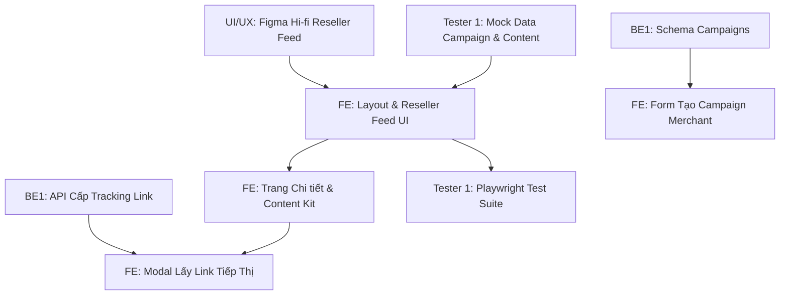

# MY WORK PLAN — FE_W2
**Project:** AI Travel Reseller MVP (TravelLink AI)  
**Week:** Tuần 2 (12/10/2026 – 16/10/2026) — Sprint 2  
**Member:** Frontend Developer (FE Lead)  
**Role:** Frontend Developer (Next.js 16 App Router, Tailwind 4, Reseller Portal)  
**Current Milestone:** AI CONTENT FACTORY & DISTRIBUTION (Sinh nội dung & Phân phối)  
**Deadline:** 12:00 PM Thứ Sáu (16/10/2026); Cross-testing & Demo: 13:30 – 17:30 ngày 16/10/2026  
**Branch:** `feature/fe-w2-reseller-feed` (tách từ `dev`)  

---

## 1. Context
- Kế thừa thành quả Tuần 1: Khung Next.js 16 App Router, thiết kế "Coastal Editorial", 5 màn hình cốt lõi (Landing, Login, Register, Chatbot, Merchant Dashboard) và bộ test Playwright 15/15 PASS đã được merge vào `dev` qua PR #8.
- Trọng tâm Tuần 2: Xây dựng toàn bộ phân hệ **Reseller Portal**: Bảng tin chiến dịch (`/reseller/campaigns`), màn hình chi tiết bài viết gợi ý (`/reseller/campaigns/[id]`), tính năng Copy kịch bản 1-click, modal nhận Tracking Link cá nhân hóa và Form tạo Campaign cho Merchant để kích hoạt chuỗi giá trị.
- Nguồn tham chiếu: PRD v1.0, [Roadmap.md](file:///E:/Tue/MyProject/AITravelReseller/ai-travel-reseller/.ai/process/Roadmap.md), [Week2.md](file:///E:/Tue/MyProject/AITravelReseller/ai-travel-reseller/.ai/process/Week2/Week2.md), [WEEK1_SUMMARY.md](file:///E:/Tue/MyProject/AITravelReseller/ai-travel-reseller/.ai/process/Week1/WEEK1_SUMMARY.md).

---

## 2. Executive Summary
Trong Tuần 2, FE chịu trách nhiệm hiện thực hóa trải nghiệm cốt lõi của Reseller & Merchant:
1. Xây dựng phân hệ Reseller Portal: Layout chung, Bảng tin Chiến dịch (`/reseller/campaigns`), lọc theo địa điểm, danh mục và hoa hồng.
2. Xây dựng Thư viện Nội dung gợi ý (`/reseller/campaigns/[id]`): Hiển thị Hooks, Scripts, Captions theo từng Persona, tích hợp nút Copy 1-click có thông báo Toast.
3. Phát triển Modal nhận Tracking Link cá nhân hóa: Tích hợp API cấp link từ BE1, hiển thị short URL và nút sao chép link.
4. Xây dựng Form tạo Campaign cho Merchant trên `/merchant`, kết nối dữ liệu thật từ Supabase DB.

---

## 3. TODAY — MUST DO (Thứ Hai 12/10/2026)
| Priority | Task | Why | Dependency | Output | Estimated Effort |
|---|---|---|---|---|---|
| P0 | Họp Kick-off Sprint 2 & Tiếp nhận Figma Hi-fi từ UI/UX | Nắm rõ layout Reseller Feed và Component Specs | UI/UX Designer | Figma Specs đã review | 1h |
| P1 | Thiết lập cấu trúc thư mục App Router cho phân hệ `/reseller` | Khung điều hướng phân hệ Reseller | None | `app/reseller/layout.tsx` | 2h |
| P1 | Tiếp nhận bộ Mock Data Campaign & Content từ Tester 1 | Có dữ liệu dựng giao diện ngay khi BE đang làm API | Tester 1 | `src/lib/campaign-demo.ts` | 2h |

---

## 4. THIS WEEK — MY TASKS
| ID | Task | Priority | Status | Dependency | Owner | Deliverable | Deadline |
|---|---|---|---|---|---|---|---|
| FE-W2-01 | Cấu trúc Layout & Màn hình Reseller Feed (`/reseller/campaigns`) | P0 | READY | UI/UX Mockups | FE | Trang danh sách chiến dịch | 13/10 12:00 |
| FE-W2-02 | Xây dựng Bộ lọc chiến dịch (Địa điểm, Danh mục, Hoa hồng) | P1 | READY | FE-W2-01 | FE | Filter bar component | 13/10 17:00 |
| FE-W2-03 | Màn hình Chi tiết Chiến dịch & Suggested Content Kit (`/reseller/campaigns/[id]`) | P0 | READY | FE-W2-01 | FE | Trang chi tiết nội dung AI | 14/10 12:00 |
| FE-W2-04 | Tính năng Copy 1-Click & Modal Nhận Affiliate Tracking Link | P0 | READY | FE-W2-03, BE1 API | FE | Modal + Clipboard Handler | 14/10 17:00 |
| FE-W2-05 | Form tạo Campaign cho Merchant trên trang `/merchant` | P1 | READY | BE1 Schema | FE | Form Component + Action | 15/10 12:00 |
| FE-W2-06 | Tích hợp dữ liệu thật từ Supabase DB & Xử lý Loading/Empty | P0 | READY | BE1 DB, BE3 Data | FE | Real data integration | 15/10 17:00 |
| FE-W2-07 | Tinh chỉnh Mobile UX, phối hợp Tester 1 chạy Playwright E2E | P1 | READY | FE-W2-04, 06 | FE + Tester 1 | Test UI pass & PR clean | 16/10 12:00 |

---

## 5. TASK BREAKDOWN

### TASK FE-W2-01 & 02 — Xây Dựng Reseller Campaign Feed (`/reseller/campaigns`)
**Goal:** Hiển thị danh sách các chiến dịch du lịch đang chạy, giúp Reseller dễ dàng tìm kiếm và chọn tour phù hợp để tiếp thị.  
**Prerequisites:** Figma Hi-fi từ UI/UX; Mock data từ Tester 1.  
**Steps:**
- [ ] Tạo file `app/reseller/layout.tsx` với navigation bar dành riêng cho Reseller (Logo TravelLink, Tab Chiến dịch, Đơn hàng, Ví hoa hồng demo).
- [ ] Tạo `app/reseller/campaigns/page.tsx` render danh sách Campaign Cards.
- [ ] Mỗi Card hiển thị: Ảnh bìa tour, Tên chiến dịch, Điểm đến (Đà Nẵng, Hội An...), Tỷ lệ hoa hồng nổi bật (ví dụ: `15% Hoa hồng ~ 135.000đ/vé`), Số lượng bài viết gợi ý sẵn có.
- [ ] Thêm thanh tìm kiếm và bộ lọc nhanh: Theo địa điểm (Đà Nẵng, Quảng Nam...), Mức hoa hồng (Tất cả, >10%, >15%).  
**Definition of Done:** Giao diện hiển thị đúng chuẩn Coastal Editorial, tìm kiếm và lọc hoạt động mượt mà, responsive tốt trên mobile.  
**Handoff To:** Tester 1 (kiểm thử UI), UI/UX (review thẩm mỹ).

---

### TASK FE-W2-03 & 04 — Chi Tiết Chiến Dịch & Thư Viện Nội Dung Gợi Ý (Content Kit)
**Goal:** Cho phép Reseller mở xem các bài viết do AI sinh ra theo từng Persona và sao chép ngay kèm Tracking Link cá nhân.  
**Prerequisites:** Dữ liệu nội dung từ bảng `contents` hoặc mock fixtures; API tạo tracking link từ BE1.  
**Steps:**
- [ ] Tạo trang `app/reseller/campaigns/[id]/page.tsx`.
- [ ] Thiết kế Tabs chuyển đổi giữa 4 Personas: *Chuyên gia bản địa, Gia đình, Tín đồ ẩm thực/Check-in, Săn deal thông thái*.
- [ ] Dưới mỗi Persona hiển thị 3 phần rõ rệt:
  * **Hooks gây chú ý:** Danh sách các câu mở đầu ấn tượng kèm nút "Copy Hook".
  * **Kịch bản Video / Bài đăng:** Nội dung chi tiết kèm nút "Copy Kịch bản".
  * **Lời kêu gọi hành động (CTA):** Đoạn kết bài thúc giục hành động kèm chỗ gắn link.
- [ ] Xây dựng tính năng Copy vào Clipboard qua `navigator.clipboard.writeText`: Kèm Toast Notification phản hồi *"Đã sao chép vào bộ nhớ tạm!"*.
- [ ] Xây dựng Modal "Lấy Link Tiếp Thị": Gọi `POST /api/tracking/generate` lấy short URL định danh của Reseller, hiển thị link rút gọn, mã QR và nút "Sao chép Link".  
**Definition of Done:** Bấm Copy sao chép đúng nội dung vào clipboard; Modal lấy đúng link tiếp thị có `tracking_id`; hoạt động trơn tru trên cả điện thoại.  
**Handoff To:** Tester 1 (viết test Playwright tự động).

---

### TASK FE-W2-05 — Form Tạo Chiến Dịch Mới Cho Merchant
**Goal:** Cho phép Merchant tạo mới Campaign tiếp thị để kích hoạt luồng AI sinh nội dung.  
**Prerequisites:** Route `/merchant` đã có từ Tuần 1; Schema bảng `campaigns` từ BE1.  
**Steps:**
- [ ] Tạo component `CreateCampaignModal` hoặc trang `/merchant/campaigns/new`.
- [ ] Form gồm các trường:
  * Chọn Sản phẩm du lịch (Dropdown lấy từ danh sách tour của Merchant).
  * Tiêu đề chiến dịch (`title`).
  * Mức hoa hồng đề xuất (`commission_rate`: 5% - 30%).
  * Thời hạn chiến dịch (Ngày bắt đầu - Ngày kết thúc).
  * Đối tượng mục tiêu & Ghi chú cho AI Content Factory.
- [ ] Submit form gọi Server Action tạo bản ghi vào bảng `campaigns`.
- [ ] Hiển thị trạng thái đang xử lý và thông báo thành công: *"Chiến dịch đã tạo! AI đang tự động sinh bài viết tiếp thị..."*.  
**Definition of Done:** Submit form lưu thành công vào database Supabase và trigger sự kiện n8n.  
**Handoff To:** BE1, BE3, Tester 3.

---

## 6. DEPENDENCY MAP


---

## 7. BLOCKERS
| Blocker | Tôi cần gì | Người phụ trách | Deadline | Impact |
|---|---|---|---|---|
| Figma Hi-fi | Bản thiết kế hoàn chỉnh Reseller Feed và Content Kit | UI/UX Designer | 12/10 12:00 | Phải dùng wireframe sơ bộ để code trước |
| API Cấp Tracking Link | Endpoint `POST /api/tracking/generate` hoạt động trên local | BE1 | 13/10 17:00 | Modal link dùng URL giả lập trước khi có API thật |

---

## 8. TEAM HANDOFF
| From | To | Deliverable | Format | Deadline | Status |
|---|---|---|---|---|---|
| FE | UI/UX | Giao diện Reseller Feed đã code chạy trên localhost:3000 | Web demo / Ảnh chụp | 13/10 17:00 | READY |
| FE | Tester 1 | Nhánh code hoàn chỉnh phân hệ Reseller để viết test | Git branch | 14/10 17:00 | READY |
| FE | Toàn team | Pull Request `feature/fe-w2-reseller-feed` vào nhánh `dev` | GitHub PR | 16/10 12:00 | PLANNED |

---

## 9. TEAM CONFLICT CHECK
- 🔴 **Conflict:** Không có. FE phụ trách toàn bộ giao diện phía client và kết nối state adapter.
- 🟡 **Potential Conflict:** Phân quyền router Reseller vs Merchant: Đảm bảo tài khoản vai trò Reseller được chuyển đúng vào `/reseller/campaigns` sau khi đăng nhập, không bị nhầm sang `/merchant`. Cần phối hợp BE1 kiểm tra `proxy.ts`.
- 🟢 **No Conflict:** Giữ nguyên quy chuẩn cấu trúc thư mục App Router tại root `app/` đã thống nhất từ Tuần 1.

---

## 10. INTERFACE CHECK
| Interface | Tôi | Người liên quan | Cần chốt | Status |
|---|---|---|---|---|
| API Tạo Tracking Link | Consumer | BE1 (Owner) | Params gửi đi & URL trả về trong response | PROPOSED |
| Truy vấn Bảng `contents` | Consumer | BE1 / BE3 | Danh sách trường hiển thị bài viết (`hook`, `script`, `caption`, `cta`) | AGREED |
| Thiết kế Thẻ Campaign Card | Implementer | UI/UX (Designer) | Các trường thông tin bắt buộc hiển thị trên Feed | PROPOSED |

---

## 11. OUT OF SCOPE
- Đăng bài tự động lên Facebook / TikTok bằng 1 nút bấm (chỉ cung cấp tính năng Copy vào clipboard).
- Xử lý rút tiền / ví hoa hồng thực tế của Reseller (để Tuần 4).
- Giao diện Admin quản trị tổng.

---

## 12. END-OF-DAY UPDATE (Mẫu nhật ký)
```text
DONE:
- ...
IN PROGRESS:
- ...
BLOCKED:
- ...
HANDOFF:
- ...
NEXT:
- ...
```

---

## 13. END-OF-WEEK CHECKLIST
- [ ] Giao diện Reseller Feed (`/reseller/campaigns`) hiển thị đầy đủ và lọc mượt mà
- [ ] Màn hình chi tiết bài viết hiển thị đúng 4 Personas kèm tính năng Copy 1-click
- [ ] Modal lấy link tiếp thị kết nối đúng API của BE1 và copy được URL
- [ ] Form tạo Campaign trên Merchant Portal submit thành công vào Supabase
- [ ] Playwright E2E UI Test vượt qua 100% test cases trên cả Desktop và Mobile
- [ ] PR được tạo, review và merge vào `dev` trước 12:00 PM Thứ Sáu (16/10/2026)
