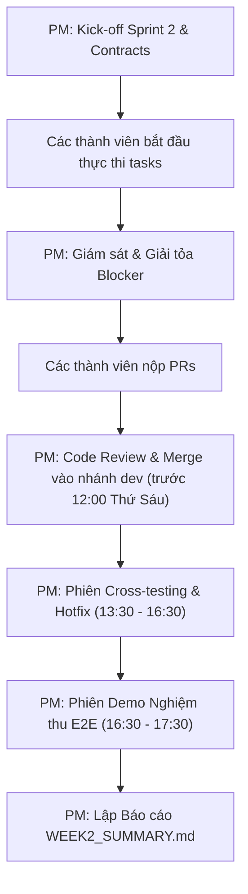

# MY WORK PLAN — PM_W2
**Project:** AI Travel Reseller MVP (TravelLink AI)  
**Week:** Tuần 2 (12/10/2026 – 16/10/2026) — Sprint 2  
**Member:** Nguyễn Minh Tuệ (Project Manager & Team Lead)  
**Role:** Project Manager & Technical Project Coordinator  
**Current Milestone:** AI CONTENT FACTORY & DISTRIBUTION (Sinh nội dung & Phân phối)  
**Deadline:** 12:00 PM Thứ Sáu (16/10/2026); Cross-testing & Demo: 13:30 – 17:30 ngày 16/10/2026  
**Artifacts:** `TEAM_WORK_LOG.md`, Sprint 2 Review Board, `WEEK2_SUMMARY.md`  

---

## 1. Context
- Kế thừa thành quả Tuần 1: Nghiệm thu xuất sắc 100% mục tiêu Foundation & Data Structure, giải tỏa sạch các blocker kỹ thuật, hợp nhất 8 PRs vào `dev` an toàn.
- Trọng tâm Tuần 2: Điều hành mắt xích cốt lõi **AI Content Factory & Distribution**: Merchant tạo Campaign → n8n tự động sinh bài đăng qua LLM → Reseller duyệt Feed và Copy bài → Nhận Affiliate Link và ghi nhận lượt Click.
- Nguồn tham chiếu: PRD v1.0, [Roadmap.md](file:///E:/Tue/MyProject/AITravelReseller/ai-travel-reseller/.ai/process/Roadmap.md), [Week2.md](file:///E:/Tue/MyProject/AITravelReseller/ai-travel-reseller/.ai/process/Week2/Week2.md), [WEEK1_SUMMARY.md](file:///E:/Tue/MyProject/AITravelReseller/ai-travel-reseller/.ai/process/Week1/WEEK1_SUMMARY.md).

---

## 2. Executive Summary
Trong Tuần 2, PM chịu trách nhiệm điều phối toàn diện 9 thành viên đảm bảo tiến độ và chất lượng:
1. Chủ trì Kick-off Sprint 2, chốt ma trận phụ thuộc dữ liệu và Interface Contracts giữa FE - BE1 - BE2 - BE3 ngay trong sáng Thứ Hai.
2. Theo dõi tiến độ hàng ngày, chủ động tháo gỡ điểm nghẽn (đặc biệt giữa Webhook BE1 → n8n BE3 và API cấp link BE1 → FE Modal).
3. Kiểm soát chất lượng mã nguồn: Tiến hành Code Review nghiêm ngặt, đảm bảo 100% PR vượt qua Typecheck, Lint và Test trước khi merge vào `dev`.
4. Chủ trì phiên Kiểm thử chéo (13:30 – 15:00), Hotfix (15:00 – 16:30) và Demo Nghiệm thu E2E (16:30 – 17:30) chiều Thứ Sáu.

---

## 3. TODAY — MUST DO (Thứ Hai 12/10/2026)
| Priority | Task | Why | Dependency | Output | Estimated Effort |
|---|---|---|---|---|---|
| P0 | Chủ trì cuộc họp Kick-off Sprint 2 lúc 09:00 AM | Thống nhất mục tiêu, hợp đồng dữ liệu Tuần 2 cho 9 thành viên | Toàn team | Quyết định chốt hợp đồng | 1.5h |
| P0 | Khởi tạo bảng theo dõi tiến độ `TEAM_WORK_LOG.md` Tuần 2 | Đồng bộ trạng thái active của toàn đội ngũ | Toàn team | `Week2/TEAM_WORK_LOG.md` | 1.5h |
| P1 | Rà soát bàn giao Figma từ UI/UX sang Frontend | Đảm bảo FE có bản vẽ Hi-fi để bắt tay vào code | UI/UX | Xác nhận handoff | 1h |

---

## 4. THIS WEEK — MY TASKS
| ID | Task | Priority | Status | Dependency | Owner | Deliverable | Deadline |
|---|---|---|---|---|---|---|---|
| PM-W2-01 | Chủ trì Kick-off Sprint 2 & Chốt Interface Contracts | P0 | READY | Week2.md | PM | Biên bản họp & Contracts | 12/10 11:30 |
| PM-W2-02 | Khởi tạo & Vận hành `TEAM_WORK_LOG.md` Tuần 2 | P0 | READY | PM-W2-01 | PM | `TEAM_WORK_LOG.md` | 12/10 12:00 |
| PM-W2-03 | Giám sát tích hợp Webhook Database sang n8n (BE1 ↔ BE3) | P0 | READY | BE1, BE3 code | PM | Webhook thông luồng | 13/10 17:00 |
| PM-W2-04 | Giám sát bàn giao API cấp link & tích hợp Frontend (BE1 ↔ FE) | P0 | READY | BE1, FE code | PM | Modal link hoạt động | 14/10 17:00 |
| PM-W2-05 | Điều phối kiểm thử tích hợp E2E trước ngày chốt mã nguồn | P1 | READY | Toàn team | PM | E2E Integration Checklist | 15/10 17:00 |
| PM-W2-06 | Review và Phê duyệt toàn bộ Pull Requests vào nhánh `dev` | P0 | READY | Code PRs | PM | 100% PRs merged | 16/10 12:00 |
| PM-W2-07 | Chủ trì phiên Cross-testing, Hotfix và Demo Nghiệm thu Tuần 2 | P0 | READY | Branch `dev` sạch | PM | Biên bản nghiệm thu Tuần 2 | 16/10 17:30 |
| PM-W2-08 | Tổng hợp Báo cáo Tổng kết Tuần 2 (`WEEK2_SUMMARY.md`) | P0 | READY | PM-W2-07 | PM | `WEEK2_SUMMARY.md` | 16/10 18:00 |

---

## 5. TASK BREAKDOWN

### TASK PM-W2-01 — Điều Phối Phiên Kick-off & Chốt Interface Contracts
**Goal:** Loại bỏ hoàn toàn nguy cơ xung đột giao diện hoặc mập mờ trách nhiệm giữa các lập trình viên.  
**Nội dung chốt trong phiên:**
1. **Contract 1 (BE1 ↔ BE3):** JSON Payload của Trigger Webhook khi tạo Campaign mới (các trường bắt buộc: `campaign_id`, `product_id`, `title`, `commission_rate`).
2. **Contract 2 (BE2 ↔ BE3):** Cấu trúc JSON Structured Output của LLM cho 4 Personas (`hooks`, `scripts`, `captions`, `ctas`).
3. **Contract 3 (BE1 ↔ FE):** Endpoint `POST /api/tracking/generate` và định dạng short URL `/r/[code]`.
4. **Contract 4 (UI/UX ↔ FE):** Bản vẽ Hi-fi Reseller Feed và specs nút Copy 1-click.  
**Definition of Done:** 100% các thành viên liên quan xác nhận hiểu rõ hợp đồng và ký nhận trách nhiệm trong log.  
**Handoff To:** Toàn đội ngũ.

---

### TASK PM-W2-06 & 07 — Review Code, Quản Lý Release & Chủ Trì Demo Nghiệm Thu
**Goal:** Đảm bảo nhánh `dev` luôn ở trạng thái sẵn sàng chạy ổn định, không có xung đột mã nguồn và kiểm chứng luồng hoạt động trực tiếp trước ban điều hành.  
**Quy trình thực hiện:**
- [ ] Rà soát từng PR: Kiểm tra linting, TypeScript compile không có cảnh báo nghiêm trọng, không có file thừa hoặc credentials bị commit lộ.
- [ ] Đảm bảo toàn bộ PR được merge trước mốc **12:00 PM Thứ Sáu (16/10/2026)**.
- [ ] 13:30 – 15:00: Phân công cặp chéo test: FE test backend tracking, BE test giao diện Feed, QA test kịch bản người dùng thật.
- [ ] 15:00 – 16:30: Chỉ huy giải quyết dứt điểm các lỗi phát sinh (Hotfix session).
- [ ] 16:30 – 17:30: Thực hiện kịch bản Demo 4 bước:
  1. Merchant tạo chiến dịch mới trên giao diện `/merchant`.
  2. n8n tự động kích hoạt và sinh bài đăng trong < 30s.
  3. Reseller duyệt feed trên `/reseller/campaigns`, xem bài theo personas và bấm Copy kịch bản.
  4. Reseller lấy link tiếp thị, mở tab ẩn danh click vào link → Ghi nhận đúng click vào DB và chuyển hướng đến trang thanh toán.  
**Definition of Done:** Demo thành công 100% không phát sinh lỗi bất ngờ; Ban điều hành ký duyệt nghiệm thu Tuần 2.  
**Handoff To:** Ban điều hành dự án, Kế hoạch Tuần 3.

---

## 6. DEPENDENCY MAP


---

## 7. BLOCKERS
| Blocker | Tôi cần gì | Người phụ trách | Deadline | Impact |
|---|---|---|---|---|
| Chậm nộp PR từ các thành viên | Các thành viên hoàn thành và nộp PR đúng hạn trước 12:00 Thứ Sáu | Toàn đội ngũ | 16/10 12:00 | Trễ lịch cross-testing buổi chiều |

---

## 8. TEAM HANDOFF
| From | To | Deliverable | Format | Deadline | Status |
|---|---|---|---|---|---|
| PM | Toàn team | Bảng phân công nhiệm vụ và lịch trình Sprint 2 | `Week2.md` & Work plans | 12/10 09:00 | READY |
| PM | Toàn team | Nhánh `dev` tổng hợp sạch sẽ và ổn định | Git branch `dev` | 16/10 12:00 | PLANNED |
| PM | Ban điều hành | Báo cáo Tổng kết Tuần 2 (`WEEK2_SUMMARY.md`) | Markdown report | 16/10 18:00 | PLANNED |

---

## 9. TEAM CONFLICT CHECK
- 🔴 **Conflict:** Không có xung đột quyền sở hữu. PM chịu trách nhiệm cao nhất về tiến độ, chất lượng và quản trị phát hành.
- 🟡 **Potential Conflict:** Quản lý thời gian buổi chiều Thứ Sáu: Phải tuân thủ nghiêm ngặt khung giờ (13:30 Test, 15:00 Hotfix, 16:30 Demo), không để việc test kéo dài làm lẹm vào giờ demo.
- 🟢 **No Conflict:** Tuân thủ triệt để nguyên tắc Git Flow: Mọi thay đổi đều qua PR, tuyệt đối không commit trực tiếp vào `dev` hay `main`.

---

## 10. INTERFACE CHECK
| Interface | Tôi | Người liên quan | Cần chốt | Status |
|---|---|---|---|---|
| Git Flow & PR Standards | Owner | Toàn bộ lập trình viên | Yêu cầu commit message, test pass, không conflict | AGREED |
| Sprint Acceptance Criteria | Owner | Toàn đội ngũ | 5 tiêu chí Definition of Done nêu trong Week2.md | AGREED |

---

## 11. OUT OF SCOPE
- Đưa tính năng ra mắt công chúng (Production Release tới người dùng thật — dành cho Tuần 4).
- Tự ý thay đổi scope đã thống nhất trong PRD và Roadmap mà không có sự đồng thuận của Ban điều hành.

---

## 12. END-OF-DAY UPDATE (Mẫu nhật ký)
```text
DONE:
- ...
IN PROGRESS:
- ...
BLOCKED:
- ...
HANDOFF:
- ...
NEXT:
- ...
```

---

## 13. END-OF-WEEK CHECKLIST
- [ ] Chủ trì thành công Kick-off và thống nhất 100% hợp đồng giao tiếp
- [ ] Vận hành nhật ký `TEAM_WORK_LOG.md` Tuần 2 cập nhật hàng ngày
- [ ] 100% PR được review kỹ lưỡng và merge vào nhánh `dev` trước 12:00 PM Thứ Sáu
- [ ] Phiên Cross-testing, Hotfix và Demo E2E hoàn thành xuất sắc
- [ ] Hoàn thiện tài liệu tổng kết `WEEK2_SUMMARY.md` và kế hoạch Tuần 3
