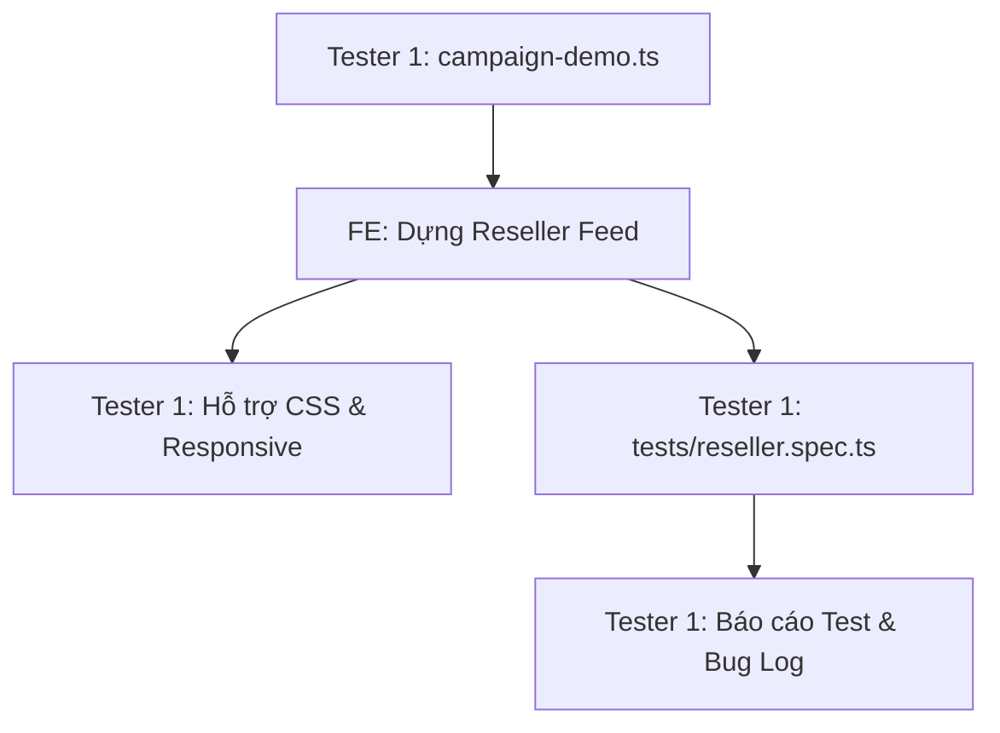

# MY WORK PLAN — TESTER1_W2
**Project:** AI Travel Reseller MVP (TravelLink AI)  
**Week:** Tuần 2 (12/10/2026 – 16/10/2026) — Sprint 2  
**Member:** Tester 1 (QA Hybrid Lead)  
**Role:** QA Tester 1 (Hỗ trợ Frontend & Automated UI Testing)  
**Current Milestone:** AI CONTENT FACTORY & DISTRIBUTION (Sinh nội dung & Phân phối)  
**Deadline:** 12:00 PM Thứ Sáu (16/10/2026); Cross-testing & Demo: 13:30 – 17:30 ngày 16/10/2026  
**Artifacts:** `src/lib/campaign-demo.ts`, `tests/reseller.spec.ts`, Bug Report, Screenshots  

---

## 1. Context
- Kế thừa thành quả Tuần 1: Tester 1 đã phối hợp cùng FE xây dựng bộ fixtures [`merchant-demo.ts`](file:///E:/Tue/MyProject/AITravelReseller/ai-travel-reseller/src/lib/merchant-demo.ts) và bộ test tự động [`tests/frontend.spec.ts`](file:///E:/Tue/MyProject/AITravelReseller/ai-travel-reseller/tests/frontend.spec.ts) đạt 15/15 PASS, chụp 15 ảnh bằng chứng giao diện.
- Trọng tâm Tuần 2: Tiếp tục đóng vai trò "Cộng sự đắc lực của FE" trong 2 tuần đầu theo Master Roadmap: Xây dựng Mock Data Campaign & Content Kit đa dạng, hỗ trợ FE ghép layout giao diện Reseller, và viết bộ kịch bản kiểm thử tự động Playwright E2E cho phân hệ Reseller (`tests/reseller.spec.ts`).
- Nguồn tham chiếu: PRD v1.0, [Roadmap.md](file:///E:/Tue/MyProject/AITravelReseller/ai-travel-reseller/.ai/process/Roadmap.md), [Week2.md](file:///E:/Tue/MyProject/AITravelReseller/ai-travel-reseller/.ai/process/Week2/Week2.md), [WEEK1_SUMMARY.md](file:///E:/Tue/MyProject/AITravelReseller/ai-travel-reseller/.ai/process/Week1/WEEK1_SUMMARY.md).

---

## 2. Executive Summary
Trong Tuần 2, Tester 1 đảm bảo tốc độ và chất lượng cho phân hệ giao diện:
1. Xây dựng ngay trong ngày Thứ Hai bộ Mock Data chi tiết (`src/lib/campaign-demo.ts`) với 4 chiến dịch lớn và hơn 20 bài đăng mẫu theo 4 Personas để FE không bị block khi backend đang xây API.
2. Hỗ trợ FE ghép component giao diện Reseller Feed và chỉnh CSS Responsive trên điện thoại.
3. Xây dựng bộ test tự động Playwright E2E cho phân hệ Reseller, kiểm tra chức năng lọc, hiển thị bài viết, copy vào clipboard và mở modal nhận link.
4. Quản lý danh sách bug và kiểm thử hồi quy (Regression Test) trước giờ nghiệm thu.

---

## 3. TODAY — MUST DO (Thứ Hai 12/10/2026)
| Priority | Task | Why | Dependency | Output | Estimated Effort |
|---|---|---|---|---|---|
| P0 | Tạo file Mock Data chi tiết `campaign-demo.ts` | Cung cấp dữ liệu tức thì cho FE dựng Reseller Feed | None | `src/lib/campaign-demo.ts` | 3h |
| P1 | Họp Kick-off Sprint 2 & Phân tích kịch bản test Reseller | Lập Test Cases sơ bộ cho phân hệ Reseller | Team Dev | Test Checklist W2 | 1.5h |
| P1 | Hỗ trợ FE kiểm tra Layout khung Reseller Portal | Đảm bảo không bị vỡ giao diện ngay từ đầu | FE | Code review CSS | 1.5h |

---

## 4. THIS WEEK — MY TASKS
| ID | Task | Priority | Status | Dependency | Owner | Deliverable | Deadline |
|---|---|---|---|---|---|---|---|
| T1-W2-01 | Xây dựng bộ Mock Data Campaign & Content (`campaign-demo.ts`) | P0 | READY | Dữ liệu tour W1 | Tester 1 | File TypeScript Mock Data | 12/10 16:00 |
| T1-W2-02 | Hỗ trợ FE ghép UI Reseller Feed & kiểm tra Responsive Mobile | P1 | READY | T1-W2-01, FE code | Tester 1 + FE | Giao diện chuẩn mobile | 13/10 17:00 |
| T1-W2-03 | Xây dựng bộ test Playwright E2E UI Reseller (`tests/reseller.spec.ts`) | P0 | READY | FE-W2-03, 04 | Tester 1 | File test Playwright | 14/10 17:00 |
| T1-W2-04 | Kiểm thử chức năng Copy 1-Click Clipboard & Modal Tracking | P1 | READY | FE-W2-04 | Tester 1 | Test cases & Bug log | 15/10 12:00 |
| T1-W2-05 | Kiểm thử Form tạo Campaign của Merchant trên trang `/merchant` | P1 | READY | FE-W2-05 | Tester 1 | Form Test Report | 15/10 17:00 |
| T1-W2-06 | Chạy Regression Test toàn bộ phân hệ Reseller & Chụp ảnh minh chứng | P0 | READY | Toàn bộ FE W2 | Tester 1 | 100% Tests PASS + Screenshots | 16/10 12:00 |

---

## 5. TASK BREAKDOWN

### TASK T1-W2-01 — Xây Dựng Bộ Mock Data `campaign-demo.ts`
**Goal:** Tạo nguồn dữ liệu giả lập phong phú, chuẩn format theo đúng cấu trúc của bảng `campaigns` và `contents` để FE import dùng ngay.  
**Dữ liệu xây dựng:**
- 4 Chiến dịch du lịch tiêu biểu:
  1. *Bà Nà Hills Sun World — Siêu deal Mùa Lễ Hội* (Đà Nẵng, Hoa hồng 15%).
  2. *VinWonders Nam Hội An — Khám phá Văn hóa & Vườn thú Safari* (Quảng Nam, Hoa hồng 12%).
  3. *Tour Lặn Ngắm San Hô Cù Lao Chàm 1 Ngày* (Hội An, Hoa hồng 18%).
  4. *Du Thuyền Sông Hàn Ngắm Cầu Rồng Phun Lửa* (Đà Nẵng, Hoa hồng 20%).
- Hơn 20 biến thể nội dung phân chia theo 4 Personas: Mỗi tour có ít nhất 2 Hooks, 1 Script chi tiết, 1 Caption kèm hashtag và 1 CTA có sẵn placeholder `[LINK_TIẾP_THỊ]`.  
**Definition of Done:** File được export chuẩn TypeScript, không lỗi typecheck, import được ngay vào trang Reseller Feed.  
**Handoff To:** FE (sử dụng dựng UI).

---

### TASK T1-W2-03 — Viết Bộ Kịch Bản Playwright E2E `tests/reseller.spec.ts`
**Goal:** Tự động hóa việc kiểm tra giao diện và tính năng trên cả 3 kích thước màn hình: Desktop (1440px), Mobile (390px), Mobile nhỏ (320px).  
**Kịch bản kiểm thử (Test Cases):**
1. `reseller-campaigns-render`: Truy cập `/reseller/campaigns` hiển thị đầy đủ danh sách chiến dịch, không có lỗi console (`pageerror`), không tràn ngang màn hình.
2. `reseller-filter-and-search`: Gõ tìm kiếm "Bà Nà" hiển thị đúng 1 card; chọn bộ lọc "Hoa hồng >15%" lọc đúng danh sách; xóa bộ lọc hiển thị lại toàn bộ.
3. `reseller-content-detail-and-personas`: Mở trang chi tiết chiến dịch, click chuyển đổi giữa 4 tab Persona, nội dung thay đổi tương ứng.
4. `reseller-clipboard-copy`: Giả lập click nút "Sao chép Kịch bản", kiểm tra quyền clipboard và bắt sự kiện xuất hiện Toast thông báo thành công.
5. `reseller-tracking-modal`: Click "Lấy Affiliate Link", modal hiển thị đúng mã rút gọn, nút copy link hoạt động.  
**Definition of Done:** Chạy `npx playwright test tests/reseller.spec.ts` đạt kết quả PASS 100%.  
**Handoff To:** FE, PM (kèm báo cáo test).

---

## 6. DEPENDENCY MAP


---

## 7. BLOCKERS
| Blocker | Tôi cần gì | Người phụ trách | Deadline | Impact |
|---|---|---|---|---|
| Quyền truy cập Clipboard trong môi trường Headless Browser | Cấu hình grant permissions `['clipboard-read', 'clipboard-write']` trong Playwright config | None (tự cấu hình) | 14/10 10:00 | Test case copy có thể fail nếu thiếu quyền |

---

## 8. TEAM HANDOFF
| From | To | Deliverable | Format | Deadline | Status |
|---|---|---|---|---|---|
| Tester 1 | FE | Bộ Mock Data `src/lib/campaign-demo.ts` | File TypeScript | 12/10 16:00 | READY |
| Tester 1 | FE | Danh sách lỗi giao diện & gợi ý căn chỉnh CSS | Markdown bug list | 13/10 17:00 | READY |
| Tester 1 | PM + FE | Bộ Playwright Test Suite PASS 100% + Ảnh Screenshots | Code + PNGs | 16/10 12:00 | PLANNED |

---

## 9. TEAM CONFLICT CHECK
- 🔴 **Conflict:** Không có. Tester 1 đóng vai trò Hybrid hỗ trợ FE theo đúng quy định tại Master Roadmap Tuần 1 và Tuần 2.
- 🟡 **Potential Conflict:** Dữ liệu Mock vs Dữ liệu thật: Đảm bảo format của `campaign-demo.ts` tương đồng với database schema của BE1 để khi FE chuyển sang fetch dữ liệu thật không bị lỗi mapping.
- 🟢 **No Conflict:** Không can thiệp vào logic backend hay prompt AI.

---

## 10. INTERFACE CHECK
| Interface | Tôi | Người liên quan | Cần chốt | Status |
|---|---|---|---|---|
| Mock Data Schema | Owner | FE (Consumer) | Khóa JSON chiến dịch và bài đăng | PROPOSED |
| Playwright Test Hooks | Owner | FE (Collaborator) | Đặt các thuộc tính `data-testid` trên nút Copy và Filter để test ổn định | PROPOSED |

---

## 11. OUT OF SCOPE
- Viết API test cho Backend (nhiệm vụ của Tester 3).
- Kiểm thử độ trung thực và chống ảo giác AI (nhiệm vụ của Tester 2).

---

## 12. END-OF-DAY UPDATE (Mẫu nhật ký)
```text
DONE:
- ...
IN PROGRESS:
- ...
BLOCKED:
- ...
HANDOFF:
- ...
NEXT:
- ...
```

---

## 13. END-OF-WEEK CHECKLIST
- [ ] File Mock Data `campaign-demo.ts` hoàn thiện và bàn giao đúng hạn
- [ ] Hỗ trợ FE hoàn thiện giao diện không lỗi responsive
- [ ] Bộ Playwright Test Suite `tests/reseller.spec.ts` chạy PASS 100%
- [ ] Chụp đầy đủ bộ ảnh minh chứng giao diện Reseller Desktop & Mobile
- [ ] Đóng toàn bộ các ticket bug giao diện trước 12:00 PM Thứ Sáu (16/10/2026)
