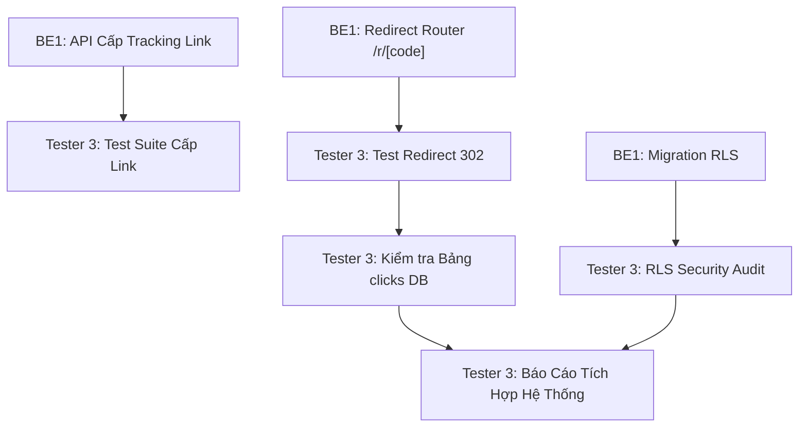

# MY WORK PLAN — TESTER3_W2
**Project:** AI Travel Reseller MVP (TravelLink AI)  
**Week:** Tuần 2 (12/10/2026 – 16/10/2026) — Sprint 2  
**Member:** Tester 3 (System & Security Lead)  
**Role:** QA Tester 3 (System Integration, Tracking API, Database & Security)  
**Current Milestone:** AI CONTENT FACTORY & DISTRIBUTION (Sinh nội dung & Phân phối)  
**Deadline:** 12:00 PM Thứ Sáu (16/10/2026); Cross-testing & Demo: 13:30 – 17:30 ngày 16/10/2026  
**Artifacts:** Tracking API Test Suite, Redirect & Click Report, RLS Security Audit  

---

## 1. Context
- Kế thừa thành quả Tuần 1: Tester 3 đã kiểm thử thành công chu trình 6 migrations Supabase, xác thực RLS policies, test hàm RPC `match_product_embeddings` và trigger Webhook qua extension `pg_net`.
- Trọng tâm Tuần 2: Kiểm thử tích hợp toàn diện luồng **Tracking & Phân phối**: Kiểm thử API cấp Tracking Link, kiểm tra Redirect Service `/r/[code]` chuyển hướng HTTP 302 an toàn, kiểm chứng dữ liệu ghi vào bảng `clicks` (IP, User Agent, Referrer), kiểm tra cơ chế chống spam click cơ bản và rà soát Row Level Security (RLS) trên các bảng mới.
- Nguồn tham chiếu: PRD v1.0, [Roadmap.md](file:///E:/Tue/MyProject/AITravelReseller/ai-travel-reseller/.ai/process/Roadmap.md), [Week2.md](file:///E:/Tue/MyProject/AITravelReseller/ai-travel-reseller/.ai/process/Week2/Week2.md), [WEEK1_SUMMARY.md](file:///E:/Tue/MyProject/AITravelReseller/ai-travel-reseller/.ai/process/Week1/WEEK1_SUMMARY.md).

---

## 2. Executive Summary
Trong Tuần 2, Tester 3 chịu trách nhiệm bảo đảm độ tin cậy của luồng dữ liệu theo dõi:
1. Xây dựng bộ Test Suite tự động (Postman/Node.js/Playwright API) kiểm thử API cấp mã tiếp thị cá nhân hóa.
2. Kiểm tra Redirect Router `/r/[code]`: Đảm bảo 100% request được chuyển hướng HTTP 302 chính xác tới `official_booking_url` của Merchant, không làm mất tham số attribution.
3. Kiểm tra tính toàn vẹn dữ liệu Click Tracking: Bảng `clicks` ghi nhận chính xác địa chỉ IP, User Agent, Referrer và tăng đúng số lượng `clicks_count`.
4. Rà soát bảo mật RLS và quyền riêng tư: Chặn Reseller xem link của người khác; bảo vệ an toàn bảng `clicks`.

---

## 3. TODAY — MUST DO (Thứ Hai 12/10/2026)
| Priority | Task | Why | Dependency | Output | Estimated Effort |
|---|---|---|---|---|---|
| P0 | Họp Kick-off Sprint 2 & Tiếp nhận API Specs từ BE1 | Thống nhất cấu trúc endpoint tracking và router | BE1 | API Contract Test Plan | 1.5h |
| P1 | Thiết lập môi trường kiểm thử API tự động | Chuẩn bị công cụ chạy test API liên tục | None | Test project repo / collection | 2h |
| P1 | Viết Test Cases sơ bộ cho luồng Redirect & Click DB | Chuẩn bị trước kịch bản kiểm thử | BE1 Specs | Test Case Document | 2.5h |

---

## 4. THIS WEEK — MY TASKS
| ID | Task | Priority | Status | Dependency | Owner | Deliverable | Deadline |
|---|---|---|---|---|---|---|---|
| T3-W2-01 | Xây dựng API Test Suite cho endpoint cấp Tracking Link | P0 | READY | BE1-W2-02 | Tester 3 | Automated API Test Suite | 13/10 17:00 |
| T3-W2-02 | Kiểm thử Redirect Router `/r/[code]` (HTTP 302 & URL Integrity) | P0 | READY | BE1-W2-04 | Tester 3 | Redirect Test Suite | 14/10 17:00 |
| T3-W2-03 | Kiểm tra tính toàn vẹn dữ liệu ghi nhận bảng `clicks` & `clicks_count` | P0 | READY | T3-W2-02 | Tester 3 | Click Data Verification Log | 15/10 12:00 |
| T3-W2-04 | Kiểm thử chống spam click cơ bản (Throttling / Duplicate IP) | P1 | READY | T3-W2-03 | Tester 3 | Anti-spam Test Report | 15/10 17:00 |
| T3-W2-05 | Kiểm thử bảo mật RLS & Phân quyền trên các bảng Tuần 2 | P0 | READY | BE1-W2-05 | Tester 3 | RLS Security Audit | 16/10 10:00 |
| T3-W2-06 | Báo cáo kiểm thử tích hợp hệ thống Tuần 2 (System QA Report) | P0 | READY | Toàn bộ T3-W2 | Tester 3 | `SYSTEM_TEST_REPORT_W2.md` | 16/10 12:00 |

---

## 5. TASK BREAKDOWN

### TASK T3-W2-02 & 03 — Kiểm Thử Redirect Router & Tính Toàn Vẹn Bảng Clicks
**Goal:** Đảm bảo khi người dùng bấm vào short link tiếp thị, hệ thống chuyển hướng mượt mà không độ trễ và lưu trữ đầy đủ thông tin click vào database.  
**Kịch bản kiểm thử (Test Cases):**
1. **Valid Link Redirect (HTTP 302):**
   - Gửi GET request đến `http://localhost:3000/r/[valid_code]`.
   - Kết quả mong đợi: Status Code là `302 Found`, Header `Location` khớp chính xác với `official_booking_url` của Merchant.
2. **Invalid / Expired Link:**
   - Gửi GET request với mã không tồn tại `http://localhost:3000/r/non-existent-code`.
   - Kết quả mong đợi: Hệ thống chuyển hướng 302 an toàn về trang chủ `/` kèm query error hoặc trả trang 404 thân thiện, không làm sập server.
3. **Click Data Integrity:**
   - Sau khi gửi 5 lượt click với các User Agent và Referrer khác nhau:
   - Truy vấn database: Bảng `clicks` tăng đúng 5 bản ghi mới.
   - Các trường `ip_address`, `user_agent`, `referrer`, `created_at` được điền đầy đủ và chính xác.
   - Bản ghi tương ứng trong bảng `affiliate_links` có `clicks_count` tăng đúng +5.  
**Definition of Done:** 100% các request test chuyển hướng chính xác và số liệu database khớp tuyệt đối.  
**Handoff To:** BE1, PM.

---

### TASK T3-W2-05 — Kiểm Thử Bảo Mật RLS & Quyền Truy Cập
**Goal:** Đảm bảo dữ liệu hoa hồng và link tiếp thị của Reseller được bảo vệ tuyệt đối, không bị lộ chéo giữa các tài khoản.  
**Kịch bản kiểm thử:**
- [ ] Role `anon` (khách vãng lai): Chỉ được phép kích hoạt trigger click thông qua route redirect `/r/*`; tuyệt đối không được đọc danh sách link tiếp thị của các Reseller khác.
- [ ] Role `authenticated` với vai trò Reseller A: Chỉ đọc được bản ghi `affiliate_links` có `reseller_id` trùng với ID của chính mình; không thể truy vấn hoặc cập nhật link của Reseller B.
- [ ] Role Merchant: Xem được danh sách chiến dịch do chính mình tạo ra; không thể sửa chiến dịch của Merchant khác.  
**Definition of Done:** Chạy test SQL xác nhận 100% chính sách RLS chặn thành công các hành vi truy cập trái phép.  
**Handoff To:** BE1 (vá lỗi nếu phát hiện lỏng quyền), PM.

---

## 6. DEPENDENCY MAP


---

## 7. BLOCKERS
| Blocker | Tôi cần gì | Người phụ trách | Deadline | Impact |
|---|---|---|---|---|
| Router `/r/[code]` deploy trên local/dev | Route handler redirect hoàn thiện trên nhánh code | BE1 | 14/10 17:00 | Chưa thể test tự động HTTP 302 |

---

## 8. TEAM HANDOFF
| From | To | Deliverable | Format | Deadline | Status |
|---|---|---|---|---|---|
| Tester 3 | BE1 | Danh sách lỗi API Tracking & Redirect (nếu có) | Issue log | 14/10 17:00 | READY |
| Tester 3 | BE1 | Báo cáo kiểm định bảo mật Row Level Security | Markdown checklist | 15/10 17:00 | READY |
| Tester 3 | PM + Team | Báo cáo tổng hợp System QA Report Tuần 2 | `SYSTEM_TEST_REPORT_W2.md` | 16/10 12:00 | PLANNED |

---

## 9. TEAM CONFLICT CHECK
- 🔴 **Conflict:** Không có. Tester 3 sở hữu độc lập mảng kiểm thử backend, API, Database và bảo mật.
- 🟡 **Potential Conflict:** Môi trường test Redirect: Trong môi trường Docker hoặc localhost, cần kiểm tra kỹ header `x-forwarded-for` để không ghi nhận nhầm IP `127.0.0.1` hoặc IP nội bộ của proxy.
- 🟢 **No Conflict:** Không can thiệp vào UI logic của FE hay prompt của BE2.

---

## 10. INTERFACE CHECK
| Interface | Tôi | Người liên quan | Cần chốt | Status |
|---|---|---|---|---|
| Tracking API Response Schema | Consumer | BE1 (Owner) | Format JSON mã link và trạng thái | PROPOSED |
| Redirect Status Codes | Tester | BE1 (Implementer) | HTTP 302 vs 307 và xử lý trường hợp mã lỗi 404 | PROPOSED |

---

## 11. OUT OF SCOPE
- Kiểm thử tải chịu tải hàng chục nghìn lượt click đồng thời (Stress testing lớn dành cho Tuần 4).
- Kiểm thử tích hợp cổng thanh toán ngân hàng thực tế.

---

## 12. END-OF-DAY UPDATE (Mẫu nhật ký)
```text
DONE:
- ...
IN PROGRESS:
- ...
BLOCKED:
- ...
HANDOFF:
- ...
NEXT:
- ...
```

---

## 13. END-OF-WEEK CHECKLIST
- [ ] API cấp Tracking Link vượt qua 100% test cases chức năng
- [ ] Redirect Router hoạt động chính xác mã HTTP 302 không làm rơi rớt tham số
- [ ] Dữ liệu lượt click được ghi nhận toàn vẹn vào bảng `clicks`
- [ ] Xác nhận không có lỗ hổng bảo mật rò rỉ dữ liệu qua chính sách RLS
- [ ] Báo cáo System QA hoàn thành trước 12:00 PM Thứ Sáu (16/10/2026)
