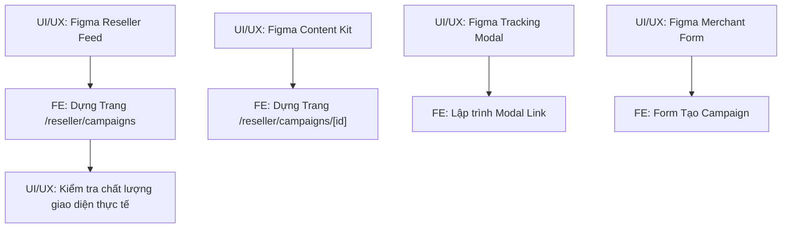

# MY WORK PLAN — UIUX_W2
**Project:** AI Travel Reseller MVP (TravelLink AI)  
**Week:** Tuần 2 (12/10/2026 – 16/10/2026) — Sprint 2  
**Member:** UI/UX Designer (Design Lead)  
**Role:** UI/UX Designer & Product Design  
**Current Milestone:** AI CONTENT FACTORY & DISTRIBUTION (Sinh nội dung & Phân phối)  
**Deadline:** 12:00 PM Thứ Sáu (16/10/2026); Cross-testing & Demo: 13:30 – 17:30 ngày 16/10/2026  
**Artifacts:** Figma UI Kit, Hi-fi Mockups, Design Tokens, Asset Package  

---

## 1. Context
- Kế thừa thành quả Tuần 1: Ngôn ngữ thiết kế "Coastal Editorial", bộ bảng màu nhận diện (Ocean Deep, Sand/Warm Canvas, Sunset Coral), typography (Lora + Be Vietnam Pro) và bố cục Merchant Portal đã được định hình và triển khai thành công trên giao diện thật.
- Trọng tâm Tuần 2: Mở rộng thiết kế sang phân hệ **Reseller Portal**: Bảng tin chiến dịch du lịch, Thư viện bài đăng tiếp thị do AI sinh ra (Suggested Content Kit), Modal tương tác nhận Tracking Link cá nhân hóa (Copy 1-click, QR code) và Form tạo chiến dịch dành cho Merchant.
- Nguồn tham chiếu: PRD v1.0, [Roadmap.md](file:///E:/Tue/MyProject/AITravelReseller/ai-travel-reseller/.ai/process/Roadmap.md), [Week2.md](file:///E:/Tue/MyProject/AITravelReseller/ai-travel-reseller/.ai/process/Week2/Week2.md), [WEEK1_SUMMARY.md](file:///E:/Tue/MyProject/AITravelReseller/ai-travel-reseller/.ai/process/Week1/WEEK1_SUMMARY.md).

---

## 2. Executive Summary
Trong Tuần 2, UI/UX chịu trách nhiệm hoàn thiện trải nghiệm thị giác và tương tác:
1. Thiết kế bản vẽ Hi-fi trên Figma cho Reseller Campaign Feed: Card chiến dịch bắt mắt, hiển thị mức hoa hồng hấp dẫn và nút hành động nhanh.
2. Thiết kế Suggested Content Kit: Tổ chức dạng Tab trực quan theo 4 Personas (Local Guide, Family, Foodie, Budget Traveler), bố cục thẻ Hook/Script/Caption tối ưu cho thao tác copy.
3. Thiết kế Modal nhận Tracking Link tiếp thị cá nhân hóa: Bố cục gọn gàng, hiển thị short URL, QR Code và nút Copy nổi bật.
4. Thiết kế Form tạo Campaign cho Merchant: Đơn giản, rõ ràng, giúp Merchant khởi tạo chiến dịch chỉ trong 3 bước.

---

## 3. TODAY — MUST DO (Thứ Hai 12/10/2026)
| Priority | Task | Why | Dependency | Output | Estimated Effort |
|---|---|---|---|---|---|
| P0 | Họp Kick-off Sprint 2 & Chốt các trường thông tin hiển thị trên Feed | Đồng bộ dữ liệu với BE1/FE | Team | UX Field Matrix | 1h |
| P0 | Hoàn thiện và bàn giao bản vẽ Hi-fi Reseller Feed trên Figma | Để FE có bản vẽ bắt tay vào code ngay chiều Thứ Hai | None | Link Figma Reseller Feed | 3h |
| P1 | Thiết kế sơ bộ giao diện Suggested Content Kit | Định hình cách hiển thị 4 Personas bài viết | None | Wireframe Content Kit | 2h |

---

## 4. THIS WEEK — MY TASKS
| ID | Task | Priority | Status | Dependency | Owner | Deliverable | Deadline |
|---|---|---|---|---|---|---|---|
| UX-W2-01 | Thiết kế Hi-fi Reseller Campaign Feed (`/reseller/campaigns`) | P0 | READY | Design System W1 | UI/UX | Figma Mockup Feed | 12/10 12:00 |
| UX-W2-02 | Thiết kế Thư viện bài viết Suggested Content Kit theo 4 Personas | P0 | READY | UX-W2-01 | UI/UX | Figma Content Kit | 13/10 12:00 |
| UX-W2-03 | Thiết kế Modal Lấy Tracking Link (Link copy, QR code, toast state) | P1 | READY | UX-W2-02 | UI/UX | Figma Tracking Modal | 13/10 17:00 |
| UX-W2-04 | Thiết kế luồng Form tạo Campaign cho Merchant Portal | P1 | READY | Schema BE1 | UI/UX | Figma Merchant Form | 14/10 12:00 |
| UX-W2-05 | Xuất Design Tokens, Icons, Assets đồ họa cho FE | P1 | READY | UX-W2-01, 02 | UI/UX | Folder assets SVG/PNG | 14/10 17:00 |
| UX-W2-06 | Review trải nghiệm thực tế trên màn hình do FE triển khai | P1 | READY | FE code | UI/UX | UX Audit Report | 15/10 17:00 |

---

## 5. TASK BREAKDOWN

### TASK UX-W2-01 — Thiết Kế Reseller Campaign Feed
**Goal:** Tạo ra bảng tin chiến dịch thu hút, giúp KOC/Reseller lướt xem và muốn chọn tour để bán ngay từ cái nhìn đầu tiên.  
**Elements:**
- Header: Lời chào cá nhân hóa, tổng quan chiến dịch đang diễn ra.
- Filter Bar: Nút bấm phân loại theo địa danh (Đà Nẵng, Hội An, Bà Nà), mức hoa hồng cao (>15%), tour mới nhất.
- Campaign Card:
  * Ảnh đại diện tour sắc nét tỉ lệ 16:9.
  * Tên tour và địa điểm kèm icon ghim vị trí.
  * Badge mức hoa hồng nổi bật màu cam đất (`Sunset Coral` / `#d96b43`): Ví dụ: `Hoa hồng 15% (135.000đ/vé)`.
  * Nút CTA chính: "Xem bài đăng & Lấy link tiếp thị".  
**Definition of Done:** File Figma hoàn chỉnh 2 phiên bản Desktop (1440px) và Mobile (390px), có specs đo lường khoảng cách chính xác.  
**Handoff To:** FE (lập trình giao diện).

---

### TASK UX-W2-02 — Thiết Kế Thư Viện Bài Viết Suggested Content Kit
**Goal:** Trình bày danh sách bài viết do AI sinh ra sao cho người dùng dễ đọc, dễ chọn lọc và thao tác copy nhanh nhất trên điện thoại.  
**Elements:**
- Tab Bar: 4 Persona du lịch phân biệt bằng icon sinh động:
  * 🗺️ Chuyên gia bản địa (Local Guide)
  * 👨‍👩‍👧 Gia đình (Family)
  * 📸 Tín đồ ẩm thực & Check-in (Foodie)
  * 💡 Săn deal thông thái (Budget Traveler)
- Card nội dung:
  * Phần Hook (Mở đầu): Chữ to, in đậm, kèm nút icon "Sao chép".
  * Phần Script/Caption: Box chữ có thể cuộn, chia đoạn thoáng mắt, kèm nút "Sao chép toàn bộ".
  * Phần CTA: Highlight đoạn kêu gọi hành động kèm vị trí gắn link.
- Trạng thái thông báo: Hiển thị tooltip/toast nhỏ gọn "Đã copy!" ngay tại vị trí ngón tay bấm.  
**Definition of Done:** Bản vẽ Figma thể hiện đầy đủ trạng thái default, hover, active và copied của từng nút.  
**Handoff To:** FE (lập trình chi tiết chiến dịch).

---

## 6. DEPENDENCY MAP


---

## 7. BLOCKERS
| Blocker | Tôi cần gì | Người phụ trách | Deadline | Impact |
|---|---|---|---|---|
| Danh sách trường dữ liệu Campaign | Chốt các trường bắt buộc phải có khi Merchant tạo chiến dịch | PM / BE1 | 12/10 10:00 | Chưa chốt form nhập liệu |

---

## 8. TEAM HANDOFF
| From | To | Deliverable | Format | Deadline | Status |
|---|---|---|---|---|---|
| UI/UX | FE | Figma Hi-fi Reseller Feed & Design Specs | Link Figma | 12/10 12:00 | READY |
| UI/UX | FE | Figma Content Kit & Tracking Modal | Link Figma | 13/10 12:00 | READY |
| UI/UX | FE | Asset package (Icons, SVG đồ họa, Illustration) | File SVG/PNG | 14/10 17:00 | READY |
| UI/UX | FE + PM | Bản đánh giá UX và danh sách góp ý giao diện | Markdown checklist | 15/10 17:00 | PLANNED |

---

## 9. TEAM CONFLICT CHECK
- 🔴 **Conflict:** Không có. UI/UX là Primary Owner của toàn bộ thiết kế giao diện, trải nghiệm người dùng và Design System.
- 🟡 **Potential Conflict:** Kích thước hiển thị trên màn hình điện thoại nhỏ (320px): Đảm bảo các thẻ bài viết không bị tràn viền và nút Copy đủ lớn để chạm dễ dàng trên mobile.
- 🟢 **No Conflict:** Tiếp tục kế thừa trung thành phong cách "Coastal Editorial" đã được duyệt ở Tuần 1.

---

## 10. INTERFACE CHECK
| Interface | Tôi | Người liên quan | Cần chốt | Status |
|---|---|---|---|---|
| Campaign Card Specs | Owner | FE (Implementer) | Kích thước ảnh, vị trí badge hoa hồng, kích thước chữ | PROPOSED |
| Copy Kit Layout | Owner | FE (Implementer) | Cách tổ chức tab persona và vị trí hiển thị toast | PROPOSED |

---

## 11. OUT OF SCOPE
- Thiết kế video motion / animation phức tạp.
- Thiết kế giao diện mobile app native (Flutter/React Native).
- Thiết kế ứng dụng cho đồng hồ thông minh hoặc tablet chuyên dụng.

---

## 12. END-OF-DAY UPDATE (Mẫu nhật ký)
```text
DONE:
- ...
IN PROGRESS:
- ...
BLOCKED:
- ...
HANDOFF:
- ...
NEXT:
- ...
```

---

## 13. END-OF-WEEK CHECKLIST
- [ ] Figma Reseller Campaign Feed bàn giao đúng hạn lúc 12:00 Thứ Hai
- [ ] Figma Suggested Content Kit và Tracking Modal bàn giao đúng hạn lúc 12:00 Thứ Ba
- [ ] Xuất đầy đủ assets và thông số cho FE
- [ ] Rà soát giao diện do FE triển khai trên trình duyệt thực tế
- [ ] Tham gia phiên nghiệm thu và demo chiều Thứ Sáu (16/10/2026)
