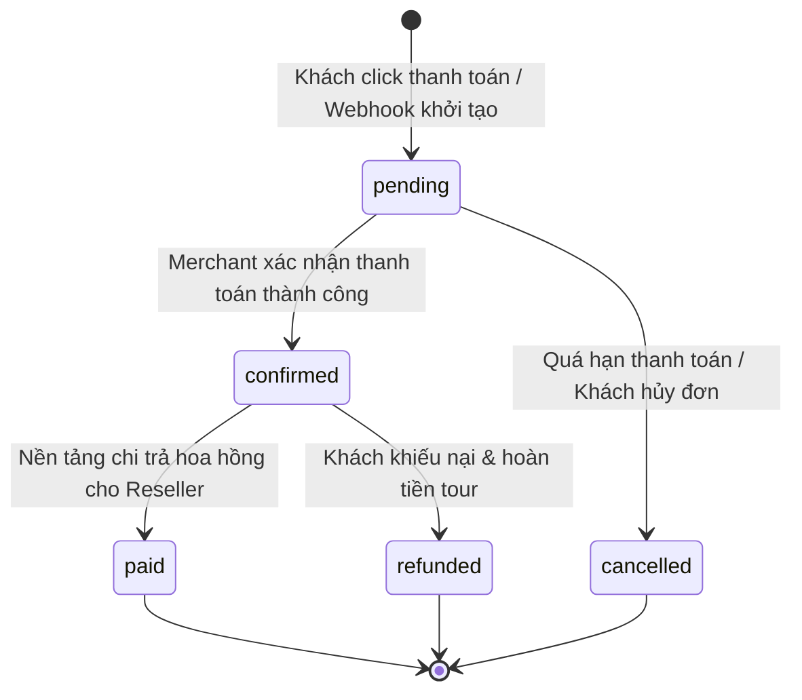

# ĐẶC TẢ NGHIỆP VỤ: LUỒNG THƯƠNG MẠI, ĐƠN HÀNG & CƠ CHẾ HOA HỒNG
**Project:** AI Travel Reseller MVP (TravelLink AI)  
**Milestone:** COMMERCE FLOW & AI SALES AGENT (Tuần 3)  
**Tác giả:** Business Analyst (BA Lead)  
**Tài liệu tham chiếu:** [Roadmap.md](file:///E:/Tue/MyProject/AITravelReseller/ai-travel-reseller/.ai/process/Roadmap.md), [DATA_SCHEMA.md](file:///E:/Tue/MyProject/AITravelReseller/ai-travel-reseller/.ai/role/DATA_SCHEMA.md), [RULE_BOOK.md](file:///E:/Tue/MyProject/AITravelReseller/ai-travel-reseller/.ai/role/RULE_BOOK.md)  
**Đối tượng sử dụng chính:** Backend 1 (BE1), Frontend (FE), UI/UX Designer, Tester 3 (System QA), Project Manager (PM)  

---

## 1. TỔNG QUAN BÀI TOÁN KINH DOANH (BUSINESS CONTEXT)

Trong chuỗi giá trị của TravelLink AI:
`Merchant (Cung cấp Tour)` → `AI Content Factory` → `Reseller (Phân phối)` → `Customer (Click link & Chat bot)` → **`Official Checkout (Thanh toán)`** → **`Ghi nhận Đơn hàng & Hoa hồng`**.

### 1.1 Nguyên tắc bất di bất dịch (Core Constraints)
1. **Nền tảng KHÔNG giữ tiền của khách hàng (Non-custodial Payment):**
   - Mọi giao dịch tài chính mua vé/tour diễn ra trực tiếp trên cổng thanh toán chính thức của Merchant (`products.payment_url` hoặc `booking_url`).
   - Nền tảng TravelLink AI chỉ đóng vai trò ghi nhận nguồn giới thiệu (Attribution), lưu trữ đơn hàng (`orders`) và tính toán nghĩa vụ hoa hồng giữa Merchant và Reseller.
2. **Minh bạch số liệu (Transparency):**
   - Reseller phải nhìn thấy rõ ràng: Bao nhiêu lượt click, bao nhiêu lượt chat, bao nhiêu đơn hàng thành công và số tiền hoa hồng thực nhận.
   - Merchant phải đối soát được: Đơn hàng nào đến từ Reseller nào, mã đặt chỗ (`booking_reference`) tương ứng trên hệ thống của Merchant.

---

## 2. NGUYÊN TẮC GHI NHẬN NGUỒN (ATTRIBUTION RULES)

### 2.1 Cửa sổ ghi nhận (Attribution Window)
- Thời hạn hiệu lực: **30 ngày** (30 Calendar Days) tính từ thời điểm khách hàng click vào link tiếp thị hoặc tương tác với AI Sales Agent lần cuối cùng.
- Nếu khách click link ngày 01/10 và thanh toán vào ngày 25/10 → Đơn hàng **vẫn được tính hoa hồng**.
- Nếu khách thanh toán sau ngày thứ 31 → Đơn hàng không còn được gán cho Reseller (Hết hạn).

### 2.2 Mô hình ghi nhận (Attribution Model)
- Áp dụng mô hình: **Last-Touch Attribution (Click cuối cùng được hưởng hoa hồng)**.
- *Ví dụ thực tế:*
  - Ngày 1: Khách hàng click link của **Reseller A**.
  - Ngày 5: Khách hàng lướt TikTok thấy bài của **Reseller B**, click vào link của Reseller B và chat với AI.
  - Ngày 6: Khách hoàn tất mua vé trên trang Merchant.
  - **Kết luận:** Toàn bộ hoa hồng của đơn hàng thuộc về **Reseller B**. Mã attribution của Reseller A bị ghi đè.

### 2.3 Cơ chế lưu vết (Tracking Mechanism)
- Khi khách hàng truy cập qua short link `/r/[code]`:
  - Hệ thống giải mã ra bộ 3 UUID: `reseller_id`, `campaign_id`, `product_id`.
  - Thiết lập Cookie phía trình duyệt:
    - Tên Cookie: `travellink_attr`
    - Giá trị: `{ "r": "reseller_id", "c": "campaign_id", "p": "product_id", "ts": 1729312000 }`
    - Cấu hình: `Max-Age=2592000` (30 ngày), `SameSite=Lax`, `Path=/`, `HttpOnly=false` (để Client component đọc được khi mở widget chat).
  - Khi chuyển hướng sang trang thanh toán của Merchant (`payment_url`), hệ thống gắn kèm query parameters chuẩn:
    `?ref=[reseller_id]&campaign=[campaign_id]&product=[product_id]&click_id=[click_uuid]`

---

## 3. CÔNG THỨC TOÁN HỌC TÍNH TOÁN HOA HỒNG (COMMISSION MATH)

Hệ thống hỗ trợ cơ chế phân chia hoa hồng tự động dựa trên tỷ lệ thỏa thuận trong bảng `campaigns`:

### 3.1 Các biến số đầu vào
- `order_amount`: Tổng giá trị đơn hàng thực tế khách đã thanh toán (VNĐ).
- `campaign_commission_rate`: Tỷ lệ hoa hồng chiến dịch do Merchant cam kết (% - ví dụ: 15.0%).
- `platform_fee_rate`: Tỷ lệ phí nền tảng TravelLink AI (Mặc định: 20% trích từ tổng tiền hoa hồng, hoặc 0% nếu Merchant trả phí cố định).

### 3.2 Công thức tính toán chuẩn
```text
1. Tổng hoa hồng Merchant phải chi trả (Gross Commission):
   gross_commission = ROUND(order_amount * (campaign_commission_rate / 100))

2. Phí dịch vụ nền tảng (Platform Revenue):
   platform_fee = ROUND(gross_commission * 0.20)

3. Hoa hồng thực nhận của Reseller (Reseller Net Earning):
   reseller_commission = gross_commission - platform_fee
```

### 3.3 Ví dụ minh họa thực tế
- Khách hàng mua **2 vé Cáp treo Bà Nà Hills + Buffet**:
  - `order_amount` = 2 x 900.000 VNĐ = **1.800.000 VNĐ**.
  - `campaign_commission_rate` = **15%**.
  - `gross_commission` = 1.800.000 x 15% = **270.000 VNĐ**.
  - `platform_fee` (20%) = 270.000 x 20% = **54.000 VNĐ**.
  - `reseller_commission` (80%) = 270.000 - 54.000 = **216.000 VNĐ**.
- *Quy tắc làm tròn:* Toàn bộ số tiền hoa hồng được làm tròn đến hàng đơn vị (VNĐ), không lưu số thập phân lẻ để tránh sai số kế toán.

---

## 4. VÒNG ĐỜI VÀ TRẠNG THÁI ĐƠN HÀNG (ORDER STATE MACHINE)

Bảng `orders` được quản lý chặt chẽ qua máy trạng thái (State Machine) sau:



### 4.1 Chi tiết các trạng thái (Statuses)
| Trạng thái | Ý nghĩa nghiệp vụ | Tác động đến Hoa hồng Reseller |
|---|---|---|
| `pending` | Đơn hàng vừa được tạo trên cổng thanh toán, đang chờ tiền về tài khoản Merchant. | Hiển thị ở mục **"Hoa hồng tạm tính / Chờ duyệt"**. Chưa được rút. |
| `confirmed` | Khách đã thanh toán thành công, vé/tour đã phát hành. | Chuyển sang mục **"Hoa hồng khả dụng / Đã duyệt"**. |
| `paid` | Kỳ đối soát hoàn tất, tiền hoa hồng đã được chuyển khoản tới ngân hàng của Reseller. | Chuyển sang mục **"Hoa hồng đã chi trả"**. |
| `cancelled` | Khách không thanh toán hoặc hủy trước giờ quy định. | Hoa hồng tạm tính bị hủy (về 0). |
| `refunded` | Khách đi tour không hài lòng hoặc sự cố thời tiết, Merchant hoàn tiền lại cho khách. | Trừ lại số tiền hoa hồng tương ứng trong kỳ đối soát gần nhất. |

---

## 5. CƠ CHẾ TIẾP NHẬN DỮ LIỆU ĐƠN HÀNG (ORDER INGESTION PIPELINE)

Để đáp ứng tính linh hoạt trong giai đoạn MVP với các Merchant du lịch tại Đà Nẵng / Hội An, hệ thống hỗ trợ 2 phương thức tiếp nhận đơn hàng:

### Phương thức 1: Webhook tự động (Dành cho Merchant có hệ thống Booking API)
- Merchant cấu hình Webhook bắn về TravelLink AI khi có đơn thanh toán thành công.
- **Endpoint:** `POST /api/webhooks/orders`
- **Headers:** `X-Merchant-Secret-Key: [secret_token]`
- **Request Payload:**
```json
{
  "event": "order.completed",
  "merchant_id": "11111111-1111-1111-1111-111111111111",
  "booking_reference": "BNH-20261019-9821",
  "product_id": "33333333-3333-3333-3333-333333333333",
  "campaign_id": "44444444-4444-4444-4444-444444444444",
  "reseller_id": "22222222-2222-2222-2222-111111111111",
  "click_id": "optional-click-uuid",
  "order_amount": 1800000,
  "currency": "VND",
  "customer_name": "Nguyễn Văn A",
  "customer_phone": "0905123456",
  "paid_at": "2026-10-19T14:30:00Z"
}
```
- **Xử lý Backend:**
  1. Xác thực `merchant_id` và secret key.
  2. Kiểm tra trùng lặp `booking_reference` (chống ghi nhận trùng đơn).
  3. Lấy `commission_rate` từ chiến dịch để tính `commission_amount`.
  4. Ghi vào bảng `orders` với trạng thái `confirmed`.
  5. Kích hoạt trigger thông báo n8n cho Reseller.

### Phương thức 2: Nhập & Khớp Mã Đặt Chỗ Thủ Công (Manual Reconciliation - Fallback MVP)
- Áp dụng khi Merchant là đơn vị du lịch truyền thống chưa có Webhook API.
- **Giao diện Merchant Portal (`/merchant/orders`):**
  - Merchant tải lên danh sách file Excel hoặc nhập trực tiếp: `Mã đặt chỗ (Booking Code)`, `Số tiền`, `Mã giới thiệu (Ref code)`.
  - Hệ thống tự động so khớp `ref code` với `reseller_id` tương ứng và chuyển đơn hàng sang `confirmed`.

---

## 6. ĐỀ XUẤT CẬP NHẬT DATABASE SCHEMA (CHO BE1)

Để phục vụ đầy đủ luồng tính hoa hồng, bảng `orders` cần bổ sung một số cột nghiệp vụ:

```sql
-- Đề xuất migration bổ sung cho bảng orders (BE1 triển khai)
ALTER TABLE public.orders 
ADD COLUMN IF NOT EXISTS gross_commission NUMERIC DEFAULT 0,
ADD COLUMN IF NOT EXISTS platform_fee NUMERIC DEFAULT 0,
ADD COLUMN IF NOT EXISTS reseller_commission NUMERIC DEFAULT 0,
ADD COLUMN IF NOT EXISTS customer_name VARCHAR,
ADD COLUMN IF NOT EXISTS customer_phone VARCHAR,
ADD COLUMN IF NOT EXISTS paid_at TIMESTAMP,
ADD COLUMN IF NOT EXISTS flag_self_purchase BOOLEAN DEFAULT FALSE,
ADD COLUMN IF NOT EXISTS notes TEXT;

-- Index hỗ trợ truy vấn báo cáo Reseller & Merchant
CREATE INDEX IF NOT EXISTS idx_orders_reseller_status ON public.orders(reseller_id, status);
CREATE INDEX IF NOT EXISTS idx_orders_merchant_status ON public.orders(merchant_id, status);
CREATE INDEX IF NOT EXISTS idx_orders_booking_ref ON public.orders(booking_reference);
```

---

## 7. YÊU CẦU GIAO DIỆN VÀ TRẢI NGHIỆM NGƯỜI DÙNG (CHO UI/UX & FE)

### 7.1 Reseller Commission Dashboard (`/reseller/commissions`)
- **Top Metrics (KPI Bar):**
  - 💰 **Tổng thu nhập tích lũy:** Tổng hoa hồng của các đơn `paid` + `confirmed`.
  - ⏳ **Hoa hồng chờ đối soát:** Tổng hoa hồng của các đơn `pending`.
  - 🎯 **Tỷ lệ chuyển đổi (CR):** `(Tổng số đơn / Tổng lượt clicks) * 100%`.
  - 🏷️ **Giá trị đơn trung bình (AOV):** `Tổng doanh thu đơn hàng / Số đơn hàng`.
- **Bộ lọc đa năng:** Lọc theo khoảng ngày (Hôm nay, 7 ngày qua, Tháng này), Lọc theo Trạng thái, Lọc theo Chiến dịch.
- **Bảng chi tiết:**
  - Cột: Ngày đặt | Mã đặt chỗ (Che 3 số giữa: `BNH-***-9821`) | Tour | Giá trị đơn | % Hoa hồng | Tiền hoa hồng | Trạng thái (Badge màu: Xanh lá cho Confirmed, Vàng cho Pending, Xanh dương cho Paid, Đỏ cho Cancelled).

### 7.2 Merchant Order Management (`/merchant/orders`)
- Danh sách đơn hàng phát sinh từ mạng lưới Reseller.
- Thao tác: Nút "Xác nhận đã thanh toán", "Báo hủy/hoàn tiền" kèm lý do.
- Thống kê tổng tiền hoa hồng phải trả cho Reseller trong kỳ.

---

## 8. CHỐNG GIAN LẬN THƯƠNG MẠI (ANTI-FRAUD RULES - CHO TESTER 3)
1. **Self-Referral Check:** Nếu phát hiện Reseller tự click link của chính mình rồi dùng tài khoản/số điện thoại của mình để đặt đơn nhằm gian lận chỉ tiêu hoa hồng thưởng → Gán cờ `flag_self_purchase = true` để Admin xét duyệt thủ công.
2. **Duplicate Order Protection:** Cùng một `booking_reference` chỉ được phép ghi nhận đúng 1 lần duy nhất trong bảng `orders`.
3. **Refund Clawback:** Nếu đơn hàng bị hoàn tiền sau khi đã xác nhận `confirmed`, hệ thống tự động tạo bản ghi điều chỉnh âm (`-reseller_commission`) vào kỳ đối soát tiếp theo.
