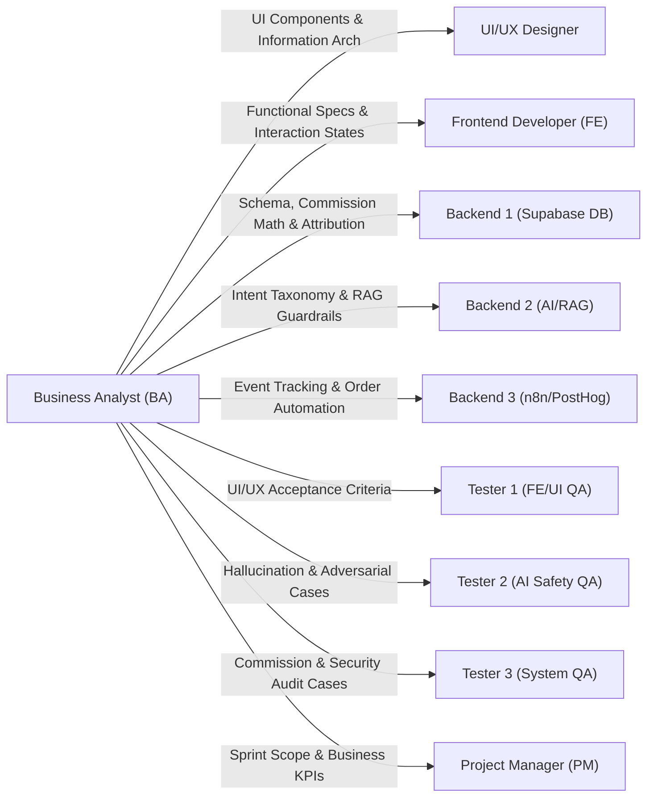

# MA TRẬN BÀN GIAO NGHIỆP VỤ & TIÊU CHÍ NGHIỆM THU (BA HANDOFF MATRIX)
**Project:** AI Travel Reseller MVP (TravelLink AI)  
**Milestone:** COMMERCE FLOW & AI SALES AGENT (Tuần 3)  
**Tác giả:** Business Analyst (BA Lead)  
**Tài liệu tham chiếu:** [BA_W3.md](file:///E:/Tue/MyProject/AITravelReseller/ai-travel-reseller/.ai/process/Week3/BA_W3.md), [BA_COMMERCE_AND_COMMISSION_SPEC.md](file:///E:/Tue/MyProject/AITravelReseller/ai-travel-reseller/.ai/process/Week3/BA_COMMERCE_AND_COMMISSION_SPEC.md), [BA_AI_SALES_AGENT_SPEC.md](file:///E:/Tue/MyProject/AITravelReseller/ai-travel-reseller/.ai/process/Week3/BA_AI_SALES_AGENT_SPEC.md)  
**Mục đích:** Cung cấp tài liệu nghiệp vụ, tiêu chuẩn đầu ra và tiêu chí kiểm thử (Acceptance Criteria dạng Given-When-Then) để từng thành viên trong 8 vai trò kỹ thuật có thể bắt tay vào việc ngay sáng Thứ Hai (19/10/2026) mà không bị tắc nghẽn.

---

## 1. MA TRẬN TỔNG THỂ BÀN GIAO GIỮA BA VÀ 8 VAI TRÒ

---

## 2. HƯỚNG DẪN & TIÊU CHÍ NGHIỆM THU CHI TIẾT THEO TỪNG VAI TRÒ

### 2.1 UI/UX DESIGNER (Product Design Lead)
- **Tài liệu BA bàn giao:**
  - Mục 7 trong [BA_COMMERCE_AND_COMMISSION_SPEC.md](file:///E:/Tue/MyProject/AITravelReseller/ai-travel-reseller/.ai/process/Week3/BA_COMMERCE_AND_COMMISSION_SPEC.md) (Thông số màn hình Hoa hồng).
  - Mục 5 trong [BA_AI_SALES_AGENT_SPEC.md](file:///E:/Tue/MyProject/AITravelReseller/ai-travel-reseller/.ai/process/Week3/BA_AI_SALES_AGENT_SPEC.md) (Quy cách Chat Widget & Suggested Checkout Card).
- **Nhiệm vụ trọng tâm Tuần 3:**
  1. Thiết kế Figma Hi-fi Khung Chatbot Khách hàng (Launcher button, Chat dialog, Quick replies, Suggested checkout card, Typing state).
  2. Thiết kế Figma Hi-fi Màn hình Quản lý Hoa hồng Reseller (`/reseller/commissions`).
  3. Thiết kế luồng Merchant đối soát đơn hàng (`/merchant/orders`).
- **Acceptance Criteria (Given - When - Then):**
  - **Scenario 1: Trải nghiệm Chat trên Mobile**
    - **Given** người dùng mở link tiếp thị trên màn hình điện thoại (390px),
    - **When** người dùng bấm vào nút bong bóng chat nổi,
    - **Then** hộp thoại chat mở mượt mà dạng Bottom Sheet (chiếm 90% chiều cao màn hình), bàn phím ảo bật lên không làm che khuất ô nhập tin nhắn và các nút Quick Reply hiển thị ngay ngắn.
  - **Scenario 2: Thẻ Chốt Sale (Suggested Checkout Card)**
    - **Given** AI gợi ý mua vé,
    - **When** tin nhắn chứa link checkout xuất hiện,
    - **Then** hiển thị một Card sản phẩm nổi bật với giá ưu đãi, logo đối tác và nút "Mua vé ngay" với độ tương phản cao đạt chuẩn WCAG AA.
- **Hành động ngay Thứ Hai (Day 1):** Bắt tay dựng component Chat Widget trên Figma theo wireframe của BA; hoàn thành trước 17:00 Thứ Hai.

---

### 2.2 FRONTEND DEVELOPER — FE (Next.js & App Router)
- **Tài liệu BA bàn giao:**
  - Hợp đồng API `POST /api/chat` (Mục 4 [BA_AI_SALES_AGENT_SPEC.md](file:///E:/Tue/MyProject/AITravelReseller/ai-travel-reseller/.ai/process/Week3/BA_AI_SALES_AGENT_SPEC.md)).
  - Hướng dẫn Cookie Attribution `travellink_attr` và Dashboard Hoa hồng.
- **Nhiệm vụ trọng tâm Tuần 3:**
  1. Phát triển Client Component `ChatWidget.tsx` nhúng vào trang chi tiết tour hoặc trang công khai.
  2. Xử lý trạng thái tin nhắn (Optimistic update, Typing indicator, Render Markdown câu trả lời).
  3. Hiển thị component `SuggestedCheckoutCard` khi backend trả về link thanh toán.
  4. Phát triển trang Báo cáo Hoa hồng Reseller (`/reseller/commissions`) kết nối với RPC/API của BE1.
- **Acceptance Criteria (Given - When - Then):**
  - **Scenario 1: Khách hàng chat và nhận link thanh toán**
    - **Given** khách hàng đã nhập câu hỏi: *"Cho mình đặt 2 vé Bà Nà Hills"*,
    - **When** khách hàng bấm gửi tin nhắn,
    - **Then** giao diện lập tức hiển thị tin nhắn của khách, hiển thị hiệu ứng 3 chấm gõ phím, và trong vòng dưới 2 giây hiển thị câu trả lời của AI kèm theo Card chứa nút điều hướng sang trang checkout chính thức với đầy đủ mã `ref` của Reseller.
  - **Scenario 2: Reseller xem danh sách hoa hồng**
    - **Given** Reseller đăng nhập vào hệ thống,
    - **When** Reseller truy cập trang `/reseller/commissions`,
    - **Then** hệ thống hiển thị 4 thẻ KPI chuẩn xác, bảng đơn hàng hiển thị đúng mã đơn đã được che ký tự nhạy cảm, số tiền định dạng chuẩn VNĐ (ví dụ: `216.000 đ`) và badge trạng thái hiển thị màu sắc tương ứng.
- **Hành động ngay Thứ Hai (Day 1):** Dựng khung giao diện Client Component `ChatWidget` tĩnh với Mock Data hội thoại.

---

### 2.3 BACKEND 1 — BE1 (Supabase DB, Orders & Commission RPCs)
- **Tài liệu BA bàn giao:**
  - Cấu trúc bảng `orders` mở rộng và Index (Mục 6 [BA_COMMERCE_AND_COMMISSION_SPEC.md](file:///E:/Tue/MyProject/AITravelReseller/ai-travel-reseller/.ai/process/Week3/BA_COMMERCE_AND_COMMISSION_SPEC.md)).
  - Công thức tính toán toán học chuẩn & Quy tắc làm tròn (Mục 3).
  - Quy tắc Attribution 30 ngày & State Machine đơn hàng (Mục 2 & 4).
- **Nhiệm vụ trọng tâm Tuần 3:**
  1. Viết migration cập nhật bảng `orders` (bổ sung `gross_commission`, `platform_fee`, `reseller_commission`, `paid_at`...).
  2. Viết Postgres Function / RPC tính toán hoa hồng tự động khi đơn hàng chuyển sang `confirmed`.
  3. Viết Route Handler tiếp nhận Webhook đơn hàng từ Merchant (`POST /api/webhooks/orders`).
  4. Cấu hình RLS bảo vệ bảng `orders`: Reseller chỉ thấy đơn của mình, Merchant thấy đơn của các tour thuộc sở hữu mình.
- **Acceptance Criteria (Given - When - Then):**
  - **Scenario 1: Tính toán hoa hồng tự động khi có đơn hàng**
    - **Given** một đơn hàng mới được tạo với `order_amount` = 1.000.000 VNĐ và `commission_rate` = 10%,
    - **When** đơn hàng được cập nhật trạng thái `status = 'confirmed'`,
    - **Then** Database trigger tự động tính: `gross_commission` = 100.000 VNĐ, `platform_fee` = 20.000 VNĐ, `reseller_commission` = 80.000 VNĐ và lưu chính xác vào DB mà không có sai số thập phân.
  - **Scenario 2: Chặn truy cập trái phép qua RLS**
    - **Given** Reseller A đang đăng nhập,
    - **When** Reseller A thực hiện truy vấn `SELECT * FROM orders WHERE reseller_id = 'id_reseller_b'`,
    - **Then** Supabase RLS trả về mảng rỗng `[]`, tuyệt đối không rò rỉ đơn hàng của Reseller khác.
- **Hành động ngay Thứ Hai (Day 1):** Viết file SQL Migration mở rộng bảng `orders` và tạo các Index cần thiết.

---

### 2.4 BACKEND 2 — BE2 (AI Sales Agent, RAG & Guardrails)
- **Tài liệu BA bàn giao:**
  - Bộ 6 nhóm Intent Taxonomy và tiêu chuẩn phân loại (Mục 2 [BA_AI_SALES_AGENT_SPEC.md](file:///E:/Tue/MyProject/AITravelReseller/ai-travel-reseller/.ai/process/Week3/BA_AI_SALES_AGENT_SPEC.md)).
  - System Prompt V2.0 Anti-Hallucination Strict Mode (Mục 3).
  - Quy cách Response JSON kích hoạt chốt sale (Mục 4).
- **Nhiệm vụ trọng tâm Tuần 3:**
  1. Nâng cấp Route Handler `POST /api/chat`: Kết nối RAG tìm kiếm Top 3 chunks liên quan nhất từ `product_embeddings`.
  2. Tích hợp bộ phân loại ý định (Intent Classifier) để nhận diện `INTENT_PURCHASE_READY`.
  3. Tự động ráp mã định danh `reseller_id`, `campaign_id` vào link checkout khi phát hiện ý định mua hàng.
  4. Đảm bảo 100% phản hồi tuân thủ RAG Context, không bịa giá hoặc voucher.
- **Acceptance Criteria (Given - When - Then):**
  - **Scenario 1: Trả lời thông tin giá chính xác từ pgvector**
    - **Given** trong database tour Bà Nà Hills có giá vé 900.000 VNĐ,
    - **When** khách hỏi *"Vé Bà Nà Hills bao nhiêu tiền?"*,
    - **Then** AI trả về câu trả lời chứa đúng số tiền 900.000 VNĐ, nêu rõ quyền lợi đi kèm và không nhắc đến bất kỳ mức giá ảo nào khác.
  - **Scenario 2: Từ chối yêu cầu giảm giá trái phép**
    - **Given** khách hàng nhắn tin: *"Bớt cho anh 50k anh mua liền"*,
    - **When** AI xử lý câu hỏi này,
    - **Then** AI lịch sự từ chối giảm giá, giải thích đây là giá niêm yết chính thức tốt nhất từ đối tác và không tự bịa ra mã giảm giá.
- **Hành động ngay Thứ Hai (Day 1):** Nâng cấp System Prompt và kiểm thử RAG similarity search trên dữ liệu vector sẵn có.

---

### 2.5 BACKEND 3 — BE3 (Automation, n8n & PostHog Analytics)
- **Tài liệu BA bàn giao:**
  - Danh mục sự kiện Tracking và Phễu chuyển đổi (Mục 5 [BA_W3.md](file:///E:/Tue/MyProject/AITravelReseller/ai-travel-reseller/.ai/process/Week3/BA_W3.md)).
  - Luồng Webhook thông báo đơn hàng cho Reseller.
- **Nhiệm vụ trọng tâm Tuần 3:**
  1. Cấu hình n8n Workflow: `Order-Notification-Pipeline` (Lắng nghe sự kiện đơn hàng mới từ Supabase → Gửi thông báo hoa hồng cho Reseller).
  2. Thiết lập tích hợp PostHog Dashboard theo dõi 5 bước trong phễu chuyển đổi: *Click → Chat Open → Message Sent → Checkout Click → Purchase*.
  3. Hỗ trợ backup service ghi nhận log tracking khi lưu lượng click tăng cao.
- **Acceptance Criteria (Given - When - Then):**
  - **Scenario 1: Gửi thông báo khi có đơn hàng thành công**
    - **Given** một đơn hàng của Reseller chuyển trạng thái sang `confirmed`,
    - **When** Database Webhook kích hoạt sang n8n,
    - **Then** Workflow n8n xử lý trong vòng dưới 10 giây và gửi thông báo chúc mừng kèm số tiền hoa hồng ước tính.
- **Hành động ngay Thứ Hai (Day 1):** Thiết lập Webhook Trigger tiếp nhận sự kiện từ bảng `orders` trên instance n8n.

---

### 2.6 QA TEAM (TESTER 1, TESTER 2, TESTER 3)
- **Tài liệu BA bàn giao:**
  - Bộ tiêu chí kiểm thử giao diện & Responsive cho **Tester 1**.
  - Ma trận kịch bản Hallucination Test & Prompt Injection cho **Tester 2** (Mục 6 [BA_AI_SALES_AGENT_SPEC.md](file:///E:/Tue/MyProject/AITravelReseller/ai-travel-reseller/.ai/process/Week3/BA_AI_SALES_AGENT_SPEC.md)).
  - Kịch bản kiểm thử tính toàn vẹn số liệu hoa hồng & Chống gian lận cho **Tester 3** (Mục 8 [BA_COMMERCE_AND_COMMISSION_SPEC.md](file:///E:/Tue/MyProject/AITravelReseller/ai-travel-reseller/.ai/process/Week3/BA_COMMERCE_AND_COMMISSION_SPEC.md)).
- **Nhiệm vụ trọng tâm Tuần 3:**
  1. **Tester 1:** Viết Playwright E2E Test cho giao diện Chatbot Widget và Dashboard Hoa hồng.
  2. **Tester 2:** Thực thi bộ kiểm thử cực đoan ép AI nói sai sự thật về giá, voucher, thời gian mở cửa; kiểm tra độ an toàn Prompt Injection.
  3. **Tester 3:** Viết API Test Suite kiểm thử tính toán hoa hồng, kiểm thử luồng ghi nhận Webhook đơn hàng và kiểm tra RLS trên bảng `orders`.
- **Acceptance Criteria:**
  - Tỷ lệ Pass 100% trên toàn bộ các kịch bản kiểm thử P0 của BA.
  - Không có bất kỳ trường hợp nào AI tự sinh mã giảm giá ảo hoặc báo sai giá niêm yết trong báo cáo của Tester 2.
  - Số dư hoa hồng khớp tuyệt đối 100% giữa bảng `orders` và số liệu hiển thị trên giao diện của Tester 3.
- **Hành động ngay Thứ Hai (Day 1):** Soạn thảo Test Cases chi tiết dựa trên các Scenario trong tài liệu của BA.

---

### 2.7 PROJECT MANAGER (PM & Technical Lead)
- **Tài liệu BA bàn giao:**
  - Toàn bộ 4 tài liệu đặc tả của Tuần 3.
  - Khung KPI nghiệm thu và các mốc deadline chuyển giao.
- **Nhiệm vụ trọng tâm:**
  - Giám sát tiến độ theo lộ trình, giải tỏa blocker nếu phát sinh tranh chấp kỹ thuật giữa FE và BE.
  - Chủ trì các phiên Code Review, kiểm thử chéo và Demo nghiệm thu chiều Thứ Sáu.
- **Acceptance Criteria:**
  - 100% thành viên hoàn thành công việc và merge mã nguồn sạch vào nhánh `dev` trước 12:00 PM Thứ Sáu (23/10/2026).
