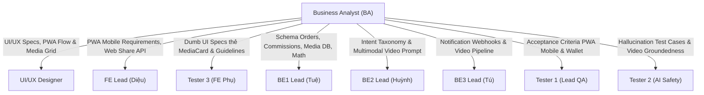

# MY WORK PLAN — BA_W3
**Project:** AI Travel Reseller MVP (TravelLink AI)  
**Week:** Tuần 3 (19/10/2026 – 24/10/2026) — Sprint 3  
**Member:** Business Analyst (BA Lead / Product Requirements Specialist)  
**Role:** Business Analyst (BA)  
**Current Milestone:** COMMERCE FLOW, AI SALES AGENT, PWA & MERCHANT VIDEO GENERATION  
**Deadline:**  
- **Pre-sprint Specs (Tài liệu làm trước):** Đã hoàn tất và sẵn sàng cho Kick-off 09:00 AM Thứ Hai (19/10/2026).  
- **Sprint Review & UAT Sign-off:** 17:00 Thứ Sáu (23/10/2026); Demo nghiệm thu: Thứ Bảy (24/10/2026).  
**Artifacts Phụ Trách:**  
- `BA_W3.md` (Kế hoạch hành động & Danh mục Task chi tiết)  
- `BA_COMMERCE_AND_COMMISSION_SPEC.md` (Đặc tả luồng Đơn hàng, Vòng đời State Machine & Công thức tính Hoa hồng)  
- `BA_AI_SALES_AGENT_SPEC.md` (Đặc tả kịch bản Chatbot tư vấn, Nhận diện ý định mua Intent & Chống ảo giác)  
- `BA_HANDOFF_MATRIX.md` (Ma trận bàn giao tài liệu & Acceptance Criteria cho 8 vai trò kỹ thuật)  

---

## 1. Context & Bối Cảnh
- **Kế thừa thành quả Tuần 1 & Tuần 2:**
  - Tuần 1: Hoàn thành cấu trúc Database (8 bảng), Supabase Auth, pgvector setup và Dumb UI.
  - Tuần 2: Hoàn thành AI Content Factory (n8n pipeline sinh 4 Personas), Reseller Campaign Feed, Hệ thống cấp mã Affiliate Tracking Link (`/r/[code]`), router 302 redirect và ghi nhận click vào bảng `clicks`.
- **Thách thức cốt lõi của Tuần 3:**
  - Chứng minh trọn vẹn chuỗi giá trị thương mại: *Khách hàng click link tiếp thị $\rightarrow$ Chat với AI Sales Agent $\rightarrow$ Nhận link checkout chính thức $\rightarrow$ Phát sinh đơn hàng $\rightarrow$ Ghi nhận hoa hồng minh bạch cho Reseller*.
  - Nâng cấp trải nghiệm di động của Reseller và Khách hàng lên chuẩn **PWA Mobile Suite** (Add to Home Screen, Bottom Navigation, Web Share API 1 chạm).
  - Mở rộng năng lực truyền thông cho Merchant: **Thư viện Video Mẫu & Tạo Video AI** (Merchant tải video mẫu $\rightarrow$ AI Multimodal bóc tách kịch bản $\rightarrow$ tự động tạo video chiến dịch du lịch tương tự).
- **Chiến lược của BA:** Cung cấp đặc tả chi tiết nghiệp vụ và ma trận nghiệm thu (Acceptance Criteria dạng Given-When-Then) để toàn bộ 8 vai trò kỹ thuật có thể triển khai song song ngay từ đầu tuần.

---

## 2. Executive Summary
Trong Tuần 3, BA chịu trách nhiệm thiết kế và cung cấp "Bản thiết kế nghiệp vụ chi tiết" (Business & Functional Blueprint) cho toàn bộ chu trình thương mại, AI và giao diện người dùng:
1. **Thiết kế luồng AI Sales Agent:** Định nghĩa Customer Journey, bộ kịch bản tư vấn mẫu, quy tắc phát hiện ý định mua hàng (Purchase Intent Triggers), thời điểm xuất link thanh toán (`suggested_checkout_url`), và kịch bản ứng xử an toàn (Anti-hallucination strict boundaries).
2. **Quy chuẩn cơ chế Hoa hồng (Commission Engine):** Xác định công thức phân chia hoa hồng (Platform Fee 20% vs Reseller 80%), nguyên tắc ghi nhận nguồn (Attribution Window 30 ngày, Last-click model), và Vòng đời trạng thái đơn hàng (`pending` $\rightarrow$ `confirmed` $\rightarrow$ `paid` / `cancelled` / `refunded`).
3. **Đặc tả nghiệp vụ PWA Mobile Suite:** Quy chuẩn thao tác di động của Reseller (Bottom Nav 4 tab, nút Share 1 chạm mở native share Zalo/TikTok, nút tải ảnh poster kèm mã QR cá nhân) và Khách hàng (In-App Browser không bắt cài app, khung chat bottom sheet toàn màn hình).
4. **Đặc tả Merchant Video Library & AI Video Generation:** Quy chuẩn lưu trữ video mẫu của Merchant (`media_references`), tiêu chuẩn video 9:16 (1080p, 15-60s) và luồng AI phân tích kịch bản để tạo video mới.
5. **Đồng hành nghiệm thu (Business UAT):** Đánh giá chéo kết quả kiểm thử nghiệp vụ của Dev và QA, nghiệm thu kịch bản Demo C3 & C1.

---

## 3. THIS WEEK — MY TASKS (LỘ TRÌNH CHI TIẾT TUẦN 3)

| ID | Task | Priority | Status | Dependency | Phục vụ chính | Deliverable | Deadline |
|---|---|---|---|---|---|---|---|
| **BA-W3-01** | Bàn giao & Giải đáp Đặc tả Nghiệp vụ tại Kick-off Sprint 3 | P0 | READY | Pre-sprint specs | Toàn đội ngũ | Biên bản Kick-off & Alignment | 19/10 10:30 |
| **BA-W3-02** | Khóa Business Rules cho BE1: Migration `orders`, `media_references` & RPC ví | P0 | READY | BA-W3-01 | BE1 (Supabase) | Data Schema & Commission Math | 19/10 14:00 |
| **BA-W3-03** | Khóa Kịch bản RAG, Buying Intent & Multimodal Prompt cho BE2 | P0 | READY | BA-W3-01 | BE2 (AI Engine) | Intent Taxonomy & Video Prompt Spec | 19/10 17:00 |
| **BA-W3-04** | Handoff Yêu cầu Giao diện PWA Mobile & Merchant Library cho UI/UX | P0 | READY | BA-W3-01 | UI/UX Designer | UI Specs cho Mobile Nav & Video Grid | 20/10 12:00 |
| **BA-W3-05** | Khóa Event Taxonomy & Webhook Schema cho BE3 (Thông báo & Video n8n) | P1 | READY | BA-W3-01 | BE3 (n8n Automation) | Webhook Specs & Video Pipeline logic | 20/10 17:00 |
| **BA-W3-06** | Hỗ trợ FE Lead (Diệu) & Tester 3 (FE phụ) xác thực luồng giao diện | P1 | READY | UI/UX Figma | FE Lead, Tester 3 | Hướng dẫn logic & Props thẻ MediaCard | 21/10 17:00 |
| **BA-W3-07** | Đồng hành cùng QA Team (Tester 1, 2) chạy Bộ Test Nghiệp Vụ | P0 | READY | Dev PRs | Tester 1, 2 | QA Sign-off on Acceptance Criteria | 22/10 17:00 |
| **BA-W3-08** | Thực hiện Nghiệm thu Nghiệp vụ (Business UAT) & Đánh giá Demo Sprint 3 | P0 | READY | Branch `dev` W3 | PM & Toàn team | Báo cáo Nghiệm thu Nghiệp vụ Tuần 3 | 23/10 17:30 |

---

## 4. MA TRẬN BÀN GIAO CHO 8 VAI TRÒ KỸ THUẬT

### Chi tiết bàn giao theo vai trò:
1. **BE1 (Supabase DB & Attribution):**
   - Tài liệu: [BA_COMMERCE_AND_COMMISSION_SPEC.md](BA_COMMERCE_AND_COMMISSION_SPEC.md) (Mục 2 & 3).
   - Nội dung: Công thức tính hoa hồng `gross_commission`, `platform_fee (20%)`, `reseller_commission (80%)`, bảng `orders`, `commissions`, bảng `media_references`.
2. **BE2 (AI Sales Agent & Multimodal):**
   - Tài liệu: [BA_AI_SALES_AGENT_SPEC.md](BA_AI_SALES_AGENT_SPEC.md).
   - Nội dung: Bảng từ khóa Buying Intent (*"đặt vé", "giá bao nhiêu", "mua thế nào"*), kịch bản bung link checkout, prompt phân tích kịch bản video mẫu.
3. **BE3 (n8n Automation & Video):**
   - Nội dung: Payload webhook thông báo đơn hàng (Telegram/Zalo) và luồng nhận diện video mẫu để chạy pipeline tạo video.
4. **FE Lead (Diệu):**
   - Nội dung: Yêu cầu PWA Core, thanh Bottom Nav, tích hợp Web Share API, khung chat bottom sheet di động và màn hình Ví hoa hồng.
5. **Tester 3 (FE Phụ / Trainee):**
   - Nội dung: Mô tả component tĩnh `media-card.tsx` và văn bản hướng dẫn tiêu chuẩn video 9:16 cho `video-guidelines-modal.tsx`.
6. **UI/UX Designer:**
   - Nội dung: Wireframe bố cục Bottom Nav, màn hình Ví tiền và lưới Media Library.
7. **Tester 1 & Tester 2:**
   - Tài liệu: [BA_HANDOFF_MATRIX.md](BA_HANDOFF_MATRIX.md).
   - Nội dung: 100% Acceptance Criteria dạng Given-When-Then cho từng luồng nghiệp vụ.
