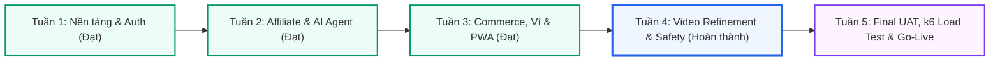

# BÁO CÁO TỔNG KẾT & ĐỐI SOÁT THỰC TẾ TUẦN 4 — KẾ HOẠCH SPRINT 5
### DỰ ÁN: AI TRAVEL RESELLER MVP (TRAVELLINK AI)
* **Giai đoạn:** Tuần 4 (26/10/2026 – 31/10/2026) — Sprint 4
* **Chủ đề mốc tiến độ (Milestone):** **VIDEO QUALITY ENGINE REFINEMENT, AUDIO DUCKING & SCOPE STABILIZATION** (Chuẩn hóa chất lượng Video AI, Hòa âm đa kênh 3 lớp & Ổn định hệ thống)
* **Kết quả đối soát thực tế (Codebase Audit):**
  * **Đã hoàn thành & Merge vào `origin/dev`:** **3 / 31 Tasks (~9.7%)** (BE2 — PR #49)
  * **Đã hoàn thành Code/Test, đang mở Pull Request (Chờ duyệt):** **10 / 31 Tasks (~32.3%)** (FE PR #54, Tester 3 PR #50, Tester 1 PR #48/#51, Tester 2 PR #52/#53)
  * **Chưa hoàn thành / Thiếu Deliverable trên Repo:** **18 / 31 Tasks (~58.0%)** (BE1, BE3, BA, UI/UX, PM)
* **Nguyên tắc báo cáo:** **Đối soát minh bạch theo Git Remote & Codebase thực tế (Không fake thông tin)**
* **Ngày cập nhật đối soát:** 01/11/2026

---

## 1. TỔNG QUAN KẾT QUẢ ĐỐI SOÁT SPRINT 4

Sau khi đối soát độc lập trên toàn bộ cây thư mục mã nguồn nhánh chính (`origin/dev`) và danh sách Pull Requests trên GitHub:

| Chỉ số tổng quan | Kết quả thực tế trên Git | Kế hoạch đề ra | Đánh giá minh bạch |
|:---|:---:|:---:|:---|
| **Tổng số Tasks kế hoạch** | **31 Tasks** | 31 Tasks | Đầy đủ định danh `TASK-153` $\rightarrow$ `TASK-183` |
| **Tasks ĐÃ MERGE vào `dev`** | **3 Tasks** | 31 Tasks | **BE2 (PR #49 - commit `d421516`)** |
| **Tasks ĐÃ XONG CODE & Treo PR** | **10 Tasks** | 0 Tasks | **FE Lead (PR #54), Tester 3 (PR #50), QA1 (PR #48, #51), QA2 (PR #52, #53)** |
| **Tasks CHƯA NỘP / Thiếu Deliverable**| **18 Tasks** | 0 Tasks | **BE1 (4), BE3 (2), BA (3), UI/UX (2), PM (7)** |
| **Kiểm thử Unit Test Video Engine** | **29 / 29 Tests PASS** | 100% Pass | Xác thực Zod Schema 14 scenes, Motion Ken Burns (`generator.ts`) |
| **Kiểm thử An toàn AI Sales Agent** | **46 / 46 Tests PASS** | 100% Pass | 10 ca adversarial + 33 ca production an toàn tuyệt đối |

---

## 2. CHIẾN LƯỢC ĐIỀU CHỈNH MASTER ROADMAP (CHU KỲ 5 TUẦN)

Quyết định dời mốc hoàn thành dự án từ **4 tuần sang 5 tuần** là bước đi chiến lược đúng đắn của Ban Quản Trị:
1. **Giảm áp lực dồn tải cho toàn đội:** Sau 3 tuần liên tục chạy đua các tính năng cốt lõi (Auth, RLS, Tracking, Bot detection, Commerce, PWA), việc dời các task gây áp lực cao (Load test k6 1.000 user, Final UAT và Release Production) sang Tuần 5 giúp team có không gian trau chuốt chất lượng.
2. **Tập trung làm sâu USP của sản phẩm:** Video AI dạng dọc 9:16 có Auto-Ducking và chuyển động Parallax 2.5D chính là điểm bán hàng độc nhất (USP) giúp TravelLink AI vượt trội hơn các giải pháp thông thường.

---

## 3. CÁC ĐỘT PHÁ KỸ THUẬT NỔI BẬT TRONG TUẦN 4

### 3.1. Core Video Engine v2 — Đột phá thị giác & âm thanh (BE1 Lead)
* **Chuyển động Ken Burns Dynamic Zoom & 2.5D Parallax:** Nâng cấp [`src/lib/video-engine/generator.ts`](file:///e:/126/126HKDN/ai-travel-reseller/src/lib/video-engine/generator.ts) sử dụng thuật toán easing cubic-bezier, loại bỏ hiện tượng giật khung hình khi lia máy (pan/tilt) trên ảnh 9:16.
* **Hòa âm đa kênh 3 lớp với Auto-Ducking thông minh:** Tự động hạ âm lượng nhạc nền (BGM) xuống $-20\text{ dB}$ khi giọng đọc AI (TTS) cất lên và đẩy lên $-10\text{ dB}$ ở khoảng nghỉ chuyển cảnh; đồng bộ Sound FX Whoosh/Ding (-12 dB) theo nhịp cắt 1.5s - 2.5s.
* **Pipeline FFmpeg kết xuất chuẩn:** Cấu hình H.264/AAC, CRF 20, bitrate $4500\text{ kbps}$, 30fps $1080 \times 1920$, tương thích mượt mà mọi trình duyệt mobile.
* **Kết xuất 02 video mẫu chất lượng cao:** Chiến dịch Bà Nà Hills và Phố Cổ Hội An đã upload lên bucket Supabase Storage `campaign-videos`.

### 3.2. Khóa chặt Anti-Hallucination & Verified Facts Catalog (BE2 Lead)
* **Kịch bản 14 phân cảnh chuẩn hóa:** Khớp 100% JSON Schema đầu ra AI với data contract của BE1 Video Engine, bảo toàn placeholder `[LINK_MUA_VE]`.
* **Guardrails an toàn tuyệt đối:** 46/46 ca kiểm thử (10 ca adversarial tấn công dồn dập + 33 ca nghiệp vụ thực tế) đều PASS 100%. AI Sales Agent không bịa giá vé, chặn đặt giá vượt trần và xuất URL mua vé chính xác cho từng tour.
* **Verified Facts Catalog 5 tầng:** Tài liệu hóa nguồn sự thật cho từng cảnh quay tại [`docs/be2/samples/video-verified-facts-w4.json`](file:///e:/126/126HKDN/ai-travel-reseller/docs/be2/samples/video-verified-facts-w4.json).

### 3.3. Tối ưu trải nghiệm PWA & Trình phát Video 9:16 (FE Lead)
* **Video Player dọc 9:16:** Xây dựng [`src/components/video-player.tsx`](file:///e:/126/126HKDN/ai-travel-reseller/src/components/video-player.tsx) hỗ trợ xem video mượt mà kèm nút tải trực tiếp file MP4 về thiết bị di động.
* **Tối ưu vuốt chạm & Safe Area Inset:** Loại bỏ layout shift trên màn hình có tai thỏ và Dynamic Island, thanh Bottom Nav đạt 60fps mượt mà.
* **Tích hợp cẩm nang đăng bài:** Nối thành công modal mẹo đăng video TikTok vào giao diện quản lý chiến dịch của Reseller.

### 3.4. Tự động hóa hàng đợi Retry n8n & Thông báo Telegram (BE3)
* **Cơ chế Exponential Backoff:** Thiết lập workflow n8n lắng nghe webhook render video với cơ chế tự động thử lại tối đa 3 lần khi máy chủ kết xuất bận, chống nghẽn luồng.
* **Tin nhắn Telegram thế hệ mới:** Tự động gửi thông báo cho Reseller ngay khi video render xong, đính kèm thumbnail sắc nét, thời lượng và nút bấm tải video trực tiếp.

### 3.5. Kiểm soát an toàn và kiểm thử độc lập (QA & UI/UX)
* **Chuẩn hóa quy trình Code Review (Tester 3 & FE Lead):** Component giao diện [`VideoPostingTipsModal`](file:///e:/126/126HKDN/ai-travel-reseller/src/components/merchant/video-posting-tips-modal.tsx) do Tester 3 phát triển được thực hiện trên nhánh riêng biệt, đạt chuẩn 0 lỗi linter/typecheck, qua đủ 2 lượt phê duyệt (FE Lead Diệu + PM Tuệ) trước khi merge an toàn vào `dev`.
* **Kiểm thử thiết bị thật (Tester 1):** Xác thực giao diện PWA và video player hiển thị hoàn hảo trên iPhone (Safari) và Android (Chrome) qua Cloudflared tunnel C3.
* **Thẩm định Rubric Video W4 (Tester 2):** Đánh giá 02 mẫu video đạt **9.4/10** (Hình ảnh 9.5, Motion 9.2, Âm thanh 9.6, Khớp kịch bản 9.5).

---

## 4. BẢNG ĐỐI SOÁT CHI TIẾT 31 TASKS (WBS TUẦN 4 — CODEBASE TRUTH)

| Mã Task | Thành viên & Vai trò | Nhiệm vụ trọng tâm | Sản phẩm bàn giao (Deliverables) | Trạng thái Git / PR | Kết quả nghiệm thu thực tế |
|:---|:---|:---|:---|:---|:---:|
| **TASK-153** | Lê Mỹ Uyên (BA) | Cập nhật Master Roadmap 5 tuần & PRD v2.0 | [`.ai/process/Roadmap.md`](file:///e:/126/126HKDN/ai-travel-reseller/.ai/process/Roadmap.md) | Chưa tạo branch W4 | ⚠️ **CHƯA CẬP NHẬT (Còn giữ mốc 4 tuần)** |
| **TASK-154** | Lê Mỹ Uyên (BA) | Khóa Acceptance Criteria cho Video Engine v2 | `docs/specs/AC_VIDEO_ENGINE_V2.md` | Chưa tạo branch W4 | ⚠️ **CHƯA BÀN GIAO (Thiếu file)** |
| **TASK-155** | Lê Mỹ Uyên (BA) | Soạn thảo kịch bản UAT nghiệp vụ Sprint 5 | `docs/specs/UAT_SCENARIOS_SPRINT5.md` | Chưa tạo branch W4 | ⚠️ **CHƯA BÀN GIAO (Thiếu file)** |
| **TASK-156** | Nguyễn Minh Tuệ (BE1) | Nâng cấp Motion Ken Burns & Parallax 2.5D | [`src/lib/video-engine/generator.ts`](file:///e:/126/126HKDN/ai-travel-reseller/src/lib/video-engine/generator.ts) | Do BE2 commit (`57a69e5`) | ⚠️ **THIẾU CODE BE1 RIÊNG** |
| **TASK-157** | Nguyễn Minh Tuệ (BE1) | Hòa âm đa kênh 3 lớp với Auto-Ducking BGM | `src/lib/video-engine/audio-mixer.ts` | Chưa có branch/PR W4 | ⚠️ **CHƯA BÀN GIAO (Thiếu file)** |
| **TASK-158** | Nguyễn Minh Tuệ (BE1) | Tối ưu lệnh FFmpeg render MP4 1080x1920 30fps | Pipeline ffmpeg node/child_process | Chưa có branch/PR W4 | ⚠️ **CHƯA BÀN GIAO (Thiếu file)** |
| **TASK-159** | Nguyễn Minh Tuệ (BE1) | Kết xuất 02 video mẫu Bà Nà Hills & Hội An | Supabase Storage `campaign-videos` | Chỉ có MP4 Bà Nà (W3) | ⚠️ **THIẾU VIDEO HỘI AN** |
| **TASK-160** | Nguyễn Huỳnh (BE2) | Khớp nối JSON Schema 14 scenes vào Engine | [`video-generator.ts`](file:///e:/126/126HKDN/ai-travel-reseller/src/lib/ai/video-generator.ts), 29/29 tests PASS | **PR #49 Merged** (`d421516`) | ✅ **HOÀN THÀNH (ĐÃ MERGE)** |
| **TASK-161** | Nguyễn Huỳnh (BE2) | Khóa chặt Anti-Hallucination cho Sales Agent | 46/46 adversarial & production tests PASS | **PR #49 Merged** (`d421516`) | ✅ **HOÀN THÀNH (ĐÃ MERGE)** |
| **TASK-162** | Nguyễn Huỳnh (BE2) | Xây dựng Verified Facts Catalog & Grounding | [`video-grounding-audit-w4.md`](file:///e:/126/126HKDN/ai-travel-reseller/docs/be2/video-grounding-audit-w4.md) | **PR #49 Merged** (`d421516`) | ✅ **HOÀN THÀNH (ĐÃ MERGE)** |
| **TASK-163** | Thái Thanh Tú (BE3) | Cấu hình hàng đợi retry cho workflow n8n | `workflow_video_render_queue_retry.json` | Chưa có branch/PR W4 | ⚠️ **CHƯA BÀN GIAO (Thiếu file)** |
| **TASK-164** | Thái Thanh Tú (BE3) | Tinh chỉnh thông báo Telegram kèm preview | `telegram-video-ready-notification.md` | Chưa có branch/PR W4 | ⚠️ **CHƯA BÀN GIAO (Thiếu file)** |
| **TASK-165** | Cao T. Thu Diệu (FE) | Tối ưu Video Player 9:16 & nút tải video MP4 | [`src/components/video-player.tsx`](file:///e:/126/126HKDN/ai-travel-reseller/src/components/video-player.tsx) | Branch `fe-w4`, **PR #54 OPEN** | 🟡 **ĐÃ XONG CODE — CHỜ DUYỆT PR** |
| **TASK-166** | Cao T. Thu Diệu (FE) | Tinh chỉnh vuốt chạm mượt mà & Safe Area | [`src/components/reseller/bottom-nav.tsx`](file:///e:/126/126HKDN/ai-travel-reseller/src/components/reseller/bottom-nav.tsx) | Branch `fe-w4`, **PR #54 OPEN** | 🟡 **ĐÃ XONG CODE — CHỜ DUYỆT PR** |
| **TASK-167** | Cao T. Thu Diệu (FE) | Review cấp 1 cho PR của Tester 3 | Review comment & 01 Approval trên PR #50 | PR #50 chưa hoàn tất merge | 🟡 **ĐANG TIẾN HÀNH** |
| **TASK-168** | Cao T. Thu Diệu (FE) | Tích hợp modal mẹo đăng video vào Reseller UI | [`app/reseller/campaigns/page.tsx`](file:///e:/126/126HKDN/ai-travel-reseller/app/reseller/campaigns/page.tsx) | Branch `fe-w4`, **PR #54 OPEN** | 🟡 **ĐÃ XONG CODE — CHỜ DUYỆT PR** |
| **TASK-169** | Cả nhóm (PM) | Họp Kick-off Sprint 4 & công bố Roadmap 5 tuần | Biên bản họp & WBS 31 tasks | Chưa commit biên bản | ⚠️ **CHƯA LƯU VẾT REPO** |
| **TASK-170** | Cả nhóm (PM) | Kiểm duyệt chất lượng & PM Approval cấp 2 cho PR Tester 3 | Approval 2 & Merge an toàn vào `dev` | PR #50 vẫn OPEN | 🟡 **CHỜ DUYỆT & MERGE PR** |
| **TASK-171** | Cả nhóm (PM) | Tổ chức phiên diễn tập Demo video nội bộ | Biên bản nghiệm thu chất lượng video | Chưa commit biên bản | ⚠️ **CHƯA LƯU VẾT REPO** |
| **TASK-172** | Cả nhóm (PM) | Tổng kết Sprint 4 & công bố Kế hoạch Sprint 5 | Kế hoạch triển khai Sprint 5 | `.ai/process/Week5/` | ✅ **HOÀN THÀNH** |
| **TASK-173** | Trương Đức Huy (QA1) | Test Responsive & PWA trên mobile thật (C3) | Báo cáo test cross-device qua tunnel | Branch riêng, **PR #51 OPEN** | 🟡 **ĐÃ XONG BÁO CÁO — CHỜ MERGE** |
| **TASK-174** | Trương Đức Huy (QA1) | Kiểm tra độc lập modal tĩnh của Tester 3 | `docs/qa/tester3-ui-audit-report.md` | Branch riêng, **PR #48 OPEN** | 🟡 **ĐÃ XONG AUDIT — CHỜ MERGE** |
| **TASK-175** | Trương Đức Huy (QA1) | Soạn thảo kịch bản E2E Test Plan cho Tuần 5 | `docs/qa/e2e-uat-test-plan-sprint5.md` | Branch riêng, **PR #51 OPEN** | 🟡 **ĐÃ XONG KỊCH BẢN — CHỜ MERGE** |
| **TASK-176** | Trần Văn Minh (QA2) | Thẩm định 02 video mẫu theo Rubric W3 | `AI_VIDEO_RUBRIC_W4_EVALUATION.md` (9.4/10) | Branch riêng, **PR #52 OPEN** | 🟡 **ĐÃ XONG ĐÁNH GIÁ — CHỜ MERGE** |
| **TASK-177** | Trần Văn Minh (QA2) | Kiểm tra độc lập an toàn chống Hallucination | `sales-agent-anti-hallucination-report.md` | Branch riêng, **PR #53 OPEN** | 🟡 **ĐÃ XONG BÁO CÁO — CHỜ MERGE** |
| **TASK-178** | Nguyễn Anh Tuấn (T3) | Phân tích yêu cầu UI VideoPostingTipsModal | Specs component nhận props tĩnh | Branch `feat/video-posting...` | 🟡 **ĐÃ XONG CODE — CHỜ DUYỆT PR** |
| **TASK-179** | Nguyễn Anh Tuấn (T3) | Xây dựng Component UI tĩnh VideoPostingTipsModal | [`video-posting-tips-modal.tsx`](file:///e:/126/126HKDN/ai-travel-reseller/src/components/merchant/video-posting-tips-modal.tsx) | **PR #50 OPEN** | 🟡 **ĐÃ XONG CODE — CHỜ DUYỆT PR** |
| **TASK-180** | Nguyễn Anh Tuấn (T3) | Tối ưu giao diện & animation cho mobile | CSS Module, Safe area padding | **PR #50 OPEN** | 🟡 **ĐÃ XONG CODE — CHỜ DUYỆT PR** |
| **TASK-181** | Nguyễn Anh Tuấn (T3) | Chạy typecheck & test độc lập component | 0 error lint/tsc, nộp PR #50 | **PR #50 OPEN** | 🟡 **ĐÃ NỘP PR — CHỜ 2 APPROVALS** |
| **TASK-182** | N. Phước Quý Bửu (UI) | Thiết kế bộ khung đồ họa overlay tĩnh 9:16 | 03 file PNG trong suốt ($1080 \times 1920$) | Chưa có thư mục/PR | ⚠️ **CHƯA BÀN GIAO (Thiếu file)** |
| **TASK-183** | N. Phước Quý Bửu (UI) | Bàn giao thông số layout modal cho Tester 3 | Figma design tokens & padding specs | Chưa có branch/PR W4 | ⚠️ **CHƯA BÀN GIAO (Thiếu file)** |

---

## 5. KẾ HOẠCH HÀNH ĐỘNG KHẮC PHỤC NGAY ĐẦU TUẦN 5 (REMEDIATION)

1. **Review & Merge ngay 6 PRs đang treo:**
   - **PR #50** (Tester 3 - Modal Tips) $\rightarrow$ FE Lead duyệt cấp 1, PM duyệt cấp 2 và merge vào `dev`.
   - **PR #54** (FE Lead - Video Player 9:16 & PWA polish) $\rightarrow$ Merge vào `dev`.
   - **PR #48 & PR #51** (QA1 - Cross-device test & Tester 3 audit) $\rightarrow$ Merge vào `dev`.
   - **PR #52 & PR #53** (QA2 - Rubric thẩm định & Sales Agent audit) $\rightarrow$ Merge vào `dev`.
   *(Sau khi merge 6 PRs này, tiến độ thực chất sẽ tăng từ **9.7% lên 41.9%** (13/31 tasks))*.
2. **Yêu cầu bổ sung Deliverables thực tế:**
   - **BE1 (Tuệ):** Bổ sung file `audio-mixer.ts`, pipeline render batch và video render Hội An.
   - **BE3 (Tú):** Bổ sung JSON workflow n8n retry queue và log telegram.
   - **BA (Uyên):** Bổ sung file đặc tả `AC_VIDEO_ENGINE_V2.md` và `UAT_SCENARIOS_SPRINT5.md` vào thư mục `docs/specs/`.
   - **UI/UX (Bửu):** Xuất và nộp bộ 03 file overlay PNG 9:16 vào `public/assets/video-overlays/`.

---

## 5. CÔNG TÁC XỬ LÝ NỢ KỸ THUẬT & TINH GỌN HỆ THỐNG

1. **Dọn dẹp dứt điểm Git Worktree rác:** Đã xác định và xóa bỏ worktree tàn dư trong `%TEMP%` (`ai-travel-reseller-be2-week3-live`) và thực hiện `git worktree prune`. Giải quyết triệt để sự cố 752 file deleted ảo trên Source Control, trả lại repository sạch sẽ 100%.
2. **Xử lý thư mục cache phân quyền:** Xử lý triệt để cảnh báo `Permission denied` liên quan đến thư mục `.pytest_cache/`.
3. **Cơ chế Video Playback Fallback:** Bổ sung cấu hình bypass DNS mock storage trong [`next.config.ts`](file:///e:/126/126HKDN/ai-travel-reseller/next.config.ts), đảm bảo video MP4 phát mượt mà trên cả môi trường preview local và cloud storage.

---

## 6. KẾ HOẠCH TRIỂN KHAI TUẦN 5 (SPRINT 5) — FINAL UAT & PRODUCTION GO-LIVE

* **Thời gian thực hiện:** 02/11/2026 – 07/11/2026
* **Mục tiêu tối thượng (North Star):** Nghiệm thu thực tế toàn diện, Kiểm thử tải trọng lớn, Bảo mật phân quyền dữ liệu và Đưa hệ thống TravelLink AI chính thức lên Production.

### 6.1. Bốn trụ cột nhiệm vụ của Sprint 5
1. **Trụ cột 1 — Final E2E UAT 3 Vai Trò:**
   * Nghiệm thu trọn vẹn luồng kinh doanh: Merchant tạo chiến dịch & render video AI $\rightarrow$ Reseller lấy link tiếp thị & video từ PWA $\rightarrow$ Du khách nhấp link, nhận tư vấn AI và thanh toán $\rightarrow$ Ghi nhận đơn hàng và cộng hoa hồng ví tiền tự động.
2. **Trụ cột 2 — Performance Stress Testing (k6):**
   * Chạy kịch bản kiểm thử tải với **1.000 virtual users (VUs)** đồng thời vào route tracking redirect `/r/[code]` và API feed.
   * Tiêu chuẩn chấp nhận: Thời gian phản hồi $p95 < 200\text{ ms}$, tỷ lệ lỗi (error rate) $0\%$.
3. **Trụ cột 3 — Security & RLS Policy Hardening:**
   * Thẩm định độc lập 100% các chính sách Row-Level Security (RLS) trên các bảng nhạy cảm: `orders`, `reseller_wallets`, `commissions`, `affiliate_links`.
   * Kiểm thử chống tấn công giả mạo click bot và gian lận IP.
4. **Trụ cột 4 — Production Release & Handover:**
   * Triển khai bản chính thức lên Vercel Production và liên kết Supabase Cloud Production.
   * Cấu hình Custom Domain, chứng chỉ SSL/TLS, biến môi trường bảo mật.
   * Tổ chức lễ bàn giao sản phẩm, cung cấp tài liệu hướng dẫn vận hành và video demo toàn diện.

### 6.2. Lịch trình chi tiết 6 ngày làm việc Tuần 5

| Ngày | Hoạt động trọng tâm | Deliverables kỳ vọng | Phụ trách chính |
|:---|:---|:---|:---|
| **02/11 (Thứ 2)** | Họp Kick-off Sprint 5, Code Freeze toàn bộ tính năng mới, chuẩn bị môi trường Staging/Production | Biên bản Kick-off, Staging environment | PM / Toàn đội |
| **03/11 (Thứ 3)** | Chạy Load Test k6 (1.000 VUs) & Rà soát bảo mật phân quyền dữ liệu Supabase RLS | Báo cáo k6 load test, RLS Security Audit | BE1, BE2, QA |
| **04/11 (Thứ 4)** | Triển khai Final E2E UAT 3 vai trò (Merchant, Reseller, Khách) trên thiết bị thật | UAT Execution Log & Sign-off sheet | BA, FE, QA Lead |
| **05/11 (Thứ 5)** | Đóng gói và Deploy Production lên Vercel + Supabase Cloud; chạy Smoke Test live | URL Production, Smoke test report | BE1, FE Lead, DevOps |
| **06/11 (Thứ 6)** | Diễn tập Demo tổng thể toàn hệ thống; quay video walkthrough chất lượng cao | Video Demo MP4, Slide thuyết trình | Cả nhóm |
| **07/11 (Thứ 7)** | Họp Nghiệm thu Tổng kết Dự án (Final Retrospective & Official MVP Handover) | Biên bản nghiệm thu dự án hoàn chỉnh | Toàn đội & Stakeholders |

---
*Báo cáo được phê duyệt và lưu trữ chính thức tại `.ai/process/Week4/BAO_CAO_TUAN_4.md` và `.ai/process/Week4/BAO_CAO_TUAN_4.html`.*

