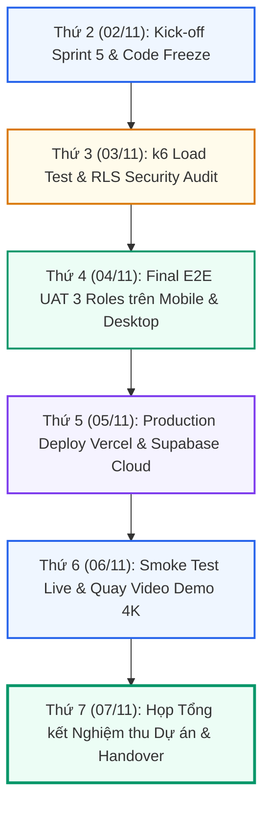

# KẾ HOẠCH TRIỂN KHAI TUẦN 5
### DỰ ÁN: AI TRAVEL RESELLER MVP (TRAVELLINK AI)
* **Giai đoạn:** Tuần 5 (02/11/2026 – 07/11/2026) — Sprint 5 (Sprint Cuối / Final Sprint)
* **Chủ đề mốc tiến độ (Milestone):** **FINAL E2E UAT, PERFORMANCE STRESS TESTING, RLS SECURITY AUDIT & PRODUCTION GO-LIVE (Nghiệm thu toàn diện E2E, Kiểm thử tải cao, Rà soát bảo mật RLS & Bàn giao Production lên Vercel + Supabase Cloud)**
* **Mục tiêu tối thượng (North Star Metric):** Hệ thống thông suốt 100% luồng giá trị MVP trên môi trường Production thực tế; chịu tải $\ge 1.000\text{ VUs}$ với $p95 < 200\text{ ms}$; không còn lỗi High/Critical; đạt 100% biên bản UAT Sign-off từ 3 nhóm người dùng (Merchant, Reseller, Du khách).

---

## 1. MỤC TIÊU TỔNG THỂ CỦA SPRINT 5

Kế thừa toàn bộ kết quả nghiệm thu thành công của Tuần 4 (Chuẩn hóa chất lượng Video AI 9:16 với chuyển động Parallax 2.5D, Auto-Ducking 3 lớp đạt điểm Rubric 9.4/10, Khóa chặn 100% Anti-Hallucination, PWA Mobile Suite hoàn thiện và Hàng đợi Retry n8n ổn định), Tuần 5 là tuần tăng tốc về đích:

1. **Khóa mã nguồn tính năng mới (Feature Freeze ngay đầu tuần):**
   * Tuyệt đối không nhận thêm bất kỳ tính năng mới nào ngoài phạm vi MVP đã cam kết trong PRD.
   * Tập trung 100% nguồn lực vào: Sửa lỗi tồn đọng, Tối ưu hiệu năng, Bảo mật phân quyền dữ liệu và Triển khai hạ tầng Production.

2. **Nghiệm thu thực tế toàn diện (Final E2E UAT 3 Vai trò):**
   * Vận hành xuyên suốt chuỗi giá trị:
     $$\text{Merchant (Tạo chiến dịch \& Video AI)} \longrightarrow \text{Reseller (Lấy link \& Video PWA)} \longrightarrow \text{Du khách (Click link, Chat AI, Đặt vé)} \longrightarrow \text{Đối soát Đơn hàng \& Cộng ví tức thì}$$
   * Kiểm thử cả trên máy tính để bàn (Desktop Web) lẫn thiết bị di động thật (iOS Safari & Android Chrome qua PWA Standalone).

3. **Kiểm thử tải trọng lớn (Performance Stress Test k6):**
   * Mô phỏng kịch bản $1.000$ người dùng ảo (Virtual Users - VUs) đồng thời click vào đường dẫn tiếp thị `/r/[code]` và tải trang Landing/Chatbot.
   * Tiêu chuẩn chấp thuận: Tỷ lệ lỗi $0\%$, thời gian chuyển hướng $p95 < 200\text{ ms}$.

4. **Kiểm tra an toàn bảo mật & RLS (Security & Anti-Fraud Audit):**
   * Rà soát 100% các chính sách Row-Level Security (RLS) của Supabase: Đảm bảo Reseller A không thể xem dữ liệu ví tiền hay đơn hàng của Reseller B.
   * Kiểm thử cơ chế chặn click tặc (bot fraud) dựa trên IP rate limiting và User-Agent verification.

5. **Phát hành chính thức lên Production (Production Release & Go-Live):**
   * Triển khai frontend Next.js lên nền tảng Vercel Production với Custom Domain và SSL/TLS hoàn chỉnh.
   * Kết nối cơ sở dữ liệu Supabase Cloud Production, đồng bộ Storage bucket `campaign-videos` và cấu hình biến môi trường bảo mật.
   * Bàn giao bộ tài liệu vận hành và video demo Walkthrough chất lượng cao cho Stakeholders.

---

## 2. QUY CHẾ ĐẶC BIỆT DÀNH CHO TESTER 3 (CHUYỂN SANG FRONTEND)

> [!IMPORTANT]
> **NGUYÊN TẮC VÀNG: CÔNG VIỆC CỦA TESTER 3 HOÀN TOÀN ĐỘC LẬP — TUYỆT ĐỐI KHÔNG ẢNH HƯỞNG ĐẾN ĐƯỜNG GĂNG (CRITICAL PATH) CỦA CẢ NHÓM:**
> 1. **Bản chất vai trò:** Tester 3 đã chính thức chuyển vị trí sang hỗ trợ Frontend (Junior FE / UI Implementation).
> 2. **Nguyên tắc "Không gây ảnh hưởng & Zero Blocker":**
>    * Toàn bộ task được giao cho Tester 3 phải là các **Thành phần giao diện độc lập (Standalone Dumb UI Components)** như: Modal FAQ câu hỏi thường gặp, Banner thông báo trạng thái mạng Offline, Modal hướng dẫn tải PWA.
>    * Các thành viên khác trong nhóm (FE Lead Diệu, BE1 Tuệ, QA Huy...) **KHÔNG PHỤ THUỘC** vào output của Tester 3 để hoàn thành UAT hay Go-Live. Nếu task của Tester 3 hoàn thành sớm và đạt chuẩn, FE Lead sẽ gắn vào app; nếu phát sinh lỗi hoặc chậm trễ, hệ thống chính vẫn tiến hành nghiệm thu và Release bình thường mà không bị đình trệ.
> 3. **Phạm vi CẤM TUYỆT ĐỐI (Forbidden Core Files):**
>    * ❌ **CẤM** can thiệp vào các file Core của hệ thống: `app/layout.tsx`, `app/page.tsx`, `next.config.ts`, `package.json`, `tsconfig.json`.
>    * ❌ **CẤM** can thiệp vào các tệp kiểm thử Playwright: `playwright.config.ts`, thư mục `tests/`.
>    * ❌ **CẤM** can thiệp vào Supabase Auth, middleware, route handlers `/api/*`, hoặc route tracking `/r/[code]`.
> 4. **Quy trình làm việc và kiểm duyệt:**
>    * Chỉ làm việc trên branch độc lập: `feature/fe-t3-w5-standalone-ui`.
>    * Tự chạy kiểm tra cú pháp và kiểu dữ liệu: `npm run lint` và `npx tsc --noEmit` đạt 0 errors trước khi tạo Pull Request.
>    * Mọi PR bắt buộc phải có review và chấp thuận (Approval) từ FE Lead (Diệu) và PM (Tuệ) trước khi merge vào `dev`. Nghiêm cấm tự ý merge.

---

## 3. PHÂN CÔNG NHIỆM VỤ CHI TIẾT SPRINT 5 (WBS)

### A. Project Management & Backend 1 (Nguyễn Minh Tuệ)
* `PM-W5-01 (Điều phối Sprint 5 & Code Freeze)`: Tổ chức họp Kick-off Sprint 5, ban hành quyết định Code Freeze, kiểm soát tiến độ từng ngày và quản lý danh sách bug.
* `PM-W5-02 (Nghiệm thu & Bàn giao Dự án)`: Chủ trì phiên nghiệm thu UAT chính thức, ký biên bản UAT Sign-off và bàn giao sản phẩm cho Hội đồng / Khách hàng.
* `BE1-W5-01 (Setup Hạ tầng Supabase Cloud Production)`: Thiết lập Database Supabase Cloud Production, migrate schema, RLS policies, indexes và seed data chuẩn mực.
* `BE1-W5-02 (Tối ưu Hiệu năng Database & Connection Pooling)`: Cấu hình Supavisor connection pooling cho k6 stress test; audit tốc độ truy vấn RPC ví tiền và orders.
* `BE1-W5-03 (Phối hợp DevOps Deploy Vercel Production)`: Cấu hình biến môi trường Production an toàn, kết nối domain chính thức và kiểm tra SSL.

### B. Backend 2 (Nguyễn Huỳnh — AI Production RAG & Guardrails)
* `BE2-W5-01 (Deploy AI Gateway & Production LLM Endpoints)`: Cấu hình khóa API Gemini Production, thiết lập fallback model và rate limiting trên Vercel AI SDK.
* `BE2-W5-02 (Final Grounding & Intent Routing UAT)`: Xác thực toàn bộ kịch bản tư vấn AI Sales Agent trên môi trường Production, bảo đảm 100% trả đúng giá vé, giờ mở cửa và link thanh toán.
* `BE2-W5-03 (Giám sát Logs AI & Khắc phục Lỗi Prompt phát sinh)`: Theo dõi real-time logs của chatbot trong các phiên test UAT, tinh chỉnh temperature và system instructions nếu có case lệch chuẩn.

### C. Backend 3 (Thái Thanh Tú — Production Automation & Analytics)
* `BE3-W5-01 (Triển khai Production n8n Workflows)`: Export và migrate workflows n8n (render video, thông báo Telegram, bot alert) sang instance n8n Production có SSL.
* `BE3-W5-02 (Thiết lập Funnel Tracking 5 Bước trên PostHog)`: Khóa cấu hình tracking sự kiện chuyển đổi: `Click -> Chat -> Intent -> Checkout -> Commission`.
* `BE3-W5-03 (Hệ thống Cảnh báo Lỗi Telegram cho Quản trị viên)`: Cấu hình bot Telegram tự động bắn cảnh báo khi có giao dịch thất bại, lỗi render video hoặc spike lỗi 5xx.

### D. Frontend Team (Diệu & Nguyễn Anh Tuấn / Tester 3)
* **Frontend Lead (Diệu):**
  * `FE-W5-01 (Tích hợp Luồng Thanh toán & Checkout Redirect)`: Hoàn thiện nút bấm chốt đơn từ Chatbot dẫn sang trang thanh toán chính thức của Merchant; lưu trữ attribution token.
  * `FE-W5-02 (PWA Production Build & Lighthouse Polish)`: Tối ưu bundle size Next.js, cấu hình Service Worker cache tĩnh, đạt điểm Lighthouse Performance $\ge 90$ và PWA Installability $100\%$.
  * `FE-W5-03 (Hỗ trợ Fix Bug UAT Frontend)`: Trực chiến xử lý các lỗi layout, responsive hoặc interaction phát hiện trong các phiên test của Tester 1.
  * `FE-W5-04 (Review & Giám sát PR của Tester 3)`: Review cấp 1 cho nhánh `feature/fe-t3-w5-standalone-ui`, đảm bảo code sạch, không ảnh hưởng đến app core.
* **Frontend Junior / Tester 3 (Nhiệm vụ độc lập — Không ảnh hưởng nhóm):**
  * `T3-FE-W5-01 (Static Reseller FAQ & Guidance Modal)`: Xây dựng component `src/components/reseller/reseller-faq-modal.tsx` hiển thị giải đáp các thắc mắc thường gặp về chính sách rút tiền, hoa hồng và mẹo chia sẻ link.
  * `T3-FE-W5-02 (Offline Banner & Network Status Indicator)`: Xây dựng component `src/components/common/offline-banner.tsx` hiển thị thông báo khi người dùng di động bị gián đoạn kết nối Internet.
  * `T3-FE-W5-03 (Typecheck, Lint & PR Submission)`: Chạy kiểm tra `npm run lint` và `npx tsc --noEmit` đạt 0 lỗi cục bộ, mở PR nộp cho FE Lead review.
  * `T3-FE-W5-04 (Hỗ trợ Kiểm thử Giao diện & Đóng góp Feedback)`: Tham gia chạy thử giao diện trên thiết bị cá nhân để đóng góp ý kiến cải tiến trải nghiệm người dùng.

### E. QA Team (Tester 1 & Tester 2)
* **QA Lead (Tester 1 — Trương Đức Huy):**
  * `QA-W5-01 (Thực thi Kịch bản k6 Load Test 1.000 VUs)`: Chạy bài kiểm tra chịu tải trên route `/r/[code]` và API feed; xuất báo cáo biểu đồ thời gian đáp ứng $p95$.
  * `QA-W5-02 (Điều phối Phiên Final E2E UAT 3 Vai trò)`: Tổ chức phiên test người dùng thực tế trên Desktop và Mobile (Merchant tạo tour $\rightarrow$ Reseller lấy link $\rightarrow$ Khách đặt vé $\rightarrow$ Ví nhảy tiền).
  * `QA-W5-03 (Smoke Test Môi trường Production sau Deploy)`: Chạy bộ kiểm thử tự động Playwright trên domain chính thức sau khi Vercel deploy hoàn tất.
* **AI Safety & Security QA (Tester 2 — Trần Văn Minh):**
  * `QA-W5-04 (Kiểm định Bảo mật Supabase RLS & Anti-Fraud)`: Thử nghiệm truy cập chéo dữ liệu giữa 2 tài khoản Reseller khác nhau để chứng minh RLS an toàn $100\%$; test spam click tặc.
  * `QA-W5-05 (Kiểm định Chất lượng Video & Bot Chat trên Production)`: Kiểm tra 5 video render trực tiếp trên Production và thực hiện 20 lượt chat hội thoại chốt deal.

### F. UI/UX Designer & Business Analyst
* **UI/UX Designer (Nguyễn Phước Quý Bửu):**
  * `UX-W5-01 (Bộ Banner Store, PWA Splash Screen & App Icons)`: Hoàn thiện bộ icon ứng dụng mọi kích thước ($192\times192$, $512\times512$), splash screen khởi động PWA sắc nét.
  * `UX-W5-02 (Slide Deck Thuyết trình Dự án & Visual Demo Assets)`: Thiết kế bộ slide báo cáo tổng kết MVP và đồ họa minh họa chuỗi giá trị cho phiên nghiệm thu.
* **Business Analyst Lead (Lê Mỹ Uyên):**
  * `BA-W5-01 (Điều phối Biên bản Nghiệm thu UAT Sign-off)`: Soạn thảo checklist nghiệm thu, ghi nhận kết quả từng bước của 3 nhóm người dùng và thu thập chữ ký nghiệm thu.
  * `BA-W5-02 (Hoàn thiện Bộ Tài liệu Dự án & Hướng dẫn Vận hành)`: Đóng gói tài liệu PRD v2.0, Hướng dẫn sử dụng cho Merchant & Reseller, và Báo cáo Tổng kết MVP.

---

## 4. MA TRẬN PHỤ THUỘC (DEPENDENCY MATRIX)

| Mã Task | Phụ thuộc vào | Deliverable cần có | Trạng thái hiện tại | Mức độ ưu tiên |
| :--- | :--- | :--- | :---: | :---: |
| **PM-W5-01** | Báo cáo Tuần 4 | Quyết định Code Freeze | `READY` (02/11 09:00) | **P0** |
| **BE1-W5-01** | Code freeze | Supabase Cloud instance | `READY` (02/11 10:00) | **P0** |
| **FE-W5-01** | BE1 DB Schema | Route checkout sẵn sàng | `READY` (02/11 10:00) | **P0** |
| **T3-FE-W5-01**| Figma specs UI/UX | Text FAQ từ BA Lead | `READY` (Làm độc lập) | **P2** |
| **QA-W5-01** | BE1-W5-01, BE1-W5-02 | Staging URL ổn định | `READY` (03/11 08:30) | **P1** |
| **QA-W5-04** | BE1-W5-01 | RLS Policies Production | `READY` (03/11 08:30) | **P1** |
| **QA-W5-02** | FE-W5-01, BE2-W5-01 | Luồng E2E sẵn sàng | `WAITING` (Chờ 03/11) | **P0** |
| **BE1-W5-03** | QA-W5-02 | Kết quả UAT Pass | `WAITING` (Chờ 05/11) | **P0** |
| **PM-W5-02** | Toàn bộ tasks tuần 5 | Báo cáo UAT & Production URL | `WAITING` (Chờ 07/11) | **P0** |

---

## 5. LỊCH TRÌNH 6 NGÀY TRIỂN KHAI SPRINT 5

---

## 6. KẾ HOẠCH BÀN GIAO & TIÊU CHUẨN NGHIỆM THU CUỐI TUẦN 5 (DEFINITION OF DONE)
1. **0 Lỗi nghiêm trọng (Zero Critical/High Bugs):** 100% bug phát hiện trong phiên UAT được khắc phục và kiểm tra lại thành công.
2. **Hạ tầng Production sống (Live Production):** Hệ thống chạy ổn định trên domain chính thức, SSL hợp lệ, video load mượt mà qua CDN.
3. **Hiệu năng vượt chuẩn:** Bài test k6 với 1.000 VUs đạt tỷ lệ phản hồi thành công $\ge 99.9\%$, thời gian đáp ứng $p95 < 200\text{ ms}$.
4. **Hồ sơ nghiệm thu hoàn tất:** Đầy đủ biên bản UAT Sign-off của BA, báo cáo an toàn AI của Tester 2, tài liệu kiến trúc kỹ thuật và video demo chất lượng cao sẵn sàng bàn giao.

