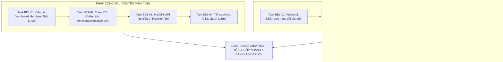

# BẢNG PHÂN CÔNG TÁC VỤ NƯỚC RÚT ĐÓNG GÓI DỰ ÁN TRONG NGÀY
## FINAL SPRINT 1-DAY TASK BREAKDOWN: BE1 & BE2 (ZERO MERGE CONFLICT)

---

- **Dự án:** **AI Travel Reseller Network (TravelLink AI)**
- **Thời gian thực hiện:** Trong ngày hôm nay (**11/11/2026**)
- **Mục tiêu tối thượng:** Đóng gói toàn bộ các chức năng nghiệp vụ còn thiếu để hoàn thiện 100% dự án trước 18:00 và sẵn sàng deploy Production.
- **Nguyên tắc kỹ thuật sống còn:** **Zero File Conflict** (BE1 và BE2 làm việc trên các tệp mã nguồn hoàn toàn độc lập, không chạm vào cùng một file).
- **Tài liệu căn cứ:** [`docs/be1/pre_deployment_missing_business_features.md`](file:///E:/Tue/MyProject/AITravelReseller/ai-travel-reseller/docs/be1/pre_deployment_missing_business_features.md)

---



---

## PHẦN 1: TỔNG HỢP PHÂN VÙNG MÃ NGUỒN (ZERO CONFLICT MATRIX)

| Phụ trách | Các tệp được phép can thiệp / tạo mới | Phạm vi cam kết |
| :--- | :--- | :--- |
| **BE1 (Bạn)** | • `src/lib/merchant/portal-server.ts`<br>• `src/components/merchant/dashboard.tsx`<br>• `app/merchant/campaigns/page.tsx` *(Mới)*<br>• `src/components/merchant/campaign-list.tsx` *(Mới)*<br>• `app/api/merchant/campaigns/route.ts`<br>• `supabase/migrations/20261111180000_payout_requests.sql` *(Mới)*<br>• `app/api/reseller/wallet/payout/route.ts` *(Mới)*<br>• `src/components/reseller/payout-modal.tsx` *(Mới)*<br>• `src/components/reseller/wallet-dashboard.tsx`<br>• `app/r/[code]/route.ts` | **Quản trị Merchant, Dòng tiền Ví Reseller, Chuyển hướng Tracking** |
| **BE2** | • `app/api/webhooks/merchant/order/route.ts` *(Mới)*<br>• `src/lib/reseller/tracking-cta.ts`<br>• `src/components/reseller/tracking-modal.tsx`<br>• `src/lib/ai/sales-agent.ts`<br>• `src/lib/ai/checkout-url.ts`<br>• `app/api/merchant/video/generate/route.ts` | **Webhook Đơn hàng Đối tác, Mã Voucher Phân phối, AI Sales Chatbot, Job Polling Video AI** |

---

## PHẦN 2: CHI TIẾT TÁC VỤ DÀNH CHO BE1 (BẠN)

### Task BE1-01: Đấu nối Dashboard Merchant với Dữ liệu Thật (Ước tính: 1.5h)
- **Mục tiêu:** Xóa bỏ mock data `demoProducts` / `demoMetrics` và dropdown trạng thái giả lập; hiển thị 4 chỉ số GMV, Đơn hàng, Lượt click, và Hoa hồng thật từ Supabase.
- **Các bước thực hiện:**
  1. Trong [`src/lib/merchant/portal-server.ts`](file:///E:/Tue/MyProject/AITravelReseller/ai-travel-reseller/src/lib/merchant/portal-server.ts):
     - Viết hàm `getMerchantDashboardMetrics(merchantId: string)`:
       - Query bảng `orders` join `products`: tính tổng GMV (`status = 'paid'`), số lượng đơn đã thanh toán.
       - Query bảng `clicks` join `campaigns`: đếm tổng số lượt click qua link của merchant.
       - Query bảng `commissions`: tính tổng hoa hồng phát sinh.
  2. Trong [`src/components/merchant/dashboard.tsx`](file:///E:/Tue/MyProject/AITravelReseller/ai-travel-reseller/src/components/merchant/dashboard.tsx):
     - Nhận dữ liệu thực tế từ server props.
     - Xóa bỏ dropdown chọn trạng thái minh họa (dòng 147–166).
     - Render danh sách sản phẩm thật thuộc quyền sở hữu của Merchant.
- **Tiêu chuẩn nghiệm thu:** Đăng nhập tài khoản Merchant Sun World (`merchant.danang@travellink.vn`), Dashboard hiển thị ngay số liệu thật từ cơ sở dữ liệu.

---

### Task BE1-02: Màn hình Quản lý Danh sách Chiến dịch (`/merchant/campaigns`) (Ước tính: 2h)
- **Mục tiêu:** Cho phép Merchant xem bảng danh sách các chiến dịch đã tạo, theo dõi tình trạng và có nút Tạm dừng / Kích hoạt lại.
- **Các bước thực hiện:**
  1. Tạo Server Component `app/merchant/campaigns/page.tsx`:
     - Kiểm tra quyền truy cập qua `getMerchantPortalAccess()`.
     - Lấy danh sách chiến dịch của Merchant từ Supabase: `id`, `name`, `product_name`, `commission_rate`, `status`, `start_date`, `end_date`.
  2. Tạo Component `src/components/merchant/campaign-list.tsx`:
     - Hiển thị bảng dạng Table chuẩn responsive.
     - Badge trạng thái: `active` (Xanh lá), `paused` (Vàng cam), `expired` (Xám).
     - Thao tác: Nút chuyển đổi trạng thái (Toggle Status) gọi API.
  3. Cập nhật [`app/api/merchant/campaigns/route.ts`](file:///E:/Tue/MyProject/AITravelReseller/ai-travel-reseller/app/api/merchant/campaigns/route.ts):
     - Bổ sung method `PATCH` nhận `{ campaign_id: string, status: "active" | "paused" }`.
     - Xác thực quyền sở hữu chiến dịch của Merchant trước khi update.
- **Tiêu chuẩn nghiệm thu:** Truy cập `/merchant/campaigns`, xem được danh sách chiến dịch, bấm Tạm dừng chiến dịch trạng thái đổi sang `paused` ngay lập tức.

---

### Task BE1-03: Modal & API Yêu cầu Rút tiền Ví Reseller (Ước tính: 2h)
- **Mục tiêu:** Cho phép Reseller gửi yêu cầu rút tiền hoa hồng khả dụng về tài khoản ngân hàng.
- **Các bước thực hiện:**
  1. Tạo migration `supabase/migrations/20261111180000_payout_requests.sql`:
     ```sql
     CREATE TABLE public.payout_requests (
       id UUID PRIMARY KEY DEFAULT gen_random_uuid(),
       reseller_id UUID NOT NULL REFERENCES public.resellers(id),
       amount NUMERIC(12,2) NOT NULL CHECK (amount >= 100000),
       bank_name TEXT NOT NULL,
       account_number TEXT NOT NULL,
       account_name TEXT NOT NULL,
       status TEXT NOT NULL DEFAULT 'pending', -- pending, processing, completed, rejected
       created_at TIMESTAMPTZ DEFAULT NOW()
     );
     ALTER TABLE public.payout_requests ENABLE ROW LEVEL SECURITY;
     CREATE POLICY "Reseller view own payout requests" ON public.payout_requests FOR SELECT USING (reseller_id = auth.uid());
     CREATE POLICY "Reseller insert own payout request" ON public.payout_requests FOR INSERT WITH CHECK (reseller_id = auth.uid());
     ```
  2. Tạo route `app/api/reseller/wallet/payout/route.ts`:
     - Method `POST`: Nhận `{ amount, bank_name, account_number, account_name }`.
     - Ràng buộc: `amount >= 100000` và `amount <= available_balance` (lấy từ RPC `get_reseller_wallet_summary`).
     - Ghi nhận bản ghi vào bảng `payout_requests`.
  3. Tạo component `src/components/reseller/payout-modal.tsx`:
     - Form nhập: Chọn ngân hàng, Số tài khoản, Tên thụ hưởng, Số tiền rút.
     - Hiển thị số dư khả dụng hiện tại để Reseller dễ đối chiếu.
  4. Trong [`src/components/reseller/wallet-dashboard.tsx`](file:///E:/Tue/MyProject/AITravelReseller/ai-travel-reseller/src/components/reseller/wallet-dashboard.tsx):
     - Thêm nút **"Rút tiền hoa hồng"** (màu xanh thương hiệu) ngay cạnh ô số dư khả dụng.
- **Tiêu chuẩn nghiệm thu:** Reseller có 9.800.000đ số dư khả dụng bấm rút 500.000đ, form báo thành công và lệnh lưu vào DB với trạng thái `pending`.

---

### Task BE1-04 (Quick Win 15 phút): Tối ưu Non-blocking Async Click với `after()`
- **Tệp:** [`app/r/[code]/route.ts`](file:///E:/Tue/MyProject/AITravelReseller/ai-travel-reseller/app/r/[code]/route.ts).
- **Thực hiện:**
  - Import `after` từ `next/server`.
  - Bao bọc lệnh chèn dữ liệu click `supabase.from('clicks').insert(...)` vào bên trong `after(async () => { ... })`.
  - Lệnh `redirect(targetUrl)` được thực thi trả về ngay HTTP 302 mà không bị block bởi I/O cơ sở dữ liệu.
- **Tiêu chuẩn nghiệm thu:** Test curl `/r/[code]` thời gian phản hồi giảm xuống dưới **150ms**.

---

## PHẦN 3: CHI TIẾT TÁC VỤ DÀNH CHO BE2 (NGUYỄN HUỲNH)

### Task BE2-01: Webhook Nhận Kết quả Thanh toán Đơn hàng Đối tác (Ước tính: 2h)
- **Mục tiêu:** Cung cấp endpoint bảo mật để cổng bán vé của Merchant (Sun World, v.v.) bắn webhook báo đơn hàng thành công, tự động chèn `orders` và phân bổ hoa hồng `commissions`.
- **Tệp cần tạo:** `app/api/webhooks/merchant/order/route.ts`.
- **Đặc tả kỹ thuật:**
  - **Method:** `POST`.
  - **Header xác thực:** `x-signature: <hmac_sha256>` (ký bằng `MERCHANT_WEBHOOK_SECRET`) hoặc `Authorization: Bearer <MERCHANT_WEBHOOK_SECRET>`.
  - **Payload nhận vào:**
    ```json
    {
      "order_id": "ORD-2026-SUN-001",
      "booking_reference": "BNH-99882",
      "amount": 1800000,
      "ref": "reseller-uuid",
      "campaign_id": "campaign-uuid",
      "product_id": "product-uuid",
      "customer_name": "Nguyễn Văn A",
      "customer_email": "khachhang@gmail.com"
    }
    ```
  - **Logic xử lý:**
    1. Kiểm tra chữ ký an toàn; từ chối 401 nếu sai secret.
    2. Kiểm tra chống gian lận tự mua: gán `flag_self_purchase = (ref === customer_reseller_id)`.
    3. Insert bản ghi vào bảng `orders` (trạng thái `paid`).
    4. Tính toán hoa hồng 80/20:
       - `gross_commission = ROUND(amount * (campaign.commission_rate / 100))`
       - `platform_fee = ROUND(gross_commission * 0.20)`
       - `net_amount = gross_commission - platform_fee`
    5. Insert bản ghi vào bảng `commissions` với `status: 'confirmed'`.
- **Tiêu chuẩn nghiệm thu:** Bắn mock cURL với payload đơn hàng, kiểm tra bảng `orders` và `commissions` xuất hiện bản ghi mới, ví Reseller tự động tăng số dư.

---

### Task BE2-02: Cấp phát & Hiển thị Mã Voucher Ký tự cho Reseller (`FR-ATT-01`) (Ước tính: 1.5h)
- **Mục tiêu:** Tạo mã voucher ký tự độc quyền (ví dụ: `BANA100K-R12`) để Reseller đọc trên livestream TikTok/Facebook cho khách nhập tay.
- **Các bước thực hiện:**
  1. Trong [`src/lib/reseller/tracking-cta.ts`](file:///E:/Tue/MyProject/AITravelReseller/ai-travel-reseller/src/lib/reseller/tracking-cta.ts):
     - Bổ sung hàm sinh mã voucher súc tích:
       `export function generateVoucherCode(campaignName: string, resellerId: string): string`
       *(Ví dụ: `BANA-` + 4 ký tự cuối của reseller_id viết hoa).*
  2. Trong [`src/components/reseller/tracking-modal.tsx`](file:///E:/Tue/MyProject/AITravelReseller/ai-travel-reseller/src/components/reseller/tracking-modal.tsx):
     - Bổ sung Tab thứ 3 bên cạnh "Link tiếp thị" và "Mã QR": **"Mã Voucher"**.
     - Giao diện gồm: Khung hiển thị mã chữ lớn, nút 1-Click "Sao chép mã", và dòng hướng dẫn cho khách livestream.
- **Tiêu chuẩn nghiệm thu:** Mở modal phân phối của bất kỳ chiến dịch nào, tab Mã Voucher hiển thị mã độc quyền và sao chép được vào clipboard trong < 300ms.

---

### Task BE2-03: Chatbot AI Nhận diện & Áp dụng Mã Voucher (Ước tính: 1h)
- **Mục tiêu:** Khi khách hàng hỏi hoặc đưa mã voucher trong khung chat, AI nhận diện được, xác nhận ưu đãi và gắn mã voucher vào link thanh toán.
- **Các bước thực hiện:**
  1. Trong [`src/lib/ai/sales-agent.ts`](file:///E:/Tue/MyProject/AITravelReseller/ai-travel-reseller/src/lib/ai/sales-agent.ts):
     - Thêm Regex phát hiện mã voucher trong tin nhắn người dùng (ví dụ: pattern `/[A-Z0-9]{4,12}-[A-Z0-9]{3,6}/i`).
     - Tinh chỉnh Intent `INTENT_BARGAIN_SEEKING` & `INTENT_PURCHASE_READY`: Nếu khách cung cấp voucher, AI xác nhận: *"Dạ mã ưu đãi [VOUCHER] đã được áp dụng thành công vào đơn đặt vé của anh/chị ạ!"*.
  2. Trong [`src/lib/ai/checkout-url.ts`](file:///E:/Tue/MyProject/AITravelReseller/ai-travel-reseller/src/lib/ai/checkout-url.ts):
     - Gắn thêm tham số `&voucher=[CODE]` vào URL trả về cho thẻ Checkout Card.
- **Tiêu chuẩn nghiệm thu:** Nhắn tin cho bot *"Mình có mã BANA-R12"*, bot phản hồi xác nhận và thẻ thanh toán chứa param `voucher=BANA-R12`.

---

### Task BE2-04: API Polling Trạng thái Video AI Chống Timeout Vercel (Ước tính: 1.5h)
- **Mục tiêu:** Loại bỏ hoàn toàn nguy cơ timeout 504 trên Vercel Serverless khi sinh video nhiều phân cảnh.
- **Các bước thực hiện:**
  - Trong [`app/api/merchant/video/generate/route.ts`](file:///E:/Tue/MyProject/AITravelReseller/ai-travel-reseller/app/api/merchant/video/generate/route.ts):
    1. Khi nhận `POST`:
       - Tạo bản ghi trong bảng `contents` với `status: 'processing'` và trả về ngay `{ success: true, job_id: content.id, status: 'processing' }` trong vòng < 200ms.
       - Kích hoạt hàm xử lý sinh video ngầm (Edge-TTS, Muse2API, FFmpeg).
       - Khi render xong, cập nhật lại bản ghi với `status: 'published'` và `video_url`.
    2. Bổ sung `GET /api/merchant/video/generate?job_id=uuid`:
       - Trả về `{ status: 'processing' | 'published' | 'failed', video_url: string | null }`.
- **Tiêu chuẩn nghiệm thu:** Bấm tạo video, modal nhận ngay `job_id`, đồng hồ đếm hiển thị tiến độ và video xuất hiện mượt mà khi backend render xong.

---

## PHẦN 4: LỆNH KIỂM ĐỊNH VÀ BÀN GIAO CUỐI NGÀY

Sau khi hoàn thành 8 task trên, hai bạn chạy bộ lệnh sau để xác nhận 100% hệ thống sẵn sàng bàn giao:

```powershell
# 1. Kiểm tra toàn vẹn TypeScript (Bắt buộc 0 errors)
npx tsc --noEmit

# 2. Chạy bộ kiểm thử Video Engine & Merchant Video
npm run test:video-engine
npm run test:merchant-video

# 3. Chạy bộ kiểm thử AI Gateway & Grounding BE2
npm run test:be2

# 4. Chạy kiểm tra tiền kiểm định Production
npm run verify:production

# 5. Chạy lệnh Build Next.js Production Turbopack
npm run build
```

---
*Tài liệu được ban hành chính thức bởi: **Nguyễn Minh Tuệ — BE1 Lead & Project Manager**.*
