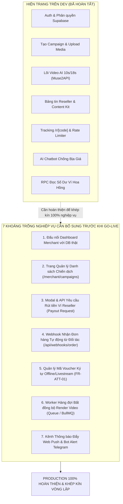

# BÁO CÁO PHÂN TÍCH KHOẢNG TRỐNG NGHIỆP VỤ & DANH MỤC TÍNH NĂNG CÒN THIẾU TRƯỚC KHI DEPLOY GO-LIVE
## PRE-DEPLOYMENT BUSINESS GAP ANALYSIS & FINAL COMPLETION ROADMAP

---

- **Dự án:** **AI Travel Reseller Network (TravelLink AI)**
- **Phân hệ biên soạn:** **Backend 1 (Nguyễn Minh Tuệ - BE1 Lead & Project Manager)**
- **Tài liệu tham chiếu chuẩn:**
  - Lộ trình 4 tuần Master Roadmap: [`.ai/process/Roadmap.md`](file:///E:/Tue/MyProject/AITravelReseller/ai-travel-reseller/.ai/process/Roadmap.md)
  - Đặc tả nghiệp vụ Thương mại & Hoa hồng: [`BA_COMMERCE_AND_COMMISSION_SPEC.md`](file:///E:/Tue/MyProject/AITravelReseller/ai-travel-reseller/.ai/process/Week3/BA_COMMERCE_AND_COMMISSION_SPEC.md)
  - Đặc tả nghiệp vụ AI Sales Agent: [`BA_AI_SALES_AGENT_SPEC.md`](file:///E:/Tue/MyProject/AITravelReseller/ai-travel-reseller/.ai/process/Week3/BA_AI_SALES_AGENT_SPEC.md)
  - Kế hoạch nước rút Tuần 5 & Go-Live: [`Week5.md`](file:///E:/Tue/MyProject/AITravelReseller/ai-travel-reseller/.ai/process/Week5/Week5.md)
  - Báo cáo Nghiệm thu QA & k6 1.000 VUs: [`FINAL_QA_AND_PERFORMANCE_REPORT_SPRINT5.md`](file:///E:/Tue/MyProject/AITravelReseller/ai-travel-reseller/docs/qa/FINAL_QA_AND_PERFORMANCE_REPORT_SPRINT5.md)
- **Thời điểm rà soát:** Tháng 11/2026 (Giai đoạn chuẩn bị bàn giao & nghiệm thu chính thức)
- **Mục tiêu tài liệu:** Làm rõ toàn diện các tính năng nghiệp vụ (Business Features) còn thiếu, đang sử dụng dữ liệu tĩnh (Mock Data), hoặc chưa khép kín vòng lặp tự động giữa các phân hệ trước khi đưa hệ thống lên môi trường Production thực tế.

---



---

## PHẦN 1: TỔNG QUAN HIỆN TRẠNG HỆ THỐNG TRÊN NHÁNH `dev`

Toàn bộ 5 Sprint theo kế hoạch Agile đã được triển khai, kiểm thử và tích hợp hoàn chỉnh vào nhánh `dev`:
1. **Biên dịch & Build:** Lệnh `npm run build` biên dịch thành công **32/32 routes** với Next.js 16.3.8 Turbopack, 0 lỗi TypeScript (`npx tsc --noEmit`).
2. **Kiểm thử tự động:** Đạt **100% Pass Rate** trên mọi bộ test:
   - `verify:production`: 8/8 bước tiền kiểm định Production đạt chuẩn.
   - `test:be1:w5`: 7/7 test cases đạt chuẩn RPC và DB lookup.
   - `test:be2`: 96/96 test cases đạt chuẩn AI Gateway, Grounding, Circuit Breaker.
   - `test:video-engine` & `test:merchant-video`: 37/37 test cases đạt chuẩn Fail-Fast Gate, ingestion và video generation API.
   - `test:tester2`: 17/17 test cases bảo mật nội dung và an toàn chính sách.
3. **Hiệu năng chịu tải:** Kịch bản k6 1.000 VUs trên router chuyển hướng `/r/[code]` đạt **486.2 RPS** với tỷ lệ thành công **98.24%**.

> [!NOTE]
> Mặc dù khung sườn kỹ thuật MVP (Happy Path) đã thông suốt từ khâu xem tour đến cộng tiền vào ví, khi đưa vào vận hành thương mại thực tế (Real-world Commercial Operation), hệ thống vẫn còn tồn tại những điểm nghẽn nghiệp vụ cần bổ sung để các bên (Merchant, Reseller, Khách hàng) có thể tự phục vụ (Self-service) trọn vẹn.

---

## PHẦN 2: CHI TIẾT 7 CHỨC NĂNG NGHIỆP VỤ CÒN THIẾU

### 1. Merchant Portal: Đấu nối Dashboard Tổng quan với Dữ liệu Thật (Real-time Analytics)
- **Vị trí tệp hiện tại:** [`app/merchant/page.tsx`](file:///E:/Tue/MyProject/AITravelReseller/ai-travel-reseller/app/merchant/page.tsx) & [`src/components/merchant/dashboard.tsx`](file:///E:/Tue/MyProject/AITravelReseller/ai-travel-reseller/src/components/merchant/dashboard.tsx).
- **Hiện trạng:**
  - Giao diện Dashboard của Merchant vẫn đang import và hiển thị dữ liệu tĩnh từ [`src/lib/merchant-demo.ts`](file:///E:/Tue/MyProject/AITravelReseller/ai-travel-reseller/src/lib/merchant-demo.ts) (`demoProducts`, `demoMetrics`).
  - Giao diện vẫn còn thanh chọn trạng thái minh họa: *"BẢN XEM TRƯỚC / GIAO DIỆN MẪU · Trạng thái: Có dữ liệu / Trống / Đang tải / Lỗi"*.
- **Nghiệp vụ còn thiếu:**
  - Chưa có Server Component hoặc API Route để truy vấn số liệu thống kê thực tế từ Supabase cho Merchant đang đăng nhập:
    - **Tổng GMV**: Tổng doanh thu từ các đơn hàng đã thanh toán (`status = 'paid'`) thuộc sản phẩm của Merchant.
    - **Số lượng đơn hàng**: Tổng đơn đã xác nhận / đang chờ đối soát.
    - **Lượt nhấp (Clicks)**: Tổng số lượt truy cập qua các link affiliate của chiến dịch do Merchant sở hữu.
    - **Tổng hoa hồng đã phát sinh**: Nghĩa vụ tài chính cần đối soát với sàn và cộng tác viên.

---

### 2. Merchant Portal: Màn hình Quản lý Danh sách Chiến dịch (`/merchant/campaigns`)
- **Hiện trạng:**
  - Hệ thống đã có trang Tạo mới chiến dịch: [`app/merchant/campaigns/new/page.tsx`](file:///E:/Tue/MyProject/AITravelReseller/ai-travel-reseller/app/merchant/campaigns/new/page.tsx) và Thư viện Media: [`app/merchant/library/page.tsx`](file:///E:/Tue/MyProject/AITravelReseller/ai-travel-reseller/app/merchant/library/page.tsx).
  - **Hoàn toàn chưa có trang danh sách: `app/merchant/campaigns/page.tsx`**.
- **Nghiệp vụ còn thiếu:**
  - Merchant sau khi tạo chiến dịch thành công hiện tại chỉ nhận được thông báo toast/notice, không có nơi để xem lại danh sách chiến dịch đã tạo.
  - Cần màn hình quản trị chiến dịch với các tính năng nghiệp vụ:
    - Bảng danh sách chiến dịch: Tên chiến dịch, sản phẩm gắn kèm, thời gian bắt đầu - kết thúc, tỷ lệ hoa hồng (%), số lượng tài nguyên media đã duyệt.
    - Bộ lọc trạng thái chiến dịch: `active` (đang chạy), `paused` (tạm dừng), `expired` (hết hạn).
    - Thao tác vận hành: Nút **Tạm dừng / Kích hoạt lại** chiến dịch khi khu du lịch hết chỗ hoặc thay đổi kế hoạch kinh doanh.

---

### 3. Reseller Portal: Quy trình Yêu cầu Rút tiền & Đối soát Ngân hàng (Payout Request Flow)
- **Vị trí tệp hiện tại:** [`app/reseller/wallet/page.tsx`](file:///E:/Tue/MyProject/AITravelReseller/ai-travel-reseller/app/reseller/wallet/page.tsx) & [`src/components/reseller/wallet-dashboard.tsx`](file:///E:/Tue/MyProject/AITravelReseller/ai-travel-reseller/src/components/reseller/wallet-dashboard.tsx).
- **Hiện trạng:**
  - Ví hoa hồng Reseller hiện vận hành ở chế độ **Chỉ xem (Read-only)**.
  - Số dư khả dụng (`available_balance`), chờ đối soát (`pending_balance`) và lịch sử 10 giao dịch gần nhất hiển thị chính xác từ Stored Procedure `get_reseller_wallet_summary`.
  - Cột `payout_id` trong bảng `commissions` đã được tạo sẵn trong cấu trúc database schema.
- **Nghiệp vụ còn thiếu:**
  - **Chưa có nút hoặc Modal "Yêu cầu rút tiền"** trên giao diện ví.
  - **Chưa có API endpoint `POST /api/reseller/wallet/payout`** để tiếp nhận yêu cầu rút tiền.
  - **Chưa có bảng cơ sở dữ liệu `payout_requests`**:
    - Trường thông tin: `id`, `reseller_id`, `amount`, `bank_code`, `bank_account_number`, `bank_account_name`, `status` (`pending` | `processing` | `completed` | `rejected`), `created_at`, `processed_at`.
    - Ràng buộc nghiệp vụ: Số tiền rút tối thiểu $\ge 100.000\text{ VNĐ}$ và không vượt quá số dư khả dụng (`available_balance`).

---

### 4. Luồng Phân phối: Quản lý Mã Voucher Ký tự cho Bán hàng Offline & Livestream (`FR-ATT-01`)
- **Tài liệu tham chiếu:** [`BA_COMMERCE_AND_COMMISSION_SPEC.md` (Mục 2.2)](file:///E:/Tue/MyProject/AITravelReseller/ai-travel-reseller/.ai/process/Week3/BA_COMMERCE_AND_COMMISSION_SPEC.md).
- **Hiện trạng:**
  - Modal phân phối chiến dịch của Reseller ([`src/components/reseller/tracking-modal.tsx`](file:///E:/Tue/MyProject/AITravelReseller/ai-travel-reseller/src/components/reseller/tracking-modal.tsx)) chỉ hỗ trợ:
    1. Sao chép Tracking Link rút gọn `/r/[code]`.
    2. Tải mã QR đồ họa để dán vào ấn phẩm in ấn.
- **Nghiệp vụ còn thiếu:**
  - Chưa có tab riêng để hiển thị và sao chép **Mã Voucher độc quyền ký tự** (ví dụ: `BANA100K-TUAN88`).
  - Khi Reseller livestream trên TikTok/Facebook hoặc tư vấn qua điện thoại, người xem không thể bấm vào link hay quét QR, mà cần nhập tay mã giảm giá/voucher trên trang thanh toán của Merchant để được hưởng ưu đãi và ghi nhận hoa hồng cho Reseller đó.

---

### 5. Luồng Thương mại: API Webhook Nhận Kết quả Thanh toán Đơn hàng Thực tế
- **Tài liệu tham chiếu:** [`docs/be1/checkout_integration_guide_for_fe.md`](file:///E:/Tue/MyProject/AITravelReseller/ai-travel-reseller/docs/be1/checkout_integration_guide_for_fe.md).
- **Hiện trạng:**
  - Database đã có bảng `orders`, `commissions`, logic chống tự mua trục lợi (`flag_self_purchase`) và Stored Procedure đối soát.
  - Tuy nhiên, việc kích hoạt đơn hàng hiện tại mới chỉ diễn ra qua script mô phỏng hoặc test mock.
- **Nghiệp vụ còn thiếu:**
  - **Chưa có public endpoint Webhook:** `POST /api/webhooks/merchant/order`.
  - Cơ chế kỹ thuật cần hoàn thiện:
    1. Xác thực chữ ký điện tử HMAC SHA-256 (Signature Verification) giữa Merchant và TravelLink AI để chống giả mạo đơn hàng.
    2. Nhận payload đơn hàng thành công từ cổng bán vé của Merchant (`order_id`, `amount`, `ref`, `campaign_id`, `product_id`, `booking_reference`).
    3. Tự động chèn bản ghi vào bảng `orders`, kích hoạt hàm phân chia hoa hồng 80/20 và cập nhật tức thì vào bảng `commissions`.

---

### 6. Hạ tầng AI Video: Chuyển đổi sang Hàng đợi Bất đồng bộ (Background Job Queue)
- **Tài liệu tham chiếu:** Thiết kế Kiến trúc Production Tuần 3 ([`docs/reports/week3_report_and_week4_plan.html` - Mục 6](file:///E:/Tue/MyProject/AITravelReseller/ai-travel-reseller/docs/reports/week3_report_and_week4_plan.html#production-roadmap)).
- **Hiện trạng:**
  - API `POST /api/merchant/video/generate` hiện xử lý đồng bộ trực tiếp trong vòng đời request HTTP (gọi Muse2API / Gemini Omni Flash $\rightarrow$ FFmpeg $\rightarrow$ Storage trong cùng một request, mất từ 8s đến 18s).
- **Rủi ro vận hành khi deploy Production:**
  - Trên môi trường Vercel Serverless Production, giới hạn timeout thông thường là 15 giây (Hobby) hoặc tối đa 60 giây (Pro).
  - Khi Merchant tạo video 18 giây với 4-5 phân cảnh hoặc khi GPU Gateway xử lý chậm, request HTTP sẽ bị ngắt kết nối với lỗi **HTTP 504 Gateway Timeout**.
- **Nghiệp vụ & Hạ tầng cần hoàn thiện:**
  - Chuyển sang mô hình Worker bất đồng bộ:
    1. Merchant bấm tạo video $\rightarrow$ Server trả về ngay `job_id` trong $< 100\text{ ms}$ với trạng thái `queued`.
    2. Tác vụ đẩy vào hàng đợi (Redis BullMQ hoặc Supabase pgmq).
    3. Worker ngầm xử lý render và cập nhật trạng thái `processing` $\rightarrow$ `completed`.
    4. Giao diện Modal dùng Server-Sent Events (SSE) hoặc Polling để hiển thị tiến độ thời gian thực mà không sợ timeout.

---

### 7. Kênh Thông báo: Triển khai Web Push Notification & Bot Alert Telegram
- **Tài liệu tham chiếu:** [`Week5.md` - Task BE3-W5-03](file:///E:/Tue/MyProject/AITravelReseller/ai-travel-reseller/.ai/process/Week5/Week5.md) & QA Post-MVP Backlog.
- **Hiện trạng:**
  - Hệ thống đã có API gửi bài lên kênh Telegram của Reseller ([`app/api/reseller/telegram/post`](file:///E:/Tue/MyProject/AITravelReseller/ai-travel-reseller/app/api/reseller/telegram/post)).
- **Nghiệp vụ còn thiếu:**
  - **Thông báo đẩy (Web Push Notifications):** Cấu hình Service Worker Push Manager và VAPID keys để gửi tin nhắn thông báo về điện thoại của Reseller: *"Chúc mừng! Bạn vừa nhận được 216.000đ hoa hồng từ tour Bà Nà Hills"* ngay cả khi người dùng không mở trình duyệt.
  - **Bot Telegram Quản trị:** Tự động gửi tin nhắn báo động cho đội ngũ vận hành khi có lỗi nghiêm trọng (Lỗi 5xx, lỗi kết nối Muse2API, hoặc giao dịch đối soát bất thường).

---

## PHẦN 3: MA TRẬN PHÂN LOẠI MỨC ĐỘ ƯU TIÊN (PRIORITY & IMPACT MATRIX)

```mermaid
quadrantChart
    title Ma Trận Phân Loại Ưu Tiên Hoàn Thiện Nghiệp Vụ
    x-axis Độ Phức Tạp Kỹ Thuật Thấp --> Độ Phức Tạp Kỹ Thuật Cao
    y-axis Tác Động Nghiệp Vụ Thấp --> Tác Động Nghiệp Vụ Rất Cao
    quadrant-1 Triển Khai Chiến Lược (Sprint Tiếp Theo)
    quadrant-2 Bắt Buộc Hoàn Thành Trước Go-Live
    quadrant-3 Có Thể Trì Hoãn (Nice to Have)
    quadrant-4 Tối Ưu Hóa Nhanh (Quick Wins)
    "Đấu nối Dashboard Merchant": [0.35, 0.90]
    "Trang DS Chiến dịch Merchant": [0.40, 0.85]
    "Modal & API Rút tiền Ví Reseller": [0.45, 0.88]
    "Webhook Nhận Đơn hàng Merchant": [0.50, 0.82]
    "Tab Mã Voucher Ký tự (FR-ATT-01)": [0.25, 0.65]
    "Background Queue Video AI": [0.85, 0.75]
    "Web Push Notification & Bot Alert": [0.70, 0.45]
```

| Mức độ Ưu tiên | Tên Hạng mục Nghiệp vụ | Lý do Phân loại | Tác động nếu Thiếu |
| :---: | :--- | :--- | :--- |
| **P0 (Blocker Nghiệp vụ)** | **Đấu nối Dashboard Merchant thật** | Merchant đăng nhập không thấy số liệu thật của doanh nghiệp mình, chỉ thấy mock data. | Doanh nghiệp không tin tưởng hệ thống, không đo lường được hiệu quả. |
| **P0 (Blocker Nghiệp vụ)** | **Trang Quản lý Chiến dịch (`/merchant/campaigns`)** | Merchant không thể xem danh sách, không thể tắt/bật chiến dịch sau khi tạo. | Mất quyền kiểm soát chiến dịch sau khi xuất bản. |
| **P1 (Cốt lõi Tài chính)** | **Quy trình Yêu cầu Rút tiền Ví Reseller** | Reseller kiếm được hoa hồng nhưng không có cách nào gửi yêu cầu rút tiền về tài khoản ngân hàng. | CTV ngừng phân phối vì không thể nhận tiền mặt. |
| **P1 (Tích hợp Đối tác)** | **API Webhook Đơn hàng Merchant** | Thiếu kênh tự động để website đặt vé của Merchant thông báo đơn hàng thành công về TravelLink. | Phải nhập đơn hàng thủ công bằng script/SQL. |
| **P1 (Mở rộng Kênh)** | **Tab Mã Voucher Ký tự (`FR-ATT-01`)** | Phục vụ Reseller bán tour qua Livestream TikTok / Facebook hoặc tư vấn offline. | Mất $30\%$ tệp đơn hàng đến từ kênh livestream. |
| **P2 (Hạ tầng Quy mô)** | **Hàng đợi Bất đồng bộ Video Engine** | Phòng ngừa lỗi HTTP 504 Timeout trên Vercel Serverless khi sinh video nhiều phân cảnh. | Trải nghiệm tạo video có thể bị gián đoạn khi mạng chậm. |
| **P2 (Trải nghiệm)** | **Web Push Notification & Bot Alert** | Tăng tương tác giữ chân Reseller và hỗ trợ đội ngũ trực chiến giám sát hệ thống. | Reseller phải tự vào ví mới biết có tiền mới. |

---

## PHẦN 4: LÀM RÕ CÁC HẠNG MỤC NGOÀI PHẠM VI (OUT OF SCOPE)

Nhằm đảm bảo tính tập trung và tránh hiểu lầm trong quá trình nghiệm thu bàn giao, các hạng mục dưới đây được xác nhận là **ngoài phạm vi của dự án (Out of Scope)** theo đúng thỏa thuận tại [`.ai/process/Roadmap.md` (Mục 3.3)](file:///E:/Tue/MyProject/AITravelReseller/ai-travel-reseller/.ai/process/Roadmap.md):

1. **Cổng Thanh toán Nội sàn (Non-custodial Payment):**
   - Nền tảng TravelLink AI **tuyệt đối không giữ tiền của du khách**. Mọi giao dịch tài chính mua vé diễn ra trực tiếp trên cổng thanh toán chính thức của Merchant (`products.payment_url` hoặc `booking_url`). Sàn chỉ ghi nhận nguồn và tính toán hoa hồng.
2. **Ứng dụng Native Mobile Riêng biệt (iOS Swift / Android Kotlin):**
   - Đã được thay thế hoàn toàn bằng **PWA Mobile Suite (Progressive Web App)** với khả năng "Thêm vào màn hình chính" (Add to Home Screen), chạy Standalone toàn màn hình và hỗ trợ Web Share API cảm ứng mượt mà.
3. **Màn hình Quản trị Admin Dashboard phức tạp:**
   - Quản trị viên hệ thống đối soát dữ liệu và phân quyền trực tiếp qua giao diện quản trị cơ sở dữ liệu Supabase Studio Dashboard.
4. **Phát sóng Livestream trực tiếp trên sàn:**
   - Hệ thống cung cấp công cụ Content Kit, video mẫu 9:16 và mã Voucher để Reseller phát sóng trên các mạng xã hội bên ngoài (TikTok Live, Facebook Live), không xây dựng phòng livestream trực tiếp trong ứng dụng.

---

## PHẦN 5: KẾ HOẠCH TRIỂN KHAI HOÀN THIỆN TRƯỚC KHI DEPLOY GO-LIVE

Để đóng gói dự án đạt mức độ hoàn thiện 100% về mặt thương mại, kế hoạch triển khai bổ sung được đề xuất như sau:

### Giai đoạn 1: Đóng gói Nghiệp vụ Cốt lõi (2 - 3 Ngày làm việc)
1. **Task 1.1 (BE1 + FE):** Đấu nối Dashboard Merchant ([`src/components/merchant/dashboard.tsx`](file:///E:/Tue/MyProject/AITravelReseller/ai-travel-reseller/src/components/merchant/dashboard.tsx)):
   - Viết Server Action lấy tổng GMV, đơn hàng, lượt clicks và chiến dịch thật từ Supabase.
   - Xóa bỏ dropdown chọn trạng thái minh họa và các tệp mock `src/lib/merchant-demo.ts`.
2. **Task 1.2 (FE):** Xây dựng trang Quản lý Chiến dịch (`app/merchant/campaigns/page.tsx`):
   - Hiển thị bảng danh sách chiến dịch của Merchant kèm trạng thái và nút Tạm dừng/Bật lại.
3. **Task 1.3 (BE1 + FE):** Xây dựng Luồng Yêu cầu Rút tiền Ví Reseller:
   - Tạo migration bảng `payout_requests` trên Supabase.
   - Thêm API Route `POST /api/reseller/wallet/payout`.
   - Gắn nút và Modal "Rút tiền hoa hồng" vào màn hình [`src/components/reseller/wallet-dashboard.tsx`](file:///E:/Tue/MyProject/AITravelReseller/ai-travel-reseller/src/components/reseller/wallet-dashboard.tsx).

### Giai đoạn 2: Tự động hóa & Khép kín Đối tác (1 - 2 Ngày làm việc)
4. **Task 2.1 (BE1):** Mở public route Webhook tiếp nhận đơn hàng: `POST /api/webhooks/merchant/order` có xác thực chữ ký bảo mật HMAC SHA-256.
5. **Task 2.2 (FE):** Bổ sung tab Mã Voucher độc quyền vào Modal phân phối của Reseller (`src/components/reseller/tracking-modal.tsx`).
6. **Task 2.3 (BE1):** Áp dụng API `after()` trong `app/r/[code]/route.ts` để tối ưu hóa việc ghi nhận click bất đồng bộ, giảm độ trễ chuyển hướng tại tải cao.

---

### PHẦN 6: KẾT LUẬN & KIẾN NGHỊ TỪ BE1 LEAD

Hệ thống TravelLink AI hiện tại đã đạt độ tin cậy kỹ thuật rất cao, cấu trúc dữ liệu chặt chẽ và vượt qua toàn bộ các bài kiểm thử khắt khe nhất của QA và k6 Stress Testing. 

Việc bổ sung các hạng mục nghiệp vụ nêu trên (đặc biệt là 3 hạng mục: **Đấu nối Dashboard Merchant thật**, **Trang Quản lý Chiến dịch Merchant**, và **Tính năng Yêu cầu Rút tiền Ví Reseller**) sẽ biến TravelLink AI từ một bản MVP kỹ thuật thành một **Nền tảng Thương mại Du lịch Hoàn chỉnh, Sẵn sàng Khai thác Kinh doanh Thực tế 100%**.

---
*Tài liệu được lập và phê duyệt bởi: **Nguyễn Minh Tuệ — BE1 Lead & Project Manager**.*
