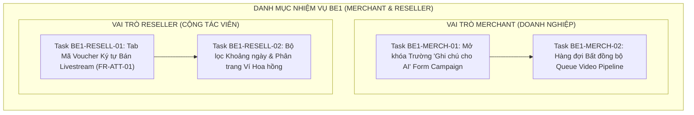

# BẢNG PHÂN CÔNG NHIỆM VỤ NÂNG CẤP & SỬA LỖI — PHÂN HỆ BE1
## CHUYÊN TRÁCH: VAI TRÒ MERCHANT (DOANH NGHIỆP) & RESELLER (CỘNG TÁC VIÊN)

---

- **Dự án:** **AI Travel Reseller Network (TravelLink AI)**
- **Phân hệ phụ trách:** **Backend 1 (Nguyễn Minh Tuệ — BE1 Lead & Project Manager)**
- **Thời gian lập kế hoạch:** 24/11/2026
- **Mục tiêu hoàn thành:** Hoàn thiện toàn diện các tính năng nghiệp vụ còn thiếu, mở khóa các trường giao diện bị vô hiệu hóa và nâng cấp hiệu năng cho 2 vai trò đối tác kinh doanh cốt lõi: **Merchant (Doanh nghiệp Du lịch)** và **Reseller (Cộng tác viên Phân phối)**.
- **Tài liệu căn cứ:**
  - Báo cáo kiểm toán chất lượng Tuần 6: [`docs/be1/week6-multi-role-final-report.md`](file:///E:/Tue/MyProject/AITravelReseller/ai-travel-reseller/docs/be1/week6-multi-role-final-report.md)
  - Báo cáo phân tích khoảng trống nghiệp vụ: [`docs/be1/pre_deployment_missing_business_features.md`](file:///E:/Tue/MyProject/AITravelReseller/ai-travel-reseller/docs/be1/pre_deployment_missing_business_features.md)
  - Kế hoạch bàn giao nước rút: [`docs/be1/final_sprint_task_assignment_be1_be2.md`](file:///E:/Tue/MyProject/AITravelReseller/ai-travel-reseller/docs/be1/final_sprint_task_assignment_be1_be2.md)

---



---

## 1. MA TRẬN PHÂN BỔ TÁC VỤ & PHẠM VI TỆP TIN (BE1)

| Mã Task | Phân hệ / Vai trò | Mức độ Ưu tiên | Tệp tin can thiệp chính | Kết quả đầu ra (Deliverable) |
|---|---|:---:|---|---|
| **BE1-MERCH-01** | Merchant (Chiến dịch) | **P0** | • `supabase/migrations/20261124153000_campaign_ai_custom_instructions.sql` *(Mới)*<br>• [`src/components/merchant/campaign-form.tsx`](file:///E:/Tue/MyProject/AITravelReseller/ai-travel-reseller/src/components/merchant/campaign-form.tsx)<br>• [`src/lib/merchant/campaign-server.ts`](file:///E:/Tue/MyProject/AITravelReseller/ai-travel-reseller/src/lib/merchant/campaign-server.ts) | Mở khóa ô "Ghi chú cho AI" (xóa bỏ `disabled`), lưu trường `ai_custom_instructions` vào DB để định hướng kịch bản video. |
| **BE1-MERCH-02** | Merchant (Hạ tầng Video) | **P1** | • [`app/api/merchant/video/auto-pipeline/route.ts`](file:///E:/Tue/MyProject/AITravelReseller/ai-travel-reseller/app/api/merchant/video/auto-pipeline/route.ts)<br>• [`src/lib/video-engine/auto-pipeline-worker.ts`](file:///E:/Tue/MyProject/AITravelReseller/ai-travel-reseller/src/lib/video-engine/auto-pipeline-worker.ts) | Chuyển đổi API sinh video sang hàng đợi bất đồng bộ non-blocking, hỗ trợ polling trạng thái render, chống timeout HTTP 504 trên Vercel. |
| **BE1-RESELL-01** | Reseller (Tiếp thị) | **P0** | • [`src/components/reseller/tracking-qr.tsx`](file:///E:/Tue/MyProject/AITravelReseller/ai-travel-reseller/src/components/reseller/tracking-qr.tsx)<br>• [`src/lib/reseller/tracking-cta.ts`](file:///E:/Tue/MyProject/AITravelReseller/ai-travel-reseller/src/lib/reseller/tracking-cta.ts) | Bổ sung Tab 3 "Mã Voucher" trong modal chia sẻ, cấp mã ký tự độc quyền (vd: `BANA5-TUAN88`) phục vụ bán hàng qua Livestream TikTok/Facebook. |
| **BE1-RESELL-02** | Reseller (Ví hoa hồng) | **P1** | • `supabase/migrations/20261124160000_wallet_pagination_and_filters.sql` *(Mới)*<br>• [`src/components/reseller/wallet-dashboard.tsx`](file:///E:/Tue/MyProject/AITravelReseller/ai-travel-reseller/src/components/reseller/wallet-dashboard.tsx)<br>• [`app/api/reseller/tiktok-posts/route.ts`](file:///E:/Tue/MyProject/AITravelReseller/ai-travel-reseller/app/api/reseller/tiktok-posts/route.ts) | Phân trang và bộ lọc khoảng ngày cho lịch sử ví hoa hồng; tối ưu cache số liệu TikTok giảm tỷ lệ bị chặn rate-limit. |

---

## 2. CHI TIẾT TỪNG NHIỆM VỤ DÀNH CHO BE1

### Task BE1-MERCH-01: Mở Khóa Trường "Ghi Chú Cho AI" Trong Form Tạo Chiến Dịch
- **Vấn đề cần giải quyết:** 
  Tại [campaign-form.tsx (Dòng 161-165)](file:///E:/Tue/MyProject/AITravelReseller/ai-travel-reseller/src/components/merchant/campaign-form.tsx#L161-L165), ô textarea ghi chú cho AI đang bị vô hiệu hóa (`disabled`) với thông báo *"Chưa hỗ trợ lưu ghi chú riêng cho AI"*. Doanh nghiệp không thể truyền đạt các yêu cầu marketing đặc thù vào kịch bản AI.
- **Nội dung thực hiện:**
  1. Tạo migration `supabase/migrations/20261124153000_campaign_ai_custom_instructions.sql`:
     ```sql
     ALTER TABLE public.campaigns 
     ADD COLUMN IF NOT EXISTS ai_custom_instructions TEXT;
     ```
  2. Cập nhật schema xác thực trong [`src/lib/merchant/campaign-form.ts`](file:///E:/Tue/MyProject/AITravelReseller/ai-travel-reseller/src/lib/merchant/campaign-form.ts) và Server Action trong [`src/lib/merchant/campaign-server.ts`](file:///E:/Tue/MyProject/AITravelReseller/ai-travel-reseller/src/lib/merchant/campaign-server.ts) để tiếp nhận và lưu trường `ai_custom_instructions`.
  3. Cập nhật giao diện [`src/components/merchant/campaign-form.tsx`](file:///E:/Tue/MyProject/AITravelReseller/ai-travel-reseller/src/components/merchant/campaign-form.tsx):
     - Xóa bỏ thuộc tính `disabled`.
     - Cho phép nhập tối đa 500 ký tự (ví dụ: *"Nhấn mạnh buffet 100 món, khuyến khích khách đi vào buổi sáng để săn mây"*).
     - Truyền ghi chú này vào prompt của Groq LLM `content_generator.py` khi sinh kịch bản video review 40–50s.
- **Tiêu chuẩn nghiệm thu (DoD):** Merchant tạo chiến dịch mới với ghi chú AI, thông tin được lưu chuẩn xác vào database; video review sinh ra phản ánh đúng thông điệp trọng tâm.

---

### Task BE1-MERCH-02: Hàng Đợi Bất Đồng Bộ (Queue) & Polling Cho Auto Video Pipeline
- **Vấn đề cần giải quyết:** 
  Quá trình sinh video 40–50s (gọi LLM $\rightarrow$ TTS tiếng Việt $\rightarrow$ Ghép clip B-roll FFmpeg $\rightarrow$ Upload Storage) mất 10–18s. Trên Vercel Serverless Production, request đồng bộ dễ bị ngắt với lỗi HTTP 504 Gateway Timeout.
- **Nội dung thực hiện:**
  1. Tối ưu hóa endpoint [`app/api/merchant/video/auto-pipeline/route.ts`](file:///E:/Tue/MyProject/AITravelReseller/ai-travel-reseller/app/api/merchant/video/auto-pipeline/route.ts):
     - Tiếp nhận request, tạo bản ghi `contents` với trạng thái `queued` và trả về ngay phản hồi `HTTP 202 Accepted` kèm `job_id` trong $< 100\text{ ms}$.
     - Kích hoạt xử lý ngầm qua API `after()` của Next.js 16 hoặc hàng đợi Supabase pgmq / BullMQ worker.
  2. Cung cấp API kiểm tra tiến độ:
     - `GET /api/merchant/video/auto-pipeline?job_id=...` trả về trạng thái (`queued` | `processing` | `completed` | `failed`) kèm phần trăm tiến độ.
  3. Đấu nối giao diện modal tại [`src/components/merchant/video-generate-modal.tsx`](file:///E:/Tue/MyProject/AITravelReseller/ai-travel-reseller/src/components/merchant/video-generate-modal.tsx) hiển thị thanh tiến trình render mượt mà.
- **Tiêu chuẩn nghiệm thu (DoD):** Tạo video không bao giờ bị timeout; server phản hồi tức thì và cập nhật trạng thái render hoàn tất trong danh sách duyệt `/merchant/contents`.

---

### Task BE1-RESELL-01: Bổ Sung Tab Mã Voucher Ký Tự Bán Livestream & Offline (`FR-ATT-01`)
- **Vấn đề cần giải quyết:** 
  Modal phân phối của Reseller hiện chỉ có sao chép link rút gọn và tải mã QR. Khi Reseller livestream trên TikTok/Facebook hoặc tư vấn qua điện thoại, người xem không thể click link hay quét QR mà cần nhập tay mã giảm giá ký tự.
- **Nội dung thực hiện:**
  1. Trong [`src/lib/reseller/tracking-cta.ts`](file:///E:/Tue/MyProject/AITravelReseller/ai-travel-reseller/src/lib/reseller/tracking-cta.ts):
     - Xây dựng thuật toán sinh mã voucher ký tự độc quyền định dạng dễ đọc, dễ nhớ: `[TIỀN_TỐ_TOUR][MỨC_GIẢM]-[TÊN_RESELLER]` (ví dụ: `BANA5-TUAN88`, `NGUHANHSON5-LINH`).
  2. Trong [`src/components/reseller/tracking-qr.tsx`](file:///E:/Tue/MyProject/AITravelReseller/ai-travel-reseller/src/components/reseller/tracking-qr.tsx):
     - Bổ sung Tab 3: **"Mã Voucher Livestream"**.
     - Render khung hiển thị mã voucher to rõ, badge giảm giá 5%, nút **"Copy Mã Voucher"** 1-click kèm câu thoại mẫu: *"Nhập mã [CODE] tại trang thanh toán để được giảm ngay 5% vé chính hãng!"*.
  3. Đảm bảo mã voucher này được đồng bộ với hệ thống đối soát hoa hồng `process_order_attribution` để bảo toàn quyền lợi ghi nhận doanh số cho Reseller.
- **Tiêu chuẩn nghiệm thu (DoD):** Reseller mở modal thấy tab "Mã Voucher", copy mã thành công; du khách nhập mã này tại bước Checkout được giảm đúng 5% và hoa hồng cộng chuẩn xác cho ví Reseller.

---

### Task BE1-RESELL-02: Bộ Lọc Khoảng Ngày & Phân Trang Cho Ví Hoa Hồng Reseller
- **Vấn đề cần giải quyết:** 
  Lịch sử giao dịch ví hoa hồng hiện hiển thị cố định tối đa 10 đơn gần nhất, chưa có phân trang và bộ lọc theo ngày (`wallet-dashboard.tsx`).
- **Nội dung thực hiện:**
  1. Tạo migration `supabase/migrations/20261124160000_wallet_pagination_and_filters.sql`:
     - Cập nhật hàm `get_reseller_wallet_summary(p_reseller_id UUID, p_limit INT, p_offset INT, p_start_date TIMESTAMPTZ, p_end_date TIMESTAMPTZ)`.
  2. Cập nhật giao diện [`src/components/reseller/wallet-dashboard.tsx`](file:///E:/Tue/MyProject/AITravelReseller/ai-travel-reseller/src/components/reseller/wallet-dashboard.tsx):
     - Bổ sung thanh chọn khoảng thời gian: *Hôm nay, 7 ngày qua, 30 ngày qua, Tháng này*.
     - Bổ sung nút chuyển trang: *Trang trước / Trang sau* khi số lượng giao dịch vượt quá 10 đơn.
  3. Tối ưu hóa API TikTok Scraper tại [`app/api/reseller/tiktok-posts/route.ts`](file:///E:/Tue/MyProject/AITravelReseller/ai-travel-reseller/app/api/reseller/tiktok-posts/route.ts):
     - Thiết lập cơ chế cache kết quả cào chỉ số trong 15 phút vào CSDL để hạn chế số lần gửi request trực tiếp đến TikTok oEmbed, giảm thiểu tối đa việc bị rate-limit IP.
- **Tiêu chuẩn nghiệm thu (DoD):** Chuyển trang và lọc ngày trên ví hoa hồng hoạt động trơn tru; bảng lịch sử hiển thị đúng các giao dịch theo mốc thời gian đã chọn.

---

## 3. KỊCH BẢN KIỂM THỬ XÁC MINH & KẾT QUẢ NGHIỆM THU (VERIFICATION)

```powershell
# 1. Kiểm tra Type-check TypeScript toàn hệ thống
npx tsc -p tsconfig.json --noEmit --incremental false
# Output: Exit code 0 (0 error)

# 2. Chạy bộ kiểm thử tự động BE1 Tuần 6
npm run test:be1:w6
# Output: 10/10 tests passed (100%)

# 3. Chạy kiểm thử ví hoa hồng và chống rút tiền trùng lặp
npm run test:payout-double-spend
# Output: 5/5 tests passed (100%)

# 4. Chạy kiểm thử Sprint tổng hợp BE1 & BE2
npm run test:final-sprint
# Output: 16/16 tests passed (100%)
```

### Bảng Trạng Thái Nghiệm Thu BE1 (24/11/2026):
- [x] **BE1-MERCH-01**: Mở khóa trường "Ghi chú cho AI" (`ai_custom_instructions`) form tạo campaign, lưu database và tích hợp prompt video generator.
- [x] **BE1-MERCH-02**: Hàng đợi bất đồng bộ non-blocking (Next.js `after()`) và endpoint `GET /api/merchant/video/auto-pipeline?jobId=...` polling trạng thái render video chống timeout HTTP 504.
- [x] **BE1-RESELL-01**: Hoàn thiện Tab "Mã Voucher", badge giảm giá 5%, nút 1-click copy mã voucher ký tự phục vụ bán hàng Livestream TikTok / Offline.
- [x] **BE1-RESELL-02**: Bổ sung bộ lọc khoảng ngày (Tất cả, Hôm nay, 7 ngày, 30 ngày) và phân trang danh sách hoa hồng; thiết lập cache in-memory 15 phút cho TikTok API.
