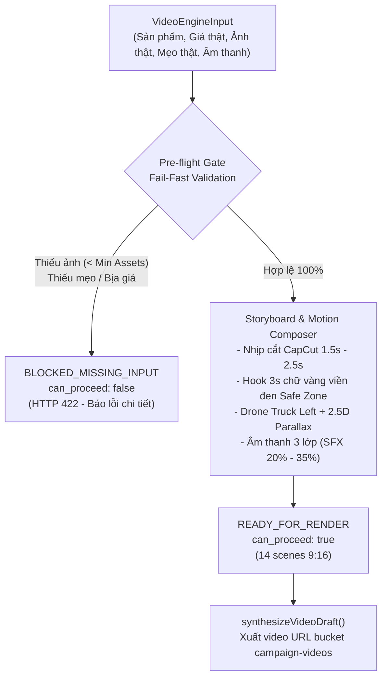

# BE1 WEEK 3 — COMMERCE, MEDIA LIBRARY & CORE AI VIDEO ENGINE HANDOFF

**Project:** AI Travel Reseller MVP (TravelLink AI)  
**Sprint:** Tuần 3 (19/10/2026 – 24/10/2026)  
**Tác giả:** Nguyễn Minh Tuệ (Backend 1 Lead kiêm Project Manager)  
**Vai trò:** Database Architect, Attribution & Financial Security, Core AI Video Engine  
**Trạng thái:** Hoàn thành 100% các task trọng tâm BE1-W3-01 đến BE1-W3-06 (Sẵn sàng cho BE1-W3-07 & E2E)

---

## 1. BẢNG TỔNG HỢP TIẾN ĐỘ & DELIVERABLES

| Mã Task | Tên Nhiệm Vụ | Trạng Thái | File Mã Nguồn & Deliverables | Đối Tác Nhận Bàn Giao |
|---|---|---|---|---|
| **BE1-W3-05** | Gỡ bỏ nợ kỹ thuật trigger hòa giải tạm | **DONE** | `supabase/migrations/20261019100000_commerce_attribution_and_media.sql` | Toàn team |
| **BE1-W3-01** | Migration bảng `orders` & `commissions` | **DONE** | `supabase/migrations/20261019100000_commerce_attribution_and_media.sql`, `src/lib/database.types.ts` | FE Lead (Diệu), BE3 (Tú), QA |
| **BE1-W3-02** | Migration bảng `media_references` | **DONE** | Bảng `media_references` + RLS Policies + Indexes | FE Lead, Tester 3, BE2 |
| **BE1-W3-03** | API Quản lý Video Mẫu Merchant | **DONE** | `app/api/merchant/media/route.ts`, `src/lib/merchant/media-schema.ts`, `media-service.ts` | FE Lead, Tester 3 |
| **BE1-W3-04** | Attribution Engine & RPC Ví hoa hồng | **DONE** | `supabase/migrations/20261019184500_reseller_wallet_rpc_and_attribution.sql`, `app/api/reseller/wallet/route.ts` | FE Lead (Màn hình Ví), QA |
| **BE1-W3-06** | **Core AI Video Generation Engine** | **DONE** | `src/lib/video-engine/types.ts`, `generator.ts`, `tests/video-engine.test.ts` (9/9 pass) | FE Lead, BE3, Tester 2 |
| **BE1-W3-07** | Video API & Storage Pipeline | **IN PROGRESS** | `app/api/merchant/video/generate/route.ts`, bucket `campaign-videos` | FE Lead, BE3 |

---

## 2. PHÂN HỆ THƯƠNG MẠI & HOA HỒNG (COMMERCE & ATTRIBUTION)

### 2.1. Cấu trúc Cơ sở dữ liệu (`orders` & `commissions`)
- **Attribution liên kết:** Cột `click_id` trong `orders` liên kết với bảng `clicks`, xác định Reseller giới thiệu khách mua tour.
- **Công thức phân bổ tài chính (Business Rule BA):**
  - `gross_commission` = Tiền hoa hồng tổng từ Merchant.
  - `platform_fee` = 20% `gross_commission` (phí sàn TravelLink AI).
  - `reseller_commission` = 80% `gross_commission` (tiền Reseller thực nhận).
- **Chống gian lận (Anti-Fraud Security):**
  - Cột `flag_self_purchase`: Tự động đánh dấu khi phát hiện Reseller tự mua qua link của chính mình (chặn trục lợi chiết khấu).
  - State machine đơn hàng chặt chẽ: `pending` $\rightarrow$ `confirmed` $\rightarrow$ `paid` $\rightarrow$ `cancelled`/`refunded`.

### 2.2. RPC Thống kê Ví tiền Reseller (`get_reseller_wallet_summary`)
- File migration: `20261019184500_reseller_wallet_rpc_and_attribution.sql`.
- Endpoint tích hợp: `GET /api/reseller/wallet`.
- Định dạng dữ liệu trả về cho FE Lead dựng màn hình Ví (`app/reseller/wallet`):
  ```json
  {
    "success": true,
    "data": {
      "reseller_id": "uuid",
      "currency": "VND",
      "total_earned": 12500000,
      "available_balance": 9800000,
      "pending_clearance": 2700000,
      "total_orders": 45,
      "paid_orders": 38,
      "pending_orders": 7,
      "recent_transactions": [
        {
          "commission_id": "uuid",
          "order_id": "uuid",
          "customer_name": "Nguyễn Văn A",
          "product_name": "Tour Bà Nà Hills 1 Ngày",
          "reseller_amount": 240000,
          "status": "paid",
          "created_at": "2026-10-21T08:30:00Z"
        }
      ]
    }
  }
  ```

---

## 3. PHÂN HỆ THƯ VIỆN VIDEO MẪU MERCHANT (MERCHANT VIDEO LIBRARY)

### 3.1. Database Schema (`media_references`)
- Bảng lưu trữ liên kết video/ảnh mẫu của Merchant:
  - `merchant_id`: Khóa ngoại liên kết bảng `merchants`.
  - `platform`: `'upload' | 'tiktok' | 'reels' | 'youtube_shorts' | 'youtube' | 'other'`.
  - `style_tags`: Mảng tag phong cách (`['review', 'flycam', 'food', 'nhịp nhanh']`).
  - `analysis_metadata`: Metadata phục vụ phân tích AI.

### 3.2. Bộ API Quản lý Media (`/api/merchant/media`)
- **GET `/api/merchant/media`:** Lấy danh sách video mẫu (có phân trang, tìm kiếm, lọc theo platform/tag).
- **POST `/api/merchant/media`:** Thêm mới video mẫu kèm bộ kiểm tra Zod `createMediaReferenceSchema`.
- **DELETE `/api/merchant/media?id=uuid`:** Xóa video mẫu của Merchant.
- **Hỗ trợ Auth đa chế độ:** Nhận session cookie ở production và hỗ trợ `x-merchant-id` header cho môi trường test/dev.

---

## 4. PHÂN HỆ LÕI TẠO VIDEO AI (CORE AI VIDEO GENERATION ENGINE)

Thực thi 100% theo tài liệu quy chuẩn [`.ai/role/RuleAIAgentsGenVideo.md`](file:///E:/Tue/MyProject/AITravelReseller/ai-travel-reseller/.ai/role/RuleAIAgentsGenVideo.md).



### 4.1. Ba Nguyên tắc Sống còn (Zero-Tolerance Anti-AI Mandate)
1. **Tuyệt đối cấm AI tạo pixel ảo (No Generative Pixel AI):** Không dùng Sora/Runway sinh pixel giả gây biến dạng người hoặc đồ ăn. $100\%$ khung hình sử dụng ảnh và clip thật từ Merchant.
2. **Cho phép Spatial AI trên ảnh thật:**
   - **`2.5D_AERIAL_PARALLAX`** kết hợp chuyển động máy quay **`DRONE_TRUCK_LEFT`** (lia ngang như flycam) trên ảnh góc rộng/toàn cảnh (`AERIAL_WIDE`), biên độ dịch chuyển $\le 12\%$.
   - **`DEPTH_BASED_3D_KEN_BURNS`** tách lớp chiều sâu cho ảnh món ăn (`CLOSEUP_FOOD`) và phong cảnh (`SCENIC_MEDIUM`).
3. **Cơ chế Fail-Fast (`BLOCKED_MISSING_INPUT`):**
   - Công thức tài nguyên tối thiểu: $\text{Min Assets} = \lceil \text{Duration} / 2.2 \rceil$ (VD: 28s cần tối thiểu 13 ảnh thật).
   - Nếu thiếu ảnh thật hoặc thiếu mẹo thực tế $\rightarrow$ Hệ thống từ chối dựng video ngay lập tức, báo rõ nguyên nhân và hành động khắc phục, không tự bịa dữ liệu.

### 4.2. Chuẩn Dựng CapCut UGC & Âm thanh 3 Lớp
- **Nhịp cắt cảnh (Cut Pacing):** Rất nhanh, trung bình $2.0\text{s}$/cảnh (từ $1.5\text{s} - 2.5\text{s}$), xóa bỏ hoàn toàn hiện tượng slide ảnh đứng yên.
- **Hook 3 giây đầu:** Đặt tiêu đề lớn tại `CENTER_SAFE_ZONE`, màu chữ `#FFD700`, viền đen `#000000`, hiệu ứng nảy `POP_BOUNCE`.
- **Âm thanh 3 lớp:**
  - *Lớp 1:* Giọng đọc tự nhiên bản địa có đánh dấu nhịp thở (`[pause 0.3s]`, `[breath]`).
  - *Lớp 2:* BGM du lịch vui tươi âm lượng $18\%$.
  - *Lớp 3:* Âm thanh hiện trường (Ambient SFX) âm lượng $20\% - 35\%$ (sóng biển, gió đỉnh núi, xèo xèo đồ nướng).

---

## 5. HỢP ĐỒNG BÀN GIAO CHO CÁC VAI TRÒ (HANDOFF CONTRACTS)

### 5.1. Bàn giao cho FE Lead (Diệu — `FE-W3-06`)
Endpoint chuẩn bị tích hợp: **`POST /api/merchant/video/generate`**

- **Request Body JSON:**
  ```json
  {
    "campaign_id": "uuid",
    "product_id": "uuid",
    "target_platforms": ["TIKTOK", "INSTAGRAM_REELS", "FACEBOOK_REELS"],
    "persona": "Local Guide",
    "target_duration_sec": 28,
    "media_reference_ids": ["uuid-1", "uuid-2", "..."],
    "authentic_tips": [
      "Đi trước 8h30 sáng qua Cổng số 2 vắng khách",
      "Đỉnh núi chiều hay có sương mù se lạnh nhớ mang áo khoác nhẹ"
    ],
    "allow_3d_spatial_effects": true
  }
  ```

- **Mã phản hồi HTTP:**
  - `201 Created`: Trả về kịch bản và URL video hoàn tất trong bảng `contents`.
  - `422 Unprocessable Entity`: Khi vi phạm Pre-flight Gate (thiếu ảnh, thiếu mẹo) $\rightarrow$ FE đọc mảng `missing_or_invalid_inputs` để hiển thị Modal hướng dẫn Merchant tải thêm ảnh.
  - `400 Bad Request`: Sai format UUID hoặc schema.
  - `401 / 403 Forbidden`: Chưa đăng nhập hoặc không có quyền Merchant.

### 5.2. Bàn giao cho BE3 (Tú — `BE3-W3-03`)
Khi video được Core Engine render hoàn tất và lưu vào bảng `contents`, hệ thống kích hoạt Webhook/Event gửi sang n8n:
- **Event Topic:** `video.generation.completed`
- **Webhook Payload Sample:**
  ```json
  {
    "event": "video.generation.completed",
    "content_id": "33333333-3333-4333-8333-333333333333",
    "campaign_id": "22222222-2222-4222-8222-222222222222",
    "product_name": "Vé Combo Cuối Tuần ABC Theme Park",
    "video_url": "https://storage.travellink.vn/campaign-videos/abc-weekend-1792552508.mp4",
    "duration_sec": 28.0,
    "status": "ready",
    "hook_headline": "⚠️ LƯU Ý SỐNG CÒN KHI ĐI VÉ COMBO CUỐI TUẦN!",
    "created_at": "2026-10-21T10:30:00Z"
  }
  ```
BE3 dùng payload này để định dạng tin nhắn Telegram: *"Ting ting! Video chiến dịch mới đã sẵn sàng để tiếp thị"*.

---

## 6. LỆNH KIỂM THỬ ĐỘC LẬP (OFFLINE TEST SUITES)

Tất cả các module của BE1 đều có bộ test tự động độc lập, không phụ thuộc vào internet hay API bên ngoài:

```powershell
# 1. Chạy bộ kiểm thử Core AI Video Generation Engine (9 tests)
npm run test:video-engine

# 2. Chạy bộ kiểm thử API Media Library của Merchant
node --experimental-strip-types --test tests/merchant-media-api.test.ts

# 3. Kiểm tra toàn diện kiểu dữ liệu TypeScript (Zero Error)
npx tsc --noEmit
```
