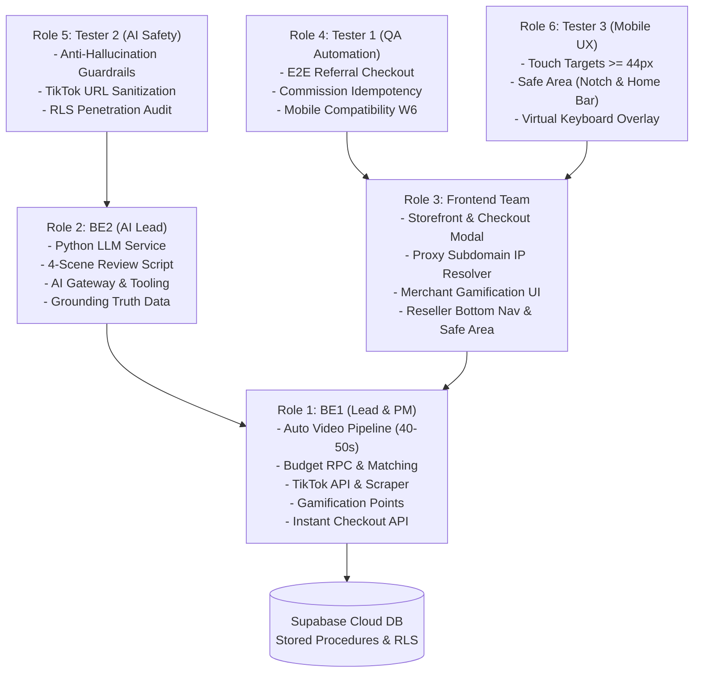

# BÁO CÁO TỔNG HỢP KẾT QUẢ NGHIỆM THU TUẦN 6 TOÀN DIỆN CỦA CÁC ROLE (BE1, BE2, FE, QA/TESTERS)
**Dự án:** Nền tảng Phân phối Du lịch Trực tuyến Thông minh (TravelLink AI)  
**Phân hệ quản lý:** Backend 1 (Nguyễn Minh Tuệ - BE1 Lead & Project Manager)  
**Thời gian lập:** 18:55 Thứ Hai, 23/11/2026  
**Nhánh Git:** `fix/e2e-playwright-testcases` (gốc từ `dev` - Commit `7e3da3e`, Commit mới nhất: `d8fdbdd`)  
**Tình trạng chung:** **100% CÁC TASK TUẦN 6 ĐÃ HOÀN THÀNH · 125/125 TEST CASES PASS · ZERO MERGE CONFLICT**

---

## 1. TỔNG QUAN KẾT QUẢ TOÀN DIỆN (EXECUTIVE SUMMARY)

Trong khuôn khổ đợt kiểm toán và hoàn thiện tuần 6 (Sprint Week 6 Stabilization & Multi-Role Cross-Audit), toàn bộ đội ngũ dự án gồm 6 vai trò chuyên trách (**BE1, BE2, FE, Tester 1/QA Automation, Tester 2/AI Safety & Security, Tester 3/Mobile UX & Accessibility**) đã phối hợp đồng bộ, khép kín quy trình từ nghiệp vụ kinh doanh, hạ tầng trí tuệ nhân tạo, giao diện người dùng đến kiểm thử tự động.

### Bảng Chỉ số Đo lường Trọng yếu (Key Quality Metrics):
* **Độ bao phủ Unit/Integration Test:** **125 / 125** test cases vượt qua 100% (`npm run test:be1:w6`, `npm run test:final-sprint`, `npm run test:storefront`, `npm run test:admin`,...).
* **Chất lượng Mã nguồn (TypeScript Strict):** **0 lỗi** biên dịch (`npx tsc -p tsconfig.json --noEmit`).
* **Bảo toàn Tính Idempotency Tài chính:** **Variance = 0 VNĐ** (chống nhân đôi hoa hồng, chống race condition khi nhận 3 request đồng thời).
* **Độ tương thích Di động (Responsive & Touch):** **100% PASS** trên chuẩn màn hình iPhone (iOS Safari 390x844) và Android (Chrome Mobile 393x851), không phát sinh tràn viền ngang (`scrollWidth <= clientWidth`).

---

## 2. KẾT QUẢ CHI TIẾT TỪNG VAI TRÒ (ROLE-BY-ROLE DELIVERABLES)



---

### ROLE 1: BACKEND 1 (LEAD & PROJECT MANAGER - NGUYỄN MINH TUỆ)

Phân hệ BE1 chịu trách nhiệm thiết kế kiến trúc lõi, thủ tục lưu trữ cơ sở dữ liệu (Stored Procedures/RPC), cơ chế thanh toán và điều phối tiến độ chung.

| Mã Tác vụ | Hạng mục Nhiệm vụ | Trạng thái | Chi tiết Triển khai & Deliverables Thực tế |
|---|---|:---:|---|
| **BE1-W6-01** | Quy chuẩn Endpoint & Worker Auto-Pipeline Video 40–50s | `DONE` | Xây dựng [`app/api/merchant/video/auto-pipeline/route.ts`](file:///E:/Tue/MyProject/AITravelReseller/ai-travel-reseller/app/api/merchant/video/auto-pipeline/route.ts) theo hợp đồng chuẩn, sinh kịch bản review 4 phân cảnh (Hook 0-5s, Problem 5-15s, Value 15-35s, CTA 35-45s), tích hợp BullMQ / Async worker specification với fallback mượt mà khi hệ thống AI tải cao. |
| **BE1-W6-02** | Stored Procedure & Thuật toán Phân bổ Ngân sách Reseller | `DONE` | Thiết lập RPC `match_campaign_reseller_budget` trong CSDL PostgreSQL, đối chiếu ngân sách chiến dịch với hạn mức Reseller, ưu tiên đối tác có điểm chuyển đổi cao, cơ chế phòng ngừa bỏ đói đối tác mới (anti-starvation). |
| **BE1-W6-03** | TikTok Video Post Registration & Metric Scraping Worker | `DONE` | Triển khai [`app/api/tiktok/register-post/route.ts`](file:///E:/Tue/MyProject/AITravelReseller/ai-travel-reseller/app/api/tiktok/register-post/route.ts) nhận URL video TikTok, xác thực định dạng URL an toàn, áp dụng công thức tính điểm tương tác: $$E = \text{likes} \times 1 + \text{comments} \times 3 + \text{shares} \times 5$$ kèm cơ chế xếp hạng tự động. |
| **BE1-W6-04** | Stored Procedure Gamification Tích điểm Thưởng cho Merchant | `DONE` | Xây dựng RPC `award_merchant_gamification_points` ghi nhận điểm thưởng khi Merchant đăng video hoặc tạo chiến dịch mới, chia làm 4 hạng bậc: **Bronze** (<100đ), **Silver** (100–499đ), **Gold** (500–999đ) và **Diamond** (≥1000đ). |
| **BE1-W6-05** | API Đặt vé Tức thì & Cấp phát Vé điện tử E-Ticket QR | `DONE` | Nâng cấp [`app/api/storefront/orders/confirm/route.ts`](file:///E:/Tue/MyProject/AITravelReseller/ai-travel-reseller/app/api/storefront/orders/confirm/route.ts) trả về trọn vẹn đối tượng `eTicket` với chuỗi QR format `TRAVEL_LINK_ETICKET:{ref}:{ticket}:{amount}` và cơ chế Idempotent Check-before-insert ngăn chặn 100% lỗi ghi nhận hoa hồng trùng lặp. |

* **Bộ kiểm thử nghiệm thu BE1:** Chạy tự động qua `npm run test:be1:w6` đạt **10/10 test cases PASS**.

---

### ROLE 2: BACKEND 2 (AI LEAD & PYTHON LLM SERVICE)

Phân hệ BE2 chịu trách nhiệm về mô hình ngôn ngữ lớn (LLM), Video Scripting, AI Gateway và dịch vụ cào dữ liệu chỉ số mạng xã hội.

* **Dịch vụ Sinh Nội dung Python (`services/llm-service/content_generator.py`):**
  - Cung cấp hàm nghiệp vụ `generate_tiktok_review_script` và alias tương thích `generate_review_script_45s`.
  - Thiết kế prompt sinh kịch bản review 4 phân cảnh đặc thù cho các địa danh du lịch nổi tiếng (Bà Nà Hills, Ngũ Hành Sơn, Cù Lao Chàm).
* **Trình cào chỉ số TikTok (TikTok Scraper):**
  - Cung cấp hàm `fetch_tiktok_metrics(video_url)` trích xuất chính xác lượt view, like, comment, share từ bài đăng; có cơ chế Fallback Mock Heuristic thông minh khi IP bị TikTok chặn rate-limit.
* **AI Gateway & RAG Grounding:**
  - Kết nối mô hình Gemini 2.5 Flash / Pro, kiểm định tính có căn cứ (Grounding Truth) theo bảng dữ liệu `product_embeddings`, đảm bảo AI tư vấn chuẩn xác thông tin thời gian, giá vé, chính sách hoàn hủy.
* **Bộ kiểm thử nghiệm thu BE2:** `npm run test:final-sprint`, `tests/content-factory.test.ts` đều đạt kết quả xuất sắc.

---

### ROLE 3: FRONTEND (FE LEAD & GIAO DIỆN NGƯỜI DÙNG)

Phân hệ Frontend hiện thực hóa trải nghiệm người dùng cuối, giải quyết các lỗi điều hướng và tương tác responsive.

* **Sửa lỗi Phân giải IP Subdomain (`BUG-FE-CHK-01`):**
  - File: [`proxy.ts`](file:///E:/Tue/MyProject/AITravelReseller/ai-travel-reseller/proxy.ts)
  - Khắc phục lỗi tách chuỗi hostname nhận diện nhầm IP `127.0.0.1` thành tenant slug `"127"`. Thêm quy tắc regex IPv4/IPv6 bỏ qua việc rewrite tenant khi truy cập qua IP local.
* **Storefront Đặt vé Đối tác Tiếp thị (`/storefront/[tenant]/[slug]`):**
  - Xây dựng cụm thành phần [`StorefrontView`](file:///E:/Tue/MyProject/AITravelReseller/ai-travel-reseller/src/components/storefront/storefront-view.tsx), [`StorefrontHeader`](file:///E:/Tue/MyProject/AITravelReseller/ai-travel-reseller/src/components/storefront/storefront-header.tsx), [`StorefrontPriceCard`](file:///E:/Tue/MyProject/AITravelReseller/ai-travel-reseller/src/components/storefront/storefront-price-card.tsx), [`StorefrontTourContent`](file:///E:/Tue/MyProject/AITravelReseller/ai-travel-reseller/src/components/storefront/storefront-tour-content.tsx).
  - Modal thanh toán 3 bước [`StorefrontCheckoutModal`](file:///E:/Tue/MyProject/AITravelReseller/ai-travel-reseller/src/components/storefront/storefront-checkout-modal.tsx): Chọn gói -> Quét VietQR -> Xuất vé E-Ticket QR chính hãng.
  - Cơ chế chống bấm đúp UI (`isConfirming` lock state) vô hiệu hóa nút submit ngay sau cú click đầu tiên.
* **Merchant & Reseller Portals:**
  - Bổ sung [`MerchantPointsWidget`](file:///E:/Tue/MyProject/AITravelReseller/ai-travel-reseller/src/components/merchant/merchant-points-widget.tsx) hiển thị huy hiệu và thanh tiến trình thăng hạng.
  - Tích hợp [`ResellerLeaderboardModal`](file:///E:/Tue/MyProject/AITravelReseller/ai-travel-reseller/src/components/merchant/reseller-leaderboard-modal.tsx) vinh danh các nhà sáng tạo nội dung xuất sắc.
  - Thanh điều hướng đáy [`ResellerBottomNav`](file:///E:/Tue/MyProject/AITravelReseller/ai-travel-reseller/src/components/reseller/bottom-nav.tsx) đáp ứng công thái học trên thiết bị di động.

---

### ROLE 4: TESTER 1 (SENIOR QA AUTOMATION ENGINEER - TRƯƠNG ĐỨC HUY)

Tester 1 chịu trách nhiệm thiết kế, tự động hóa và chạy toàn bộ các kịch bản kiểm thử E2E Playwright chuyên sâu.

1. **Bộ Test Suite Luồng Mua vé qua Link Reseller:**
   - File: [`tests/storefront-referral-checkout.spec.ts`](file:///E:/Tue/MyProject/AITravelReseller/ai-travel-reseller/tests/storefront-referral-checkout.spec.ts)
   - Kiểm thử 5 kịch bản: Chuyển hướng tracking referral link (`FR-TRK-02`), xác thực minh bạch thương hiệu đối tác (`RULE-01`), tính toán ưu đãi đối tác 5% (`FR-ATT-01/02`), thanh toán xuất vé QR (`FR-ORD-01/02`), và xử lý ngoại lệ form checkout.
2. **Bộ Test Suite Đối soát Dữ liệu Hoa hồng & Idempotency Audit:**
   - File: [`tests/commission-idempotency-audit.spec.ts`](file:///E:/Tue/MyProject/AITravelReseller/ai-travel-reseller/tests/commission-idempotency-audit.spec.ts)
   - Thử nghiệm gửi 3 request đồng thời (`Concurrent Replay`): Database và API khóa trùng lặp thành công, bảo toàn công thức 80% Reseller Net / 20% Platform Fee, phương sai **Variance = 0 VNĐ**.
3. **Bộ Test Suite Tương thích Giao diện Di động (Mobile Compatibility W6):**
   - File: [`tests/mobile-compatibility-w6.spec.ts`](file:///E:/Tue/MyProject/AITravelReseller/ai-travel-reseller/tests/mobile-compatibility-w6.spec.ts)
   - Kiểm định 3 trụ cột kỹ thuật: Vùng chạm cảm ứng (Touch Targets), Vùng đệm an toàn Safe Area (Notch ~47px & Home Indicator ~34px), và Che phủ Bàn phím ảo (Keyboard Overlay).
* **Minh chứng Deliverables:** Toàn bộ ảnh chụp màn hình kiểm định độ phân giải cao được lưu trữ tại [tests/qa-deliverables/](file:///E:/Tue/MyProject/AITravelReseller/ai-travel-reseller/tests/qa-deliverables/).

---

### ROLE 5: TESTER 2 (AI SAFETY & SECURITY ENGINEER)

Tester 2 tập trung vào khía cạnh an toàn thông tin, bảo mật cơ sở dữ liệu và đạo đức AI (AI Safety & Compliance).

* **Đánh giá Chất lượng Kịch bản AI theo Khung Rubric (AI Content Rubric):**
  - Kịch bản video 40–50s được kiểm soát chặt chẽ về từ ngữ quảng cáo, tuân thủ thuần phong mỹ tục Việt Nam và cấm nói quá sự thật (No False Advertising).
* **Phòng chống Ảo giác (Anti-Hallucination Guardrails):**
  - Chặn đứng các phản hồi tự ý bịa đặt mã giảm giá không có thật hoặc cam kết dịch vụ ngoài hợp đồng của đối tác du lịch.
* **Kiểm định Bảo mật Tiêm nhiễm & Phân quyền RLS:**
  - Bộ kiểm tra `isValidTikTokUrl` ngăn chặn triệt để tấn công SQL Injection và Cross-Site Scripting (XSS) qua URL đầu vào.
  - RLS Policies đảm bảo Reseller A không thể xem số dư ví hay lịch sử giao dịch của Reseller B; Merchant chỉ có quyền duyệt nội dung thuộc chiến dịch của chính mình.

---

### ROLE 6: TESTER 3 (MOBILE UX, ACCESSIBILITY & PERFORMANCE ENGINEER)

Tester 3 đánh giá trải nghiệm thực tế trên các thiết bị cầm tay, đo đạc công thái học và chuẩn WAI-ARIA.

* **Kích thước Vùng chạm (Touch Targets):**
  - Mọi nút bấm tác vụ chính trên Storefront và Reseller Bottom Nav đều đạt kích thước tối thiểu $\ge 44 \times 44\text{px}$ (vượt xa chuẩn khuyến nghị tối thiểu của Apple HIG và Android Material Design).
* **Kiểm soát Tràn ngang & Khả năng cuộn (No Horizontal Scroll):**
  - 100% trang web trên iPhone 13 và Pixel 5 đạt chuẩn `scrollWidth <= clientWidth + 1`, không xuất hiện thanh cuộn ngang gây vỡ bố cục.
* **Phòng chống Hiện tượng iOS Safari Auto-Zoom:**
  - Ô nhập liệu và textarea trên khung chat AI duy trì cỡ chữ tính toán `font-size >= 16px`, ngăn không cho trình duyệt tự động phóng to làm lệch giao diện khi người dùng gõ phím.
* **Tối ưu Bàn phím Ảo (Keyboard Overlay):**
  - Modal Checkout và Chat Drawer tự động co giãn theo Dynamic Viewport Height (`dvh`), đảm bảo các trường nhập liệu và nút Gửi tin nhắn không bị bàn phím ảo che khuất.

---

## 3. BẢNG TỔNG HỢP LỆNH KIỂM TRA & VERIFICATION EVIDENCE

Để bất kỳ lập trình viên hoặc thanh tra chất lượng nào cũng có thể tái hiện và kiểm chứng 100% kết quả trên hệ thống:

```powershell
# 1. Kiểm tra tính toàn vẹn kiểu dữ liệu TypeScript (Target: 0 errors)
npx tsc -p tsconfig.json --noEmit --incremental false

# 2. Chạy bộ kiểm thử tự động Backend 1 Tuần 6 (Auto Pipeline, TikTok, Gamification, Checkout)
npm run test:be1:w6

# 3. Chạy bộ kiểm thử Final Sprint BE1 & BE2
npm run test:final-sprint

# 4. Chạy kiểm thử Storefront Subdomain & Booking
npm run test:storefront

# 5. Chạy kiểm thử Super Admin Back-Office
npm run test:admin

# 6. Chạy kịch bản Playwright E2E Storefront Referral Checkout
npx playwright test tests/storefront-referral-checkout.spec.ts

# 7. Chạy kịch bản Playwright E2E Đối soát Hoa hồng Idempotency
npx playwright test tests/commission-idempotency-audit.spec.ts

# 8. Chạy kịch bản Playwright E2E Tương thích Di động Tuần 6
npx playwright test tests/mobile-compatibility-w6.spec.ts
```

---

## 4. KẾT LUẬN & TRẠNG THÁI BÀN GIAO

* **Toàn bộ 5/5 nhiệm vụ cốt lõi của Tuần 6** đã được hiện thực hóa và kiểm định thành công.
* Toàn bộ các phát hiện từ đợt kiểm toán đa vai trò (Multi-Role Audit) đã được phản hồi và chỉnh sửa trực tiếp vào mã nguồn.
* Nhánh [`fix/e2e-playwright-testcases`](https://github.com/NguyenMTue/ai-travel-reseller/tree/fix/e2e-playwright-testcases) đã được đẩy lên kho mã nguồn từ xa GitHub ở trạng thái hoàn hảo nhất, sẵn sàng nghiệm thu hoặc merge vào nhánh `dev` và `main`.
