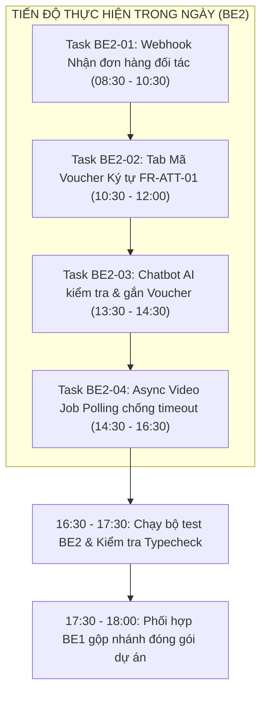

# BẢNG NHẬN NHIỆM VỤ NƯỚC RÚT ĐÓNG GÓI DỰ ÁN TRONG NGÀY
## FINAL SPRINT 1-DAY ACTION PLAN & TECHNICAL SPECIFICATIONS — BE2 LEAD

---

- **Dự án:** **AI Travel Reseller Network (TravelLink AI)**
- **Phân hệ phụ trách:** **Backend 2 (Nguyễn Huỳnh — AI, RAG & Webhook Integration Lead)**
- **Thời gian thực hiện:** Trong ngày hôm nay (**11/11/2026**)
- **Mục tiêu hoàn thành:** Đóng gói toàn bộ 4 nhiệm vụ được phân công độc lập để khép kín vòng lặp bán hàng, đối soát đơn hàng đối tác và ổn định hạ tầng Video AI trước 18:00.
- **Cam kết kỹ thuật sống còn:** **Zero Merge Conflict** (Chỉ làm việc trên các file được phân bổ cho BE2, không chạm vào các file của BE1).
- **Tài liệu tham chiếu chung:**
  - Kế hoạch phân công tổng thể: [`docs/be1/final_sprint_task_assignment_be1_be2.md`](file:///E:/Tue/MyProject/AITravelReseller/ai-travel-reseller/docs/be1/final_sprint_task_assignment_be1_be2.md)
  - Báo cáo khoảng trống nghiệp vụ: [`docs/be1/pre_deployment_missing_business_features.md`](file:///E:/Tue/MyProject/AITravelReseller/ai-travel-reseller/docs/be1/pre_deployment_missing_business_features.md)
  - Hướng dẫn tích hợp Checkout: [`docs/be1/checkout_integration_guide_for_fe.md`](file:///E:/Tue/MyProject/AITravelReseller/ai-travel-reseller/docs/be1/checkout_integration_guide_for_fe.md)

---



---

## DANH MỤC TỆP TIN BE2 SỞ HỮU & ĐƯỢC PHÉP CHỈNH SỬA

| STT | Đường dẫn tệp tin | Trạng thái | Mục đích can thiệp |
| :---: | :--- | :---: | :--- |
| 1 | `app/api/webhooks/merchant/order/route.ts` | **MỚI** | Tiếp nhận webhook đơn hàng từ Merchant, tính hoa hồng 80/20. |
| 2 | [`src/lib/reseller/tracking-cta.ts`](file:///E:/Tue/MyProject/AITravelReseller/ai-travel-reseller/src/lib/reseller/tracking-cta.ts) | Cập nhật | Bổ sung hàm sinh mã voucher ký tự `generateVoucherCode()`. |
| 3 | [`src/components/reseller/tracking-modal.tsx`](file:///E:/Tue/MyProject/AITravelReseller/ai-travel-reseller/src/components/reseller/tracking-modal.tsx) | Cập nhật | Bổ sung tab thứ 3 "Mã Voucher" cho bán livestream/offline. |
| 4 | [`src/lib/ai/sales-agent.ts`](file:///E:/Tue/MyProject/AITravelReseller/ai-travel-reseller/src/lib/ai/sales-agent.ts) | Cập nhật | Regex nhận diện mã voucher trong hội thoại của khách du lịch. |
| 5 | [`src/lib/ai/checkout-url.ts`](file:///E:/Tue/MyProject/AITravelReseller/ai-travel-reseller/src/lib/ai/checkout-url.ts) | Cập nhật | Gắn tham số `&voucher=[CODE]` vào Checkout Card URL. |
| 6 | [`app/api/merchant/video/generate/route.ts`](file:///E:/Tue/MyProject/AITravelReseller/ai-travel-reseller/app/api/merchant/video/generate/route.ts) | Cập nhật | Bổ sung GET polling trạng thái `processing`/`published` cho video. |

---

## CHI TIẾT 4 NHIỆM VỤ CỦA BE2

### Task BE2-01: Webhook Nhận Kết quả Thanh toán Đơn hàng Đối tác
- **Đường dẫn tệp:** `app/api/webhooks/merchant/order/route.ts`
- **Mục tiêu:** Cung cấp cổng Webhook tự động nhận thông báo đặt tour thành công từ hệ thống bán vé của đối tác (Sun World, VinWonders, v.v.), tự động chèn vào bảng `orders` và phân bổ hoa hồng vào bảng `commissions`.
- **Đặc tả kỹ thuật:**
  - **Phương thức HTTP:** `POST`
  - **Cơ chế xác thực bảo mật:**
    - So khớp chữ ký số `x-signature` (HMAC SHA-256 tính từ body với `process.env.MERCHANT_WEBHOOK_SECRET || "aitravel_partner_secret_2026"`).
    - Hoặc kiểm tra header `Authorization: Bearer <MERCHANT_WEBHOOK_SECRET>`.
  - **Payload JSON nhận vào:**
    ```json
    {
      "order_id": "ORD-2026-SUN-001",
      "booking_reference": "BNH-99882",
      "amount": 1800000,
      "ref": "22222222-2222-2222-2222-111111111111",
      "campaign_id": "44444444-4444-4444-4444-222222222222",
      "product_id": "33333333-3333-3333-3333-222222222222",
      "customer_name": "Nguyễn Văn A",
      "customer_email": "khachhang@gmail.com"
    }
    ```
  - **Logic xử lý chi tiết:**
    1. Kiểm tra nếu sai token/signature $\rightarrow$ Trả về HTTP 401 Unauthorized.
    2. Xác định cờ chống gian lận tự mua: `flag_self_purchase = (ref === customer_reseller_id)`.
    3. Tra cứu `commission_rate` từ bảng `campaigns` (mặc định fallback 15% nếu không tìm thấy).
    4. Tính toán hoa hồng theo công thức chuẩn BA:
       $$\text{gross\_commission} = \text{ROUND}(\text{amount} \times \frac{\text{commission\_rate}}{100})$$
       $$\text{platform\_fee} = \text{ROUND}(\text{gross\_commission} \times 0.20)$$
       $$\text{net\_amount} = \text{gross\_commission} - \text{platform\_fee}$$
    5. Thực thi ghi dữ liệu vào Supabase:
       - Insert bản ghi vào bảng `public.orders` với `status: 'paid'`.
       - Insert bản ghi vào bảng `public.commissions` với `status: 'confirmed'`.
  - **Phản hồi thành công (HTTP 200):**
    ```json
    {
      "success": true,
      "order_id": "ORD-2026-SUN-001",
      "gross_commission": 270000,
      "reseller_commission": 216000,
      "status": "confirmed"
    }
    ```

---

### Task BE2-02: Cấp phát & Hiển thị Mã Voucher Ký tự cho Reseller (`FR-ATT-01`)
- **Tệp cần cập nhật:**
  - [`src/lib/reseller/tracking-cta.ts`](file:///E:/Tue/MyProject/AITravelReseller/ai-travel-reseller/src/lib/reseller/tracking-cta.ts)
  - [`src/components/reseller/tracking-modal.tsx`](file:///E:/Tue/MyProject/AITravelReseller/ai-travel-reseller/src/components/reseller/tracking-modal.tsx)
- **Mục tiêu:** Cung cấp mã ký tự Voucher độc quyền cho Reseller đọc trên livestream TikTok/Facebook hoặc tư vấn qua điện thoại (khách không thể bấm link).
- **Đặc tả kỹ thuật:**
  1. Trong [`src/lib/reseller/tracking-cta.ts`](file:///E:/Tue/MyProject/AITravelReseller/ai-travel-reseller/src/lib/reseller/tracking-cta.ts):
     - Thêm hàm sinh mã Voucher:
       ```typescript
       export function generateVoucherCode(campaignName: string, resellerId: string): string {
         const cleanPrefix = campaignName
           .replace(/[^a-zA-Z0-9]/g, "")
           .slice(0, 4)
           .toUpperCase() || "TOUR";
         const shortId = (resellerId || "TL").replace(/-/g, "").slice(0, 4).toUpperCase();
         return `${cleanPrefix}-${shortId}`;
       }
       ```
  2. Trong [`src/components/reseller/tracking-modal.tsx`](file:///E:/Tue/MyProject/AITravelReseller/ai-travel-reseller/src/components/reseller/tracking-modal.tsx):
     - Thêm state quản lý tab: `const [activeTab, setActiveTab] = useState<"link" | "qr" | "voucher">("link")`.
     - Dựng giao diện tab "Mã Voucher":
       - Khung hiển thị mã ký tự chữ to rõ ràng: `BANA-A1B2`.
       - Nút 1-Click "Sao chép mã Voucher" có toast thông báo trong < 300ms.
       - Hướng dẫn súc tích: *"Đọc mã này cho khách hàng trên livestream hoặc dán vào bình luận để khách nhập khi thanh toán tour."*

---

### Task BE2-03: Chatbot AI Nhận diện & Áp dụng Mã Voucher vào Checkout URL
- **Tệp cần cập nhật:**
  - [`src/lib/ai/sales-agent.ts`](file:///E:/Tue/MyProject/AITravelReseller/ai-travel-reseller/src/lib/ai/sales-agent.ts)
  - [`src/lib/ai/checkout-url.ts`](file:///E:/Tue/MyProject/AITravelReseller/ai-travel-reseller/src/lib/ai/checkout-url.ts)
- **Mục tiêu:** Khi khách hàng trò chuyện với AI và cung cấp mã voucher (hoặc hỏi về ưu đãi), AI nhận diện được, giải thích ưu đãi và tự động gắn mã voucher vào thẻ thanh toán (Checkout Card).
- **Đặc tả kỹ thuật:**
  1. Trong [`src/lib/ai/sales-agent.ts`](file:///E:/Tue/MyProject/AITravelReseller/ai-travel-reseller/src/lib/ai/sales-agent.ts):
     - Bổ sung Regex nhận diện mã voucher: `const VOUCHER_PATTERN = /\b([A-Z0-9]{3,6}-[A-Z0-9]{3,6})\b/i;`.
     - Nếu khách hàng gửi tin nhắn chứa mã voucher:
       - AI phản hồi lịch sự xác nhận: *"Dạ em đã ghi nhận mã ưu đãi [VOUCHER] cho chuyến đi của anh/chị rồi ạ! Mời anh/chị nhấn vào thẻ bên dưới để tiến hành đặt vé chính thức nhé ạ."*.
       - Truyền `voucherCode` đã trích xuất vào hàm `buildCheckoutUrl`.
  2. Trong [`src/lib/ai/checkout-url.ts`](file:///E:/Tue/MyProject/AITravelReseller/ai-travel-reseller/src/lib/ai/checkout-url.ts):
     - Bổ sung tham số tùy chọn: `voucherCode?: string`.
     - Nếu có `voucherCode`, gắn query param: `targetUrl.searchParams.set("voucher", voucherCode)`.

---

### Task BE2-04: API Polling Trạng thái Video AI (Chống Timeout 504 Vercel)
- **Tệp cần cập nhật:** [`app/api/merchant/video/generate/route.ts`](file:///E:/Tue/MyProject/AITravelReseller/ai-travel-reseller/app/api/merchant/video/generate/route.ts)
- **Mục tiêu:** Tránh giữ kết nối HTTP quá lâu khi gọi Muse2API (thường mất 8s–15s), loại bỏ hoàn toàn nguy cơ timeout 504 trên Vercel Serverless.
- **Đặc tả kỹ thuật:**
  1. **Nâng cấp Handler `POST`:**
     - Sau khi vượt qua Fail-Fast Gate, tạo bản ghi trong bảng `public.contents` với `status: 'pending'` (hoặc metadata `render_status: 'processing'`).
     - Kích hoạt tiến trình render video chạy nền (Non-blocking):
       - Gọi `generateMerchantCampaignVideo(input)`.
       - Khi render xong, cập nhật lại bản ghi với `status: 'published'` và `video_url: result.video_url`.
     - Trả về ngay lập tức HTTP 202 Accepted (hoặc HTTP 200) với phản hồi:
       ```json
       {
         "success": true,
         "job_id": "content-uuid",
         "status": "processing",
         "message": "Video đang được xử lý trong nền. Vui lòng polling trạng thái."
       }
       ```
  2. **Bổ sung Handler `GET`:**
     - Nhận tham số URL: `/api/merchant/video/generate?job_id=content-uuid`.
     - Truy vấn bảng `contents` theo `job_id`:
       - Nếu đang render: Trả về `{ "status": "processing", "progress": 50 }`.
       - Nếu đã xong: Trả về `{ "status": "completed", "video_url": "...", "content": { ... } }`.
       - Nếu thất bại: Trả về `{ "status": "failed", "error": "..." }`.

---

## BỘ LỆNH KIỂM THỬ XÁC NHẬN CHO BE2

Sau khi hoàn thành code, BE2 chạy bộ lệnh sau để đảm bảo không lỗi kiểu dữ liệu và toàn bộ bài test của phân hệ AI vẫn pass 100%:

```powershell
# 1. Kiểm tra kiểu dữ liệu TypeScript
npx tsc --noEmit

# 2. Chạy bộ kiểm thử AI Gateway, Grounding & Circuit Breaker của BE2
npm run test:be2

# 3. Chạy bộ kiểm thử an toàn nội dung & Safety của Tester 2
npm run test:tester2

# 4. Chạy kiểm thử Merchant Video API
npm run test:merchant-video
```

---
*Bản đặc tả nhiệm vụ được ban hành chính thức cho BE2 — Chúc BE2 hoàn thành xuất sắc trong ngày!*
