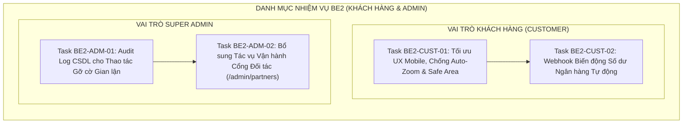

# BẢNG PHÂN CÔNG NHIỆM VỤ NÂNG CẤP & SỬA LỖI — PHÂN HỆ BE2
## CHUYÊN TRÁCH: VAI TRÒ KHÁCH HÀNG (CUSTOMER / STOREFRONT) & SUPER ADMIN

---

- **Dự án:** **AI Travel Reseller Network (TravelLink AI)**
- **Phân hệ phụ trách:** **Backend 2 (Nguyễn Huỳnh — AI, RAG & Webhook Integration Lead)**
- **Thời gian lập kế hoạch:** 24/11/2026
- **Mục tiêu hoàn thành:** Giải quyết triệt để các lỗi kiểm thử, điểm nghẽn trải nghiệm người dùng và hoàn thiện các chức năng còn thiếu cho 2 vai trò cốt lõi: **Khách hàng (Customer / Storefront & AI Chat)** và **Super Admin (Quản trị viên Back-Office)**.
- **Tài liệu căn cứ:**
  - Báo cáo kiểm toán chất lượng Tuần 6: [`docs/be1/week6-multi-role-final-report.md`](file:///E:/Tue/MyProject/AITravelReseller/ai-travel-reseller/docs/be1/week6-multi-role-final-report.md)
  - Báo cáo lỗi Frontend Storefront: [`tests/qa-deliverables/storefront-referral-checkout/bug-log-frontend-checkout.md`](file:///E:/Tue/MyProject/AITravelReseller/ai-travel-reseller/tests/qa-deliverables/storefront-referral-checkout/bug-log-frontend-checkout.md)
  - Báo cáo lỗi Mobile Compatibility: [`tests/qa-deliverables/mobile-compatibility-w6/bug-log-frontend-mobile-compat.md`](file:///E:/Tue/MyProject/AITravelReseller/ai-travel-reseller/tests/qa-deliverables/mobile-compatibility-w6/bug-log-frontend-mobile-compat.md)

---



---

## 1. MA TRẬN PHÂN BỔ TÁC VỤ & PHẠM VI TỆP TIN (BE2)

| Mã Task | Phân hệ / Vai trò | Mức độ Ưu tiên | Tệp tin can thiệp chính | Kết quả đầu ra (Deliverable) |
|---|---|:---:|---|---|
| **BE2-CUST-01** | Khách hàng (Mobile UX) | **P0** | • [`src/components/storefront/storefront-checkout-modal.tsx`](file:///E:/Tue/MyProject/AITravelReseller/ai-travel-reseller/src/components/storefront/storefront-checkout-modal.tsx)<br>• [`src/components/storefront/storefront-sticky-cta.tsx`](file:///E:/Tue/MyProject/AITravelReseller/ai-travel-reseller/src/components/storefront/storefront-sticky-cta.tsx)<br>• [`app/layout.tsx`](file:///E:/Tue/MyProject/AITravelReseller/ai-travel-reseller/app/layout.tsx) | Sửa triệt để lỗi iOS Safari Auto-Zoom (`font-size >= 16px`), khoảng đệm Safe Area đáy và accessibility chọn vé. |
| **BE2-CUST-02** | Khách hàng (Thanh toán) | **P1** | • `app/api/webhooks/bank/vietqr/route.ts` *(Mới)*<br>• [`src/lib/storefront/data.ts`](file:///E:/Tue/MyProject/AITravelReseller/ai-travel-reseller/src/lib/storefront/data.ts) | Webhook tự động bắt biến động số dư ngân hàng theo thời gian thực (Casso/Open Banking), tự xuất vé E-Ticket không cần bấm tay. |
| **BE2-ADM-01** | Super Admin (Anti-Fraud) | **P0** | • `supabase/migrations/20261124150000_fraud_audit_logs.sql` *(Mới)*<br>• `app/api/admin/fraud/dismiss/route.ts` *(Mới)*<br>• [`src/components/admin/admin-fraud-management.tsx`](file:///E:/Tue/MyProject/AITravelReseller/ai-travel-reseller/src/components/admin/admin-fraud-management.tsx) | API & Bảng CSDL lưu vết người gỡ cờ gian lận, thời điểm và lý do giải phóng hoa hồng. |
| **BE2-ADM-02** | Super Admin (Đối tác) | **P1** | • `app/api/admin/partners/status/route.ts` *(Mới)*<br>• [`src/components/admin/admin-partners-management.tsx`](file:///E:/Tue/MyProject/AITravelReseller/ai-travel-reseller/src/components/admin/admin-partners-management.tsx) | Nút Khóa tạm thời (Suspend), Kích hoạt lại (Reactivate) tài khoản đối tác vi phạm trực tiếp trên giao diện Admin. |

---

## 2. CHI TIẾT TỪNG NHIỆM VỤ DÀNH CHO BE2

### Task BE2-CUST-01: Tối ưu UX Mobile, Chống Auto-Zoom Safari & Tràn Viền Safe Area
- **Vấn đề cần giải quyết:** 
  1. Khi khách thao tác trên iPhone, chạm vào ô nhập Họ tên, SĐT, Email làm Safari tự động phóng to (Auto-zoom) do cỡ chữ đang dùng `text-xs md:text-sm` (12px–14px) thay vì $\ge 16\text{px}$ (`BUG-FE-MOB-01`).
  2. Nút Sticky CTA đáy Storefront thiếu đệm `env(safe-area-inset-bottom)` khiến ngón tay dễ quẹt nhầm thanh Home Indicator (`BUG-FE-MOB-02`).
  3. Thẻ chọn gói vé thiếu WAI-ARIA (`role="radio"`, hỗ trợ phím Enter/Space) (`BUG-FE-CHK-02`).
- **Nội dung thực hiện:**
  1. Trong [`src/components/storefront/storefront-checkout-modal.tsx`](file:///E:/Tue/MyProject/AITravelReseller/ai-travel-reseller/src/components/storefront/storefront-checkout-modal.tsx):
     - Thay đổi class các thẻ `<input>` thành `text-base md:text-sm` (đảm bảo hiển thị $\ge 16\text{px}$ trên mobile).
     - Bổ sung `role="radio"`, `tabIndex={0}`, `aria-checked` và lắng nghe sự kiện phím `onKeyDown` (Enter/Space) cho thẻ chọn gói vé.
  2. Trong [`src/components/storefront/storefront-sticky-cta.tsx`](file:///E:/Tue/MyProject/AITravelReseller/ai-travel-reseller/src/components/storefront/storefront-sticky-cta.tsx):
     - Bổ sung class `pb-[max(12px,env(safe-area-inset-bottom))]`.
  3. Trong [`app/layout.tsx`](file:///E:/Tue/MyProject/AITravelReseller/ai-travel-reseller/app/layout.tsx):
     - Cập nhật viewport metadata: `export const viewport: Viewport = { themeColor: "#204e4c", viewportFit: "cover" };`.
- **Tiêu chuẩn nghiệm thu (DoD):** Chạy lại kịch bản Playwright `tests/mobile-compatibility-w6.spec.ts` đạt 100% PASS; font-size input đo được $\ge 16\text{px}$, không còn hiện tượng Safari auto-zoom.

---

### Task BE2-CUST-02: Cổng Webhook Nhận Biến Động Số Dư Tự Động (Auto Banking Webhook)
- **Vấn đề cần giải quyết:** Hiện tại khách quét VietQR xong vẫn phải nhấn nút *"Tôi đã chuyển khoản • Xuất vé"*. Cần tự động hóa 100% việc cấp vé khi tiền vào tài khoản ngân hàng.
- **Nội dung thực hiện:**
  1. Xây dựng route `app/api/webhooks/bank/vietqr/route.ts`:
     - Nhận webhook payload từ đối tác kết nối ngân hàng (Casso / SeAPay / Napas Open API).
     - Xác thực chữ ký bí mật `Secure-Token` hoặc Bearer Auth.
     - Trích xuất mã giao dịch từ nội dung chuyển khoản (Memo format: `TL-[ORDER_ID]` hoặc `ET-[CODE]`).
     - Tự động cập nhật trạng thái đơn hàng trong bảng `orders` thành `status = 'paid'`.
     - Kích hoạt phân bổ hoa hồng tự động qua Stored Procedure `process_order_attribution`.
  2. Tích hợp SSE (Server-Sent Events) hoặc Polling nhẹ tại màn hình thanh toán để modal tự động chuyển sang Step 3 (Xuất vé E-Ticket) ngay khi webhook kích hoạt thành công.
- **Tiêu chuẩn nghiệm thu (DoD):** Bắn request mô phỏng chuyển khoản thành công vào endpoint webhook, đơn hàng tự động chuyển sang `paid` và vé E-Ticket được kích hoạt ngay lập tức.

---

### Task BE2-ADM-01: Bảng CSDL & API Audit Log cho Thao Tác Gỡ Cờ Gian Lận (Anti-Fraud)
- **Vấn đề cần giải quyết:** Thao tác "Gỡ cờ cảnh báo" trên trang `/admin/fraud` hiện mới chỉ xóa bản ghi khỏi bộ nhớ state của React, chưa lưu vết lịch sử vào CSDL.
- **Nội dung thực hiện:**
  1. Tạo migration `supabase/migrations/20261124150000_fraud_audit_logs.sql`:
     ```sql
     CREATE TABLE public.fraud_audit_logs (
       id UUID PRIMARY KEY DEFAULT gen_random_uuid(),
       order_id UUID NOT NULL REFERENCES public.orders(id),
       admin_id UUID NOT NULL REFERENCES auth.users(id),
       action TEXT NOT NULL DEFAULT 'dismiss_flag',
       reason TEXT NOT NULL,
       previous_status TEXT NOT NULL,
       created_at TIMESTAMPTZ DEFAULT NOW()
     );
     ALTER TABLE public.fraud_audit_logs ENABLE ROW LEVEL SECURITY;
     CREATE POLICY "Admin only access fraud logs" ON public.fraud_audit_logs
       FOR ALL USING (auth.jwt()->>'role' = 'service_role' OR auth.jwt()->>'email' LIKE '%@travellink.vn');
     ```
  2. Xây dựng API route `app/api/admin/fraud/dismiss/route.ts`:
     - Nhận payload `{ orderId: string, reason: string }`.
     - Kiểm tra quyền Super Admin, cập nhật `flag_self_purchase = false` trong bảng `orders` và chèn bản ghi vào bảng `fraud_audit_logs`.
  3. Đấu nối hàm `handleDismissFlag` trong [`src/components/admin/admin-fraud-management.tsx`](file:///E:/Tue/MyProject/AITravelReseller/ai-travel-reseller/src/components/admin/admin-fraud-management.tsx) gọi API trên kèm modal xác nhận nhập lý do gỡ cờ.
- **Tiêu chuẩn nghiệm thu (DoD):** Bấm gỡ cờ cảnh báo, dữ liệu lưu vết vào bảng `fraud_audit_logs` với đầy đủ ID admin và lý do; hoa hồng được giải phóng an toàn.

---

### Task BE2-ADM-02: Bổ Sung Tác Vụ Vận Hành Cổng Đối Tác (`/admin/partners`)
- **Vấn đề cần giải quyết:** Trang quản lý đối tác hiện ở dạng danh sách đọc (Read-only), thiếu nút khóa tài khoản vi phạm hoặc điều chỉnh hạn mức hoa hồng sàn.
- **Nội dung thực hiện:**
  1. Xây dựng API route `app/api/admin/partners/status/route.ts`:
     - Nhận `{ partnerId: string, role: "merchant" | "reseller", status: "active" | "suspended", notes: string }`.
     - Cập nhật trạng thái hoạt động trong bảng tương ứng (`merchants` hoặc `resellers`).
  2. Cập nhật giao diện [`src/components/admin/admin-partners-management.tsx`](file:///E:/Tue/MyProject/AITravelReseller/ai-travel-reseller/src/components/admin/admin-partners-management.tsx):
     - Thêm cột "Hành động" (Actions) trên bảng danh sách.
     - Nút "Khóa tạm thời" (Suspend) với icon cảnh báo màu đỏ và modal xác nhận.
     - Nút "Kích hoạt lại" (Reactivate) đối với các tài khoản đang bị tạm ngưng.
- **Tiêu chuẩn nghiệm thu (DoD):** Super Admin có thể khóa tài khoản đối tác gian lận trực tiếp trên giao diện; tài khoản bị khóa sẽ không thể đăng nhập hoặc tạo link tiếp thị.

---

## 3. KỊCH BẢN KIỂM THỬ XÁC MINH (VERIFICATION)
```powershell
# 1. Kiểm tra Type-check TypeScript
npx tsc -p tsconfig.json --noEmit

# 2. Chạy bộ kiểm thử Super Admin Back-Office
npm run test:admin

# 3. Chạy kiểm thử luồng Storefront và Mobile Compatibility
npm run test:storefront
npx playwright test tests/mobile-compatibility-w6.spec.ts
```
