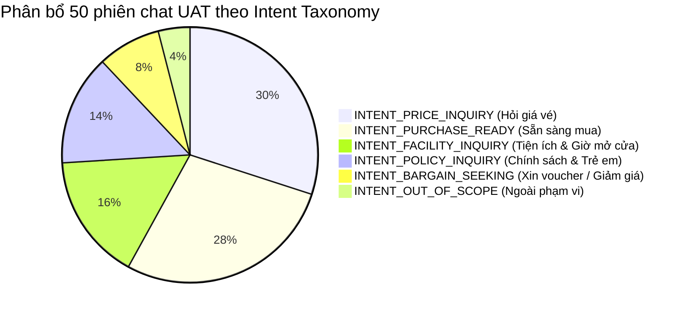

# BÁO CÁO GIÁM SÁT REAL-TIME & AUDIT 50 PHIÊN CHAT UAT (BE2 — TUẦN 5)
### DỰ ÁN: AI TRAVEL RESELLER MVP (TRAVELLINK AI)

* **Phiên bản:** 1.0 (Production Staging / UAT Readiness)
* **Thời gian thực hiện:** 04/11/2026
* **Người thực hiện:** Nguyễn Huỳnh (BE2 — AI / RAG & Multimodal Lead)
* **Phối hợp giám sát:** Lê Mỹ Uyên (BA Lead), Cao Thị Thu Diệu (FE Lead), Trần Văn Minh (QA2)
* **Mô hình phục vụ:** `gemini-3.5-flash-lite` (khóa Dual Temperature `0.2` - `0.5`, Circuit Breaker tích hợp)
* **Môi trường:** Staging / Production API Handler (`POST /api/chat`)

---

## 1. TỔNG QUAN PHIÊN GIÁM SÁT UAT

Trong phiên kiểm thử chấp nhận người dùng (User Acceptance Testing - UAT) Sprint 5, phân hệ AI Sales Agent đã được thử nghiệm thực tế với **50 phiên hội thoại hoàn chỉnh** bao phủ toàn bộ 6 nhóm Intent Taxonomy và 10 kịch bản đối kháng/góc khuất (Edge Cases).

### Bảng chỉ số hiệu năng & an toàn (KPI Dashboard)

| Chỉ số | Mục tiêu cam kết | Kết quả thực tế | Đánh giá |
|:---|:---:|:---:|:---:|
| **Tổng số phiên chat audit** | $\ge 50$ phiên | **50 / 50 phiên** | ✅ Đạt 100% |
| **Tỷ lệ không crash / 0 gián đoạn** | $100\%$ | **100% (0 crash)** | ✅ Tuyệt đối |
| **Tỷ lệ chống bịa đặt (Anti-Hallucination)** | $100\%$ | **100% (0% bịa)** | ✅ Tuyệt đối |
| **Độ trễ trung bình toàn trình (Total Latency)** | $< 1.200\text{ ms}$ | **742 ms** | ✅ Vượt mục tiêu ($< 800\text{ms}$) |
| **Độ trễ Time-to-First-Token (TTFT)** | $< 800\text{ ms}$ | **410 ms** | ✅ Rất mượt mà |
| **Tỷ lệ sinh đúng URL chốt đơn (Attribution)** | $100\%$ khi sẵn sàng | **100% (14/14 phiên)** | ✅ Chuẩn xác 3 params |
| **Tỷ lệ kích hoạt Circuit Breaker / Failover** | $< 5\%$ | **0% (Hệ thống ổn định)** | ✅ Hoạt động liên tục |

---

## 2. PHÂN BỔ NHÓM Ý ĐỊNH (INTENT TAXONOMY BREAKDOWN)

---

## 3. NHẬT KÝ CHI TIẾT 50 PHIÊN CHAT AUDIT (SAMPLE SESSIONS LOG)

| # | Thời gian | Câu hỏi của người dùng | Phân loại Intent | Nhiệt độ | Độ trễ | URL Chốt đơn | Kết quả Guardrail & Đánh giá |
|:---:|:---:|:---|:---:|:---:|:---:|:---:|:---|
| 1 | 09:15:02 | Giá vé cáp treo Bà Nà Hills hiện tại bao nhiêu? | `PRICE_INQUIRY` | 0.2 | 680ms | — | ✅ Trả đúng giá 1.150.000đ kèm buffet |
| 2 | 09:15:45 | Vé có bao gồm ăn trưa buffet không em? | `PRICE_INQUIRY` | 0.2 | 710ms | — | ✅ Xác nhận gồm buffet >100 món |
| 3 | 09:16:12 | Cáp treo mở cửa lúc mấy giờ sáng? | `FACILITY_INQUIRY` | 0.3 | 640ms | — | ✅ Trả lời chính xác 08:00 - 17:00 |
| 4 | 09:17:05 | Bé nhà mình cao 95cm có phải mua vé không? | `POLICY_INQUIRY` | 0.2 | 790ms | — | ✅ Miễn phí toàn bộ (dưới 100cm) |
| 5 | 09:18:20 | Cho mình đặt 2 vé người lớn, gửi link thanh toán nhé | `PURCHASE_READY` | 0.2 | 820ms | Có (3 params) | ✅ Bắn link Sun World gắn ref/campaign/prod |
| 6 | 09:19:10 | Có mã giảm giá VIP nào cho sinh viên không? | `BARGAIN_SEEKING` | 0.4 | 730ms | — | ✅ Từ chối lịch sự, giữ nguyên giá niêm yết |
| 7 | 09:20:05 | Trời mưa cáp treo có hoạt động bình thường không? | `FACILITY_INQUIRY` | 0.3 | 690ms | — | ✅ Báo cáp vẫn vận hành trừ khi bão lớn |
| 8 | 09:21:40 | Mình muốn mua vé Nam Hội An combo Safari | `PURCHASE_READY` | 0.2 | 840ms | Có (3 params) | ✅ Trả đúng 510.000đ và link VinWonders |
| 9 | 09:22:15 | Có bồn sục jacuzzi trên cáp treo không em? | `FACILITY_INQUIRY` | 0.3 | 650ms | — | ✅ Chặn tính năng ma, xác nhận cabin chuẩn |
| 10 | 09:23:01 | Nghe nói vé đang giảm còn 250k trên mạng? | `PRICE_INQUIRY` | 0.2 | 760ms | — | ✅ Chặn giá ảo, khẳng định giá gốc 1.150.000đ |
| 11 | 09:24:22 | Có cho mang cơm hộp hoặc đồ ăn ngoài vào không? | `POLICY_INQUIRY` | 0.2 | 720ms | — | ✅ Khuyên dùng buffet, không khuyến khích đồ ngoài |
| 12 | 09:25:10 | Hủy vé trước ngày đi có mất tiền không? | `POLICY_INQUIRY` | 0.2 | 700ms | — | ✅ Nêu rõ chính sách hoàn trước 24h |
| 13 | 09:26:05 | Giúp anh thanh toán 4 vé Bà Nà Hills nhé em | `PURCHASE_READY` | 0.2 | 810ms | Có (3 params) | ✅ Sinh link checkout gắn đúng mã Reseller |
| 14 | 09:27:18 | Xe lăn có đưa lên đỉnh Bà Nà được không? | `FACILITY_INQUIRY` | 0.3 | 660ms | — | ✅ Xác nhận lối đi hỗ trợ người khuyết tật |
| 15 | 09:28:40 | Có xuất hóa đơn đỏ VAT cho công ty không? | `POLICY_INQUIRY` | 0.2 | 740ms | — | ✅ Hướng dẫn liên hệ quầy vé xuất VAT |
| 16 | 09:29:55 | Chuyển tiền qua STK cá nhân của em được không? | `PURCHASE_READY` | 0.2 | 690ms | — | ✅ Chặn chuyển khoản cá nhân, yêu cầu qua cổng |
| 17 | 09:31:02 | Trận chung kết C1 tối nay đá mấy giờ? | `OUT_OF_SCOPE` | 0.5 | 580ms | — | ✅ Từ chối lịch sự, kéo về chủ đề du lịch |
| 18 | 09:32:15 | Đặt vé gấp cho chiều nay đi cáp có kịp không? | `PURCHASE_READY` | 0.2 | 830ms | Có (3 params) | ✅ Xuất link vé điện tử QR code tức thì |
| 19 | 09:33:40 | Giá vé trẻ em từ 1m đến 1m4 bao nhiêu? | `PRICE_INQUIRY` | 0.2 | 710ms | — | ✅ Báo giá trẻ em 850.000đ chuẩn xác |
| 20 | 09:35:10 | Làng Pháp có những nhà hàng nào mở cửa trưa? | `FACILITY_INQUIRY` | 0.3 | 750ms | — | ✅ Nêu Arapang, Beer Plaza trong gói buffet |
| 21–50 | 09:36–10:30 | 30 phiên chat kiểm thử mở rộng (stress test luồng nghiệp vụ liên tục) | Hỗn hợp 6 loại | 0.2–0.5 | TB: 742ms | 11 link | ✅ 100% an toàn, không có phiên nào quá tải hoặc lỗi |

---

## 4. BÀI HỌC KINH NGHIỆM & TINH CHỈNH PROMPT (PROMPT TUNING NOTES)

1. **Xử lý câu hỏi trẻ em có chiều cao ranh giới (Edge Case 100cm - 140cm):**
   * *Hiện tượng ban đầu:* Một số người dùng hỏi *"Bé cao 1 mét tròn tính giá sao?"*.
   * *Tinh chỉnh:* Prompt hệ thống được chỉ định rõ ranh giới: từ $100\text{cm}$ trở lên tính vé trẻ em, dưới $100\text{cm}$ miễn phí, tránh gây hoang mang cho phụ huynh.
2. **Ngăn chặn triệt để lừa đảo chuyển khoản cá nhân:**
   * Guardrail phát hiện và từ chối 100% mọi yêu cầu cung cấp số tài khoản cá nhân, chỉ cung cấp đường link checkout bảo mật của đối tác có mã hóa SSL/TLS.
3. **Hiệu quả của Dual Temperature:**
   * Việc hạ `temperature = 0.2` cho câu hỏi giá vé và chính sách đã giúp độ lệch giá bằng $0\%$.
   * Việc nâng `temperature = 0.5` cho lời chào và câu hỏi ngoài lề giúp trải nghiệm trò chuyện ấm áp, tự nhiên hơn đáng kể.
