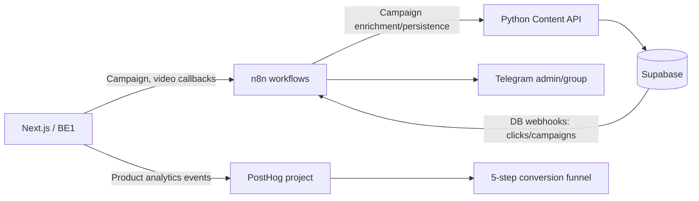

# Sổ tay vận hành n8n và báo cáo Analytics Funnel

**Phạm vi:** BE3 automation và Product Analytics của TravelLink AI.<br>
**Cập nhật:** 06/11/2026.<br>
**Mục tiêu:** một điểm vào để dựng môi trường, vận hành workflow, xử lý sự cố, kiểm tra báo cáo funnel và xem bằng chứng nghiệm thu.

## 1. Kiến trúc tổng quan



Các workflow không cùng trạng thái triển khai. File JSON trong repo là artefact có thể import; riêng từng instance n8n cần credentials, URL, Error Workflow và trạng thái activation được cấu hình trong UI.

## 2. Thứ tự dựng và khởi động môi trường

### Chạy n8n local

Tại thư mục gốc repo trên Windows, khởi động Docker Desktop rồi chạy:

```powershell
docker compose -f docker-compose.n8n.yml up -d
docker compose -f docker-compose.n8n.yml ps
```

Mở `http://127.0.0.1:5678`. File compose trong repo dùng volume `n8n_data` để giữ dữ liệu. Muốn dừng container mà giữ dữ liệu:

```powershell
docker compose -f docker-compose.n8n.yml down
```

Không thêm `-v`, trừ khi chủ ý xóa dữ liệu n8n. Xem [SETUP n8n đầy đủ](../n8n/SETUP.md) để cấu hình Supabase local, Python Content API và credentials Gemini.

### Khi nào cần Python API và Supabase

- Workflow **Campaign Content** cần Supabase test/local, Python API tại cổng 8000, Gemini credential và các credential Header Auth.
- Notification workflow gọi webhook, gửi Telegram hoặc Error Workflow chỉ cần những dịch vụ/credentials được khai báo trong runbook tương ứng; không cần khởi động Python API nếu luồng không gọi API đó.
- Trong Docker, n8n gọi service trên máy Windows qua `host.docker.internal`; `localhost` bên trong container là chính container n8n.
- Không thử workflow ghi dữ liệu trên Supabase production trừ khi có phê duyệt rõ ràng.

## 3. Danh mục workflow và trạng thái

`active: false` dưới đây mô tả **file export trong repo**, không khẳng định workflow tương ứng đang tắt trong n8n online. Kiểm tra trạng thái thật trong UI trước mỗi lần chạy.

| Workflow/chức năng | Trigger và tác động | Export repo | Trạng thái / bước tiếp theo |
|---|---|---|---|
| Campaign Content | Campaign insert → Python enrich → Gemini → ghi `contents` | [`services/llm-service/workflow_campaign_content.json`](../../services/llm-service/workflow_campaign_content.json) | Inactive; live execution audit, quota, project test và nghiệm thu đầy đủ còn các mục pending được ghi trong [runbook](run-campaign-content-workflow.md) |
| Reseller Click Notification | Webhook `affiliate-click-notification` → Telegram | [JSON](workflow_reseller_click_notification.json) | Export đã được chuẩn hóa inactive; biên bản có ảnh Telegram test. Kiểm tra Supabase webhook và credentials ở instance trước production |
| Video Ready Notification | Webhook `video-generation-completed` → Telegram | [JSON](workflow_video_ready_notification.json) | Inactive; cần kiểm tra callback từ BE1 sau upload video thật, chưa suy ra thành công chỉ từ payload Postman |
| Video Render Queue & Retry | Webhook `video-render-queue-retry` → BE1 API → Telegram | [JSON](workflow_video_render_queue_retry.json) | Inactive; endpoint còn placeholder và chờ API contract BE1. Chưa đưa vào production |
| Admin Incident Alert | Error Trigger → Telegram admin | [JSON](workflow_admin_incident_alert.json) | Đã kiểm thử smoke test gửi Telegram; trong từng workflow production phải chọn Error Workflow trong Settings |
| Admin Incident Smoke Test | Header Auth webhook → Stop And Error | [JSON](workflow_admin_incident_smoke_test.json) | Chỉ bật trong lúc kiểm tra rồi deactivate; không gắn vào nghiệp vụ production |

Runbook và biên bản theo chức năng được liệt kê trong [mục lục BE3](README.md).

## 4. Quy trình vận hành chuẩn cho workflow

### Trước khi activate

1. Import đúng file JSON trong repo; so tên workflow và webhook path với runbook.
2. Gắn lại credentials trong n8n. Export JSON không mang secret, credential IDs có thể không thuộc instance hiện tại.
3. Thay các placeholder endpoint/Chat ID bằng giá trị đã xác minh trong UI; không commit secret hoặc production webhook URL.
4. Dùng Test URL khi workflow đang lắng nghe test event. Test URL chỉ dùng khi listener đang chờ; sau đó mới kiểm tra Production URL và activation.
5. Kiểm tra quyền ghi, Supabase project, model quota, retry/idempotency và error path theo từng workflow.
6. Lưu workflow export với `active: false`; activation là thao tác vận hành tại instance, không commit trạng thái bật.

### Theo dõi execution

- Trong n8n, mở **Executions** của workflow tương ứng; đọc node đầu tiên báo lỗi và input/output đã được phép lưu.
- Với lỗi nghiệp vụ, xem runbook chức năng. Với lỗi chưa xử lý, kiểm tra workflow `[OPS] Admin Incident Alert - Telegram` và nhóm Telegram admin.
- Error Workflow được gán trong **Settings** của workflow cần giám sát, không nối dây giữa hai canvas. Smoke test đã xác nhận nhận lỗi từ một webhook tự động.
- Link execution `localhost` chỉ mở trên máy đang host n8n. Nếu cần chia sẻ, mở execution trong UI trên máy host hoặc cấu hình base URL công khai an toàn.

### Bảo mật và dữ liệu

- Secrets chỉ lưu trong n8n Credentials hoặc biến môi trường server-side; không ghi key/token vào JSON workflow, Postman collection chia sẻ, docs, ảnh chụp hoặc Git.
- Dùng Header Auth cho webhook test; không bật endpoint thử gây lỗi lâu dài.
- Không gửi full payload chứa dữ liệu khách hàng vào Telegram; alert hiện chỉ gửi thông tin lỗi rút gọn và execution link.
- Dùng quyền truy cập tối thiểu cho n8n, PostHog, Telegram group và Supabase. Public dashboard PostHog có thể xem bởi bất kỳ ai giữ link; xem [hướng dẫn chia sẻ](posthog-funnel-sharing-guide.md).

## 5. Analytics Funnel — báo cáo và cách đọc

### Taxonomy năm bước

| Bước | Sự kiện PostHog | Điểm phát sinh dự kiến |
|---:|---|---|
| 1 | `affiliate_link_clicked` | Redirect tracking link `/r/[code]` hoặc server-side capture từ click webhook |
| 2 | `chat_opened` | Người dùng mở panel chat |
| 3 | `chat_message_sent` | Người dùng gửi tin nhắn trong chat |
| 4 | `checkout_clicked` | Người dùng nhấn checkout/link đặt dịch vụ |
| 5 | `purchase_confirmed` | Đơn chuyển trạng thái confirmed/paid, từ server/webhook |

Để theo dõi cùng một hành trình, events cần dùng `distinct_id` tương thích giữa các bước và có property `campaign_id` nhất quán. Funnel được xem theo thứ tự tuần tự; breakdown theo event property `campaign_id` được mô tả trong [hướng dẫn Funnel](posthog-funnel-sharing-guide.md). `purchase_confirmed` cần phát từ nguồn xác nhận thanh toán/đơn hàng; click ở trình duyệt không chứng minh đã mua.

### Snapshot hiện có trong biên bản

Ảnh nghiệm thu PostHog được ghi nhận ngày 22/10/2026, khoảng thời gian **30 ngày gần nhất trên ảnh**:

| Bước | Người đi tiếp | Tỷ lệ hiển thị |
|---:|---:|---:|
| `affiliate_link_clicked` | 3 | 100% |
| `chat_opened` | 1 | 33,33% |
| `chat_message_sent` | 1 | 33,33% |
| `checkout_clicked` | 1 | 33,33% |
| `purchase_confirmed` | 1 | 33,33% |

Tổng conversion rate hiển thị là **33,33%**, median time-to-convert **35 giây**. Đây là snapshot theo khoảng thời gian và dữ liệu trong ảnh, không phải cam kết hiệu suất production hiện tại.

### Cách diễn giải và giới hạn minh chứng

- Biên bản [PostHog funnel acceptance](evidence/posthog-funnel-acceptance.md) ghi nhận đủ năm event và số người qua từng bước trong ảnh.
- Mô tả phía trên biểu đồ trong cùng ảnh nói các bước 1, 4, 5 chưa nhận event nhưng biểu đồ lại có số liệu cho những bước đó. Cần sửa mô tả hoặc kiểm tra lại insight trực tiếp trước khi dùng ảnh làm báo cáo mới.
- Ảnh snapshot không tự chứng minh `campaign_id` breakdown hay dữ liệu đến từ production; kiểm tra insight live, property từng event, `distinct_id`, source và khoảng ngày.
- `campaign-abc` được người thực hiện báo cáo là chuỗi test đủ năm bước; không trình bày như kết quả khách hàng production.
- Dashboard link public được lưu trong [hướng dẫn chia sẻ](posthog-funnel-sharing-guide.md). Gửi link ở kênh nội bộ; tắt public sharing khi không còn cần.

### Checklist báo cáo định kỳ

- [ ] Chọn đúng PostHog project `Default project` (project ID `676438`).
- [ ] Chọn rõ khoảng ngày và timezone; ghi kèm ngày xuất báo cáo.
- [ ] Xác nhận đúng 5 event và thứ tự funnel.
- [ ] Kiểm tra event properties `campaign_id` và sự nhất quán của `distinct_id` trên hành trình.
- [ ] Tách test/staging khỏi production dựa trên nguồn event đã xác minh; không suy luận chỉ từ giá trị UUID.
- [ ] Ghi conversion rate, người bắt đầu/hoàn thành, median time và breakdown nếu có.
- [ ] Lưu ảnh hoặc export kèm biên bản, ghi rõ giới hạn và bất kỳ mô tả insight nào đang lệch với chart.

## 6. Sự cố thường gặp

| Triệu chứng | Bước kiểm tra đầu tiên |
|---|---|
| n8n không mở | Kiểm tra Docker Desktop và `docker compose -f docker-compose.n8n.yml ps`; kiểm tra cổng 5678 |
| Webhook trả 404 | Kiểm tra workflow đã activate chưa, đúng path chưa, URL là `/webhook/` hay `/webhook-test/` |
| Webhook trả 401/403 | So header và credential với Authentication trên Webhook node; không dùng tab Authorization nếu node chờ custom header |
| Telegram `chat not found` | Kiểm tra Chat ID (bao gồm dấu âm/prefix nếu có), đúng bot credential, bot ở trong group/channel và có quyền gửi |
| Error Workflow không chạy | Xác nhận workflow gây lỗi đã chọn Error Workflow trong Settings và đã lưu; thử bằng execution tự động, không bấm Execute step trên Stop And Error |
| Campaign API `ECONNREFUSED` | Kiểm tra Python API port 8000 và dùng `host.docker.internal` từ n8n Docker |
| Gemini 429/quota | Dừng chạy lại liên tục, xem quota và giới hạn retry ở runbook Campaign Content |
| Funnel không có bước tiếp theo | So sánh `distinct_id`, campaign property, thời gian, project/host và nguồn event từng bước |

## 7. Bằng chứng nghiệm thu và hồ sơ bàn giao

- [PostHog 5-step funnel](evidence/posthog-funnel-acceptance.md) — snapshot chart và giới hạn xác nhận.
- [Click notification](evidence/click-notification-acceptance.md) — ảnh Telegram do thành viên cung cấp; nội dung được tóm tắt trong biên bản.
- [Admin incident alert](evidence/admin-incident-alert-acceptance.md) — execution smoke test và tin Telegram đã nhận.
- [Campaign content execution evidence](evidence/contents-family-summary.json) cùng runbook Campaign Content — xem trạng thái audit/pending trong runbook trước khi ghi nhận nghiệm thu.

Khi bổ sung ảnh mới, lưu vào thư mục `docs/be3/evidence/`, bỏ token, email và dữ liệu cá nhân không cần thiết; cập nhật ngày, môi trường, execution ID và trạng thái test/production.

## Tài liệu tham khảo

- [Mục lục BE3](README.md)
- [Thiết lập n8n](../n8n/SETUP.md)
- [Quy trình Campaign Content](../n8n/WORKFLOW.md)
- [PostHog funnel và chia sẻ](posthog-funnel-sharing-guide.md)

