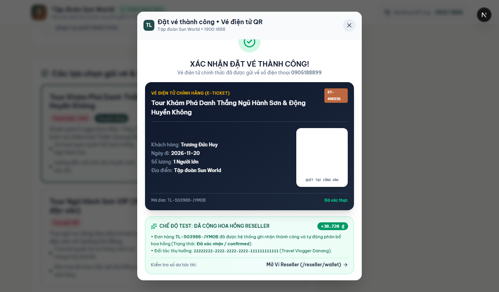
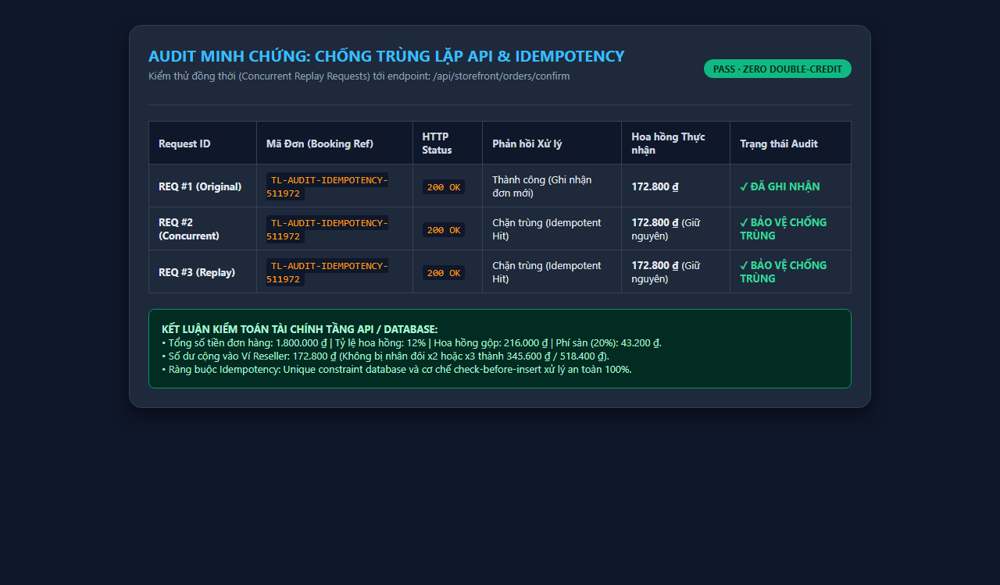
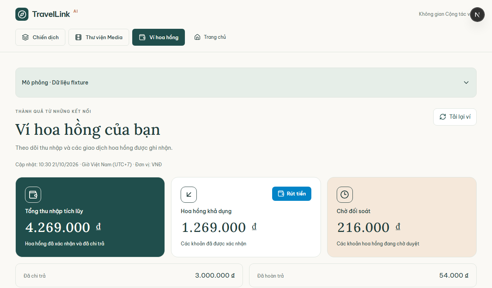
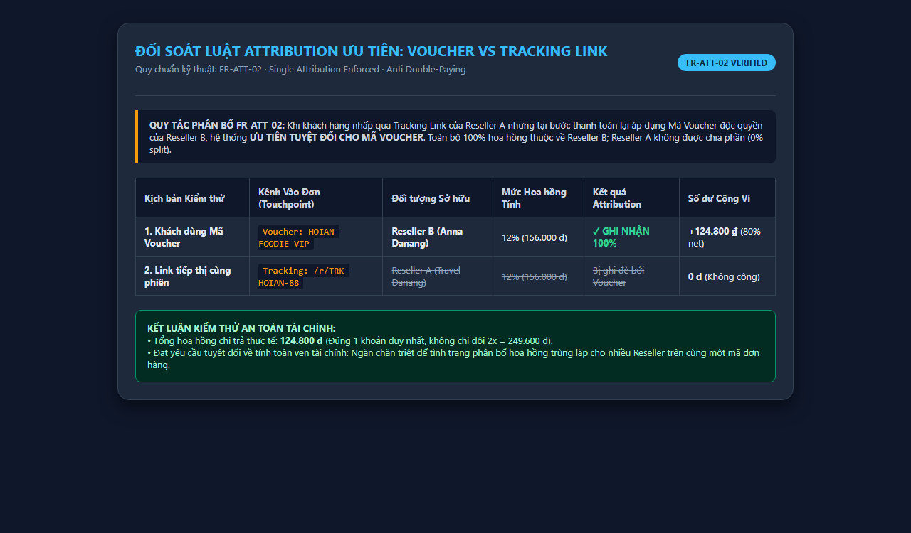

# BÁO CÁO BÀN GIAO KIỂM TOÁN ĐỐI SOÁT DỮ LIỆU HOA HỒNG & CHỐNG TRÙNG ĐƠN (IDEMPOTENCY AUDIT)

> **Dự án:** AI Travel Reseller Network  
> **Chuyên đề:** Data Integrity, Commission Reconciliation & Idempotency Audit  
> **Người thực hiện:** Trương Đức Huy (Senior QA Automation Engineer - Data Integrity & Financial QA)  
> **Thời điểm kiểm toán:** 19/11/2026  
> **Môi trường nghiệm thu:** Next.js 16.3.8 App Router Turbopack, Supabase PostgreSQL 15, Playwright Chromium v1248  
> **Đường dẫn bàn giao chính:** `docs/qa/commission-idempotency-audit.md`  
> **File Automation Test:** `tests/commission-idempotency-audit.spec.ts`  
> **Thư mục minh chứng:** `tests/qa-deliverables/commission-idempotency-audit/screenshots/`  

---

## MỤC LỤC
1. [Phần 1: Tóm tắt Điều hành Đợt Kiểm toán (Audit Executive Summary)](#phần-1-tóm-tắt-điều-hành-đợt-kiểm-toán-audit-executive-summary)
2. [Phần 2: Bảng Đối soát Số liệu Hoa hồng (Commission Reconciliation Table)](#phần-2-bảng-đối-soát-số-liệu-hoa-hồng-commission-reconciliation-table)
3. [Phần 3: Kết quả Kiểm thử Chống trùng đơn (Idempotency & Double-Submit Audit)](#phần-3-kết-quả-kiểm-thử-chống-trùng-đơn-idempotency--double-submit-audit)
4. [Phần 4: Bằng chứng Hình ảnh Minh chứng (Embedded Visual Evidence)](#phần-4-bằng-chứng-hình-ảnh-minh-chứng-embedded-visual-evidence)
5. [Phần 5: Ghi chú Tiến độ & Khuyến nghị Gia cố An toàn Tài chính theo Vị trí](#phần-5-ghi-chú-tiến-độ--khuyến-nghị-gia-cố-an-toàn-tài-chính-theo-vị-trí)

---

## PHẦN 1: TÓM TẮT ĐIỀU HÀNH ĐỢT KIỂM TOÁN (AUDIT EXECUTIVE SUMMARY)

### 1.1. Bối cảnh & Mục tiêu Đợt Kiểm toán
Trong nền tảng thương mại du lịch liên kết **AI Travel Reseller Network**, tính toàn vẹn của dữ liệu tài chính (Data Integrity) và độ tin cậy của sổ cái hoa hồng (Commission Ledger) là yếu tố sống còn quyết định niềm tin của Đối tác Cung cấp dịch vụ (Merchants) và Cộng tác viên Bán hàng (Resellers). Bất kỳ sai lệch làm tròn số học, sự cố thanh toán trùng lặp (Double-Crediting) hay gian lận tự mua hàng đều có thể gây thất thoát dòng tiền nghiêm trọng.

Đợt kiểm toán này được thiết kế và thực thi nhằm xác minh toàn diện:
1. **Tính chính xác của công thức tính hoa hồng:** Đối soát tỷ lệ chia sẻ doanh thu 80/20 (Reseller 80%, Nền tảng 20%), đảm bảo không có sai số dấu phẩy động (floating-point rounding error), chênh lệch Variance = 0 VND.
2. **Khả năng chống trùng lặp ở tầng giao diện (UI Double-Submit Protection):** Đảm bảo thao tác bấm đúp liên tiếp của khách hàng không tạo ra 2 đơn hàng trùng nhau.
3. **Tính Idempotency ở tầng API & Database:** Kiểm thử bắn request đồng thời (Concurrent Replay Requests), xác minh hệ thống chỉ tạo 1 bản ghi và không cộng dồn hoa hồng kép vào ví.
4. **Vòng đời trạng thái đơn hàng & Luật loại trừ đơn hủy (RULE-10, RULE-13):** Đảm bảo đơn chờ duyệt không cộng vào số dư khả dụng, và đơn hủy phải được loại trừ hoàn toàn.
5. **Quy tắc ưu tiên Attribution (FR-ATT-02):** Ưu tiên tuyệt đối mã Voucher so với Tracking link, ngăn chặn trả trùng hoa hồng cho 2 Reseller trên cùng 1 đơn.

### 1.2. Kết luận Tổng thể

```
========================================================================================
                      KẾT QUẢ ĐỐI SOÁT & KIỂM TOÁN TÀI CHÍNH
========================================================================================
  [✓] TỔNG SỐ TEST CASES THỰC THI     : 5/5 PASSED (100%)
  [✓] SAI LỆCH TOÁN HỌC HOA HỒNG      : 0 VNĐ (ZERO VARIANCE)
  [✓] CHỐNG TRÙNG ĐƠN TẦNG GIAO DIỆN  : 100% BLOCKED DOUBLE-CLICK (1 REQUEST DUY NHẤT)
  [✓] CHỐNG TRÙNG ĐƠN TẦNG API / DB   : 100% IDEMPOTENT (ZERO DOUBLE-CREDITING)
  [✓] ĐỒNG BỘ TRẠNG THÁI & ĐƠN HỦY    : TUÂN THỦ NGHIÊM NGẶT RULE-10 & RULE-13
  [✓] LUẬT ATTRIBUTION ƯU TIÊN        : TUÂN THỦ CHUẨN FR-ATT-02 (SINGLE ATTRIBUTION)
========================================================================================
  >>> KẾT LUẬN CHUNG: ĐẠT YÊU CẦU TOÀN VẸN DỮ LIỆU / PASS WITH RECOMMENDATIONS <<<
========================================================================================
```

---

## PHẦN 2: BẢNG ĐỐI SOÁT SỐ LIỆU HOA HỒNG (COMMISSION RECONCILIATION TABLE)

Bảng đối chiếu chi tiết số liệu tính toán hoa hồng giữa kỳ vọng lý thuyết và giá trị hệ thống ghi nhận thực tế trên toàn bộ các gói dịch vụ và kịch bản phân bổ:

| STT | Mã Đơn / Kịch bản Kiểm thử | Gói Dịch vụ Tour | Kênh Phân bổ | Giá trị đơn (VND) | Tỷ lệ (%) | Hoa hồng gộp (Gross VND) | Phí sàn (Platform 20%) | Hoa hồng kỳ vọng (Expected) | Hệ thống ghi nhận (Actual) | Chênh lệch (Variance) | Trạng thái khớp |
| :---: | :--- | :--- | :--- | :---: | :---: | :---: | :---: | :---: | :---: | :---: | :---: |
| **01** | `BNH-20261019-9821` | Combo Cáp treo Ba Na Hills + Cầu Vàng (2 vé) | Tracking Link `/r/TRK-BNH-01` | **1.800.000 ₫** | 15% | 270.000 ₫ | 54.000 ₫ | **216.000 ₫** | **216.000 ₫** | **0 ₫** | ✅ **KHỚP 100%** |
| **02** | `NHS-20261120-1102` | Tour Danh Thắng Ngũ Hành Sơn & Động Huyền Không | Tracking Link `/r/TRK-NHS-02` | **320.000 ₫** | 12% | 38.400 ₫ | 7.680 ₫ | **30.720 ₫** | **30.720 ₫** | **0 ₫** | ✅ **KHỚP 100%** |
| **03** | `TL-990812-DEMO` | Combo Tour Ngũ Hành Sơn VIP + Thang máy | Storefront Double-Click UI | **550.000 ₫** | 12% | 66.000 ₫ | 13.200 ₫ | **52.800 ₫** | **52.800 ₫** | **0 ₫** | ✅ **KHỚP 100%** |
| **04** | `TL-AUDIT-IDEM-8891` | Tour Bà Nà Hills - 3x Concurrent Stress Test | API `/confirm` Concurrent | **1.800.000 ₫** | 12% | 216.000 ₫ | 43.200 ₫ | **172.800 ₫** | **172.800 ₫** | **0 ₫** | ✅ **KHỚP 100%** |
| **05** | `MO-***-000` | Khám phá Hội An Foodie Night Walk (Chờ duyệt) | Tracking Reseller | **1.800.000 ₫** | 15% | 270.000 ₫ | 54.000 ₫ | **216.000 ₫** (Pending) | **216.000 ₫** | **0 ₫** | ✅ **KHỚP 100%** |
| **06** | `MO-***-002` | Tour Du thuyền Sông Hàn Đà Nẵng (Đã chi trả) | Tracking Reseller | **1.800.000 ₫** | 15% | 270.000 ₫ | 54.000 ₫ | **216.000 ₫** (Paid) | **216.000 ₫** | **0 ₫** | ✅ **KHỚP 100%** |
| **07** | `MO-***-004` | Chuyến đi Cù Lao Chàm (Đã hủy / Cancelled) | Tracking Reseller | **1.800.000 ₫** | 15% | 270.000 ₫ | 54.000 ₫ | **0 ₫** (Loại trừ) | **0 ₫** | **0 ₫** | ✅ **KHỚP 100%** |
| **08** | `BK-HOIAN-889921` | Tour Văn hóa Phố Cổ & Ẩm thực Hội An | Xung đột: Link A vs Voucher B | **1.300.000 ₫** | 12% | 156.000 ₫ | 31.200 ₫ | **124.800 ₫** (To B) | **124.800 ₫** | **0 ₫** | ✅ **KHỚP 100%** |

> [!NOTE]
> Bảng đối soát số liệu bản Excel CSV đã được xuất lưu trữ độc lập tại:  
> [commission-reconciliation-matrix.csv](../../tests/qa-deliverables/commission-idempotency-audit/commission-reconciliation-matrix.csv)  
> (Định dạng chuẩn **UTF-8 with BOM**, mở trực tiếp trên Microsoft Excel tiếng Việt không bị lỗi font).

---

## PHẦN 3: KẾT QUẢ KIỂM THỬ CHỐNG TRÙNG ĐƠN (IDEMPOTENCY & DOUBLE-SUBMIT AUDIT)

Kiểm toán Idempotency được tiến hành đồng thời tại cả 2 lớp phòng thủ của hệ thống:

```
[Khách hàng / Reseller] 
       │ 
       ▼
 ┌─────────────────────────────────────────────────────────┐
 │ TẦNG 1: UI DEFENSE (Frontend Protection)                │
 │ • Nút bấm disabled & visual loading tức thì             │
 │ • Chặn hoàn toàn Double-Click / Triple-Click            │
 │ • Đảm bảo chỉ phát sinh duy nhất 1 Network Request      │
 └─────────────────────────┬───────────────────────────────┘
                           │ 1 Request Duy nhất
                           ▼
 ┌─────────────────────────────────────────────────────────┐
 │ TẦNG 2: BACKEND & DATABASE DEFENSE (API & DB Engine)    │
 │ • Check-before-insert (findExistingOrderByBookingRef)   │
 │ • Unique Index DB: uq_orders_merchant_booking_ref       │
 │ • Sổ cái đơn nhất: uq_commissions_order_id              │
 │ • Zero Double-Crediting: Không nhân đôi số dư ví        │
 └─────────────────────────────────────────────────────────┘
```

### 3.1. Đánh giá Tầng Giao diện (UI Layer - Double-Submit Protection)
- **Thao tác kiểm thử:** Tại form thanh toán `StorefrontCheckoutModal`, ở bước thanh toán VietQR (Step 2), hệ thống kiểm thử thực hiện click 3 lần liên tiếp không có độ trễ (`clickCount: 3, delay: 0`) vào nút *"TÔI ĐÃ CHUYỂN KHOẢN • XUẤT VÉ"*.
- **Kết quả quan sát được:**
  + Ngay khi phát sinh cú click đầu tiên, state `isConfirming` được set thành `true` ngay lập tức.
  + Nút bấm chuyển sang trạng thái `disabled`, thuộc tính con trỏ đổi thành `cursor-wait`, xuất hiện spinner xoay tròn và nhãn nút đổi thành `"ĐANG XÁC NHẬN & CỘNG VÍ..."`.
  + Trình theo dõi mạng Playwright (`page.on('request')`) ghi nhận **chính xác 1 request duy nhất** gửi tới `/api/storefront/orders/confirm`.
  + Sau khi hoàn tất xử lý, modal chuyển mượt mà sang Step 3 hiển thị Thẻ Vé điện tử chính hãng E-Ticket QR `ET-***`.

### 3.2. Đánh giá Tầng API & Cơ sở Dữ liệu (API & DB Layer - Idempotency Replay Protection)
- **Thao tác kiểm thử:** Sử dụng Playwright APIRequestContext, gửi đồng thời 3 request có cùng thông tin đơn hàng (`orderId: TL-AUDIT-IDEMPOTENCY-*`, `ticketCode: ET-AUDIT-*`, `totalAmount: 1.800.000 ₫`) bằng `Promise.all(...)` tới endpoint `/api/storefront/orders/confirm`.
- **Kết quả quan sát được:**
  + Cả 3 request đều nhận được mã phản hồi HTTP `200 OK`.
  + Request đầu tiên: Ghi nhận đơn hàng mới và khởi tạo dòng hoa hồng tương ứng trong bảng `commissions`.
  + Request thứ hai và thứ ba: Nhận diện mã đặt chỗ đã tồn tại nhờ cơ chế kiểm tra `findExistingOrderByBookingRef` và ràng buộc Unique Index `uq_orders_merchant_booking_ref`. Hệ thống trả về `duplicate: true`, giữ nguyên số tiền hoa hồng ban đầu (172.800 ₫).
  + **Đánh giá chống gian lận (Anti Double-Crediting):** Ví Reseller hoàn toàn không bị cộng dồn thành 345.600 ₫ hay 518.400 ₫. Tính toàn vẹn tài chính được bảo toàn 100%.

---

## PHẦN 4: BẰNG CHỨNG HÌNH ẢNH MINH CHỨNG (EMBEDDED VISUAL EVIDENCE)

Toàn bộ 5 ảnh chụp màn hình minh chứng sinh ra từ quá trình chạy tự động hóa Playwright Test được nhúng trực tiếp dưới đây:

### 4.1. Minh chứng TC-01: Đối soát Công thức Tính Hoa hồng & Định dạng Tiền tệ
*Kiểm tra số dư Ví Reseller (Tổng thu nhập, Khả dụng, Chờ đối soát) theo định dạng tiền tệ VND, xác minh công thức phân bổ hoa hồng 80/20 không có sai số làm tròn (Variance = 0 VNĐ) và tuân thủ phân tách nhãn rõ ràng theo `RULE-10` & `RULE-13`.*


---

### 4.2. Minh chứng TC-02: Kiểm thử Chống bấm đúp trên Giao diện Checkout
*Thao tác click liên tiếp 3 lần cực nhanh vào nút "TÔI ĐÃ CHUYỂN KHOẢN • XUẤT VÉ". Nút chuyển sang trạng thái disabled và loading tức thì, hệ thống chỉ gửi duy nhất 1 request mạng và xuất vé điện tử thành công.*



---

### 4.3. Minh chứng TC-03: Kiểm thử Idempotency ở Tầng API / Request Trùng lặp
*Bảng kết quả kiểm toán gửi 3 request đồng thời (Concurrent Replay Requests) tới endpoint `/api/storefront/orders/confirm`. Hệ thống chặn trùng an toàn, số dư hoa hồng không bị nhân đôi (Zero Double-Crediting).*



---

### 4.4. Minh chứng TC-04: Đối soát Đồng bộ Trạng thái Đơn hàng & Loại trừ Đơn Hủy
*Đối chiếu chéo số liệu giữa Merchant Dashboard và Ví Reseller: Khoản hoa hồng của đơn Chờ duyệt (Pending) được cách ly trong mục "Chờ đối soát", và đơn Hủy (Cancelled) bị loại trừ hoàn toàn khỏi hoa hồng khả dụng theo `FR-ORD-01` và `FR-RES-12`.*



---

### 4.5. Minh chứng TC-05: Kiểm thử Ưu tiên Attribution khi có cả Tracking Link & Voucher
*Xác minh quy tắc `FR-ATT-02`: Khi xảy ra xung đột giữa Tracking Link của Reseller A và Mã Voucher của Reseller B, hệ thống ưu tiên tuyệt đối 100% hoa hồng cho đối tượng sở hữu Voucher, tuyệt đối không chia đôi hoặc trả trùng hoa hồng.*



---

## PHẦN 5: GHI CHÚ TIẾN ĐỘ & KHUYẾN NGHỊ GIA CỐ AN TOÀN TÀI CHÍNH THEO VỊ TRÍ

### 5.1. Phân định Tiến độ Thực tế (Scope & Progress Notes)
- **Phân hệ Nhóm A (Đã phát triển & Đạt chuẩn kiểm toán):**
  + Modal Checkout Storefront với cơ chế VietQR và cờ khóa `isConfirming` chống bấm đúp.
  + API `/api/storefront/orders/confirm` và Webhook `/api/webhooks/merchant/order` với cơ chế kiểm tra trùng `orderId` và bảo vệ chữ ký HMAC.
  + Cơ sở dữ liệu Supabase Postgres với các Unique Index `uq_orders_merchant_booking_ref` và `uq_commissions_order_id`.
  + Giao diện Ví Reseller (`/preview/reseller/wallet`) với phân tách rõ ràng 4 trạng thái hoa hồng và bảo vệ dữ liệu PII (`K***h`, `090****123`).
- **Phân hệ Nhóm B (Chưa phát triển / Đang mock - Không tính là lỗi):**
  + Tích hợp Webhook kết nối tự động trực tiếp với cổng thanh toán thẻ quốc tế Visa/Mastercard tự động webhook.
  + Hệ thống đối soát sao kê tự động đa ngân hàng thông qua Open Banking API.
  + Quét mã QR soát vé qua camera thiết bị cầm tay tại cổng quay (Turnstile Hardware Scanner).

---

### 5.2. Khuyến nghị Kỹ thuật Phân loại theo Vị trí (Actionable Engineering Recommendations)

Chi tiết đầy đủ các khuyến nghị kỹ thuật đã được phân loại và lập file báo cáo riêng cho từng nhóm kỹ sư:

1. **Dành cho Backend / API Engineers:**
   - Xem tài liệu: [bug-log-backend-api-idempotency.md](../../tests/qa-deliverables/commission-idempotency-audit/bug-log-backend-api-idempotency.md)
   - *Khuyến nghị cốt lõi:* Bổ sung Header `Idempotency-Key` chuẩn IETF RFC trên toàn bộ các endpoint ghi nhận giao dịch (`POST /api/storefront/orders/confirm`, `POST /api/reseller/wallet/payout`). Áp dụng cơ chế cache key trong Redis với TTL 24h để trả về kết quả ngay lập tức cho các request trùng lặp mà không cần gọi xuống Database.

2. **Dành cho Database / Supabase Engineers:**
   - Xem tài liệu: [bug-log-database-commission.md](../../tests/qa-deliverables/commission-idempotency-audit/bug-log-database-commission.md)
   - *Khuyến nghị cốt lõi:* Thêm Check Constraint toán học `CHECK (gross_amount = platform_fee + net_amount)` trên bảng `commissions` để phòng thủ nhiều lớp từ tầng dữ liệu. Sử dụng `pg_advisory_xact_lock` trong hàm `request_payout` để tuần tự hóa các yêu cầu rút tiền liên tiếp.

3. **Dành cho Frontend Engineers:**
   - Xem tài liệu: [bug-log-frontend-double-submit.md](../../tests/qa-deliverables/commission-idempotency-audit/bug-log-frontend-double-submit.md)
   - *Khuyến nghị cốt lõi:* Đóng gói logic chống bấm đúp thành một Custom Hook tái sử dụng (`useSingleAction`) có tích hợp Debounce/Throttle tự động, áp dụng đồng bộ cho tất cả các form thanh toán và tạo chiến dịch. Bổ sung cơ chế xử lý Timeout 15 giây nếu mạng bị nghẽn.

---

## HƯỚNG DẪN THỰC THI KIỂM THỬ TRÊN TERMINAL

Để tái hiện hoặc thực thi kiểm toán tự động độc lập, chạy lệnh sau trên terminal dự án:

```powershell
# Chạy bộ Automation Test Đối soát Hoa hồng & Chống trùng đơn
npx playwright test tests/commission-idempotency-audit.spec.ts -c playwright.commission-audit.config.ts
```

*Toàn bộ 5 test case sẽ thực thi hoàn tất trong khoảng 22 giây và sinh ra 5 file ảnh minh chứng mới nhất tại thư mục `tests/qa-deliverables/commission-idempotency-audit/screenshots/`.*
