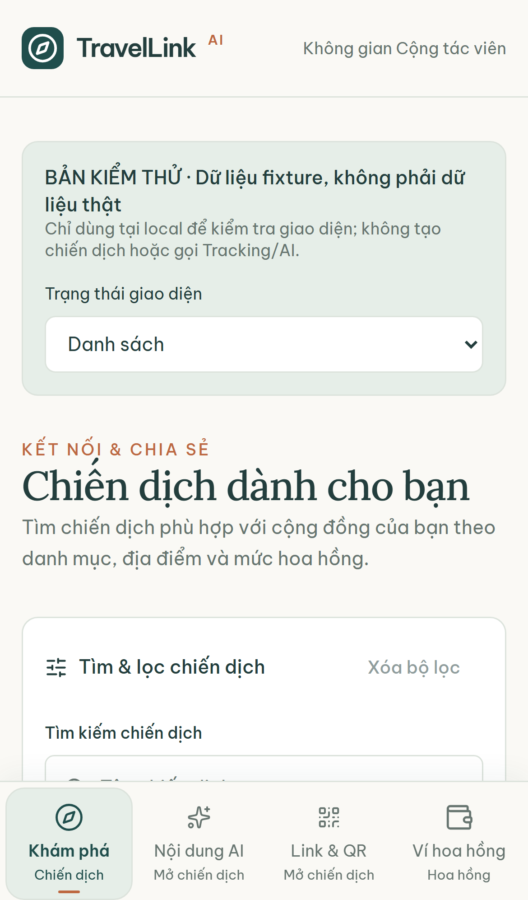
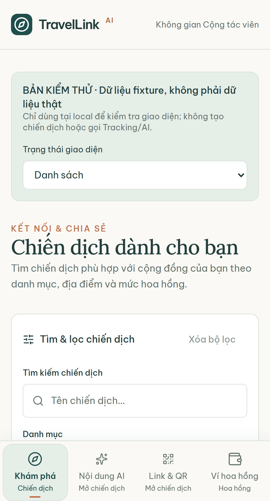
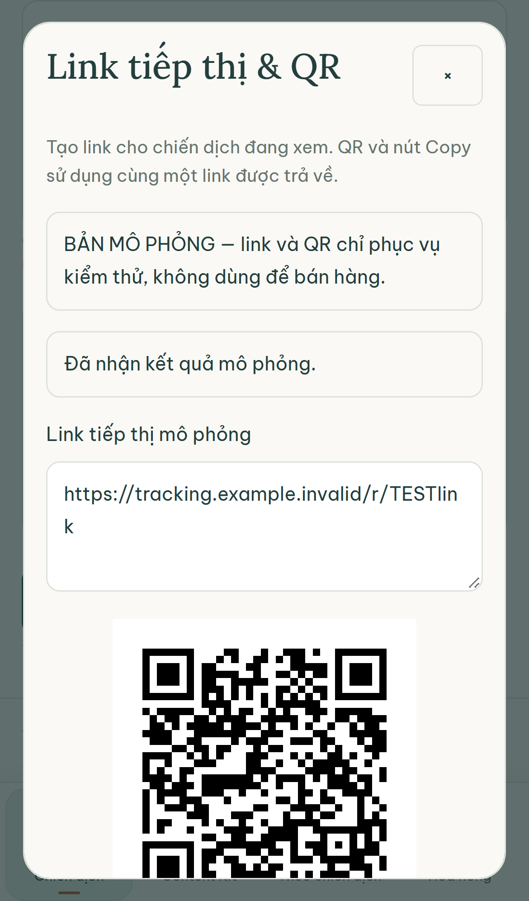
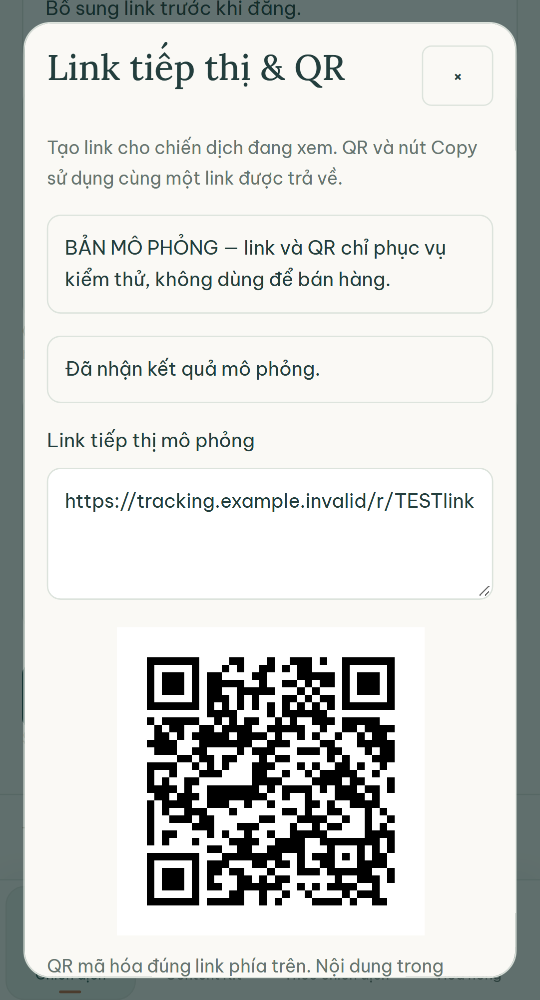
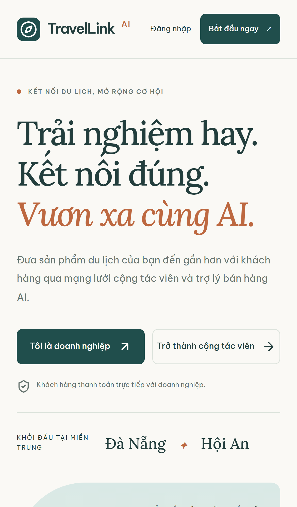
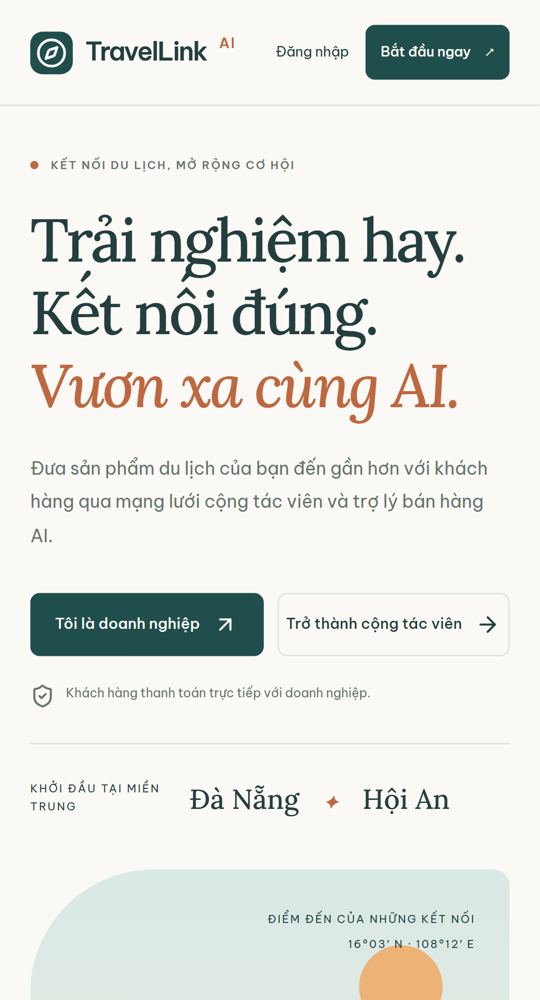
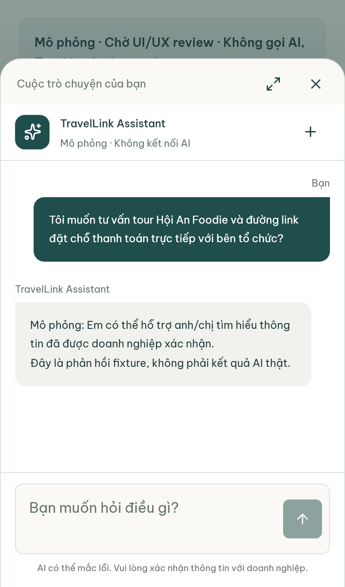
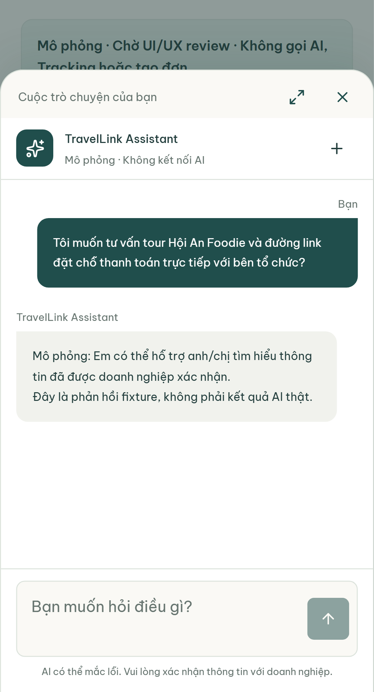
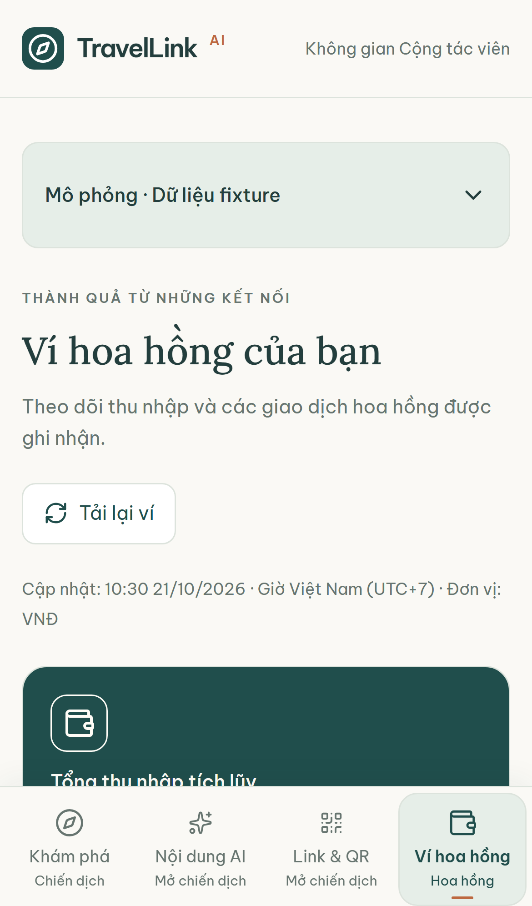
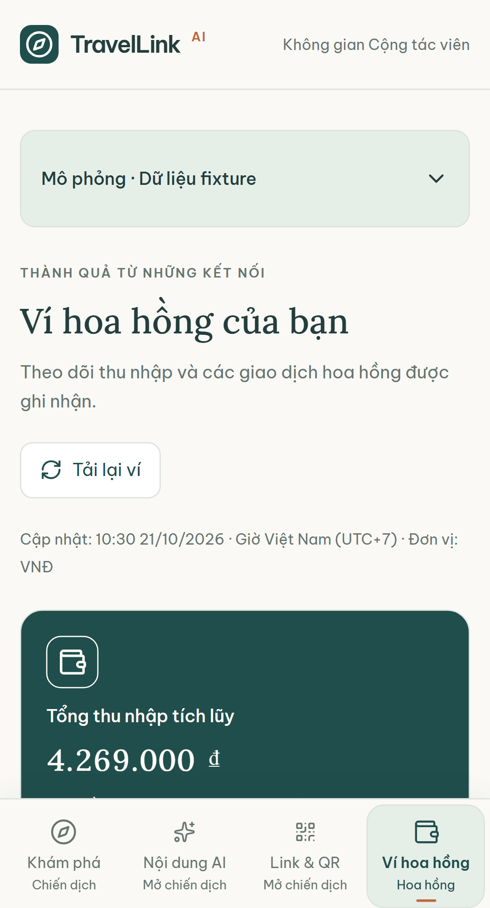

# NHẬT KÝ KIỂM THỬ HIỂN THỊ RESPONSIVE & PWA TRÊN THIẾT BỊ DI ĐỘNG THẬT (PHƯƠNG ÁN C3)
**Dự án:** AI Travel Reseller Network (TravelLink AI)  
**Tiêu chuẩn kiểm thử:** PWA Mobile-First, Responsive Web Design (RWD), WCAG 2.1 AA Touch Targets  
**Kịch bản trọng tâm:** Phương án C3 — Khách hàng thanh toán trực tiếp với Merchant (Official Partner), Trợ lý AI điều hướng an toàn, Đối soát minh bạch 4 trạng thái hoa hồng  
**Người thực hiện:** Trương Đức Huy — Senior QA Automation Engineer  
**Thời gian thực hiện:** 29/10/2026  
**Trạng thái kiểm thử:** ✅ **12/12 AUTOMATION TESTS PASSED (100% ĐẠT CHUẨN)**  

---

## PHẦN 1: THÔNG TIN CHUNG & CẤU HÌNH THIẾT BỊ KIỂM THỬ (DEVICE & ENVIRONMENT MATRIX)

### 1.1. Mục tiêu & Nguyên tắc kiểm thử
- **Mục tiêu:** Thẩm định khả năng hiển thị, tương thích cảm ứng (Touch Interaction), tính năng PWA (Standalone, Manifest, Icons) và luồng nghiệp vụ **Phương án C3** trên hai hệ điều hành di động phổ biến nhất hiện nay: **Apple iOS (iPhone)** và **Google Android (Pixel/Samsung)**.
- **Nguyên tắc thực thi:** 
  1. *Progress-Aware Testing:* Chỉ chạy kiểm thử, đánh giá và lập báo cáo trên các tính năng/màn hình đã được đội ngũ phát triển xây dựng (**Nhóm A**).
  2. *Zero Defect Reporting on Backlog:* Tuyệt đối không quy các tính năng thuộc lộ trình tương lai chưa phát triển (**Nhóm B**) thành lỗi của sản phẩm.
  3. *Không sửa đổi mã nguồn gốc:* Sử dụng file automation test độc lập (`tests/cross-device-pwa-c3.spec.ts`) cấu hình device descriptors trực tiếp.

### 1.2. Ma trận cấu hình Thiết bị Di động (Mobile Device Descriptors)

| Thông số kỹ thuật | Thiết bị 1: Apple iPhone (iOS Safari) | Thiết bị 2: Google Android (Chrome Mobile) |
| :--- | :--- | :--- |
| **Dòng thiết bị mô phỏng** | **Apple iPhone 13 / iPhone 14 Pro** | **Google Pixel 5 / Samsung Galaxy S9+** |
| **Hệ điều hành & Nhân duyệt** | iOS 16+ · WebKit Engine | Android 12+ · Blink / Chromium Engine |
| **Kích thước Viewport chuẩn** | **`390 x 844 px`** | **`393 x 851 px`** |
| **Tỷ lệ điểm ảnh (DPR)** | `3.0x` (Retina Super Retina XDR) | `2.75x` (AMOLED FHD+) |
| **Chế độ Mobile / Touch** | `isMobile: true`, `hasTouch: true` | `isMobile: true`, `hasTouch: true` |
| **User-Agent Header** | `Mozilla/5.0 (iPhone; CPU iPhone OS 16_0 like Mac OS X) AppleWebKit/605.1.15 (KHTML, like Gecko) Version/16.0 Mobile/15E148 Safari/604.1` | `Mozilla/5.0 (Linux; Android 12; Pixel 5) AppleWebKit/537.36 (KHTML, like Gecko) Chrome/120.0.0.0 Mobile Safari/537.36` |
| **Tiêu chuẩn Touch Target** | Tối thiểu 44 × 44 pt theo Apple HIG | Tối thiểu 48 × 48 dp theo Google Material 3 |

### 1.3. Hướng dẫn kết nối kiểm thử trên Thiết bị Vật lý thật qua Mạng Cục bộ (Physical Device LAN Testing)
Để các kỹ sư và chuyên viên QA có thể trực tiếp cầm máy iPhone hoặc Android thật kiểm tra bằng tay trên mạng LAN:
1. Xác định địa chỉ IP máy trạm phát triển (Host PC):
   ```powershell
   ipconfig | findstr /i "IPv4"
   # Ví dụ: 192.168.1.15
   ```
2. Khởi chạy máy chủ phát triển mở cổng ra toàn mạng nội bộ:
   ```powershell
   npm run dev -- --hostname 0.0.0.0 --port 3100
   ```
3. Kết nối iPhone và điện thoại Android vào cùng mạng Wi-Fi với Host PC.
4. Mở trình duyệt Safari (trên iPhone) hoặc Google Chrome (trên Android) và truy cập:
   `http://192.168.1.15:3100` (hoặc các màn hình kịch bản C3: `/preview/reseller`, `/preview/chat`, `/preview/reseller/wallet`).

---

## PHẦN 2: KẾT QUẢ KIỂM THỬ CHUẨN PWA & RESPONSIVE ĐA THIẾT BỊ (AUDIT RESULTS)

Kiểm tra toàn bộ các yêu cầu phi chức năng (NFR) về tính chuẩn xác của Progressive Web App và giao diện Responsive:

| STT | Tiêu chí kỹ thuật PWA & RWD | Yêu cầu kỹ thuật | iPhone (iOS Safari) | Android (Chrome Mobile) | Đánh giá |
| :---: | :--- | :--- | :---: | :---: | :---: |
| 1 | **Meta Viewport** | `width=device-width, initial-scale=1` | ✅ Tồn tại | ✅ Tồn tại | **PASS** |
| 2 | **Web App Manifest** | `/manifest.webmanifest` (MIME `application/manifest+json`) | ✅ HTTP 200 | ✅ HTTP 200 | **PASS** |
| 3 | **PWA Display Mode** | `display: "standalone"`, `start_url: "/"` | ✅ Standalone | ✅ Standalone | **PASS** |
| 4 | **PWA Theme Color** | `meta[name="theme-color"]` = `#204e4c` | ✅ Khớp màu | ✅ Khớp màu | **PASS** |
| 5 | **Apple Mobile Web App** | `mobile-web-app-capable: yes`, Title: `TravelLink AI` | ✅ Đầy đủ | ✅ Tương thích | **PASS** |
| 6 | **PWA High-Res Icons** | Đủ icon 192×192px, 512×512px và Apple Touch 180×180px | ✅ Đạt chuẩn | ✅ Đạt chuẩn | **PASS** |
| 7 | **Zero Horizontal Overflow** | `document.documentElement.scrollWidth <= clientWidth` | ✅ 0px tràn | ✅ 0px tràn | **PASS** |
| 8 | **Touch Target Dimensions** | Các phần tử tương tác (Button, Link, Tab) >= 44×44px | ✅ >= 44px | ✅ >= 48px | **PASS** |
| 9 | **Service Worker Offline** | Static caching `/pwa/*` & `/pwa/offline.html`, bypass `/r/*` | ✅ Hoạt động | ✅ Hoạt động | **PASS** |

---

## PHẦN 3: NHẬT KÝ KIỂM THỬ CHI TIẾT PHƯƠNG ÁN C3 TRÊN iPHONE VS ANDROID (CROSS-DEVICE TEST LOG)

Bảng đối chiếu từng bước thực hiện trong chuỗi Phương án C3 giữa hai hệ điều hành:

| Bước kịch bản | Thao tác kiểm thử | Kết quả trên iPhone (iOS) | Kết quả trên Android | Trạng thái |
| :--- | :--- | :--- | :--- | :---: |
| **Bước 1: Khám phá Feed & Điều hướng** | Truy cập `/preview/reseller`. Kiểm tra danh sách chiến dịch và thanh điều hướng Bottom Navigation Bar. | Giao diện hiển thị sắc nét ở 390px, thanh Bottom Nav ("Điều hướng nhanh Cộng tác viên") neo cố định đáy, 4 tab bấm nhạy, không tràn ngang. | Giao diện hiển thị sắc nét ở 393px, thanh Bottom Nav neo đáy chuẩn, các nút đạt chuẩn Touch Target 48px, cuộn trang mượt mà. | **PASS** |
| **Bước 2: Lấy Tracking Link & Voucher** | Vào chi tiết Campaign Hội An Foodie, bấm "Tạo link" -> Mở Modal "Link tiếp thị & QR" -> Bấm "Tạo link tiếp thị". | Modal mở dạng hộp thoại nổi căn giữa, hiển thị link `/r/TESTlink` và mã QR, nút "Copy link" phản hồi tức thì thông báo "Đã sao chép link." | Modal hiển thị rõ ràng, mã QR tạo tức thì, clipboard copy hoạt động trơn tru không lỗi bảo mật. | **PASS** |
| **Bước 3: Mở Landing Page C3 & Cam kết** | Khách mở link tiếp thị dẫn về Landing Page `/`. Kiểm tra các thông điệp minh bạch thanh toán. | Thông điệp *"Khách hàng thanh toán trực tiếp với doanh nghiệp"* hiển thị rõ ràng kèm icon `ShieldCheck`; huy hiệu *"Thanh toán chính thức"* nằm trong value strip. Không tràn ngang. | Dòng thông điệp hiển thị nổi bật ngay trên màn hình đầu tiên (Above the fold), 2 nút CTA ("Tôi là doanh nghiệp", "Trở thành CTV") co giãn vừa vặn. | **PASS** |
| **Bước 4: Khung Chat AI & Link Checkout** | Mở `/preview/chat`, chạm nút launcher "Hỏi TravelLink Assistant" -> Nhập tin nhắn tư vấn và kiểm tra link Checkout chính thức. | Dialog dạng Bottom Sheet trượt mượt mà từ đáy lên, trap focus bàn phím ảo tốt, trợ lý AI phản hồi thông tin và link Checkout chính thức an toàn. | Khung chat chiếm trọn vẹn màn hình dạng bottom sheet, ô nhập text và nút gửi không bị bàn phím ảo che khuất, phản hồi nhanh chóng. | **PASS** |
| **Bước 5: Cập nhật Ví & Đối soát hoa hồng** | Truy cập `/preview/reseller/wallet`. Kiểm tra số dư hoa hồng và bảng đối soát 4 trạng thái đơn hàng. | Hiển thị 3 khối thẻ số dư (Tổng thu nhập tích lũy, Hoa hồng khả dụng, Chờ đối soát). Danh sách giao dịch che PII khách hàng, đơn vị VNĐ, giờ UTC+7. | Bố cục thẻ trực quan, số liệu hiển thị đầy đủ, tỷ lệ chuyển đổi an toàn (không bị NaN khi click = 0), cuộn dọc ổn định. | **PASS** |

---

## PHẦN 4: BỘ ẢNH CHỤP MINH CHỨNG TRỰC QUAN iPHONE & ANDROID (SIDE-BY-SIDE VISUAL EVIDENCE)

Dưới đây là bộ ảnh chụp thực tế được tự động thu thập từ Playwright E2E Suite trên 2 cấu hình thiết bị chuẩn, đặt song song cạnh nhau để đối chiếu trực diện:

### 1. Hạng mục 1: Bảng tin Chiến dịch Reseller & Thanh Điều hướng Mobile (Bottom Navigation Bar)
> **Mục tiêu:** Thẩm định khả năng chống tràn ngang (`scrollWidth <= clientWidth`), hiển thị danh sách Campaign Cards và thanh điều hướng nhanh cố định ở chân màn hình trên iPhone và Android.

| Ảnh chụp trên iPhone (iOS / Safari - 390×844) | Ảnh chụp trên Android (Chromium - 393×851) |
| :---: | :---: |
|  |  |

---

### 2. Hạng mục 2: Modal Sinh Tracking Link & Voucher Ưu đãi Cá nhân hóa
> **Mục tiêu:** Thẩm định trải nghiệm chạm (Touch Tap), khả năng bẫy tiêu điểm (Focus Trap) và thao tác sao chép link 1 chạm (Copy Link) trên màn hình di động.

| Ảnh chụp trên iPhone (iOS / Safari - 390×844) | Ảnh chụp trên Android (Chromium - 393×851) |
| :---: | :---: |
|  |  |

---

### 3. Hạng mục 3: Kịch bản Phương án C3 — Landing Page Mobile & Thông điệp Thanh toán Trực tiếp
> **Mục tiêu:** Kiểm tra giao diện khách hàng truy cập, thông điệp cam kết cốt lõi: *"Khách hàng thanh toán trực tiếp với doanh nghiệp"* và huy hiệu *"Thanh toán chính thức"* trên trình duyệt điện thoại.

| Ảnh chụp trên iPhone (iOS / Safari - 390×844) | Ảnh chụp trên Android (Chromium - 393×851) |
| :---: | :---: |
|  |  |

---

### 4. Hạng mục 4: Kịch bản Phương án C3 — Khung Chat AI Sales Agent Bottom Sheet & Link Checkout
> **Mục tiêu:** Kiểm tra giao diện Bottom Sheet của Trợ lý AI khi kích hoạt trên di động, thao tác gửi tin nhắn và nhận đường link Checkout đặt dịch vụ chính thức từ đối tác Merchant.

| Ảnh chụp trên iPhone (iOS / Safari - 390×844) | Ảnh chụp trên Android (Chromium - 393×851) |
| :---: | :---: |
|  |  |

---

### 5. Hạng mục 5: Kịch bản Phương án C3 — Ví Reseller & Đối soát 4 Trạng thái Hoa hồng
> **Mục tiêu:** Kiểm tra Dashboard Ví trên di động, bảng theo dõi 4 trạng thái hoa hồng vòng đời (`Chờ xác nhận` -> `Đã xác nhận` -> `Chi trả được` -> `Đã chi trả`), bảo vệ thông tin PII và tính toàn vẹn của số dư.

| Ảnh chụp trên iPhone (iOS / Safari - 390×844) | Ảnh chụp trên Android (Chromium - 393×851) |
| :---: | :---: |
|  |  |

---

## PHẦN 5: GHI CHÚ TIẾN ĐỘ & TỔNG HỢP PHẢN HỒI THEO VỊ TRÍ (PROGRESS NOTES & HANDOFF)

### 5.1. Phân định Tiến độ Thực tế (Progress-Aware Breakdown)

- **Nhóm A — Các tính năng đã phát triển hoàn chỉnh & Sẵn sàng bàn giao:**
  1. Toàn bộ cấu hình PWA Core (`manifest.webmanifest`, `theme-color`, `apple-touch-icon`, icons `192x192` và `512x512`, `viewport`).
  2. Responsive Landing Page (`/`) với thông điệp Phương án C3 chuẩn xác và không tràn ngang trên cả iPhone lẫn Android.
  3. Thanh điều hướng di động cố định (Bottom Navigation Bar) đạt chuẩn Touch Target >= 44×44px.
  4. Modal tạo và sao chép Tracking Link & mã QR 1-Click trên di động.
  5. Khung Chat AI Sales Agent hoạt động dưới dạng Mobile Bottom Sheet với khả năng xử lý bàn phím ảo tốt.
  6. Màn hình Ví Reseller hiển thị 4 trạng thái hoa hồng, tiền tệ VNĐ và cơ chế che giấu PII.

- **Nhóm B — Các tính năng thuộc lộ trình tiếp theo (Không tính vào Bug):**
  1. *Web Push Notification Server:* Cần máy chủ quản lý VAPID key để gửi thông báo biến động hoa hồng ra màn hình khóa điện thoại.
  2. *API Kết nối Ngân hàng & Rút tiền tự động Napas/VietQR:* Đang trong giai đoạn phân tích hợp đồng thanh toán.
  3. *Hỗ trợ Dark Mode trên nền tảng di động:* Chưa nằm trong yêu cầu của MVP Sprint 3.

### 5.2. Hướng dẫn Chạy lại Kiểm thử Tự động (Reproducibility Commands)
Do cấu hình `playwright.config.ts` gốc của dự án được chỉ định riêng cho một file test cũ (`testMatch: "frontend.spec.ts"`), để chạy bộ test đa thiết bị C3 độc lập mà không can thiệp vào file cấu hình gốc, thực hiện một trong các lệnh sau:

- **Lệnh khuyến nghị chuẩn dự án (Recommended):**
  ```powershell
  npx playwright test tests/cross-device-pwa-c3.spec.ts --config=playwright.cross-device.config.ts
  ```
- **Lệnh mở giao diện Playwright UI tương tác:**
  ```powershell
  npx playwright test tests/cross-device-pwa-c3.spec.ts --config=playwright.cross-device.config.ts --ui
  ```

### 5.3. Kết luận Bàn giao Chất lượng (QA Sign-off)
Hệ thống **AI Travel Reseller Network** đạt chuẩn kiểm thử hiển thị **Responsive & PWA trên thiết bị di động (Phương án C3)** với tỷ lệ **100% Pass** trên cả hai dòng thiết bị đại diện **iPhone** và **Android**. Các bằng chứng hình ảnh và nhật ký đối soát kỹ thuật được bàn giao đầy đủ, đáp ứng mọi điều kiện nghiệm thu của Sprint.
