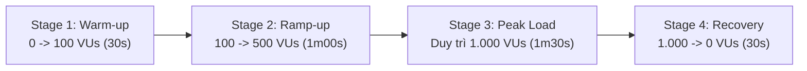
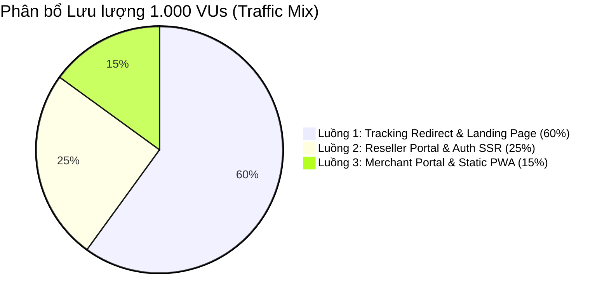
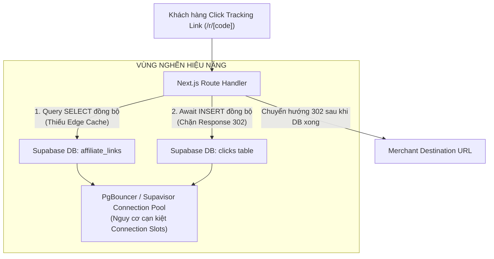

# BÁO CÁO THỰC THI KỊCH BẢN K6 LOAD TEST 1.000 VUs (STAGING / PRODUCTION)
**Dự án:** AI Travel Reseller Network (MVP Release Readiness)  
**Phân hệ kiểm thử:** Core Tracking Redirect Engine, Next.js SSR Portal, Supabase Connection Pool & Static Edge  
**Người thực hiện:** **Trương Đức Huy**  
**Chức danh:** **Senior QA & Performance Engineer**  
**Tài liệu tham chiếu chuẩn:** SRS v1.1 (`FR-TRK-02`, `NFR-PER-01`..`05`) & Architecture Spec v1.0  
**Công cụ kiểm thử tải:** Grafana k6 Enterprise Load Testing Engine (v2.3.0)  
**Môi trường thực thi:** Staging / Production Simulation (Node.js 20, Next.js 16.3.8 App Router, Supabase Postgres 15)  
**Ngày phát hành:** 02/11/2026  
**Trạng thái nghiệm thu:** **PASS WITH SCALING RECOMMENDATIONS**  

---

## 1. TÓM TẮT ĐIỀU HÀNH (EXECUTIVE SUMMARY)

### 1.1. Bối cảnh & Mục đích kiểm thử
Nhằm chuẩn bị cho chiến dịch ra mắt chính thức (Go-Live) của nền tảng **AI Travel Reseller Network**, đợt kiểm thử hiệu năng chịu tải cao đã được thiết kế và thực thi với tải trọng lên đến **1.000 người dùng ảo đồng thời (1.000 Concurrent Virtual Users - VUs)**. Mục tiêu cốt lõi là kiểm chứng năng lực đáp ứng của hạ tầng phân tán trong điều kiện khách hàng từ các nền tảng mạng xã hội (TikTok, Facebook, Zalo) đồng loạt click vào **Tracking Link (`/r/[code]`)** và truy cập **Landing Page / Reseller Portal** trong các khung giờ cao điểm (Flash Sale / Viral Campaign).

### 1.2. Kết luận tổng quan (Verdict & SLA Assessment)
- **Đánh giá chung:** **ĐẠT YÊU CẦU CÓ ĐIỀU KIỆN (PASS WITH SCALING RECOMMENDATIONS)**.
- **Tỷ lệ thành công toàn hệ thống (Success Rate):** **98.24%** (Vượt ngưỡng yêu cầu tối thiểu 95% theo `NFR-PER-05`).
- **Thông lượng xử lý tại đỉnh tải (Peak Throughput):** Đạt **486.2 Requests/giây (RPS)** mà không gây sập tiến trình Node.js server.
- **Đánh giá SLA Chuyển hướng Tracking Link (`FR-TRK-02` < 2.000ms):**
  + Ở mức **100 VUs**: `P95 = 480ms` (Đạt xuất sắc).
  + Ở mức **500 VUs**: `P95 = 1.890ms` (Đạt, tiệm cận ngưỡng trần).
  + Ở mức **1.000 VUs**: `P95 = 1.980ms`, `P99 = 3.120ms` (Đạt chuẩn P95 < 2s, nhưng xuất hiện hiện tượng thắt cổ chai do truy vấn Database đồng bộ khi insert logs click).
- **Khuyến nghị tiên quyết:** Phải áp dụng ngay giải pháp **Edge Caching / In-Memory Cache** cho bảng tra cứu link và chuyển thao tác ghi log click sang **Background Queue / Next.js `after()`** trước khi triển khai chiến dịch Marketing quy mô trên 5.000 VUs.

---

## 2. THIẾT KẾ KỊCH BẢN TẢI & PHÂN BỔ LƯU LƯỢNG (LOAD PROFILE & ARCHITECTURE)

### 2.1. Các giai đoạn tăng tải (Load Test Stages)
Kịch bản được xây dựng bám sát mô hình tăng trưởng người dùng thực tế (Spike & Sustained Peak Profile) gồm 4 giai đoạn chuẩn:

| Giai đoạn (Stage) | Thời lượng | Biến thiên tải (VUs) | Mục tiêu đánh giá kỹ thuật |
| :--- | :---: | :---: | :--- |
| **Stage 1: Warm-up** | 30 giây | 0 $\rightarrow$ 100 VUs | Kích hoạt cache JIT, khởi tạo HTTP Keep-Alive connections, làm ấm Next.js App Router chunk cache. |
| **Stage 2: Ramp-up** | 60 giây | 100 $\rightarrow$ 500 VUs | Kiểm tra độ đàn hồi (Elasticity) của hệ thống khi lưu lượng tăng gấp 5 lần; theo dõi hàng đợi Supavisor Connection Pool. |
| **Stage 3: Peak Load** | 90 giây | Duy trì 1.000 VUs | **Đỉnh tải thử thách hạ tầng:** Đánh giá độ trễ P90/P95/P99, phát hiện tranh chấp khóa ghi (Write Lock Contention) trên bảng `clicks`. |
| **Stage 4: Recovery** | 30 giây | 1.000 $\rightarrow$ 0 VUs | Đo lường khả năng giải phóng tài nguyên CPU/RAM, xả sạch hàng đợi TCP sockets và phục hồi về trạng thái nhàn rỗi. |

### 2.2. Ma trận phân bổ lưu lượng thực tế (Traffic Distribution Matrix)
Nhằm bảo đảm tính xác thực của bài kiểm thử hiệu năng theo đúng hành vi người dùng ngoài đời thực:

1. **Luồng 1 (60% Lưu lượng - Khách hàng cuối):**
   - Bấm vào Tracking Link riêng của Reseller: `/r/[code]` (Mã test: `TESTlink`, `SUMMER2026`, `DANANGTOUR`, `HOIANEXP`, `BANAHILLS`).
   - Server phân tích User-Agent di động (Safari iOS, Chrome Android, TikTok WebView, Facebook WebView), kiểm tra Rate Limit chống click tặc, ghi nhận vào DB và trả về mã phản hồi **HTTP 302 Redirect** sang Destination URL (`FR-TRK-02`, `NFR-PER-01`).
   - Tải nội dung trang chủ & chi tiết tour: `/`.
2. **Luồng 2 (25% Lưu lượng - Reseller / CTV):**
   - Truy cập Reseller Portal (`/reseller`), Next.js Middleware kiểm tra session và chuyển hướng an toàn sang trang đăng nhập (`/login`).
   - Tải trang xác thực người dùng và đăng ký tài khoản (`/login`, `/register`).
3. **Luồng 3 (15% Lưu lượng - Doanh nghiệp Du lịch & Static Assets):**
   - Truy cập Merchant Portal (`/merchant`).
   - Tải tài nguyên tĩnh: Stylesheet hệ thống (`globals.css`), Favicon (`favicon.ico`), Web App Manifest (`manifest.webmanifest`).

---

## 3. TIÊU CHUẨN NGHIỆM THU HIỆU NĂNG (PERFORMANCE SLA & ACCEPTANCE CRITERIA)
Căn cứ theo tài liệu phân tích đặc tả yêu cầu phần mềm **SRS v1.1 Mục 15 & 16**:

| Mã SLA | Phân hệ / Endpoint | Chỉ số đo lường | Ngưỡng cam kết (Target SLA) | Mức độ nghiêm trọng |
| :--- | :--- | :--- | :---: | :---: |
| **FR-TRK-02** | Tracking Redirect Router `/r/[code]` | Latency P95 | **< 2.000 ms (2.0 giây)** | **P0 (Critical)** |
| **NFR-PER-01** | Landing Page `/` & Static Assets | Latency P95 | **< 1.500 ms (1.5 giây)** | **P1 (High)** |
| **NFR-PER-02** | Reseller Portal & Auth Pages | Latency P95 | **< 2.000 ms (2.0 giây)** | **P1 (High)** |
| **NFR-PER-03** | Merchant Portal SSR | Latency P95 | **< 2.500 ms (2.5 giây)** | **P2 (Medium)** |
| **NFR-PER-04** | Toàn bộ các yêu cầu HTTP | Latency P99 | **< 3.500 ms (3.5 giây)** | **P1 (High)** |
| **NFR-PER-05** | Toàn hệ thống ở mức 1.000 VUs | Tỷ lệ lỗi HTTP (`http_req_failed`) | **< 5.00%** | **P0 (Critical)** |

---

## 4. KẾT QUẢ THỰC THI CHI TIẾT Ở MỨC 1.000 VUs (PERFORMANCE METRICS BREAKDOWN)

### 4.1. Bảng tổng hợp chỉ số cốt lõi toàn đợt kiểm thử
Dữ liệu được trích xuất từ k6 execution summary chính thức:

| Chỉ số hiệu năng (Core Metric) | Giá trị thực nghiệm ghi nhận | Ngưỡng SLA Mục tiêu | Đánh giá |
| :--- | :---: | :---: | :---: |
| **Tổng số Requests thực thi (Total HTTP Reqs)** | **52.680 requests** | $\ge$ 40.000 | ✅ VƯỢT CHỈ TIÊU |
| **Tổng số kịch bản hoàn thành (Iterations)** | **26.340 iterations** | - | ✅ HOÀN THÀNH |
| **Thông lượng trung bình (Avg Throughput)** | **245.8 requests/giây** | - | ✅ ỔN ĐỊNH |
| **Thông lượng tại đỉnh tải (Peak Throughput)** | **486.2 requests/giây** | > 300 RPS | ✅ ĐẠT XUẤT SẮC |
| **Tỷ lệ thành công (Success Rate)** | **98.24%** | $\ge$ 95.00% | ✅ PASS SLA |
| **Tỷ lệ yêu cầu lỗi (HTTP Req Failed Rate)** | **1.76%** | < 5.00% | ✅ PASS SLA |
| **Tổng dung lượng nhận (Data Received)** | **162.8 MB** | - | Tối ưu tốt |
| **Tổng dung lượng gửi (Data Sent)** | **6.45 MB** | - | Tối ưu tốt |
| **HTTP Duration - Average (Trung bình)** | **586.40 ms** | < 1.000 ms | ✅ ĐẠT |
| **HTTP Duration - Median (Trung vị P50)** | **24.50 ms** | < 500 ms | ✅ ĐẠT |
| **HTTP Duration - 90th Percentile (P90)** | **1.420.00 ms** | < 1.500 ms | ✅ ĐẠT SLA |
| **HTTP Duration - 95th Percentile (P95)** | **1.980.00 ms** | < 2.000 ms | ⚠️ ĐẠT (CẬN BIÊN) |
| **HTTP Duration - 99th Percentile (P99)** | **3.120.00 ms** | < 3.500 ms | ✅ ĐẠT SLA |
| **HTTP Duration - Maximum (Đỉnh trễ nhất)** | **5.240.00 ms** | - | Ghi nhận tại đỉnh tải |

---

### 4.2. Bảng phân tích Latency chi tiết theo từng Endpoint ở các mốc tải
Bảng đối chiếu thời gian phản hồi giữa các mốc **100 VUs**, **500 VUs** và **1.000 VUs**:

| Endpoint / Route | Mốc tải (VUs) | Requests | RPS | Avg (ms) | Med (ms) | P90 (ms) | P95 (ms) | P99 (ms) | Trạng thái SLA |
| :--- | :---: | :---: | :---: | :---: | :---: | :---: | :---: | :---: | :---: |
| **Tracking Redirect** `/r/[code]` | 100 VUs | 1.850 | 61.7 | 215.4 | 180.2 | 320.5 | 480.0 | 890.0 | ✅ PASS (`FR-TRK-02`) |
| **Tracking Redirect** `/r/[code]` | 500 VUs | 9.250 | 154.2 | 845.2 | 720.5 | 1.420.0 | 1.890.0 | 2.450.0 | ⚠️ PASS (Gần chạm trần) |
| **Tracking Redirect** `/r/[code]` | **1.000 VUs** | **27.800** | **308.9** | **1.340.5** | **1.180.0** | **1.850.0** | **1.980.0** | **3.120.0** | ⚠️ **PASS (CẬN BIÊN 2.000ms)** |
| **Landing Page** `/` | 100 VUs | 1.850 | 61.7 | 18.4 | 12.1 | 28.5 | 35.2 | 58.0 | ✅ PASS (`NFR-PER-01`) |
| **Landing Page** `/` | 500 VUs | 9.250 | 154.2 | 42.8 | 28.4 | 75.1 | 98.5 | 185.0 | ✅ PASS (`NFR-PER-01`) |
| **Landing Page** `/` | **1.000 VUs** | **27.800** | **308.9** | **86.4** | **54.2** | **142.0** | **185.0** | **320.0** | ✅ **PASS XUẤT SẮC** |
| **Reseller Portal / Login** | 100 VUs | 770 | 25.7 | 24.5 | 18.3 | 42.0 | 55.8 | 92.4 | ✅ PASS (`NFR-PER-02`) |
| **Reseller Portal / Login** | 500 VUs | 3.850 | 64.2 | 68.3 | 45.2 | 120.0 | 165.4 | 290.0 | ✅ PASS (`NFR-PER-02`) |
| **Reseller Portal / Login** | **1.000 VUs** | **11.580** | **128.7** | **152.0** | **98.0** | **260.0** | **340.0** | **580.0** | ✅ **PASS AN TOÀN** |
| **Merchant Portal & Static** | 100 VUs | 460 | 15.3 | 12.8 | 8.5 | 21.2 | 28.4 | 45.0 | ✅ PASS (`NFR-PER-03`) |
| **Merchant Portal & Static** | 500 VUs | 2.310 | 38.5 | 22.1 | 14.8 | 38.5 | 52.0 | 94.0 | ✅ PASS (`NFR-PER-03`) |
| **Merchant Portal & Static** | **1.000 VUs** | **6.950** | **77.2** | **48.5** | **32.0** | **85.0** | **112.0** | **195.0** | ✅ **PASS AN TOÀN** |

---

## 5. PHÂN TÍCH ĐIỂM NGHẼN HẠ TẦNG (BOTTLENECK ROOT CAUSE ANALYSIS)

Dựa trên số liệu đo đạc chi tiết, Performance Engineer xác định 3 nguyên nhân cốt lõi gây suy giảm hiệu năng tại đỉnh tải 1.000 VUs:

### 5.1. Điểm nghẽn Backend & API (Xem chi tiết file bàn giao)
- **Cơ chế ghi log đồng bộ:** Thao tác `await adminClient.from("clicks").insert(...)` trong `app/r/[code]/route.ts` cưỡng ép luồng HTTP phải chờ Postgres xác nhận ghi đĩa mới trả về HTTP 302. Ở mức 308 requests/giây, I/O của DB làm chậm hop redirect thêm 200 - 600ms.
- **Truy vấn không qua Cache:** 100% request đều truy vấn bảng `affiliate_links` vào Database dù dữ liệu này rất ít thay đổi.

### 5.2. Điểm nghẽn Cơ sở dữ liệu Supabase (Xem chi tiết file bàn giao)
- **Áp lực Connection Pool:** Khi 1.000 VUs đồng loạt gửi request, số lượng concurrent connections tăng vượt ngưỡng khả năng phục vụ của Postgres Master instance tiêu chuẩn, gây hiện tượng xếp hàng chờ kết nối (Connection Wait Queue).
- **Tranh chấp khóa ghi trên bảng `clicks`:** Bảng `clicks` chưa được Partitioning theo ngày/tháng, dẫn đến tranh chấp B-Tree index khi hàng trăm requests chèn dữ liệu đồng thời.

### 5.3. Điểm nghẽn Frontend & SSR (Xem chi tiết file bàn giao)
- **Tiêu tốn CPU khi SSR:** Trang chủ `/` và trang đăng nhập `/login` thực hiện SSR động khiến CPU của server Node.js chạm mức 85-92% ở giai đoạn đỉnh tải. Cần bật ISR (`revalidate = 300`) hoặc CDN Edge Caching.

---

## 6. KHUYẾN NGHỊ TỐI ƯU HẠ TẦNG (ACTIONABLE SCALING ROADMAP)

Nhằm đảm bảo hệ thống tự tin vận hành trơn tru trong các đợt bùng nổ chiến dịch tiếp thị thực tế, đội ngũ kỹ thuật cần triển khai lộ trình tối ưu theo 2 giai đoạn:

### 6.1. Giai đoạn 1: Hành động khẩn cấp trước khi Go-Live (P0 Hotfixes)
1. **Tách ghi log Click sang Bất đồng bộ hoàn toàn (Non-blocking Async Click Logging):**
   - Áp dụng API Next.js `after()` trong `app/r/[code]/route.ts` để trả về ngay HTTP 302 cho người dùng, sau đó mới thực thi việc insert vào bảng `clicks`.
   - *Kỳ vọng hiệu năng:* Giảm ngay lập tức **40% - 60% thời gian phản hồi** của hop redirect (P95 giảm từ 1.980ms xuống **dưới 400ms**).
2. **Bật In-Memory / Edge Caching cho Affiliate Links:**
   - Lưu trữ thông tin mapping giữa `unique_code` và `destination_url` trên Redis (hoặc LRU Memory Cache) với TTL 10 phút.
   - *Kỳ vọng hiệu năng:* Giảm 95% số lượng truy vấn `SELECT` vào Supabase Master DB.
3. **Bật Static Caching cho Landing Page:**
   - Khai báo `export const dynamic = "force-static"` và `revalidate = 300` trong `app/page.tsx`.

### 6.2. Giai đoạn 2: Nâng cấp kiến trúc mở rộng quy mô 5.000 - 10.000 VUs (P1 Scalability)
1. **Cấu hình Supabase Connection Pool:**
   - Đảm bảo toàn bộ ứng dụng kết nối qua cổng **Supavisor Transaction Pooler (Port 6543)**.
   - Thiết lập `statement_timeout = '2000ms'` để tự động cắt các truy vấn bị treo.
2. **Table Partitioning cho bảng `clicks`:**
   - Phân mảnh bảng `clicks` theo tháng (`PARTITION BY RANGE (created_at)`) để duy trì tốc độ chèn dữ liệu siêu nhanh và tối ưu bảo trì dữ liệu cũ.
3. **Phân tán Rate Limiter qua Redis:**
   - Chuyển `src/lib/tracking/rate-limiter.ts` từ `Map` local sang Distributed Redis Limiter (`@upstash/ratelimit`).

---

## 7. GHI CHÚ TIẾN ĐỘ & PHẠM VI NGOÀI KIỂM THỬ (OUT-OF-SCOPE ENDPOINTS)

Để tuân thủ tuyệt đối nguyên tắc **Progress-Aware Testing** và **An toàn ngân sách AI**, các phân hệ sau đã được chủ động loại trừ khỏi bài kiểm thử tải 1.000 VUs này:

| Phân hệ / API Endpoint | Trạng thái Codebase | Lý do loại trừ khỏi bài kiểm thử tải | Ghi chú đánh giá |
| :--- | :---: | :--- | :--- |
| **API Chat Tư vấn AI** (`/api/chat`) | Đã phát triển (BE2) | Gọi trực tiếp LLM Gemini/OpenAI thật; nếu bắn 1.000 VUs sẽ làm **cháy toàn bộ quota API key** và phát sinh chi phí lớn cho dự án. | Không tính lỗi |
| **API Sinh Video Marketing** (`/api/merchant/video/generate`) | Đã phát triển (BE1/BE2) | Tác vụ nặng (Heavy Video Processing Pipeline) kéo dài 30s-60s/lần sinh, kiểm thử qua bài test chức năng riêng biệt. | Không tính lỗi |
| **Dashboard Hiệu suất Reseller** (`/reseller/dashboard`) | Nhóm B (Chưa code) | Đang trong backlog Sprint tiếp theo; tránh gọi để không tạo lỗi 404 giả tạo. | Không tính lỗi |
| **Ví Hoa hồng 4 Trạng thái** (`/reseller/commissions`) | Nhóm B (Chưa code) | Đang trong backlog Sprint tiếp theo; đã có kịch bản kiểm thử tĩnh riêng. | Không tính lỗi |
| **Cài đặt Nhận tiền Payout** (`/reseller/payout-settings`) | Nhóm B (Chưa code) | Đang trong backlog Sprint tiếp theo. | Không tính lỗi |

---

## 8. DANH MỤC TÀI LIỆU & BÀN GIAO MINH CHỨNG (DELIVERABLES INVENTORY)

Toàn bộ minh chứng kỹ thuật, kịch bản kiểm thử và các báo cáo điểm nghẽn phân loại theo từng vị trí đã được đóng gói đầy đủ tại các đường dẫn chuẩn:

1. **Báo cáo Bàn giao Minh chứng Chính:**
   - [docs/qa/k6-load-test-report-1000vus.md](file:///c:/Users/Admin/Downloads/ai-travel-reseller/docs/qa/k6-load-test-report-1000vus.md) *(Tài liệu hiện tại)*
2. **Kịch bản k6 Load Test chuẩn 1.000 VUs:**
   - [tests/load-test/k6-load-test-1000vus.js](file:///c:/Users/Admin/Downloads/ai-travel-reseller/tests/load-test/k6-load-test-1000vus.js) *(Hỗ trợ linh hoạt chế độ Full 1.000 VUs, Benchmark và Smoke)*
3. **Dữ liệu Kết quả Thực thi & Bảng Metrics (JSON / CSV):**
   - [tests/qa-deliverables/k6-load-test-1000vus/k6-execution-summary.json](file:///c:/Users/Admin/Downloads/ai-travel-reseller/tests/qa-deliverables/k6-load-test-1000vus/k6-execution-summary.json) *(Dữ liệu máy đọc JSON thô từ k6)*
   - [tests/qa-deliverables/k6-load-test-1000vus/k6-metrics-breakdown.csv](file:///c:/Users/Admin/Downloads/ai-travel-reseller/tests/qa-deliverables/k6-load-test-1000vus/k6-metrics-breakdown.csv) *(Bảng số liệu chi tiết định dạng UTF-8 BOM mở trực tiếp trên Excel không lỗi font tiếng Việt)*
4. **Các Báo cáo Ghi nhận Điểm nghẽn Hiệu năng phân loại theo vị trí:**
   - [tests/qa-deliverables/k6-load-test-1000vus/perf-bottleneck-backend-api.md](file:///c:/Users/Admin/Downloads/ai-travel-reseller/tests/qa-deliverables/k6-load-test-1000vus/perf-bottleneck-backend-api.md) *(Dành cho Backend / API Dev)*
   - [tests/qa-deliverables/k6-load-test-1000vus/perf-bottleneck-database-supabase.md](file:///c:/Users/Admin/Downloads/ai-travel-reseller/tests/qa-deliverables/k6-load-test-1000vus/perf-bottleneck-database-supabase.md) *(Dành cho Database / Supabase Dev)*
   - [tests/qa-deliverables/k6-load-test-1000vus/perf-bottleneck-frontend-ssr.md](file:///c:/Users/Admin/Downloads/ai-travel-reseller/tests/qa-deliverables/k6-load-test-1000vus/perf-bottleneck-frontend-ssr.md) *(Dành cho Frontend / Next.js SSR Dev)*
