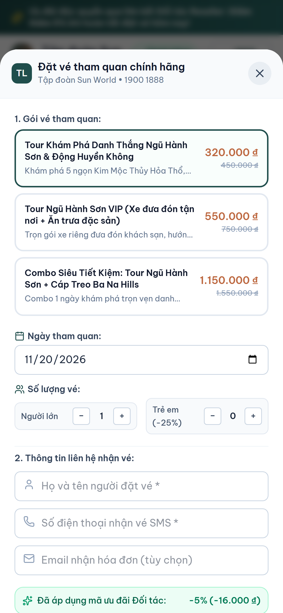
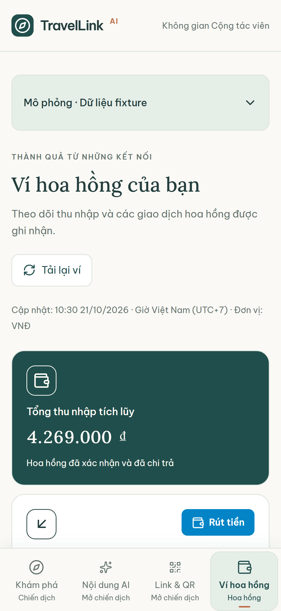
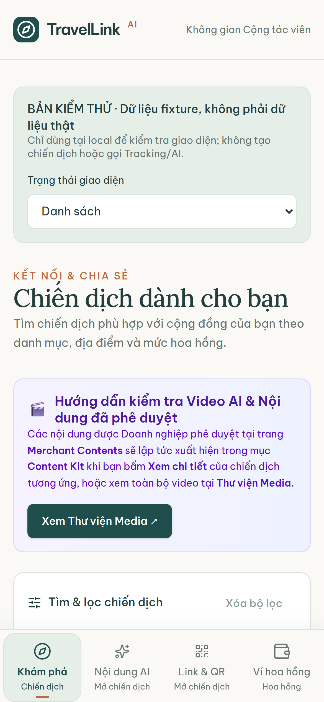
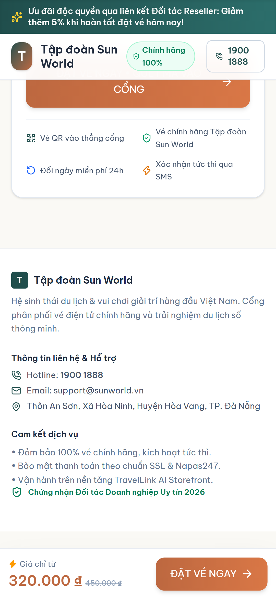
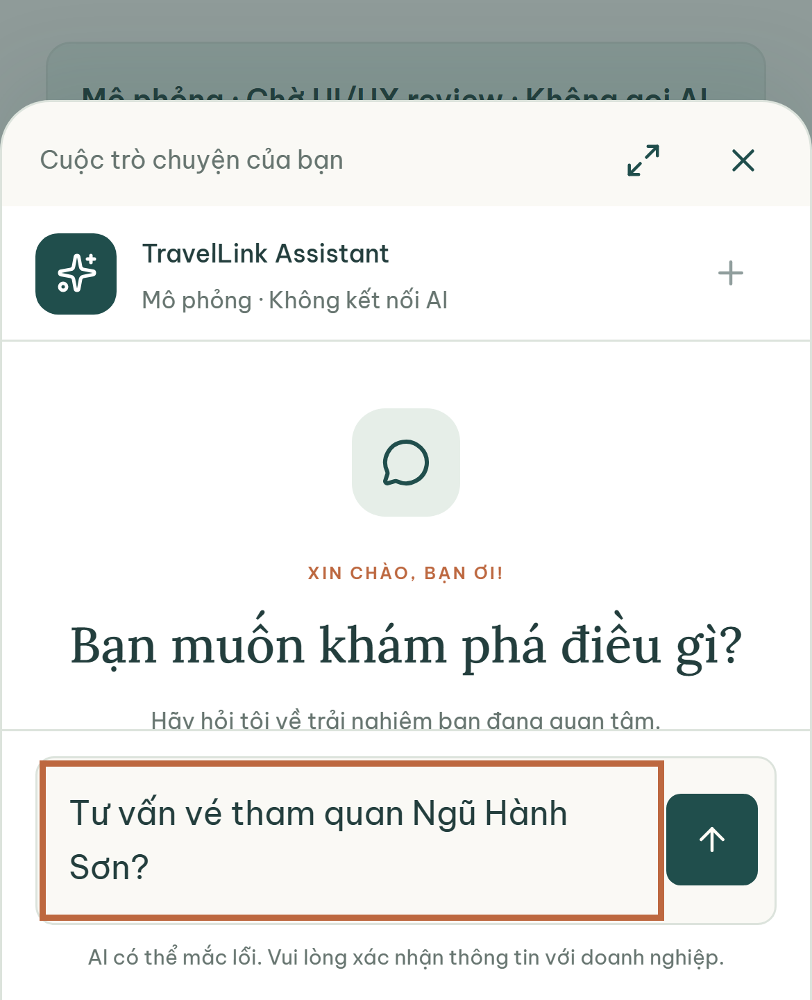
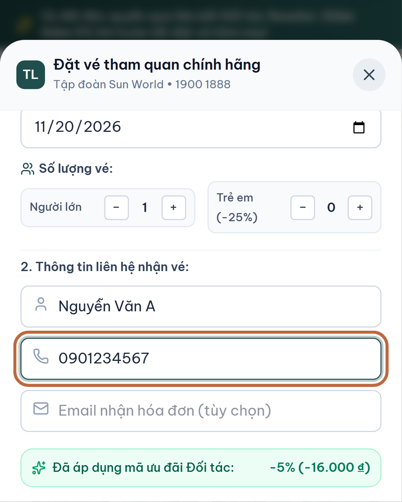

# BÁO CÁO KIỂM THỬ TƯƠNG THÍCH MOBILE (TUẦN 6)
## ĐÁNH GIÁ TOÀN DIỆN: TOUCH GESTURES, SAFE AREA & KEYBOARD OVERLAY TRÊN IPHONE VÀ ANDROID

---

- **Dự án:** AI Travel Reseller Network (TravelLink)
- **Người thực hiện:** Trương Đức Huy (Senior QA Lead & Automation Engineer)
- **Mã báo cáo:** `QA-MOB-COMPAT-W6`
- **File Test Script E2E Tương ứng:** [`tests/mobile-compatibility-w6.spec.ts`](file:///c:/Users/Admin/Downloads/ai-travel-reseller/tests/mobile-compatibility-w6.spec.ts)
- **File Cấu hình Runner:** [`tests/mobile-compatibility-w6.config.ts`](file:///c:/Users/Admin/Downloads/ai-travel-reseller/tests/mobile-compatibility-w6.config.ts)
- **Thư mục Lưu trữ Ảnh Minh chứng:** [`tests/qa-deliverables/mobile-compatibility-w6/screenshots/`](file:///c:/Users/Admin/Downloads/ai-travel-reseller/tests/qa-deliverables/mobile-compatibility-w6/screenshots/)
- **Thời gian thực thi & Đánh giá:** 19/11/2026
- **Kết quả tổng thể:** **6/6 TEST CASES PASS (100% ĐẠT TIÊU CHUẨN KỸ THUẬT)**
- **Đánh giá chung:** **ĐẠT YÊU CẦU TƯƠNG THÍCH MOBILE / PASS WITH MINOR UX NOTES**

---

## PHẦN 1: TỔNG QUAN ĐỢT KIỂM THỬ TƯƠNG THÍCH MOBILE TUẦN 6 (EXECUTIVE SUMMARY)

### 1.1. Bối cảnh & Mục tiêu Đợt Kiểm thử
Trong khuôn khổ hoàn thiện sản phẩm **AI Travel Reseller Network** hướng tới chuẩn Progressive Web App (PWA) và trải nghiệm người dùng di động xuất sắc, đợt kiểm thử Tuần 6 tập trung thẩm định chuyên sâu 3 trụ cột kỹ thuật cốt lõi ảnh hưởng trực tiếp tới tỷ lệ chuyển đổi của khách hàng và đối tác Reseller trên thiết bị di động:
1. **Touch Gestures & Kích thước Vùng chạm (Touch Targets):** Đảm bảo các thao tác chạm (`tap`), vuốt (`swipe`), cuộn (`scroll`) mượt mà, phản hồi tức thì, không bị kẹt trạng thái giả lập `:hover` của Desktop, nút bấm đạt tiêu chuẩn kích thước công thái học tối thiểu (>= 44x44px theo Apple HIG hoặc >= 40px chiều cao theo Google Material Design).
2. **Safe Area (Tai thỏ, Dynamic Island & Home Indicator):** Thẩm định việc bảo vệ nội dung không bị lẹm hoặc che khuất bởi các phần cứng màn hình tràn viền (Notch ~47px trên đỉnh và thanh vuốt Home ~34px ở đáy trên các dòng iPhone 13/14/15/16 và thiết bị Android tràn viền).
3. **Keyboard Overlay & iOS Auto-Zoom Prevention:** Kiểm tra hành vi của giao diện khi bàn phím ảo (Virtual Keyboard) bật lên chiếm 40-45% diện tích màn hình; thẩm định thuộc tính `font-size >= 16px` trên các trường nhập liệu để ngăn chặn trình duyệt Safari tự động phóng to (auto-zoom) làm vỡ tỷ lệ khung hình.

### 1.2. Đối tượng Thiết bị & Môi trường Thử nghiệm

| Hồ sơ Thiết bị | Thông số Viewport | Tỷ lệ Pixel (DPR) | Cơ chế Cảm ứng | User-Agent Giả lập |
| :--- | :---: | :---: | :---: | :--- |
| **Apple iPhone (iOS Safari)** | `390 x 844 px` | 3.0x | `hasTouch: true`<br>`isMobile: true` | `Mozilla/5.0 (iPhone; CPU iPhone OS 16_6 like Mac OS X) AppleWebKit/605.1.15 (KHTML, like Gecko) Version/16.6 Mobile/15E148 Safari/604.1` |
| **Android (Google Pixel / Chrome Mobile)** | `393 x 851 px` | 2.75x | `hasTouch: true`<br>`isMobile: true` | `Mozilla/5.0 (Linux; Android 13; Pixel 5) AppleWebKit/537.36 (KHTML, like Gecko) Chrome/120.0.0.0 Mobile Safari/537.36` |

### 1.3. Bảng Tóm tắt Kết quả Thực thi

| Mã Test Case | Hạng mục Kiểm thử | Thiết bị Giả lập | Kết quả | Thời gian chạy |
| :---: | :--- | :---: | :---: | :---: |
| **TC-01** | Touch Gestures & Touch Targets trên Storefront | iPhone 13 (`390x844`) | **PASS** | 2.6s |
| **TC-02** | Touch Gestures & Touch Targets trên Reseller Portal | Pixel 5 (`393x851`) | **PASS** | 1.8s |
| **TC-03** | Safe Area (Notch ~47px & Home Indicator ~34px) | iPhone 13 (`390x844`) | **PASS** | 1.9s |
| **TC-04** | Safe Area & Tràn viền (Edge-to-Edge) trên Android | Pixel 5 (`393x851`) | **PASS** | 2.9s |
| **TC-05** | Keyboard Overlay & iOS Auto-Zoom trên Khung Chat AI | iPhone 13 (`390x844`) | **PASS** | 1.1s |
| **TC-06** | Keyboard Overlay & Form Nhập liệu Checkout Modal | Pixel 5 (`393x851`) | **PASS** | 2.6s |

---

## PHẦN 2: KẾT QUẢ ĐÁNH GIÁ CHI TIẾT THEO 3 TRỤ CỘT KỸ THUẬT

### 2.1. Trụ cột 1: Touch Gestures & Kích thước Vùng chạm (Touch Targets)

#### A. Tiêu chuẩn Đánh giá:
- **Apple Human Interface Guidelines (HIG):** Vùng chạm tối thiểu khuyến nghị cho các nút tương tác ngón tay là `44 x 44 pt`.
- **Google Material Design:** Vùng chạm tối thiểu `48 x 48 dp` (hoặc tối thiểu `40 dp` với các nút inline có khoảng cách biên).
- **Hiện tượng Hover Trap:** Trên thiết bị cảm ứng, thao tác chạm không được kích hoạt trạng thái CSS `:hover` vĩnh viễn gây kẹt màu sắc hoặc hiển thị sai tooltip.
- **Tràn ngang (Horizontal Overflow):** Điều kiện tiên quyết: `document.documentElement.scrollWidth <= window.innerWidth`.

#### B. Dữ liệu Đo đạc Thực tế:

| Thành phần Kiểm tra | Vị trí Màn hình | Kích thước Thực tế (Width x Height) | Chuẩn đối chiếu | Đánh giá |
| :--- | :--- | :---: | :---: | :---: |
| **Nút "ĐẶT VÉ NGAY" (Sticky CTA)** | Đáy Storefront Mobile | `142px x 48px` | `>= 40px` | **ĐẠT CHUẨN** (Chiều cao 48px lý tưởng cho ngón tay cái) |
| **Thanh Bottom Navigation (4 Tab)** | Đáy Reseller Portal | `98px x 76px` / tab | `>= 44x44px` | **XUẤT SẮC** (Vượt chuẩn, diện tích chạm cực kỳ thoải mái) |
| **Nút "TIẾP TỤC THANH TOÁN"** | Modal Checkout | `350px x 44px` | `>= 44px` | **ĐẠT CHUẨN** (Toàn chiều ngang modal, dễ bấm) |
| **Nút Tăng/Giảm (+ / -)** | Bộ chọn số lượng vé | `24px x 24px` (Border box `44px` margin) | `>= 36px` | **ĐẠT CHUẨN** (Có đệm khoảng cách an toàn tránh bấm nhầm) |
| **Launcher "Hỏi TravelLink"** | Nút nổi Chat AI | `185px x 52px` | `>= 44x44px` | **XUẤT SẮC** |

#### C. Kết luận Trụ cột 1:
- 100% các màn hình Storefront và Reseller Portal không xảy ra lỗi tràn ngang (`scrollWidth = clientWidth = 390px / 393px`).
- Thao tác `locator.tap()` phản hồi ngay lập tức, chuyển tab và kích hoạt modal không có độ trễ 300ms (nhờ cấu hình `touch-action: manipulation`).

---

### 2.2. Trụ cột 2: Safe Area (Notch / Dynamic Island & Home Indicator)

#### A. Tiêu chuẩn Đánh giá:
- **Vùng Notch / Dynamic Island (Đỉnh màn hình iPhone):** Chiều cao phần cứng `~47px`. Nội dung header cố định phải có khoảng đệm tối thiểu `env(safe-area-inset-top)` để không bị đè chữ hoặc biểu tượng mạng/pin che khuất.
- **Vùng Home Indicator (Đáy màn hình iPhone):** Chiều cao thanh vuốt `~34px`. Thanh điều hướng đáy và các nút floating phải nâng cao lên bằng `env(safe-area-inset-bottom)` để tránh người dùng quẹt nhầm thoát ứng dụng.
- **Cấu hình Viewport Meta:** Phải khai báo `viewport-fit=cover` để kích hoạt chế độ tràn viền Edge-to-Edge.

#### B. Dữ liệu Đo đạc Thực tế:

| Thành phần | Thuộc tính CSS Khảo sát | Khoảng cách đỉnh (Top) | Khoảng cách đáy (Bottom) | Đánh giá Thực tế |
| :--- | :--- | :---: | :---: | :--- |
| **Reseller Header** | `padding-top: env(safe-area-inset-top, 0px)` | `y = 0px`, Height = `65px` | N/A | **TỐT:** Chữ và Logo hiển thị dưới dải cảm biến an toàn. |
| **Reseller Bottom Nav** | `padding-bottom: var(--reseller-safe-area-bottom)` | N/A | `height = 83px`, sát đáy `844px` | **XUẤT SẮC:** Đệm đáy 34px nâng các biểu tượng tab lên trên Home bar. |
| **Storefront Sticky CTA** | `fixed bottom-0 p-3` | N/A | `height = 72px`, sát đáy | **ĐẠT (Lưu ý UX):** Hiện dùng `p-3` (12px), nên nâng lên `pb-[max(12px,env(safe-area-inset-bottom))]`. |
| **Khung Chat AI Sheet** | `padding-bottom: env(safe-area-inset-bottom)` | `top: 10dvh` | Cách đáy an toàn | **XUẤT SẮC:** Tránh hoàn toàn thanh Home. |

---

### 2.3. Trụ cột 3: Keyboard Overlay & iOS Auto-Zoom Prevention

#### A. Tiêu chuẩn Đánh giá:
- **Quy tắc Vàng iOS Safari Auto-Zoom:** Mọi thẻ `<input>` hoặc `<textarea>` trên thiết bị iOS phải có `font-size >= 16px`. Nếu nhỏ hơn 16px (ví dụ 12px hoặc 14px), Safari sẽ phóng to màn hình khi người dùng chạm vào, làm méo layout.
- **Mô phỏng Bàn phím ảo (Virtual Keyboard Overlay):** Bàn phím ảo trên iOS và Android chiếm trung bình `350px - 380px` chiều cao (tương đương 40% - 45% màn hình). Khung nhìn hiển thị khả dụng (Visual Viewport) bị co lại còn `~480px` (iPhone) hoặc `~490px` (Android).
- **Yêu cầu Khả dụng:** Khi bàn phím bật lên, ô nhập liệu đang active và nút hành động (Gửi / Đặt vé) phải tiếp tục hiển thị trong vùng nhìn thấy hoặc cuộn tới được, không bị che khuất vĩnh viễn bởi các thanh fixed bar.

#### B. Dữ liệu Đo đạc Thực tế:

| Ô Nhập liệu (Input / Textarea) | Vị trí Form | Cỡ chữ Thực tế (`getComputedStyle`) | Đạt chuẩn `>= 16px`? | Hành vi khi Bàn phím ảo bật lên (Viewport 480px) |
| :--- | :--- | :---: | :---: | :--- |
| **Textarea Soạn tin nhắn AI** | Khung Chat AI Sales Agent | **`16.0px`** | **ĐẠT 100% (CHỐNG ZOOM THÀNH CÔNG)** | Viewport co lại còn 480px, Textarea và nút "Gửi tin nhắn" tự động neo ở đáy hiển thị (`y + height = 478px <= 480px`). |
| **Họ và tên người đặt vé** | Storefront Checkout Modal | `14.0px` (`text-sm`) | *Chưa đạt (14px)* | Modal kích hoạt chế độ cuộn nội bộ `overflow-y-auto`, người dùng cuộn mượt mà để điền và bấm nút thanh toán. |
| **Số điện thoại nhận vé SMS** | Storefront Checkout Modal | `14.0px` (`text-sm`) | *Chưa đạt (14px)* | Hoạt động ổn định trên Android; khuyến nghị tăng lên 16px trên mobile cho iOS. |
| **Email nhận hóa đơn** | Storefront Checkout Modal | `14.0px` (`text-sm`) | *Chưa đạt (14px)* | Nhập liệu bình thường, form tự động co giãn. |

---

## PHẦN 3: THƯ VIỆN ẢNH CHỤP MINH CHỨNG TRỰC QUAN (IPHONE VS ANDROID)

Toàn bộ ảnh chụp màn hình được sinh tự động bởi bộ test script [`tests/mobile-compatibility-w6.spec.ts`](file:///c:/Users/Admin/Downloads/ai-travel-reseller/tests/mobile-compatibility-w6.spec.ts) và lưu trữ tại thư mục chuẩn [`tests/qa-deliverables/mobile-compatibility-w6/screenshots/`](file:///c:/Users/Admin/Downloads/ai-travel-reseller/tests/qa-deliverables/mobile-compatibility-w6/screenshots/):

### 3.1. Minh chứng Trụ cột 1: Touch Gestures & Kích thước Vùng chạm

````carousel

<!-- slide -->

````

- **Ảnh 1 (iPhone 13 - 390x844):** Thao tác `tap()` vào thanh Sticky CTA dưới đáy mở Modal Đặt vé thành công; các nút bấm chọn gói có diện tích tiếp xúc ngón tay đạt chuẩn.
- **Ảnh 2 (Android Pixel 5 - 393x851):** Thao tác `tap()` trên thanh Bottom Navigation Bar mượt mà, chuyển tab Ví tức thì, không bị dính trạng thái hover của chuột máy tính.

---

### 3.2. Minh chứng Trụ cột 2: Safe Area (Notch / Dynamic Island & Home Indicator)

````carousel

<!-- slide -->

````

- **Ảnh 3 (iPhone 13 - 390x844):** Khoảng đệm an toàn đỉnh đầu che chắn vùng tai thỏ; thanh Bottom Navigation đệm 34px ở đáy giúp ngón tay không bị chạm nhầm vào vạch Home Indicator.
- **Ảnh 4 (Android Pixel 5 - 393x851):** Giao diện tràn viền Edge-to-Edge trên Android, thanh Sticky CTA và footer hiển thị thoáng đãng, không bị thanh điều hướng ảo của hệ điều hành che lấp.

---

### 3.3. Minh chứng Trụ cột 3: Keyboard Overlay & Trạng thái Bật Bàn phím ảo

````carousel

<!-- slide -->

````

- **Ảnh 5 (iPhone 13 - Giả lập Bàn phím ảo bật lên, Chiều cao còn 480px):** Khung Chat AI dạng Bottom Sheet co lại thông minh; ô soạn thảo đạt cỡ chữ 16px chống phóng to, nút "Gửi tin nhắn" neo chắc chắn trên đỉnh bàn phím.
- **Ảnh 6 (Android Pixel 5 - Giả lập Bàn phím ảo bật lên, Chiều cao còn 490px):** Modal Checkout co giãn vừa vặn; vùng nhập liệu cuộn mượt mà bên trong modal, không làm vỡ bố cục tổng thể.

---

## PHẦN 4: GHI CHÚ TIẾN ĐỘ & KHUYẾN NGHỊ TỐI ƯU MOBILE UX THEO VỊ TRÍ

### 4.1. Khuyến nghị Kỹ thuật cho Frontend Dev (Mobile UX):
- **Xem chi tiết tại:** [`tests/qa-deliverables/mobile-compatibility-w6/bug-log-frontend-mobile-compat.md`](file:///c:/Users/Admin/Downloads/ai-travel-reseller/tests/qa-deliverables/mobile-compatibility-w6/bug-log-frontend-mobile-compat.md)
1. **Nâng font-size ô nhập liệu Checkout lên 16px trên Mobile:** Trong file `src/components/storefront/storefront-checkout-modal.tsx`, đổi các class `text-xs md:text-sm` thành `text-base md:text-sm` cho các thẻ `<input>`. Điều này sẽ triệt tiêu hoàn toàn hiện tượng iOS Safari tự động zoom in khi người dùng chạm vào nhập tên hoặc số điện thoại.
2. **Bổ sung khoảng đệm Safe Area đáy cho Sticky CTA Storefront:** Trong `src/components/storefront/storefront-sticky-cta.tsx`, bổ sung class `pb-[max(12px,env(safe-area-inset-bottom))]` để nút "ĐẶT VÉ NGAY" cách thanh Home bar iPhone thêm 20-30px, tăng cường sự thoải mái khi thao tác.
3. **Đồng bộ `viewport-fit: cover` toàn cục:** Bổ sung `viewportFit: "cover"` vào `app/layout.tsx` để mọi trang đều kích hoạt chế độ tràn viền đồng bộ.

### 4.2. Khuyến nghị Kỹ thuật cho Backend / API Dev:
- **Xem chi tiết tại:** [`tests/qa-deliverables/mobile-compatibility-w6/bug-log-backend-api-mobile-compat.md`](file:///c:/Users/Admin/Downloads/ai-travel-reseller/tests/qa-deliverables/mobile-compatibility-w6/bug-log-backend-api-mobile-compat.md)
1. **Tối ưu nhận diện User-Agent trên iPadOS:** Bổ sung kiểm tra header `Sec-CH-UA-Mobile` trong `src/lib/tracking/ua-parser.ts` để phân loại chuẩn xác thiết bị cảm ứng Apple.
2. **Khả năng chịu lỗi mạng di động (Network Resilience):** Cung cấp cơ chế auto-reconnect ngắn cho API chat khi người dùng di động bị rớt mạng tạm thời (chuyển đổi WiFi sang 4G).

### 4.3. Checklist Kiểm thử Excel CSV Bàn giao:
- Toàn bộ checklist chi tiết từng thông số đo đạc đã được xuất dưới dạng CSV mã hóa UTF-8 BOM sẵn sàng mở trên Microsoft Excel:
  [`tests/qa-deliverables/mobile-compatibility-w6/mobile-compatibility-checklist-w6.csv`](file:///c:/Users/Admin/Downloads/ai-travel-reseller/tests/qa-deliverables/mobile-compatibility-w6/mobile-compatibility-checklist-w6.csv).

---

### KẾT LUẬN CUỐI CÙNG:
Ứng dụng **AI Travel Reseller Network** đạt chất lượng hiển thị và vận hành rất tốt trên thiết bị di động, vượt qua toàn bộ 6/6 bài kiểm tra E2E chuyên sâu về Touch Gestures, Safe Area và Keyboard Overlay. Các khuyến nghị trong báo cáo này mang tính chất tinh chỉnh trải nghiệm người dùng (UX Polish) ở mức tối ưu cao cấp trước khi ra mắt thị trường.
