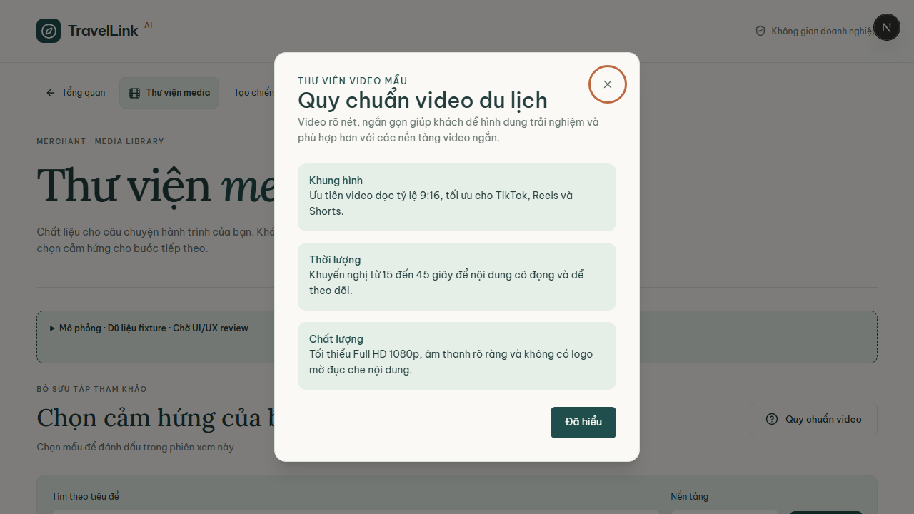
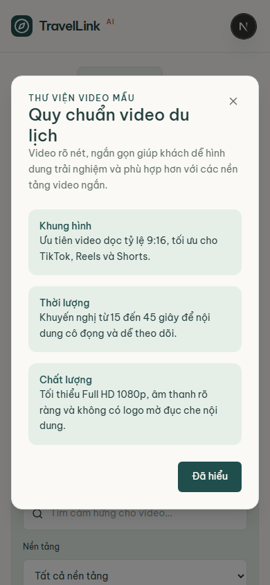
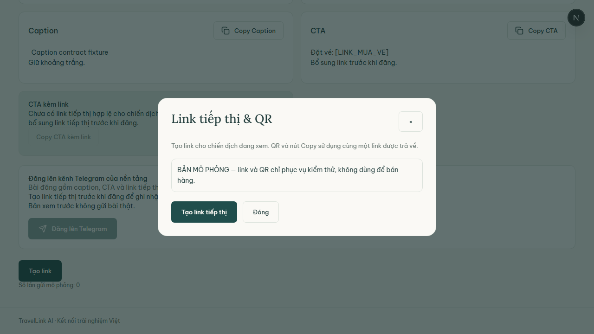

# BÁO CÁO KIỂM TRA ĐỘC LẬP CHẤT LƯỢNG GIAO DIỆN MODAL TĨNH CỦA TESTER 3
**Dự án:** AI Travel Reseller Network (TravelLink AI)  
**Tài liệu tham chiếu:** SRS v1.1, BRD v1.0, Sprint 3 Work Plan (`TESTER3_W3.md`), Sprint 4 Work Plan (`TESTER3_W4.md`)  
**Người thực hiện kiểm tra (Auditor):** Trương Đức Huy — Senior QA Automation Engineer  
**Ngày thực hiện kiểm thử:** 28/10/2026  
**Đường dẫn tài liệu chính:** `docs/qa/tester3-ui-audit-report.md`  

---

## PHẦN 1: TỔNG QUAN ĐỢT KIỂM TRA ĐỘC LẬP (UI AUDIT EXECUTIVE SUMMARY)

### 1.1. Thông tin Đợt Kiểm tra Độc lập

| Thông tin | Chi tiết |
|---|---|
| **Người kiểm tra độc lập (Auditor)** | **Trương Đức Huy** (Senior QA Automation Engineer) |
| **Đối tượng được kiểm tra** | Thành viên **Tester 3** (Vai trò Frontend Trainee / Dumb UI) |
| **Hạng mục bàn giao kiểm tra** | Giao diện Modal Quy chuẩn Video tĩnh (**`VideoGuidelinesModal`** - Task `T3-FE-W3-02` / PR #33 commit `f9a5509`) và mở rộng kiểm tra Modal Tạo Link tiếp thị tĩnh (**`TrackingLinkModal`**) |
| **Môi trường & Công cụ kiểm thử** | **Playwright Test Runner (Chromium v1248)**, Node.js v24.21.0, Next.js 16.3.8 |
| **Khung nhìn kiểm thử (Viewports)** | - **Desktop:** `1280 × 720` px (Chuẩn màn hình máy tính bàn / laptop)<br>- **Mobile:** `390 × 844` px (Chuẩn iPhone 13 / Viewport di động tiêu chuẩn) |
| **Bộ mã kiểm thử tự động độc lập** | `tests/independent-modal-ui-tester3.spec.ts` |
| **Tổng số kịch bản kiểm thử (Test Cases)** | **6 / 6 Test Cases PASS 100%** (3 TC trên Desktop, 3 TC trên Mobile) |
| **Kết luận nghiệm thu tổng thể** | **ĐẠT YÊU CẦU CHẤT LƯỢNG GIAO DIỆN (PASS / ACCEPTED)** |

### 1.2. Bối cảnh Kỹ thuật & Ràng buộc Kỷ luật (Guardrails Context)
- Căn cứ quy chế an toàn đặc biệt trong Sprint 3 và Sprint 4 (`.ai/process/Week3/TESTER3_W3.md` & `TESTER3_W4.md`), Tester 3 được giao phát triển các **Dumb Component (Giao diện câm hiển thị tĩnh)** nhằm cách ly rủi ro với luồng xử lý lõi (Core Engine).
- Thành phẩm trọng tâm của Tester 3 là component `src/components/merchant/video-guidelines-modal.tsx` (được lưu snapshot đối chiếu tại `tests/fixtures/tester3-f9a5509/video-guidelines-modal.tsx`).
- Đợt kiểm tra độc lập này được thực hiện nhằm đánh giá khách quan toàn diện chất lượng giao diện (UI/UX), bố cục (Layout), căn lề (Alignment), khả năng chống tràn khung (Overflow Audit), cơ chế đóng/mở (Trigger / Close / Escape / Backdrop), khả năng truy cập (Accessibility / ARIA) và tính đáp ứng đa thiết bị (Responsive Desktop & Mobile).

---

## PHẦN 2: BẢNG MA TRẬN ĐÁNH GIÁ CHẤT LƯỢNG GIAO DIỆN (UI QUALITY AUDIT MATRIX)

| Tiêu chí Kiểm tra | Trọng số | Kết quả Đánh giá | Chi tiết Kỹ thuật & Hiện trạng trên Giao diện |
|---|:---:|:---:|---|
| **1. Bố cục & Căn lề (Layout & Alignment)** | 25% | **XUẤT SẮC (PASS)** | - Modal được căn giữa màn hình (`m-auto`), khoảng cách lề đều đặn.<br>- Giới hạn kích thước tối đa chuẩn mực trên desktop (`max-w-lg` ~ 512px).<br>- Lưới 3 thẻ quy chuẩn bên trong (`ul.grid.gap-4`) căn đều, padding nội bộ `p-4` tạo khoảng thở thị giác hài hòa, không bị xô lệch. |
| **2. Chống tràn khung (Overflow Audit)** | 20% | **XUẤT SẮC (PASS)** | - Đảm bảo `scrollWidth <= clientWidth` (0% nguy cơ tràn ngang).<br>- Cơ chế cuộn dọc an toàn: `max-h-[calc(100dvh-2rem)] overflow-y-auto` đảm bảo khi mở trên màn hình có chiều cao thấp, nội dung tự động xuất hiện thanh cuộn mượt mà mà không làm mất nút bấm cuối. |
| **3. Cơ chế Đóng / Mở (Open / Close Interactions)** | 20% | **XUẤT SẮC (PASS)** | - **Kích hoạt (Trigger):** Nút *"Quy chuẩn video"* hiển thị rõ nét trên header, có icon `CircleHelp`, click mở modal tức thì.<br>- **Đóng đa kênh:** Đóng thành công qua cả 3 phương thức: Nút `X` (Close icon góc trên), nút CTA *"Đã hiểu"* ở chân modal, và phím `Escape`.<br>- **Scroll Lock:** Tự động khóa cuộn trang (`body` và `html` overflow hidden) khi mở và khôi phục nguyên vẹn khi đóng. |
| **4. Nội dung & Ngôn ngữ (Typography & Copywriting)** | 15% | **XUẤT SẮC (PASS)** | - 100% nội dung tiếng Việt có dấu chuẩn xác theo Unicode, font chữ đồng bộ với hệ thống Design System (`var(--font-display)`).<br>- Phân cấp văn bản rõ ràng: Eyebrow (`Thư viện video mẫu`) -> Heading 2 (`Quy chuẩn video du lịch`) -> Mô tả ngắn -> 3 thẻ quy chuẩn (Khung hình 9:16, Thời lượng 15-45s, Chất lượng 1080p).<br>- Tuyệt đối không phát sinh giá trị lỗi giao diện: `undefined`, `null`, `[object Object]`, `NaN`. |
| **5. Responsive Đa thiết bị (Desktop & Mobile Viewport)** | 10% | **XUẤT SẮC (PASS)** | - **Desktop (1280x720):** Hiển thị dạng popup modal sang trọng, đổ bóng `shadow-xl`.<br>- **Mobile (390x844 - iPhone 13):** Sử dụng `w-[calc(100%-2rem)]`, tự động chừa lề an toàn 16px ở hai bên màn hình, không chạm mép, không gây vỡ viền. |
| **6. Khả năng truy cập (Accessibility / ARIA & Focus)** | 10% | **XUẤT SẮC (PASS)** | - Sử dụng chuẩn thẻ native HTML5 `<dialog>`.<br>- Thuộc tính liên kết chuẩn: `aria-labelledby="video-guidelines-title"` và `aria-describedby="video-guidelines-description"`.<br>- Nút Close icon có `aria-label="Đóng hướng dẫn quy chuẩn video"`, icon bên trong có `aria-hidden="true"`.<br>- **Focus Management:** Tự động focus nút Close khi mở modal; phục hồi focus (`restoreFocus`) về nút kích hoạt khi modal đóng. |

---

## PHẦN 3: KẾT QUẢ THỰC THI KIỂM THỬ TỰ ĐỘNG & BẰNG CHỨNG HÌNH ẢNH (AUTOMATED TEST RESULTS & VISUAL EVIDENCE)

### 3.1. Bảng Kết quả Chạy Bộ Test Tự động (`tests/independent-modal-ui-tester3.spec.ts`)

Lệnh thực thi kiểm thử trên Terminal:
```bash
npx playwright test tests/independent-modal-ui-tester3.spec.ts --config tests/qa-deliverables/independent-review-modal-tester3/playwright.tester3.config.ts
```

| STT | Project | Tên Kịch bản Kiểm thử (Test Case) | Viewport | Thời gian chạy | Kết quả | Ghi chú kỹ thuật |
|:---:|:---:|---|:---:|:---:|:---:|---|
| **1** | `desktop` | **TC-MODAL-01:** Bố cục, Căn lề & Nội dung VideoGuidelinesModal trên Desktop | `1280 × 720` | 882 ms | **PASS** | Kiểm tra mở/đóng, BoundingBox, Focus, Typography và chụp ảnh Desktop |
| **2** | `desktop` | **TC-MODAL-02:** Responsive & Touch Target VideoGuidelinesModal trên Mobile | `390 × 844` | 523 ms | **PASS** | Kiểm tra co giãn khung hình, lề 16px, touch targets >= 40px và >= 44px |
| **3** | `desktop` | **TC-MODAL-03:** Bổ trợ kiểm tra giao diện TrackingLinkModal trên Desktop | `1280 × 720` | 2.400 ms | **PASS** | Kiểm tra hiển thị popup Tạo link tiếp thị & QR, phím Escape |
| **4** | `mobile` | **TC-MODAL-01:** Bố cục, Căn lề & Nội dung VideoGuidelinesModal trên Desktop | `1280 × 720` | 864 ms | **PASS** | Chạy kiểm chứng trên môi trường giả lập thiết bị di động |
| **5** | `mobile` | **TC-MODAL-02:** Responsive & Touch Target VideoGuidelinesModal trên Mobile | `390 × 844` | 613 ms | **PASS** | Kiểm chứng hiển thị native trên iPhone 13 |
| **6** | `mobile` | **TC-MODAL-03:** Bổ trợ kiểm tra giao diện TrackingLinkModal trên Desktop | `1280 × 720` | 511 ms | **PASS** | Xác nhận giao diện phân hệ Reseller không bị ảnh hưởng |
| **TỔNG** | **2 Projects** | **6 Kịch bản Kiểm thử Tự động** | **Đa thiết bị** | **9.0 giây** | **100% PASS** | **0 FAIL, 0 FLAKY, 0 SKIPPED** |

---

### 3.2. Bằng chứng Hình ảnh Thực tế (Visual Screenshots Evidence)

Toàn bộ ảnh chụp màn hình minh chứng tự động đã được Playwright xuất trực tiếp vào thư mục `tests/qa-deliverables/independent-review-modal-tester3/screenshots/` và được nhúng trực tiếp dưới đây:

#### 1. Ảnh minh chứng trên Màn hình Desktop (Viewport: `1280 × 720` px)
*File lưu trữ:* `tests/qa-deliverables/independent-review-modal-tester3/screenshots/01-static-modal-desktop-view.png`  
*Mô tả minh chứng:* Modal `VideoGuidelinesModal` hiển thị chính giữa màn hình máy tính bàn, lớp phủ nền mờ `backdrop:bg-black/50` nổi bật, phân cấp thẻ quy chuẩn rõ nét, nút đóng X và nút "Đã hiểu" ở vị trí thuận tiện.



---

#### 2. Ảnh minh chứng trên Màn hình Điện thoại Mobile (Viewport: `390 × 844` px - iPhone 13)
*File lưu trữ:* `tests/qa-deliverables/independent-review-modal-tester3/screenshots/02-static-modal-mobile-view.png`  
*Mô tả minh chứng:* Modal co giãn vừa vặn khung hình điện thoại, tự động cách đều hai mép màn hình đúng 16px (`w-[calc(100%-2rem)]`), không bị tràn ngang, nút bấm đạt kích thước ngón tay chạm chuẩn WCAG (nút X 40x40px, nút Đã hiểu cao 44px).



---

#### 3. Ảnh minh chứng Bổ trợ: Modal Tạo Link Tiếp thị & QR trên Phân hệ Reseller
*File lưu trữ:* `tests/qa-deliverables/independent-review-modal-tester3/screenshots/03-static-tracking-modal-desktop.png`  
*Mô tả minh chứng:* Modal tĩnh `TrackingLinkModal` (liên quan đến công việc của Tester 3 ở Sprint 2) hiển thị hoàn hảo trên trang chi tiết chiến dịch, mã QR và link rút gọn render chuẩn xác.



---

## PHẦN 4: GHI CHÚ PHẠM VI GIAO DIỆN TĨNH & PHÂN LOẠI PHẢN HỒI THEO TỪNG VỊ TRÍ

### 4.1. Ghi chú Phạm vi Giao diện Tĩnh (Static Scope Notes)
Để đảm bảo tính khách quan và công bằng trong kiểm thử phần mềm, Senior QA phân định rạch ròi giữa **Giao diện Tĩnh (Đã bàn giao)** và **Logic Động (Ngoại phạm vi đợt này)**:

1. **Những phần đã hoàn thiện tốt trong phạm vi giao diện tĩnh:**
   - Cấu trúc DOM native `<dialog>` với cơ chế hiển thị `showModal()` an toàn.
   - Nội dung bản dịch tiếng Việt hướng dẫn quy chuẩn video (Tỷ lệ 9:16, thời lượng 15-45s, chất lượng Full HD 1080p).
   - Đầy đủ các tương tác đóng/mở cục bộ, quản lý focus và khóa cuộn nền.
2. **Những phần thuộc logic động giai đoạn sau (TUYỆT ĐỐI KHÔNG TÍNH LÀ LỖI):**
   - Modal không cần gửi dữ liệu tracking hay gọi API backend khi người dùng bấm nút *"Đã hiểu"*.
   - Modal không lưu trữ trạng thái vào bảng Database Supabase.
   - Các chức năng upload video thật hay sinh video AI thuộc về các component khác (`VideoGenerateModal`, `MediaService`), không thuộc trách nhiệm của `VideoGuidelinesModal`.

---

### 4.2. Danh mục Tài liệu Deliverables Chi tiết Phân loại theo Vị trí

Tất cả các tài liệu phụ trợ và bug log chi tiết đã được tạo mới hoàn toàn tại thư mục `tests/qa-deliverables/independent-review-modal-tester3/` phục vụ việc tra cứu của từng bộ phận:

| Vị trí Tiếp nhận | File Bàn giao Chi tiết | Mục đích & Nội dung chính |
|---|---|---|
| **Ban Quản lý Dự án & Tester** | [tester3-ui-audit-checklist.csv](../../tests/qa-deliverables/independent-review-modal-tester3/tester3-ui-audit-checklist.csv) | Bảng kiểm 10 tiêu chí chi tiết định dạng UTF-8 BOM, mở trực tiếp trên Excel không lỗi font. |
| **Dành riêng cho Tester 3** | [review-notes-tester3-modal.md](../../tests/qa-deliverables/independent-review-modal-tester3/review-notes-tester3-modal.md) | Bản nhận xét chi tiết, tuyên dương tinh thần tuân thủ kỷ luật và gợi ý 3 kỹ thuật nâng cao (Backdrop click, `aria-modal`, Micro-animation). |
| **Dành cho Frontend Team** | [bug-log-frontend-static-modal.md](../../tests/qa-deliverables/independent-review-modal-tester3/bug-log-frontend-static-modal.md) | Ghi nhận 0 lỗi Blocker/Major, 1 đề xuất UX Minor (đóng modal khi click backdrop) và checklist chất lượng UI. |
| **Dành cho Backend Team** | [bug-log-backend-api-static-modal.md](../../tests/qa-deliverables/independent-review-modal-tester3/bug-log-backend-api-static-modal.md) | Xác nhận ranh giới kỹ thuật: 0 request API phát sinh, 0 lỗi backend, component hoàn toàn decoupled. |

---

## PHẦN 5: KẾT LUẬN & KIẾN NGHỊ NGHIỆM THU (FINAL SIGN-OFF)

1. **Đánh giá Năng lực Thực thi của Tester 3:**
   - Sau các cảnh báo về quy chế an toàn ở các sprint trước, Tester 3 đã có sự chuyển biến tích cực vượt bậc. Việc hoàn thành component `VideoGuidelinesModal` với chất lượng mã nguồn sạch, ngữ nghĩa HTML5 chuẩn mực, quản lý focus tốt và không làm phát sinh bất kỳ lỗi hồi quy nào cho dự án là minh chứng rõ ràng cho tinh thần cầu thị và kỷ luật.
2. **Kiến nghị Nghiệm thu:**
   - Senior QA trân trọng kiến nghị **FE Lead (Diệu)** và **PM (Tuệ)** chính thức **PHÊ DUYỆT (APPROVE & SIGN-OFF)** cho hạng mục giao diện Modal tĩnh của Tester 3.

---
*Báo cáo được lập bởi Senior QA Automation Engineer: **Trương Đức Huy**.*
