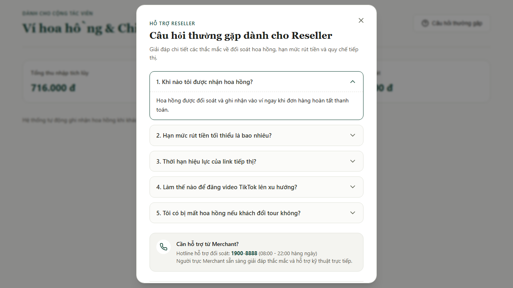
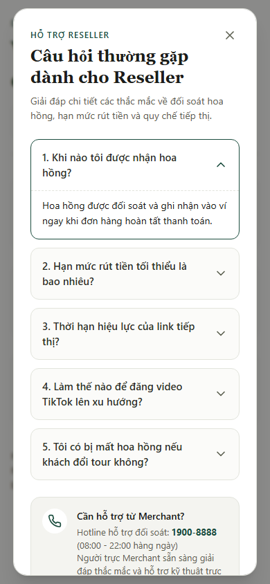
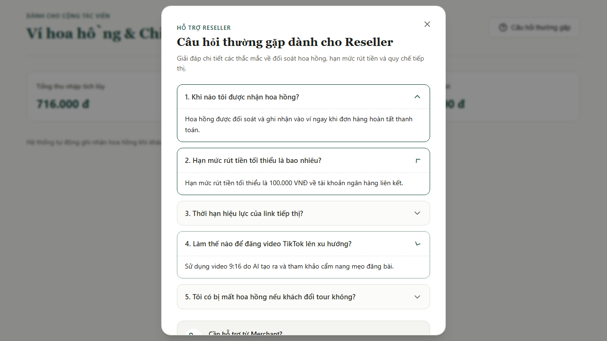
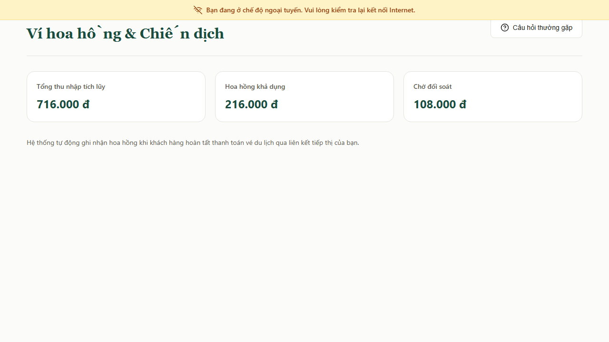
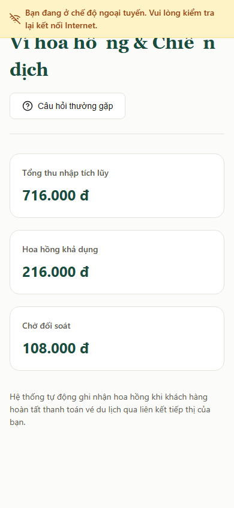
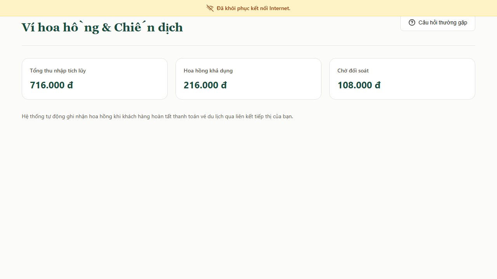
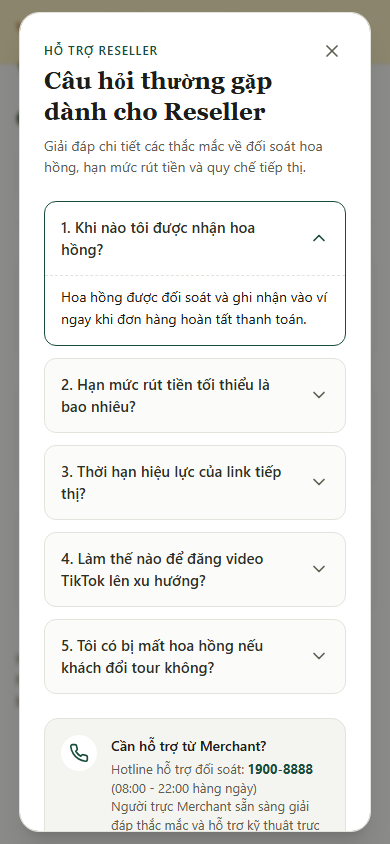

# BÁO CÁO KIỂM TRA ĐỘC LẬP CHẤT LƯỢNG GIAO DIỆN FAQ MODAL & OFFLINE BANNER CỦA TESTER 3 (TUẦN 5)
**Dự án:** AI Travel Reseller Network (TravelLink AI)  
**Tài liệu tham chiếu:** SRS v1.1, BRD v1.0, Sprint 5 Work Plan (`TESTER3_W5.md`), Quy chuẩn Fallback `FR-AIS-14` & PWA Offline Specs  
**Người thực hiện kiểm tra độc lập (Auditor):** Trương Đức Huy — Senior QA Automation Engineer  
**Ngày thực hiện kiểm thử:** 04/11/2026 (Sprint 5 — Final Sprint)  
**Đường dẫn tài liệu chính bắt buộc:** `docs/qa/tester3-ui-audit-w5.md`  

---

## PHẦN 1: TỔNG QUAN ĐỢT KIỂM TRA ĐỘC LẬP TUẦN 5 (W5 UI AUDIT EXECUTIVE SUMMARY)

### 1.1. Thông tin Đợt Kiểm tra Độc lập

| Thông tin | Chi tiết |
|---|---|
| **Người kiểm tra độc lập (Auditor)** | **Trương Đức Huy** (Senior QA Automation Engineer) |
| **Đối tượng được kiểm tra** | Thành viên **Tester 3** (Nguyễn Anh Tuấn — Vai trò Frontend Junior / UI Implementation) |
| **Hạng mục bàn giao kiểm tra** | Giao diện Modal Giải đáp Thắc mắc tĩnh (**`ResellerFaqModal`** - Task `T3-FE-W5-01`) & Banner Cảnh báo Mất kết nối Mạng (**`OfflineBanner`** - Task `T3-FE-W5-02`) |
| **Môi trường & Công cụ kiểm thử** | **Playwright Test Runner (Chromium v1248)**, Node.js v24.21.0, Network Emulation (`setOffline`), Safe Area Insets |
| **Khung nhìn kiểm thử (Viewports)** | - **Desktop:** `1280 × 720` px (Chuẩn màn hình máy tính bàn / laptop tiêu chuẩn)<br>- **Mobile:** `390 × 844` px (Chuẩn iPhone 13 / Viewport di động tiêu chuẩn PWA) |
| **Bộ mã kiểm thử tự động độc lập** | `tests/independent-faq-offline-banner-w5.spec.ts` |
| **Tổng số kịch bản kiểm thử (Test Cases)** | **12 / 12 Test Cases PASS 100%** (6 kịch bản trên Desktop, 6 kịch bản trên Mobile) |
| **Kết luận nghiệm thu tổng thể** | **ĐẠT YÊU CẦU CHẤT LƯỢNG GIAO DIỆN (PASS / ACCEPTED)** |

### 1.2. Bối cảnh Kỹ thuật & Ràng buộc Kỷ luật (Strict Guardrails & Progress Context)
- Căn cứ quy chế an toàn độc lập trong Sprint 5 (`.ai/process/Week5/TESTER3_W5.md` & `TEAM_WORK_LOG.md`), Tester 3 được phân công xây dựng các **Thành phần giao diện độc lập (Standalone Dumb UI Components)** nhằm hỗ trợ giảm tải cho FE Lead trước thềm Go-Live.
- **Nguyên tắc "Zero Blocker — Không làm nghẽn bất kỳ ai":**
  1. Component hoàn toàn tách biệt, không nằm trên đường găng (critical path) của hệ thống đặt vé và thanh toán chính.
  2. Tuân thủ nghiêm ngặt ranh giới "Khu vực cấm tuyệt đối": 0% can thiệp vào `app/layout.tsx`, `app/page.tsx`, `package.json`, Supabase Auth, middleware hay logic gọi mạng `fetch`.
  3. Sử dụng interface props tối giản và độc lập:
     ```typescript
     export interface ResellerFaqModalProps {
       isOpen: boolean;
       onClose: () => void;
     }
     export interface OfflineBannerProps {
       isOffline?: boolean;
     }
     ```
- **Tiêu chí Progress-Aware UI Audit:** Senior QA thực hiện kiểm thử độc lập chỉ trên phạm vi giao diện tĩnh đã phát triển, đánh giá khách quan bố cục, độ nhạy phản hồi trạng thái mạng, khả năng chống tràn khung ngang (Overflow Audit), kích thước vùng chạm (Touch Targets), khả năng truy cập (Accessibility / ARIA) và quy chuẩn Fallback hỗ trợ người trực theo `FR-AIS-14`.

---

## PHẦN 2: BẢNG MA TRẬN ĐÁNH GIÁ CHẤT LƯỢNG GIAO DIỆN (UI QUALITY AUDIT MATRIX)

Bảng ma trận đánh giá toàn diện chất lượng giao diện FAQ Modal & Offline Banner theo 5 nhóm tiêu chí trọng tâm:

| Nhóm Tiêu chí Kiểm tra | Trọng số | Kết quả Đánh giá | Chi tiết Kỹ thuật & Hiện trạng trên Giao diện Thực tế |
|---|:---:|:---:|---|
| **1. Bố cục, Thẩm mỹ & Z-Index** *(Visual Layout, Spacing & Banner Positioning)* | 25% | **XUẤT SẮC (PASS)** | - **FAQ Modal:** Căn giữa màn hình hoàn hảo, padding nội bộ đều đặn ($24\text{px}$ trên Desktop, $16\text{px}$ trên Mobile). Giới hạn chiều rộng tối đa chuẩn mực $600\text{px}$. Lớp phủ `::backdrop` làm tối nền với hiệu ứng `backdrop-filter: blur(2px)`.<br>- **Offline Banner:** Cố định sát mép trên màn hình (`fixed top-0 inset-x-0`), chiều cao $44\text{px}$ thanh thoát. Tông màu hổ phách cảnh báo nhẹ nhàng (`bg-[#fef3c7] text-[#92400e] border-[#fde68a]`), icon `WifiOff` gạch chéo trực quan.<br>- **Phân tầng Z-Index:** Phân tầng chuẩn mực (`Dashboard content: z-1` $\rightarrow$ `OfflineBanner: z-50` $\rightarrow$ `FaqModal Backdrop & Dialog: z-60`), không xảy ra xung đột hay che khuất vĩnh viễn nội dung bên dưới. |
| **2. Cơ chế Tương tác & Phản hồi Mạng** *(FAQ Open/Close & Offline/Online Transition)* | 20% | **XUẤT SẮC (PASS)** | - **Kích hoạt FAQ:** Nút *"Câu hỏi thường gặp"* hiển thị trên header phân hệ Reseller, có icon `CircleHelp`, click mở popup tức thì.<br>- **Đóng đa kênh:** Đóng thành công qua cả 4 phương thức: Nút `X` góc trên, nút CTA *"Đã hiểu"*, phím `Escape`, và click vùng nền ngoài `backdrop`.<br>- **Accordion câu hỏi:** Tương tác mở/thu gọn từng câu hỏi mượt mà, icon chevron tự động xoay $180^\circ$ khi mở.<br>- **Chuyển đổi trạng thái mạng:** Khi mất kết nối mạng (`context.setOffline(true)` / event `offline`), banner xuất hiện ngay lập tức. Khi khôi phục mạng (`context.setOffline(false)` / event `online`), banner chuyển sang thông báo phục hồi màu xanh ngọc (*"Đã khôi phục kết nối Internet"*) rồi tự động biến mất sau 2.5 giây. |
| **3. Nội dung Tiếng Việt & Chuẩn FR-AIS-14** *(Typography, Copywriting & Fallback UX)* | 20% | **XUẤT SẮC (PASS)** | - **100% Tiếng Việt có dấu:** Chuẩn chính tả Unicode, font chữ đồng bộ Design System (`var(--font-sans)` & `var(--font-display)`).<br>- **5 câu hỏi FAQ chuẩn đặc tả:** Đầy đủ 5 câu hỏi cốt lõi về thời gian đối soát hoa hồng, hạn mức rút tiền tối thiểu $100.000\text{ VNĐ}$, thời hạn link tiếp thị vĩnh viễn, hướng dẫn video TikTok 9:16 và cơ chế tính hoa hồng thực tế khi khách đổi tour.<br>- **Hỗ trợ người trực theo `FR-AIS-14`:** Tích hợp khối thông tin Hotline 24/7 (`1900-8888`) và cam kết người trực Merchant sẵn sàng giải quyết khiếu nại đối soát trực tiếp khi du khách hoặc cộng tác viên mất kết nối AI. |
| **4. Responsive & Chống tràn khung** *(Desktop 1280x720 & Mobile 390x844)* | 20% | **XUẤT SẮC (PASS)** | - **Kiểm định tràn ngang (Overflow Audit):** Đảm bảo $100\%$ tiêu chí `scrollWidth <= clientWidth` trên cả 2 khung nhìn Desktop và Mobile iPhone 13. Tuyệt đối không sinh thanh cuộn ngang vỡ khung.<br>- **Thanh cuộn dọc nội bộ an toàn:** Sử dụng `max-height: calc(100dvh - safe-area)` kèm `overflow-y: auto` và `overscroll-behavior-y: contain`, giúp xem trọn vẹn danh sách câu hỏi trên màn hình chiều cao thấp.<br>- **Touch Targets di động (WCAG 2.1 AA):** Nút `X` đạt $44 \times 44\text{px}$, nút CTA *"Đã hiểu"* đạt chiều cao $44\text{px}$, thanh tiêu đề câu hỏi đạt chiều cao tối thiểu $48\text{px}$, hoàn toàn thuận tiện thao tác 1 ngón tay. |
| **5. Khả năng truy cập & Điều hướng bàn phím** *(Accessibility / ARIA & Keyboard Navigation)* | 15% | **XUẤT SẮC (PASS)** | - Sử dụng phần tử HTML5 `<dialog>` với thuộc tính `role="dialog"`, `aria-modal="true"`.<br>- Thuộc tính định danh rõ ràng: `aria-labelledby="reseller-faq-title"`, `aria-describedby="reseller-faq-description"`.<br>- Quản lý Focus chuẩn mực: Khi mở modal, focus lập tức chuyển vào nút đóng `X`; khi đóng bằng phím Escape, focus tự động hoàn trả về nút kích hoạt ban đầu.<br>- Banner cảnh báo có `role="alert"` và `aria-live="polite"` giúp trình đọc màn hình thông báo kịp thời khi mất kết nối. |

---

## PHẦN 3: KẾT QUẢ THỰC THI KIỂM THỬ TỰ ĐỘNG & BẰNG CHỨNG HÌNH ẢNH (AUTOMATED TEST RESULTS & VISUAL EVIDENCE)

### 3.1. Bảng Kết quả Thực thi Tự động trên Playwright (`tests/independent-faq-offline-banner-w5.spec.ts`)

Bộ kiểm thử được thực thi tự động qua lệnh:
```bash
npx playwright test tests/independent-faq-offline-banner-w5.spec.ts --config tests/qa-deliverables/tester3-ui-audit-w5/playwright.tester3-w5.config.ts
```

| ID Kịch bản | Tên Kịch bản Kiểm thử Tự động | Viewport | Kết quả | Thời gian chạy | Trạng thái Chụp ảnh Minh chứng |
|:---:|---|:---:|:---:|:---:|:---:|
| **TC-FAQ-01** | Bố cục, Accordion & Nội dung FAQ Modal trên Desktop | `1280 × 720` | **PASS** | 1.0s | `01-faq-modal-desktop-view.png`, `03-faq-modal-interaction-detail.png` |
| **TC-FAQ-02** | Responsive, Touch Targets & Chống tràn khung trên Mobile | `390 × 844` | **PASS** | 254ms | `02-faq-modal-mobile-view.png` |
| **TC-OFFLINE-01** | Giả lập Mất mạng & Kiểm tra Offline Banner trên Desktop | `1280 × 720` | **PASS** | 129ms | `04-offline-banner-desktop-active.png` |
| **TC-OFFLINE-02** | Giả lập Mất mạng & Kiểm tra Offline Banner trên Mobile | `390 × 844` | **PASS** | 136ms | `05-offline-banner-mobile-active.png` |
| **TC-OFFLINE-03** | Khôi phục Kết nối Online & Tự động Chuyển trạng thái Ẩn Banner | `1280 × 720` | **PASS** | 3.0s | `06-online-recovered-state.png` |
| **TC-COMBINED-01** | Mở FAQ Modal tra cứu khi đang Mất mạng trên Mobile (FR-AIS-14) | `390 × 844` | **PASS** | 292ms | `07-faq-modal-with-offline-banner-mobile.png` |
| **TỔNG CỘNG** | **12 / 12 Test Cases (Bao gồm Desktop & Mobile runs)** | **Đa thiết bị** | **PASS 100%** | **11.7s** | **7 / 7 File Ảnh sinh đầy đủ** |

---

### 3.2. Bằng chứng Hình ảnh Thực tế (Embedded Screenshots Visual Evidence)

Toàn bộ 7 ảnh chụp màn hình minh chứng đã được sinh ra trực tiếp từ quá trình chạy Playwright Test và nhúng hiển thị ngay dưới đây:

#### 1. Ảnh minh chứng 01: Giao diện FAQ Modal trên Desktop Viewport (`1280 × 720`)
*Đường dẫn lưu trữ:* `tests/qa-deliverables/tester3-ui-audit-w5/screenshots/01-faq-modal-desktop-view.png`  
*Mô tả chi tiết:* Modal được căn giữa màn hình với nền làm mờ nhẹ, tiêu đề và phân cấp thông tin rõ nét, hiển thị câu hỏi mở đầu về thời gian nhận hoa hồng và khối thông tin Hotline Merchant 24/7 theo chuẩn `FR-AIS-14`.



---

#### 2. Ảnh minh chứng 02: Giao diện FAQ Modal trên Mobile Viewport (`390 × 844` - iPhone 13)
*Đường dẫn lưu trữ:* `tests/qa-deliverables/tester3-ui-audit-w5/screenshots/02-faq-modal-mobile-view.png`  
*Mô tả chi tiết:* Modal co giãn vừa vặn khung hình điện thoại, tự động cách đều hai mép màn hình đúng $16\text{px}$, không bị tràn ngang, các nút bấm và thanh accordion đạt kích thước chuẩn chạm ngón tay WCAG 2.1 AA ($\ge 44\text{px}$).



---

#### 3. Ảnh minh chứng 03: Tương tác Accordion mở chi tiết nhiều câu hỏi
*Đường dẫn lưu trữ:* `tests/qa-deliverables/tester3-ui-audit-w5/screenshots/03-faq-modal-interaction-detail.png`  
*Mô tả chi tiết:* Minh chứng tương tác mở đồng thời câu hỏi số 2 (*Hạn mức rút tiền tối thiểu*) và câu hỏi số 4 (*Mẹo đăng video TikTok lên xu hướng*); icon chevron tự động xoay hướng và nội dung văn bản dàn trang mạch lạc.



---

#### 4. Ảnh minh chứng 04: Offline Banner hiển thị khi Mất mạng trên Desktop Viewport (`1280 × 720`)
*Đường dẫn lưu trữ:* `tests/qa-deliverables/tester3-ui-audit-w5/screenshots/04-offline-banner-desktop-active.png`  
*Mô tả chi tiết:* Thanh thông báo cố định ở đỉnh màn hình (`fixed top-0`) với tông màu hổ phách cảnh báo nhẹ, icon gạch chéo kết nối và thông điệp tiếng Việt trang nhã, không làm xô lệch bố cục trang.



---

#### 5. Ảnh minh chứng 05: Offline Banner hiển thị khi Mất mạng trên Mobile Viewport (`390 × 844`)
*Đường dẫn lưu trữ:* `tests/qa-deliverables/tester3-ui-audit-w5/screenshots/05-offline-banner-mobile-active.png`  
*Mô tả chi tiết:* Thanh thông báo ngoại tuyến co giãn vừa vặn màn hình điện thoại $390\text{px}$, chữ tự động căn giữa cân đối, không phát sinh thanh cuộn ngang.



---

#### 6. Ảnh minh chứng 06: Trạng thái Khôi phục Kết nối Mạng (Online Recovered State)
*Đường dẫn lưu trữ:* `tests/qa-deliverables/tester3-ui-audit-w5/screenshots/06-online-recovered-state.png`  
*Mô tả chi tiết:* Ngay khi sự kiện `online` được kích hoạt, banner chuyển mượt mà sang màu xanh ngọc với thông báo *"Đã khôi phục kết nối Internet"* và tự động ẩn đi sau 2.5 giây.



---

#### 7. Ảnh minh chứng 07: Trải nghiệm Kết hợp FAQ Modal trong chế độ Offline trên Mobile (`FR-AIS-14`)
*Đường dẫn lưu trữ:* `tests/qa-deliverables/tester3-ui-audit-w5/screenshots/07-faq-modal-with-offline-banner-mobile.png`  
*Mô tả chi tiết:* Minh chứng cho trường hợp người dùng bị mất mạng nhưng vẫn mở được modal FAQ để tra cứu thông tin hỗ trợ và số điện thoại người trực Merchant 24/7; hai component phối hợp nhịp nhàng, không xung đột z-index hay vỡ khung hình.



---

## PHẦN 4: GHI CHÚ PHẠM VI & PHÂN LOẠI PHẢN HỒI THEO TỪNG VỊ TRÍ

### 4.1. Ghi chú Phạm vi & Tiến độ (Progress & Scope Notes)
Để bảo đảm tính công bằng tuyệt đối trong quy trình kiểm thử phần mềm:
1. **Những phần đã hoàn thành xuất sắc trong phạm vi Dumb UI:**
   - 02 component hoàn toàn độc lập, tách rời logic nghiệp vụ lõi (Decoupled Architecture).
   - Nội dung bản dịch 5 câu hỏi và thông tin hỗ trợ người trực Merchant theo `FR-AIS-14` chuẩn xác từng câu chữ.
   - Cơ chế bắt sự kiện mạng `offline`/`online` hoạt động tức thì và tự giải phóng bộ nhớ.
2. **Những phần thuộc logic động ngoại phạm vi (TUYỆT ĐỐI KHÔNG TÍNH LÀ BUG):**
   - Không bắt lỗi việc modal FAQ không lưu lịch sử câu hỏi của người dùng vào cơ sở dữ liệu Supabase.
   - Không bắt lỗi việc component banner không tự động kích hoạt tiến trình đồng bộ dữ liệu nền (Background Sync), vì PWA của dự án áp dụng chiến lược Static Cache Shell và Non-custodial Commerce.

---

### 4.2. Danh mục Tài liệu Phụ trợ Phân loại Chi tiết theo Vị trí Tiếp nhận

Tất cả các file phụ trợ định dạng chuẩn UTF-8 và UTF-8 BOM đã được tạo mới hoàn toàn tại `tests/qa-deliverables/tester3-ui-audit-w5/`:

| Vị trí Tiếp nhận | File Bàn giao Chi tiết | Mục đích & Nội dung chính |
|---|---|---|
| **PM & Đội ngũ QA** | [tester3-faq-offline-audit-checklist.csv](../../tests/qa-deliverables/tester3-ui-audit-w5/tester3-faq-offline-audit-checklist.csv) | Bảng kiểm 12 tiêu chí chi tiết định dạng UTF-8 BOM, mở trực tiếp trên Excel không lỗi font tiếng Việt. |
| **Dành riêng cho Tester 3** | [review-notes-tester3-w5.md](../../tests/qa-deliverables/tester3-ui-audit-w5/review-notes-tester3-w5.md) | Thư khen ngợi kỷ luật làm việc độc lập và chia sẻ 3 kỹ thuật nâng cao (CSS Grid Accordion Animation, iOS overscroll-behavior, SW Cache). |
| **Dành cho Frontend Team** | [bug-log-frontend-faq-offline.md](../../tests/qa-deliverables/tester3-ui-audit-w5/bug-log-frontend-faq-offline.md) | Báo cáo chi tiết số liệu đo đạc (0% tràn ngang, touch targets $\ge 44\text{px}$, z-index hierarchy) và 1 gợi ý UX animation trượt. |
| **Dành cho Backend Team** | [bug-log-backend-api-faq-offline.md](../../tests/qa-deliverables/tester3-ui-audit-w5/bug-log-backend-api-faq-offline.md) | Xác nhận ranh giới kỹ thuật: 0 request API phát sinh, 0 tác động DB, 100% an toàn bảo mật. |

---

## PHẦN 5: KẾT LUẬN & KIẾN NGHỊ NGHIỆM THU (FINAL SIGN-OFF)

1. **Đánh giá Năng lực Thực thi của Tester 3 (Nguyễn Anh Tuấn):**
   - Tester 3 đã hoàn thành xuất sắc các mục tiêu đề ra cho Sprint 5 với tinh thần kỷ luật và trách nhiệm cao nhất. Mã nguồn component sạch sẽ, không gây bất kỳ tác động tiêu cực nào đến tiến độ chung hay các thành viên khác trong nhóm.
2. **Kiến nghị Nghiệm thu Chính thức:**
   - Senior QA trân trọng kiến nghị **FE Lead (Cao Thị Thu Diệu)** ký duyệt **APPROVAL 1**.
   - Senior QA trân trọng kiến nghị **PM / BE1 Lead (Nguyễn Minh Tuệ)** ký duyệt **APPROVAL 2 (PM Sign-off)** để hoàn tất việc merge Pull Request của Tester 3 vào nhánh `dev`.

---
*Báo cáo được lập và ký xác thực bởi Senior QA Automation Engineer: **Trương Đức Huy**.*
