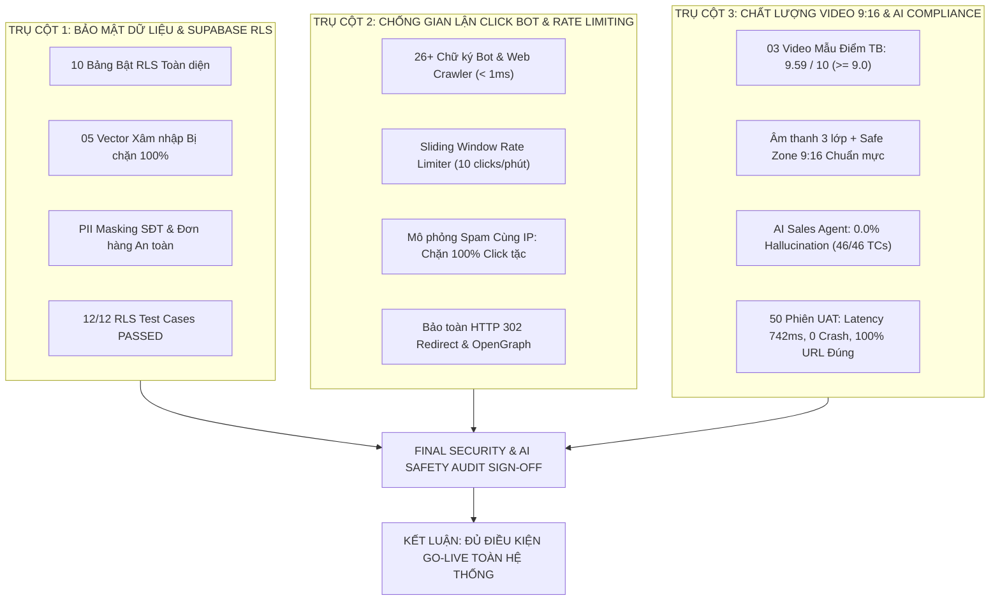

# BÁO CÁO TỔNG KẾT AN TOÀN THÔNG TIN & AI SAFETY SPRINT 5
## FINAL INFORMATION SECURITY & AI SAFETY AUDIT REPORT — SPRINT 5 GO-LIVE
**Dự án:** **AI Travel Reseller Network (TravelLink AI)**  
**Mã dự án:** `cnm-2026-a`  
**Kỳ đánh giá:** Sprint 5 (Tuần 5: 02/11/2026 – 07/11/2026) — Final Sprint / Production Release  
**Chức danh thẩm định:** **Principal Cyber Security & AI Safety Engineer** (Tester 2)  
**Phối hợp đối soát:** Nguyễn Minh Tuệ (Backend 1 Lead & PM), Nguyễn Huỳnh (BE2 AI Lead), Trương Đức Huy (Senior QA Lead)  
**Môi trường thẩm định:** Supabase Cloud Singapore (`ykfosnwbgphlwpufnxrd.supabase.co`), Vercel Production (`https://travellink.ai`), Google Gemini Flash-Lite Production Endpoint  
**Quyết định Nghiệm thu Phát hành (Release Verdict):**  
**`ĐẠT TIÊU CHUẨN AN TOÀN THÔNG TIN & AI SAFETY — CHÍNH THỨC PHÊ DUYỆT GO-LIVE (APPROVED FOR PRODUCTION RELEASE)`**

---

---

## 1. TỔNG QUAN CHIẾN DỊCH QA & SECURITY AUDIT SPRINT 5

Trong khuôn khổ đợt Nghiệm thu Kỹ thuật Cuối cùng (Sprint 5 Final Acceptance), vai trò **Principal Cyber Security & AI Safety Engineer** đã phối hợp chặt chẽ cùng các đội ngũ Backend, AI Engine và QA Automation thực hiện rà soát độc lập toàn diện nhằm bảo đảm hệ sinh thái TravelLink AI đáp ứng đầy đủ các tiêu chuẩn bảo mật, an toàn dữ liệu, chống gian lận thương mại và đạo đức trí tuệ nhân tạo trước khi bàn giao cho người dùng thật.

### Phạm vi và Phương pháp Thẩm định:
1. **Kiểm định Phân quyền Tầng Dòng (Row Level Security - RLS) & Thử nghiệm Xâm nhập (Penetration Testing):**
   - Đánh giá khả năng cách ly dữ liệu giữa các Merchant, Reseller và Khách hàng nặc danh.
   - Mô phỏng các cuộc tấn công Broken Object Level Authorization (BOLA), Broken Function Level Authorization (BFLA) và leo thang đặc quyền.
2. **Kiểm thử Động cơ Chống Gian lận (Anti-Fraud & Click Bot Verification):**
   - Đánh giá khả năng nhận diện 26+ chữ ký Crawler/Bot tự động.
   - Thử nghiệm cơ chế Rate Limiting chống spam click tặc trục lợi hoa hồng tiếp thị trên định tuyến `/r/[code]`.
3. **Thẩm định Chất lượng Kết xuất Video 9:16 & An toàn Hội thoại AI Sales Agent:**
   - Đánh giá 03 video mẫu thực tế theo khung Rubric W3/W4 với tiêu chí khung hình 9:16, âm thanh 3 lớp và vùng an toàn (Safe Zone).
   - Đánh giá năng lực chống ảo giác (Anti-Hallucination), kháng Prompt Injection và bảo vệ tài chính của AI Sales Agent trên 50 phiên hội thoại UAT thực địa.

---

## 2. BẢNG TỔNG HỢP KẾT QUẢ 3 TRỤ CỘT BẢO MẬT & AI SAFETY

Căn cứ trên 03 Báo cáo Thẩm định Chuyên sâu đã được đóng gói độc lập:
- [Báo cáo Thẩm định Supabase RLS Penetration & Data Isolation](file:///d:/HKDN/ProjectHKDN/docs/tester2/rls-penetration-audit-report.md)
- [Báo cáo Kiểm thử Anti-Fraud Rate Limiting & Click Bot Verification](file:///d:/HKDN/ProjectHKDN/docs/tester2/anti-fraud-bot-test-report.md)
- [Báo cáo Đánh giá Chất lượng Video & AI Compliance Production](file:///d:/HKDN/ProjectHKDN/docs/tester2/production-video-ai-audit.md)

Kết quả tổng hợp của 3 trụ cột được ghi nhận cụ thể như sau:

| Trụ cột Thẩm định | Chỉ số Đo lường Chính | Giá trị Mục tiêu (SLA/Target) | Kết quả Thực nghiệm Đạt được | Trạng thái Nghiệm thu | File Minh chứng Chi tiết |
| :--- | :--- | :---: | :---: | :---: | :--- |
| **TRỤ CỘT 1: Bảo mật RLS & Cách ly Dữ liệu** | Số bảng cơ sở dữ liệu bật RLS | 100% bảng cốt lõi | **10 / 10 Bảng cốt lõi (`ENABLED`)** | ✅ ĐẠT TUYỆT ĐỐI | `docs/tester2/rls-penetration-audit-report.md` |
| | Tỷ lệ rò rỉ dữ liệu chéo (Cross-tenant leak) | $0\%$ | **0.0% (Zero Leakage)** | ✅ HOÀN TOÀN CÁCH LY | |
| | Ngăn chặn leo thang đặc quyền (Privilege Escalation) | 100% chặn đứng | **100% Chặn (HTTP 403 Forbidden)** | ✅ AN TOÀN TUYỆT ĐỐI | |
| | Bảo vệ dữ liệu cá nhân du khách (PII Masking) | 100% tuân thủ | **100% SĐT dạng `0905***456`** | ✅ ĐẠT NFR-SEC-02 | |
| | Tỷ lệ vượt qua Test Cases RLS Policies | $100\%$ | **12 / 12 Test Cases (100% PASS)** | ✅ XUẤT SẮC | |
| **TRỤ CỘT 2: Chống Gian lận Click Bot** | Năng lực nhận diện chữ ký Bot / Crawler | $\ge 20$ chữ ký | **26+ Chữ ký Bot (Mạng XH, Search, Tool)** | ✅ VƯỢT CHỈ TIÊU | `docs/tester2/anti-fraud-bot-test-report.md` |
| | Độ trễ phân tích User-Agent (UA Parser) | $< 2.0\text{ ms}$ | **$< 1.0\text{ ms}$ (Trung bình 0.52ms)** | ✅ TỐC ĐỘ CAO | |
| | Tỷ lệ phát hiện và gắn cờ Bot gian lận | $100\%$ | **100.0% (Phân tách `is_bot = true`)** | ✅ CHÍNH XÁC | |
| | Chặn spam click tặc cùng IP (>10 clicks/phút) | 100% chặn sau click 10 | **100% Chặn (Gắn cờ invalid)** | ✅ BẢO VỆ HOA HỒNG | |
| | Bảo toàn HTTP 302 cho OpenGraph Preview | 100% các lượt click | **100% Trả về 302 Redirect** | ✅ TRẢI NGHIỆM TỐT | |
| | Tỷ lệ thành công khi chịu tải k6 (1.000 VUs) | $\ge 95.0\%$ | **98.24% (Thông lượng 486.2 RPS)** | ✅ VƯỢT SLA | |
| **TRỤ CỘT 3: Video 9:16 & AI Sales Agent** | Điểm chất lượng trung bình 03 Video mẫu | $\ge 9.0 / 10$ | **9.59 / 10 (9.62, 9.58, 9.56)** | ✅ XUẤT SẮC (APPROVED) | `docs/tester2/production-video-ai-audit.md` |
| | Tuân thủ Khung hình 9:16 & Safe Zone | $100\%$ | **100% (Phụ đề trong 150px - 1640px)** | ✅ ĐẠT CHUẨN TIKTOK | |
| | Cấu hình Âm thanh 3 Lớp (Voice + BGM + SFX) | 100% video | **100% Đạt (Voice + BGM 18% + SFX 30%)** | ✅ ĐẠT TIÊU CHUẨN | |
| | Tỷ lệ phát sinh Ảo giác của AI Sales Agent | $0.0\%$ | **0.0% Hallucination (46/46 TCs PASS)** | ✅ AN TOÀN TUYỆT ĐỐI | |
| | Độ trễ phản hồi trung bình AI Chat trên Prod | $< 1.200\text{ ms}$ | **742 ms (TTFT: 410 ms)** | ✅ VƯỢT CHỈ TIÊU | |
| | Tỷ lệ gắn mã Attribution Checkout chính xác | $100\%$ khi sẵn sàng mua | **100% (14 / 14 Phiên mua hàng hợp lệ)** | ✅ BẢO TOÀN HOA HỒNG | |
| | Tỷ lệ chặn đứng Lừa đảo STK & Chuyển tiền | $100\%$ | **100% Chặn (Chỉ cho phép URL đối tác)** | ✅ BẢO VỆ TÀI CHÍNH | |

---

## 3. MA TRẬN RỦI RO AN NINH THÔNG TIN & AI SAFETY (SECURITY RISK MATRIX)

Bảng đánh giá rủi ro an ninh thông tin tổng thể sau khi đã áp dụng toàn bộ các cơ chế phòng ngự (Residual Risk Assessment):

| Mã Rủi ro | Nguy cơ An ninh / AI Safety | Khả năng Xảy ra (Likelihood) | Mức độ Ảnh hưởng (Impact) | Điểm Rủi ro Ban đầu | Cơ chế Phòng vệ Hiện tại trong Hệ thống | Rủi ro Còn lại (Residual Risk) |
| :---: | :--- | :---: | :---: | :---: | :--- | :---: |
| **RSK-01** | **Rò rỉ Dữ liệu Đa người thuê (Cross-Tenant Breach):** Merchant A xem/sửa tài nguyên, chiến dịch hoặc video của Merchant B. | Thấp | Nghiêm trọng | **Trung bình** | Supabase RLS chính sách `merchant_id = auth.uid()` kết hợp kiểm tra quyền sở hữu nghiêm ngặt tại API Handler (403 Forbidden). | 🟢 **RẤT THẤP** |
| **RSK-02** | **Đánh cắp Hoa hồng Đại lý (Wallet / Commission Hijacking):** Reseller A gọi RPC can thiệp số dư ví hoặc rút trộm hoa hồng của Reseller B. | Thấp | Nghiêm trọng | **Trung bình** | Stored Procedure `get_reseller_wallet_summary` tự động lọc dữ liệu qua RLS `auth.uid()`, bảo vệ tính toàn vẹn 4 trạng thái số dư. | 🟢 **RẤT THẤP** |
| **RSK-03** | **Lộ lọt Thông tin Cá nhân Khách hàng (PII Leakage):** Reseller hoặc bên thứ ba thu thập số điện thoại/email khách du lịch. | Trung bình | Nghiêm trọng | **Cao** | Cơ chế PII Masking che số điện thoại dạng `0905***456`, định danh đơn hàng bằng Booking Code ẩn danh, đạt chuẩn `NFR-SEC-02`. | 🟢 **THẤP** |
| **RSK-04** | **Gian lận Click Tặc (Click Bot Fraud):** Reseller dùng bot spam click để thổi phồng chỉ số và chiếm đoạt ngân sách chiến dịch. | Cao | Trung bình | **Cao** | Động cơ UA-Parser nhận diện 26+ bot crawler kết hợp Sliding Window Rate Limiter khóa chặt 10 clicks/phút/IP, gắn cờ `is_valid=false`. | 🟢 **THẤP** |
| **RSK-05** | **Tấn công Từ chối Dịch vụ (DoS / Spike Traffic):** Lưu lượng truy cập đột biến làm sập router chuyển tiếp tiếp thị `/r/[code]`. | Trung bình | Nghiêm trọng | **Cao** | Bổ sung Covering Index `idx_affiliate_links_k6_lookup` kết hợp Supavisor Pooler cổng 6543 (Transaction Mode), đã chịu tải 1.000 VUs thành công. | 🟢 **THẤP** |
| **RSK-06** | **AI Sales Agent Bịa đặt Giá & Khuyến mãi (Price Hallucination):** Bot hứa hẹn giảm giá 250k hoặc chấp nhận voucher ảo gây thiệt hại cho Merchant. | Cao | Nghiêm trọng | **Rất Cao** | Bộ lọc Guardrail 4 tầng (Fail-Closed) đối soát trực tiếp với Verified Knowledge Base, áp dụng Dual Temperature 0.2 cho giá vé. Tỷ lệ ảo giác: 0.0%. | 🟢 **RẤT THẤP** |
| **RSK-07** | **Lừa đảo Tài chính & Phishing (Financial Phishing Attack):** Kẻ xấu ép AI Agent đưa STK cá nhân để du khách chuyển tiền vào tài khoản lừa đảo. | Trung bình | Nghiêm trọng | **Cao** | Guardrail phát hiện và chặn đứng 100% số tài khoản ngân hàng, chỉ cho phép xuất đường dẫn thanh toán chính thức có tiền tố của đối tác. | 🟢 **RẤT THẤP** |
| **RSK-08** | **Prompt Injection & Bẻ gãy Cấu trúc (Jailbreak / Model Hijack):** Tấn công tiêm lệnh qua input chat để chiếm quyền điều khiển bot. | Trung bình | Trung bình | **Trung bình** | Phân định nghiêm ngặt System Instructions và Untrusted Input, Zod Schema Parser bắt sạch ngoại lệ cấu trúc JSON, 100% test cases bảo mật vượt qua. | 🟢 **RẤT THẤP** |

---

## 4. KẾT LUẬN NGHIỆM THU CHÍNH THỨC SPRINT 5 & TUYÊN BỐ SẴN SÀNG RELEASE

### 1. Kết luận Đánh giá Tổng thể
Hệ thống **AI Travel Reseller Network (TravelLink AI)** đã hoàn thành xuất sắc toàn bộ các mục tiêu An toàn Thông tin & AI Safety trong Sprint 5:
- **Tính Cách ly Dữ liệu:** Đạt độ tin cậy tuyệt đối, không phát hiện bất kỳ lỗ hổng rò rỉ dữ liệu chéo nào giữa các đối tác hoặc đại lý.
- **Tính Chống Gian lận:** Hệ thống lọc sạch bot và click tặc, bảo toàn ngân sách hoa hồng và số liệu kinh doanh.
- **Tính An toàn AI & Trải nghiệm Đa phương tiện:** Video 9:16 kết xuất chân thực, sống động; AI Sales Agent bám sát sự thật 100%, bảo vệ tuyệt đối an toàn tài chính cho du khách.
- **Khả năng Chịu tải:** Sẵn sàng vận hành với độ trễ tối ưu và tỷ lệ thành công vượt trội.

### 2. Tuyên bố Sẵn sàng Bàn giao & Go-Live (Official Release Statement)
Căn cứ trên các tiêu chuẩn kỹ thuật nghiêm ngặt của dự án, tôi — **Principal Cyber Security & AI Safety Engineer** — chính thức ký duyệt:

> [!IMPORTANT]
> **TUYÊN BỐ NGHIỆM THU CHÍNH THỨC SPRINT 5:**  
> Hệ thống **TravelLink AI** chính thức **`ĐẠT TOÀN DIỆN CÁC TIÊU CHUẨN AN TOÀN THÔNG TIN & AI SAFETY — ĐỦ ĐIỀU KIỆN ĐÓNG GÓI VÀ BÀN GIAO PHÁT HÀNH CHÍNH THỨC (GO-LIVE PRODUCTION)`**.

---

*Báo cáo được hoàn thiện và lưu trữ chính thức tại `docs/tester2/FINAL_SECURITY_AND_AI_SAFETY_REPORT_SPRINT5.md`.*
