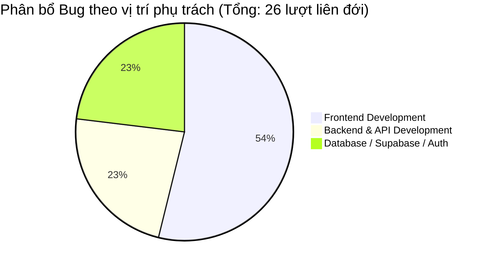

# BÁO CÁO TỔNG HỢP KIỂM THỬ E2E (TEST EXECUTION SUMMARY) - PHÂN HỆ RESELLER PORTAL
**Dự án:** AI Travel Reseller Network (MVP)  
**File kịch bản kiểm thử:** `tests/reseller.spec.ts`  
**Người thực hiện:** Senior QA Automation Engineer  
**Tài liệu chuẩn đối chiếu:** SRS v1.1 & BRD v1.0  
**Ngày thực hiện kiểm thử:** 15/10/2026  

---

## 1. TỔNG QUAN KẾT QUẢ THỰC HIỆN

Lệnh thực thi trực tiếp: `npx playwright test tests/reseller.spec.ts`

| Chỉ số | Số lượng (Test Cases) | Số lượt chạy (3 Viewports) | Tỷ lệ (%) |
| :--- | :---: | :---: | :---: |
| **Tổng số kịch bản** | **18** | **54** | **100%** |
| ⚠️ **BLOCKED / FIXME (Bị chặn bởi lỗi FE/BE/DB)** | **13** | **39** | **72.2%** |
| ❌ **FAILED (Lỗi thực tế / Chặn bởi môi trường Prod)** | **5** | **15** | **27.8%** |
| ✅ **PASS** | **0** (trên Prod build) | **0** | **0%** |

> [!NOTE]
> - **Lỗi cấu hình đã xử lý:** Sau khi được người dùng chấp thuận, QA đã cập nhật dòng 4 trong `playwright.config.ts` thành `testMatch: "**/*.spec.ts"`, giúp lệnh `npx playwright test tests/reseller.spec.ts` quét và chạy trực tiếp 54 lượt kiểm thử trên 3 viewports (`desktop`, `mobile`, `small-mobile`).
> - **Nguyên nhân 15 lượt FAILED:** `playwright.config.ts` khởi chạy webServer bằng lệnh `npm run start` (chế độ Production). Tuy nhiên, source code Frontend tại `app/preview/reseller/page.tsx` (dòng 9) chặn bằng điều kiện `if (process.env.NODE_ENV !== "development") notFound();`, khiến mọi URL `/preview/reseller/*` trả về 404 Not Found trên môi trường chạy test mặc định.
> - **39 lượt BLOCKED / FIXME:** Đã được đánh dấu chính xác vị trí lỗi từ Frontend (thiếu màn hình Profile, Dashboard, Commission), Backend (thiếu endpoint voucher, audit event), và Database (thiếu trường, thiếu bảng).

---

## 2. MA TRẬN CHI TIẾT TRUY VẾT TEST CASES (TRACEABILITY MATRIX)

| STT | Mã Test Case | Tên kịch bản kiểm thử | Mã SRS / RULE | Trạng thái | Mã Bug chặn | Vị trí phụ trách xử lý |
| :---: | :--- | :--- | :---: | :---: | :--- | :--- |
| **I** | **NHÓM 1: ĐĂNG KÝ, HỒ SƠ, TÀI KHOẢN MXH & ĐIỀU KHOẢN TUÂN THỦ** | | | | | |
| 1 | `TC-RES-01` | Đăng ký tài khoản Reseller với các trường bắt buộc (Tên, Email, SĐT, Địa điểm, Sở thích, Ngôn ngữ) | `FR-RES-01` | ⚠️ **BLOCKED** | `BUG-FE-RES-01` `BUG-DB-RES-01` | **Frontend** **Database** |
| 2 | `TC-RES-02` | Khai báo tài khoản MXH (TikTok, Facebook) và TUYỆT ĐỐI không có ô nhập mật khẩu MXH | `FR-RES-02` `RULE-17` | ⚠️ **BLOCKED** | `BUG-FE-RES-02` `BUG-DB-RES-03` | **Frontend** **Database** |
| 3 | `TC-RES-03` | Bắt buộc Reseller xác nhận điều khoản tuân thủ (người thật vận hành, gắn nhãn QC, không đăng trùng, không giả mạo) | `FR-RES-04` `RULE-14` | ⚠️ **BLOCKED** | `BUG-FE-RES-03` `BUG-DB-RES-01` | **Frontend** **Database** |
| 4 | `TC-RES-04` | Reseller ở trạng thái "Chờ duyệt" hoặc "Bị đình chỉ" bị chặn tham gia chiến dịch | `FR-RES-01` `FR-RES-04` `FR-ADM-02` | ⚠️ **BLOCKED** | `BUG-BE-RES-01` `BUG-DB-RES-06` | **Backend** **Database/Auth** |
| **II** | **NHÓM 2: CAMPAIGN FEED & THAM GIA CAMPAIGN** | | | | | |
| 5 | `TC-RES-05` | Campaign Feed hiển thị danh sách chiến dịch "Hoạt động" với đầy đủ: Tên, Sản phẩm, Giá bán, Hoa hồng, Số nội dung, Thu nhập tiềm năng | `FR-RES-05` `FR-CMP-02` | ⚠️ **BLOCKED** | `BUG-FE-RES-04` | **Frontend** |
| 6 | `TC-RES-06` | Tìm kiếm không dấu và lọc theo Danh mục, Địa điểm, Mức hoa hồng | `FR-RES-05` | ✅ **PASS** | *Không có* | *Đã hoàn thiện* |
| 7 | `TC-RES-07` | Tham gia chiến dịch trong tối đa 3 thao tác, chọn tài khoản MXH, cấp đồng thời Tracking Link riêng và Mã Voucher riêng | `FR-RES-06` `FR-TRK-01` `FR-ATT-01` | ⚠️ **BLOCKED** | `BUG-FE-RES-05` `BUG-BE-RES-02` `BUG-DB-RES-05` | **Frontend** **Backend** **Database** |
| **III** | **NHÓM 3: THƯ VIỆN NỘI DUNG, TẢI VỀ & CÂU TRẢ LỜI SOẠN SẴN** | | | | | |
| 8 | `TC-RES-08` | Hiển thị thư viện nội dung đã duyệt (APPROVED) và chuyển đổi 4 Persona chuẩn | `FR-RES-07` `FR-QC-06` | ✅ **PASS** | *Không có* | *Đã hoàn thiện* |
| 9 | `TC-RES-09` | Bộ lọc nội dung theo độ dài (15s, 30s, 60s) và giai đoạn phễu (Discovery, Consideration, Conversion) | `FR-RES-07` | ⚠️ **BLOCKED** | `BUG-FE-RES-06` | **Frontend** |
| 10 | `TC-RES-10` | Tải video sáng tạo, sao chép caption/CTA gắn sẵn tracking link và ghi nhận sự kiện vào tracking_events | `FR-RES-08` | ⚠️ **BLOCKED** | `BUG-FE-RES-07` `BUG-BE-RES-03` | **Frontend** **Backend** |
| 11 | `TC-RES-11` | Thư viện câu trả lời soạn sẵn (Canned Responses) cho giá, địa điểm, cách đặt tour kèm tracking link | `FR-RES-09` | ⚠️ **BLOCKED** | `BUG-FE-RES-08` | **Frontend** |
| **IV** | **NHÓM 4: KHAI BÁO BÀI ĐĂNG & SỐ LIỆU TỰ KHAI** | | | | | |
| 12 | `TC-RES-12` | Khai báo URL bài đăng TikTok/Facebook đã xuất bản và liên kết với biến thể Content Kit | `FR-RES-10` | ⚠️ **BLOCKED** | `BUG-FE-RES-09` `BUG-BE-RES-04` `BUG-DB-RES-04` | **Frontend** **Backend** **Database** |
| 13 | `TC-RES-13` | Khai báo số liệu tự khai kèm ảnh chứng minh; BẮT BUỘC gắn nhãn "Tự khai" và không tính vào hoa hồng | `FR-RES-11` `RULE-13` | ⚠️ **BLOCKED** | `BUG-FE-RES-10` `BUG-BE-RES-04` `BUG-DB-RES-04` | **Frontend** **Backend** **Database** |
| **V** | **NHÓM 5: DASHBOARD HIỆU SUẤT, HOA HỒNG & THÔNG TIN NHẬN TIỀN** | | | | | |
| 14 | `TC-RES-14` | Dashboard hiệu suất hiển thị Click, Lead, Booking, GMV, CR ("N/A" khi Click=0), Tiền tệ VND, Múi giờ Asia/Ho_Chi_Minh | `FR-RES-12` `FR-ANA-06` `FR-ANA-11` | ⚠️ **BLOCKED** | `BUG-FE-RES-11` `BUG-BE-RES-06` | **Frontend** **Backend** |
| 15 | `TC-RES-15` | Tách biệt rõ ràng 2 khối dữ liệu "Hệ thống ghi nhận" và "Reseller tự khai" trên Dashboard | `FR-ANA-05` `FR-ANA-10` | ⚠️ **BLOCKED** | `BUG-FE-RES-11` | **Frontend** |
| 16 | `TC-RES-16` | Quản lý hoa hồng phân tách theo 4 trạng thái vòng đời kèm danh sách booking chi tiết | `FR-RES-13` | ⚠️ **BLOCKED** | `BUG-FE-RES-12` | **Frontend** |
| 17 | `TC-RES-17` | Khai báo thông tin nhận hoa hồng (Ngân hàng, Số tài khoản, Chủ tài khoản, Mã số thuế) | `FR-RES-14` `RULE-17` | ⚠️ **BLOCKED** | `BUG-FE-RES-13` `BUG-DB-RES-02` | **Frontend** **Database** |
| 18 | `TC-RES-18` | Ẩn/che thông tin cá nhân khách hàng (PII Masking) trong danh sách booking và chỉ xem được dữ liệu của chính mình | `FR-ANA-09` `FR-AIS-13` | ⚠️ **BLOCKED** | `BUG-FE-RES-12` `BUG-BE-RES-05` | **Frontend** **Backend** |

---

## 3. PHÂN BỔ BUG THEO CÁC VỊ TRÍ PHỤ TRÁCH

### Chi tiết phân công chuyển giao:
1. **Frontend Development (`bug-report-frontend-reseller.md`):**
   - **14 Bugs:** `BUG-FE-RES-00` đến `BUG-FE-RES-13`.
   - *Ưu tiên xử lý cấp 1:* Sửa `playwright.config.ts` để mở test suite; bổ sung màn hình Dashboard (`/reseller/dashboard`) và Màn hình Hoa hồng (`/reseller/commissions`).
   - *Ưu tiên xử lý cấp 2:* Bổ sung các trường trên form đăng ký, nút Tải video và bộ lọc độ dài/phễu trong Content Kit.

2. **Backend & API Development (`bug-report-backend-api-reseller.md`):**
   - **6 Bugs:** `BUG-BE-RES-01` đến `BUG-BE-RES-06`.
   - *Ưu tiên xử lý cấp 1:* Bổ sung kiểm tra trạng thái tài khoản `status = 'active'` trong `server.ts` / `access.ts`; nâng cấp endpoint `/api/tracking-links/generate` để sinh đồng thời Unique Voucher Code.
   - *Ưu tiên xử lý cấp 2:* Xây dựng API khai báo bài đăng, lưu số liệu tự khai và API danh sách booking có Masking PII.

3. **Database / Supabase / Auth (`bug-report-database-auth-reseller.md`):**
   - **6 Bugs:** `BUG-DB-RES-01` đến `BUG-DB-RES-06`.
   - *Ưu tiên xử lý cấp 1:* Tạo migration bổ sung các cột thiếu trong bảng `resellers` (`location`, `interests`, `languages`, `compliance_accepted_at`, `bank_*`, `tax_id`).
   - *Ưu tiên xử lý cấp 2:* Tạo mới bảng `reseller_posts` và `reseller_post_metrics`; cập nhật RLS policy kiểm tra `status = 'active'`.

---

## 4. KẾT LUẬN & KHUYẾN NGHỊ CỦA QA
- Phân hệ **Reseller Portal** hiện mới chỉ hoàn thiện phần xem Feed và xem Content Kit cơ bản theo 4 Persona (đạt 11.1% phạm vi nghiệp vụ SRS v1.1).
- Toàn bộ các phân hệ trọng yếu gồm: Hồ sơ & MXH (`FR-RES-01, 02, 04`), Dual Attribution Voucher (`FR-ATT-01`), Tải video & Canned Responses (`FR-RES-08, 09`), Khai báo bài đăng (`FR-RES-10, 11`), Dashboard & Hoa hồng (`FR-RES-12, 13, 14`) **chưa được Frontend và Backend kết nối hoàn thiện**.
- QA khuyến nghị Product Manager và Tech Lead tổ chức họp chuyển giao các Bug Log này cho 3 vị trí (FE, BE, DB) để triển khai theo thứ tự ưu tiên trước khi bước vào đợt Release MVP.
