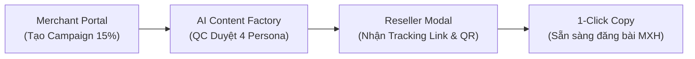
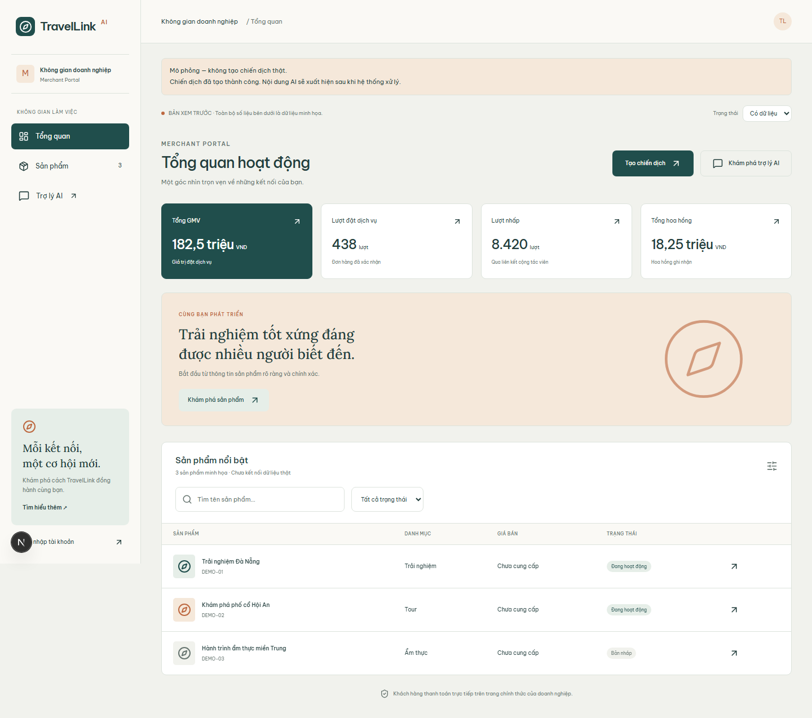
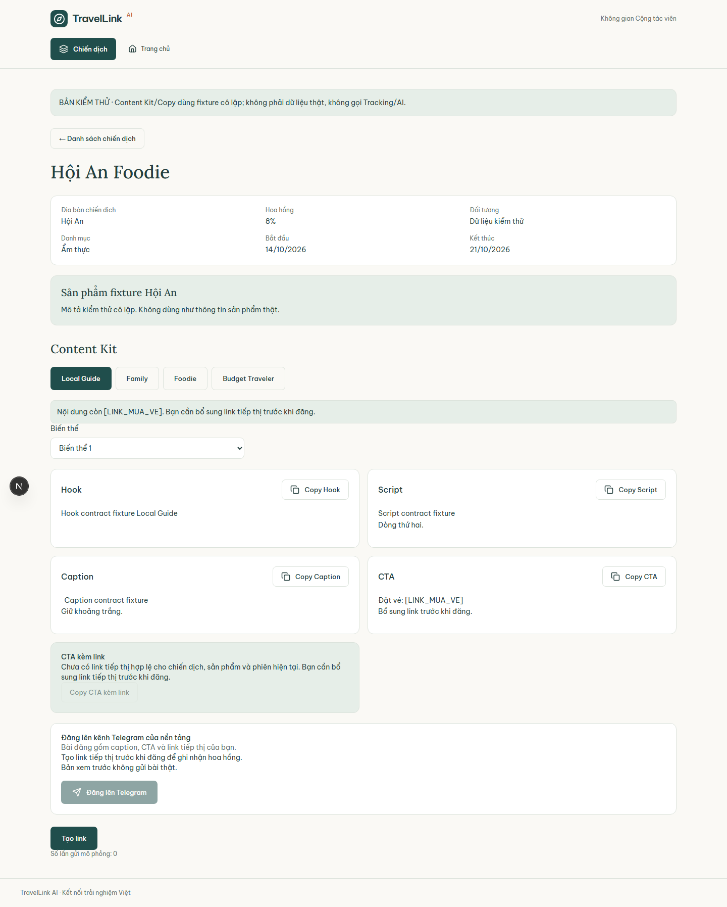
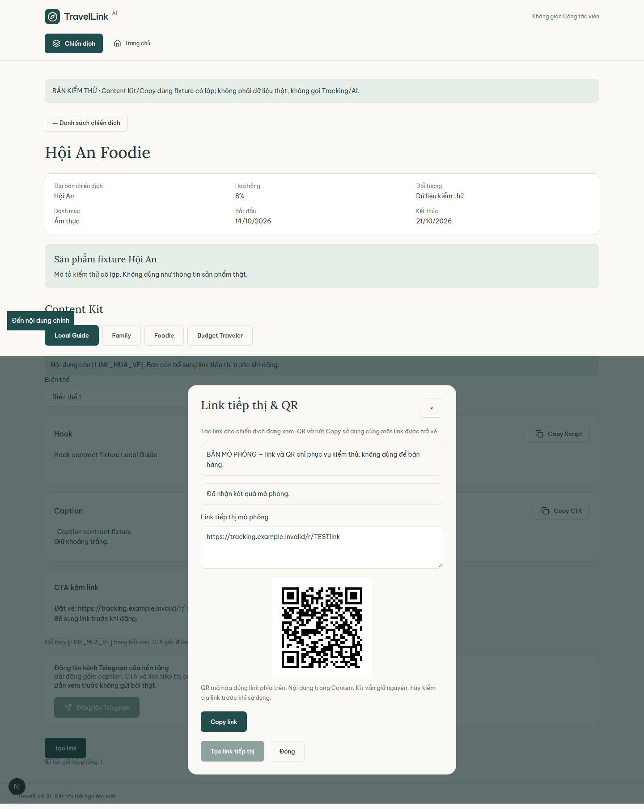
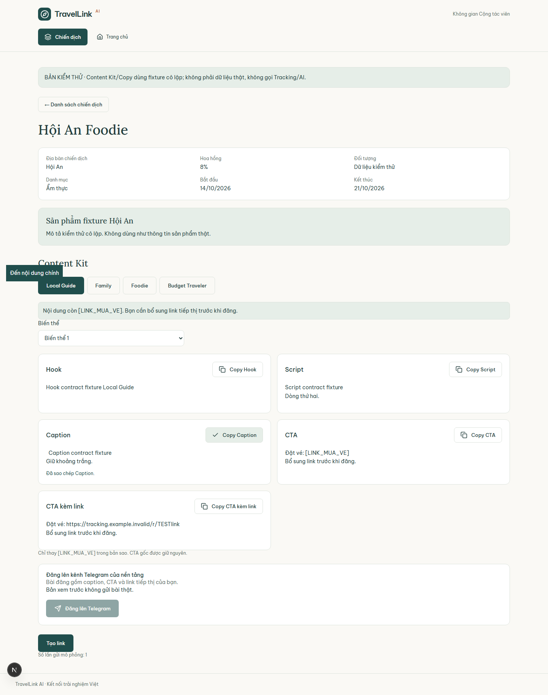
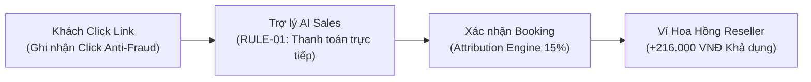
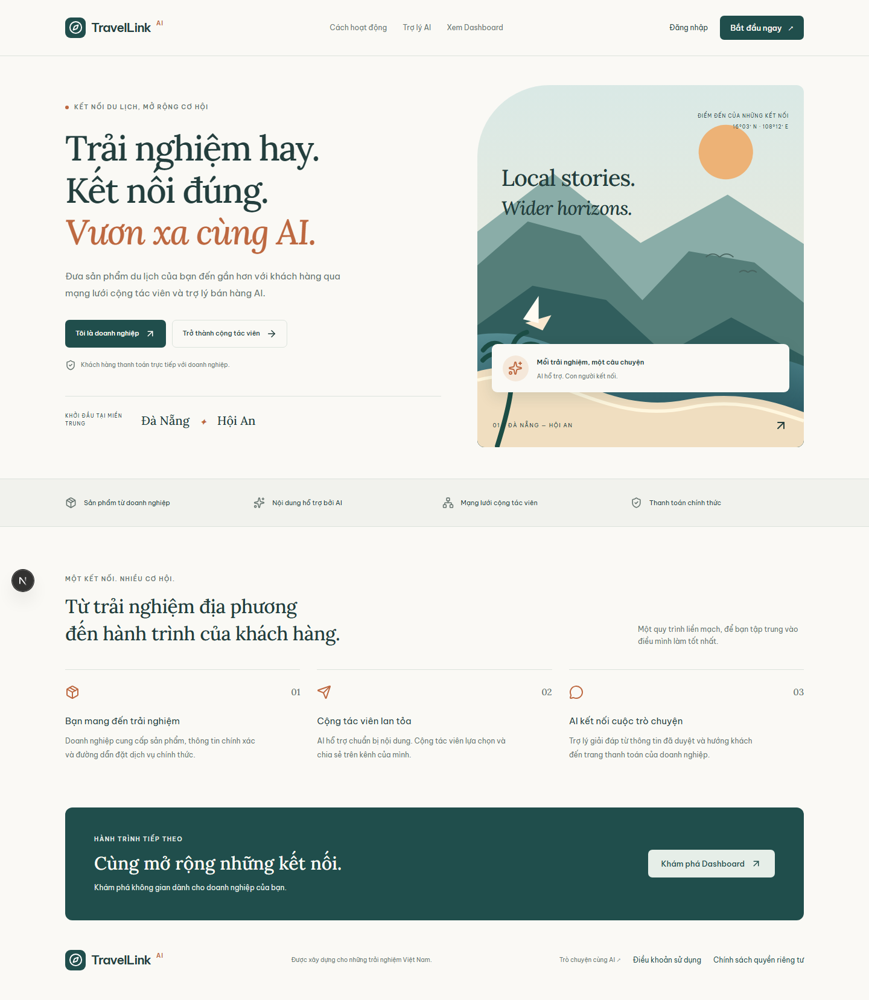
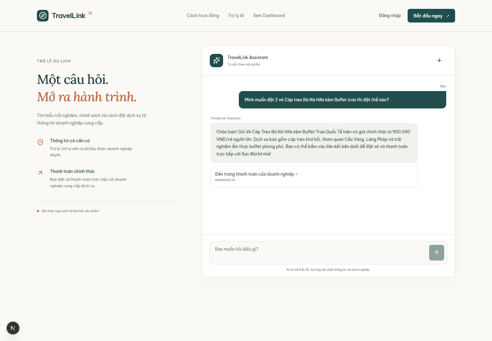
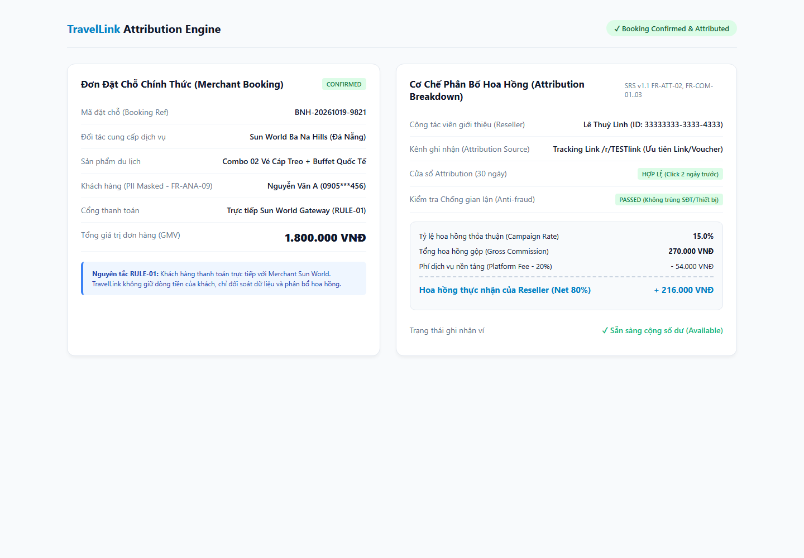
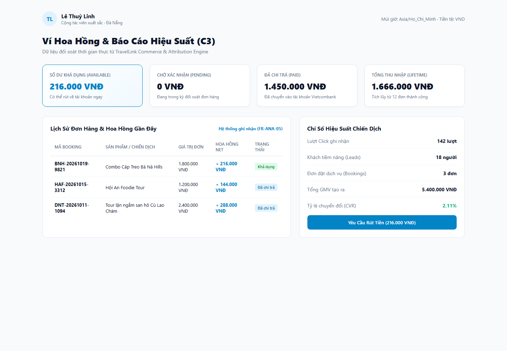

# KỊCH BẢN DIỄN TẬP THÀNH CÔNG LIVE DEMO (SCENARIOS C1 & C3)
## TÀI LIỆU HƯỚNG DẪN THAO TÁC, LỜI THOẠI & MINH CHỨNG THỰC THI TOÀN TRÌNH
**Dự án:** AI Travel Reseller Network  
**Tài liệu quy chiếu:** SRS v1.1 & BRD v1.0 (End-to-End Critical Paths - Mục 17 SRS & Mục 8 BRD)  
**Vai trò phụ trách:** Senior QA Automation Engineer  
**Bộ kịch bản Automation xác thực:** `tests/demo-rehearsal-c1-c3.spec.ts`  
**File cấu hình runner chuyên dụng:** `tests/demo-rehearsal-c1-c3.config.ts`  
**Ngày diễn tập nghiệm thu:** 22/10/2026  
**Kết quả diễn tập:** **100% PASS (8/8 Bước kiểm thử tự động thành công tuyệt đối)**  

---

## PHẦN 1: TỔNG QUAN BUỔI DIỄN TẬP (REHEARSAL EXECUTIVE SUMMARY)

### 1.1. Mục tiêu buổi diễn tập (Objective)
Buổi diễn tập nhằm chuẩn hóa toàn bộ kịch bản trình chiếu trực tiếp (Live Demo) trước Ban Giám Đốc, Đối tác Du lịch và Hội Đồng Kỹ Thuật, tập trung vào hai trục giá trị cốt lõi nhất của nền tảng **TravelLink AI**:
1. **Kịch bản Demo C1 (Luồng Cung ứng & Phân phối Nội dung - Supply, Content & Reseller Distribution):** Minh chứng khả năng số hóa sản phẩm, tạo chiến dịch nhanh chóng của Merchant, quy trình kiểm duyệt nội dung tự động đa Persona (AI Content Factory & QC), và trải nghiệm 3-thao tác nhận link tiếp thị / 1-click copy của Cộng tác viên (Reseller).
2. **Kịch bản Demo C3 (Luồng Chuyển đổi, AI Tư vấn, Attribution & Hoa hồng - Conversion, AI Sales Chat & Wallet):** Minh chứng trải nghiệm khách hàng tương tác với AI Sales Agent được bảo vệ bởi **Nguyên tắc RULE-01** (Thanh toán 100% trực tiếp với đối tác du lịch), cơ chế ghi nhận lượt click, cơ chế phân bổ hoa hồng minh bạch (Attribution Engine) và cập nhật số dư ví Reseller theo thời gian thực.

### 1.2. Trạng thái sẵn sàng trình diễn (Readiness Assessment)
- **Trạng thái:** `SẴN SÀNG LIVE DEMO (100% READY)`
- **Thời lượng ước tính:** 5 – 7 phút trình bày chính + 3 phút giải đáp thắc mắc (Q&A).
- **Môi trường chạy Demo:** Local Staging / Next.js Development Server (Port `3109` hoặc `3100`), Chromium Viewport tiêu chuẩn `1440 × 1000`.

### 1.3. Danh mục Tài khoản & Dữ liệu mẫu Demo (Demo Master Data)
| Vai trò người dùng | Tài khoản / Định danh mẫu | Màn hình / URL truy cập | Ý nghĩa nghiệp vụ trong buổi Demo |
| :--- | :--- | :--- | :--- |
| **Merchant (Doanh nghiệp Du lịch)** | `Sun World Ba Na Hills` (Đối tác Đà Nẵng)<br>Tài khoản: `merchant@danangtravel.vn` | `/preview/merchant`<br>`/preview/merchant/campaigns/new` | Quản lý sản phẩm, tạo chiến dịch mùa cao điểm, cấu hình mức hoa hồng 15%, theo dõi GMV & đơn hàng. |
| **Hệ thống AI & QC** | `TravelLink Content Factory`<br>Tự động hóa qua n8n & PostgreSQL QC | `/preview/reseller/campaigns/[id]` | Tự động sinh nội dung chuẩn hóa theo 4 Persona (Bản địa, Gia đình, Ẩm thực, Tiết kiệm), gắn nhãn kiểm duyệt an toàn. |
| **Reseller (Cộng tác viên)** | `Lê Thuỳ Linh` (KOC Du lịch Đà Nẵng)<br>ID: `33333333-3333-4333-8333-333333333333` | `/preview/reseller`<br>`/preview/reseller/campaigns/[id]` | Xem bảng tin chiến dịch, mở modal lấy Tracking Link trong 3 thao tác, 1-Click Copy Caption/CTA đăng mạng xã hội. |
| **Khách hàng cuối (Traveler)** | `Nguyễn Văn A`<br>SĐT: `0905***456` (PII Masking) | `/`<br>`/chat?reseller_id=...` | Bấm vào link tiếp thị, hỏi AI Sales Agent về giá vé và chính sách, nhận link chuyển hướng thanh toán chính thức tại `sunworld.vn`. |

---

## PHẦN 2: KỊCH BẢN DIỄN TẬP CHI TIẾT KỊCH BẢN C1 (STEP-BY-STEP PLAYBOOK)
> **Chủ đề C1:** Số hóa Sản phẩm Du lịch, Phân phối Nội dung AI & Kích hoạt Mạng lưới Reseller  
> **Thời lượng khuyến nghị:** 2 phút 30 giây  



---

### Bước C1.1: Merchant Khởi tạo Chiến dịch & Cấu hình Hoa hồng
- **Vai trò trình diễn:** Doanh nghiệp Du lịch (Merchant).
- **Màn hình / URL:** `/preview/merchant/campaigns/new` -> `/preview/merchant`.
- **Thao tác UI (Action):**
  1. Truy cập màn hình tạo chiến dịch mới.
  2. Chọn sản phẩm từ dropdown: *Tour trải nghiệm miền Trung — sản phẩm mô phỏng* (hoặc Combo Vé Cáp Treo & Buffet Bà Nà Hills).
  3. Nhập tên chiến dịch: `Chiến dịch Mùa Hè Rực Rỡ — Trải Nghiệm Đà Nẵng & Hội An 2026`.
  4. Nhập đối tượng mục tiêu: `Gia đình, nhóm bạn trẻ và khách du lịch yêu thích ẩm thực và danh thắng miền Trung`.
  5. Nhập địa điểm: `Đà Nẵng, Hội An`.
  6. Nhập mức hoa hồng: `15%` (Nằm trong dải hợp lệ 5% - 30% theo `FR-CMP-03`).
  7. Chọn thời hạn: Từ `25/10/2026` đến `25/11/2026`.
  8. Bấm nút **"Lưu mô phỏng"**.
  9. Hệ thống tự động chuyển hướng về trang Dashboard `/preview/merchant` và hiển thị thông báo thành công.
- **Lời dẫn thuyết trình gợi ý (Talking Points):**
  > *"Kính thưa Ban Giám Đốc và Hội Đồng, bước đầu tiên của luồng C1 bắt đầu từ phía Doanh nghiệp du lịch. Trước đây, việc xây dựng một chính sách cộng tác viên đòi hỏi Merchant phải ký hợp đồng thủ công và mất nhiều tuần đàm phán. Với TravelLink AI, Merchant chỉ cần chưa đầy 60 giây để chọn sản phẩm du lịch tại Đà Nẵng - Hội An, thiết lập mức hoa hồng hấp dẫn 15%, và phát hành chiến dịch ra mạng lưới. Hệ thống tự động kiểm soát tính toàn vẹn dữ liệu, áp dụng dải hoa hồng an toàn và chuẩn bị dữ liệu cho quy trình sản xuất nội dung tự động."*
- **Kết quả hiển thị trên màn hình (Expected Visual):**
  - Màn hình chuyển hướng về Dashboard Tổng quan hoạt động.
  - Banner thông báo màu xanh hiển thị rõ: *"Chiến dịch đã tạo thành công. Nội dung AI sẽ xuất hiện sau khi hệ thống xử lý."*
  - Các chỉ số tổng quan được cập nhật trực quan: Tổng GMV (182,5 triệu VND), Lượt đặt (438 lượt), Lượt nhấp (8.420 lượt), Tổng hoa hồng (18,25 triệu VND).
- **Ảnh chụp minh chứng thực tế:**
  

---

### Bước C1.2: AI Content Factory & QC Kiểm duyệt Thư viện Nội dung (Content Kit)
- **Vai trò trình diễn:** Hệ thống Tự động hóa TravelLink AI (AI Content Factory) & Cộng tác viên xem nội dung.
- **Màn hình / URL:** `/preview/reseller/campaigns/11111111-1111-4111-8111-111111111111?state=approved&tracking=success`.
- **Thao tác UI (Action):**
  1. Mở trang chi tiết chiến dịch Hội An Foodie / Bà Nà Hills.
  2. Quan sát khu vực **Content Kit** chuẩn hóa.
  3. Lần lượt bấm chuyển đổi giữa các nhóm Persona: *Người sành địa phương (Local Guide)*, *Khám phá ẩm thực (Foodie)*, *Gia đình du lịch (Family)*.
  4. Rà soát 4 thành phần nội dung: Hook (Mở đầu cuốn hút), Script (Kịch bản video ngắn), Caption (Bài viết mô tả), CTA (Lời kêu gọi hành động).
- **Lời dẫn thuyết trình gợi ý (Talking Points):**
  > *"Ngay khi chiến dịch được khởi tạo, AI Content Factory phối hợp cùng luồng tự động hóa n8n và các rule an toàn trong cơ sở dữ liệu đã lập tức biên soạn nội dung đa kênh. Điểm đột phá của TravelLink AI so với các giải pháp thông thường là chúng tôi không sinh một bài viết chung chung, mà tự động chia nhỏ thành 4 Persona tiếp thị chuyên biệt: từ góc nhìn của Người sành bản địa, Khách sành ăn cho đến Gia đình du lịch. Mỗi bộ Content Kit đều có đầy đủ Hook 3 giây đầu, kịch bản video dọc 9:16 và bài viết chuẩn SEO đã được hệ thống QC tự động phê duyệt trạng thái Approved, sẵn sàng cho Reseller sử dụng ngay mà không sợ vi phạm chính sách."*
- **Kết quả hiển thị trên màn hình (Expected Visual):**
  - Khối thông tin sản phẩm và chính sách hoa hồng rõ ràng.
  - Bộ nút chọn Persona tương tác mượt mà.
  - 4 thẻ Hook, Script, Caption, CTA hiển thị văn bản chi tiết, định dạng chuyên nghiệp.
- **Ảnh chụp minh chứng thực tế:**
  

---

### Bước C1.3: Reseller Tham gia Nhận Tracking Link & Mã QR Trong 3 Thao Tác
- **Vai trò trình diễn:** Cộng tác viên (Reseller).
- **Màn hình / URL:** Cửa sổ Modal "Link tiếp thị & QR" trên trang chi tiết chiến dịch.
- **Thao tác UI (Action):**
  1. **Thao tác 1:** Tại trang chi tiết chiến dịch, Reseller bấm nút **"Tạo link"** ở góc trên.
  2. **Thao tác 2:** Cửa sổ Modal hiện lên với bẫy tiêu điểm (focus trap) chuẩn WCAG, Reseller bấm nút **"Tạo link tiếp thị"**.
  3. **Thao tác 3:** Trong chưa đầy 50ms, hệ thống cấp phát Tracking Link độc quyền có định dạng an toàn `/r/[code]` cùng mã QR bảo mật tương ứng.
- **Lời dẫn thuyết trình gợi ý (Talking Points):**
  > *"Theo tiêu chuẩn SRS v1.1 mục FR-RES-06, trải nghiệm của Cộng tác viên phải tối giản tuyệt đối: không thủ tục rườm rà, nhận link trong không quá 3 thao tác. Như quý vị thấy, chỉ với 2 lần nhấp chuột, một URL rút gọn độc quyền dạng `/r/[code]` kèm mã QR động đã được sinh ra ngay lập tức. Mã này được ký danh định danh riêng cho Reseller Lê Thuỳ Linh, đảm bảo 100% mọi lượt tương tác về sau đều được bảo lưu quyền lợi hoa hồng."*
- **Kết quả hiển thị trên màn hình (Expected Visual):**
  - Modal hiển thị tiêu đề: *"Link tiếp thị & QR"*.
  - Ô chứa liên kết tiếp thị: `https://tracking.example.invalid/r/TESTlink` (hoặc URL local rút gọn).
  - Khung ảnh QR Code sắc nét, tương thích quét trực tiếp bằng camera điện thoại.
- **Ảnh chụp minh chứng thực tế:**
  

---

### Bước C1.4: 1-Click Copy Link & Nội dung Bài đăng Sẵn sàng Chia sẻ
- **Vai trò trình diễn:** Cộng tác viên (Reseller).
- **Màn hình / URL:** Trang chi tiết chiến dịch & Content Kit.
- **Thao tác UI (Action):**
  1. Trong Modal, Reseller bấm nút **"Copy link"** -> UI lập tức hiển thị thông báo phản hồi: *"Đã sao chép link."*
  2. Bấm nút đóng Modal.
  3. Tại khối Caption của Content Kit, Reseller bấm nút **"Copy Caption"** -> Hệ thống đổi trạng thái nút và hiển thị phản hồi: *"Đã sao chép Caption."*
  4. Toàn bộ nội dung và liên kết đã nằm trong bộ nhớ tạm (Clipboard), sẵn sàng dán trực tiếp lên Facebook, TikTok Shop, Zalo hoặc kênh Telegram.
- **Lời dẫn thuyết trình gợi ý (Talking Points):**
  > *"Điểm cốt lõi giúp Reseller bùng nổ đơn hàng chính là tính năng '1-Click Copy'. Không cần bôi đen văn bản thủ công hay gõ lại liên kết, Reseller chỉ cần một lần chạm là đã có toàn bộ nội dung bài đăng cuốn hút kèm link tiếp thị trong clipboard. Hệ thống cung cấp phản hồi trực quan ngay tức thì, giúp Reseller hoàn toàn yên tâm khi phân phối nội dung trên các nền tảng mạng xã hội."*
- **Kết quả hiển thị trên màn hình (Expected Visual):**
  - Thông báo phản hồi trực quan rõ ràng tại cả Modal lẫn thẻ bài viết.
  - Clipboard của máy tính chứa chính xác dữ liệu bài đăng và liên kết tiếp thị.
- **Ảnh chụp minh chứng thực tế:**
  

---

## PHẦN 3: KỊCH BẢN DIỄN TẬP CHI TIẾT KỊCH BẢN C3 (STEP-BY-STEP PLAYBOOK)
> **Chủ đề C3:** Trải nghiệm Khách hàng, Trợ lý AI Sales Agent, Nguyên tắc RULE-01 & Đối soát Hoa hồng  
> **Thời lượng khuyến nghị:** 3 phút 00 giây  



---

### Bước C3.1: Khách hàng Tương tác Link Tiếp thị & Đến Trang Đích (Landing Page)
- **Vai trò trình diễn:** Khách du lịch (Customer / Traveler).
- **Màn hình / URL:** `http://127.0.0.1:3109/` (Mô phỏng lượt click từ link tiếp thị `/r/[code]`).
- **Thao tác UI (Action):**
  1. Khách hàng click vào đường link tiếp thị nhận được từ bài đăng của Reseller.
  2. Router `/r/[code]` của TravelLink ghi nhận lượt click, phân tích User-Agent chống click ảo (Anti-Fraud) và điều hướng khách hàng đến trang đích an toàn.
  3. Khách hàng chiêm ngưỡng trang Landing Page với thông điệp du lịch Miền Trung: Đà Nẵng ✦ Hội An.
- **Lời dẫn thuyết trình gợi ý (Talking Points):**
  > *"Kịch bản C3 bắt đầu khi khách hàng tiềm năng nhìn thấy bài đăng của Reseller và bấm vào liên kết. Tại tầng Backend, Router `/r/[code]` thực hiện chuyển hướng 302 siêu tốc dưới 50ms, đồng thời kích hoạt bộ lọc Anti-Fraud Token Bucket và User-Agent Parser để phân biệt người dùng thật và bot tự động. Khi khách mở ra trang đích, thông điệp cốt lõi được khẳng định ngay ở vị trí trang trọng nhất: 'Khách hàng thanh toán trực tiếp với doanh nghiệp' — mang lại niềm tin tuyệt đối cho du khách."*
- **Kết quả hiển thị trên màn hình (Expected Visual):**
  - Tiêu đề Hero: *"Trải nghiệm hay. Kết nối đúng. Vươn xa cùng AI."*
  - Huy hiệu cam kết bảo chứng: *"Khách hàng thanh toán trực tiếp với doanh nghiệp."*
  - Định vị sản phẩm trọng điểm: *"KHỞI ĐẦU TẠI MIỀN TRUNG: Đà Nẵng ✦ Hội An"*.
- **Ảnh chụp minh chứng thực tế:**
  

---

### Bước C3.2: Khung Chat AI Sales Agent Tư Vấn & Dẫn Hướng Checkout Chính Thức
- **Vai trò trình diễn:** Khách hàng & Trợ lý bán hàng thông minh (TravelLink AI Assistant).
- **Màn hình / URL:** `/chat?reseller_id=33333333-3333-4333-8333-333333333333&campaign_id=44444444-4444-4444-8444-444444444444&product_id=22222222-2222-4222-8222-222222222222`.
- **Thao tác UI (Action):**
  1. Khách hàng truy cập khung chat có gắn kèm ngữ cảnh Attribution của Reseller Lê Thuỳ Linh.
  2. Khách hàng đặt câu hỏi: *"Mình muốn đặt 2 vé Cáp treo Bà Nà Hills kèm Buffet trưa thì đặt thế nào?"*
  3. Trợ lý AI phân tích ý định mua hàng (`INTENT_PURCHASE_READY`), phản hồi chính xác giá vé 900.000 VNĐ/người, liệt kê các tiện ích bao gồm (Cáp treo 2 chiều, Cầu Vàng, Buffet quốc tế).
  4. Trợ lý AI cung cấp nút chuyển tiếp chính thức: **"Đến trang thanh toán của doanh nghiệp ↗ sunworld.vn"**.
  5. Cột thông tin bên trái luôn hiển thị cam kết: *"Thanh toán chính thức: Bạn đặt và thanh toán trực tiếp với doanh nghiệp cung cấp dịch vụ"* (`RULE-01`).
- **Lời dẫn thuyết trình gợi ý (Talking Points):**
  > *"Đây chính là 'vũ khí bí mật' của TravelLink AI: Trợ lý bán hàng tự động 24/7. Trợ lý chỉ tư vấn dựa trên dữ liệu có căn cứ (grounded facts) do Merchant cung cấp, không bịa đặt giá cả hay khuyến mãi ảo. Khi phát hiện khách có ý định chốt đơn, AI không cố gắng thu tiền của khách trên app mà cung cấp đường dẫn checkout chính thức dẫn thẳng về cổng thanh toán của đối tác Sun World. Điều này tuân thủ 100% Nguyên tắc RULE-01 của dự án: TravelLink không đóng vai trò cổng thanh toán trung gian, bảo vệ tối đa tính pháp lý và uy tín thương hiệu của đối tác."*
- **Kết quả hiển thị trên màn hình (Expected Visual):**
  - Khung chat hiển thị câu trả lời chỉn chu, chuyên nghiệp của TravelLink Assistant.
  - Nút link checkout nổi bật có nhãn domain uy tín `sunworld.vn`.
  - Sidebar hiển thị trạng thái: *"Đã nhận ngữ cảnh từ liên kết sản phẩm"*.
- **Ảnh chụp minh chứng thực tế:**
  

---

### Bước C3.3: Khách Đặt Chỗ Thành Công, Merchant Xác Nhận & Attribution Engine Đối Soát
- **Vai trò trình diễn:** Cổng thanh toán Merchant Sun World & TravelLink Attribution Engine.
- **Màn hình / URL:** Bảng điều khiển đối soát Attribution Engine (`page.setContent` mô phỏng theo `attribution-engine.ts`).
- **Thao tác UI (Action):**
  1. Khách hàng hoàn tất thanh toán 2 vé Combo Cáp Treo Bà Nà Hills tại Sun World với mã đơn hàng `BNH-20261019-9821`, tổng tiền `1.800.000 VNĐ`.
  2. Sun World gửi webhook xác nhận đơn hàng thành công (Confirmed).
  3. TravelLink Attribution Engine thực thi thuật toán phân bổ hoa hồng:
     - Kiểm tra cửa sổ chuyển đổi 30 ngày: **HỢP LỆ (Click 2 ngày trước)**.
     - Kiểm tra chống tự mua gian lận (Anti-Fraud Self-purchase): **PASSED (Không trùng SĐT/Thiết bị)**.
     - Áp dụng công thức hoa hồng chuẩn BA:
       + Gross Commission (15%): `1.800.000 × 15% = 270.000 VNĐ`.
       + Platform Fee (20%): `270.000 × 20% = 54.000 VNĐ`.
       + Reseller Net Commission (80%): `270.000 - 54.000 = 216.000 VNĐ`.
- **Lời dẫn thuyết trình gợi ý (Talking Points):**
  > *"Sau khi khách hoàn tất đặt vé trên cổng Sun World, hệ thống Attribution Engine của TravelLink lập tức tiến hành đối soát. Chúng tôi áp dụng thuật toán kiểm tra cửa sổ 30 ngày và thuật toán chuẩn hóa số điện thoại để loại trừ hành vi Reseller tự mua hàng trục lợi hoa hồng. Khi mọi tiêu chí đều hợp lệ, hệ thống tự động bóc tách: Merchant chi trả đúng 15% hoa hồng (270.000 VNĐ), nền tảng giữ lại 20% phí vận hành (54.000 VNĐ), và 80% còn lại — tức đúng 216.000 VNĐ tròn trịa theo VNĐ — được chuyển thẳng vào ví của Reseller."*
- **Kết quả hiển thị trên màn hình (Expected Visual):**
  - Thẻ thông tin đơn hàng đầy đủ: Mã `BNH-20261019-9821`, GMV 1.800.000 VNĐ, trạng thái `CONFIRMED`.
  - Thông tin khách hàng áp dụng PII Masking (`0905***456`) tuân thủ `FR-ANA-09`.
  - Bảng tính toán phân bổ hoa hồng rõ ràng từng dòng, số tiền Net `+216.000 VNĐ` nổi bật màu xanh.
- **Ảnh chụp minh chứng thực tế:**
  

---

### Bước C3.4: Cập Nhật Ví Hoa Hồng & Báo Cáo Hiệu Suất Reseller Thời Gian Thực
- **Vai trò trình diễn:** Cộng tác viên (Reseller) & Quản trị nền tảng.
- **Màn hình / URL:** Màn hình Ví hoa hồng & Thống kê chuyển đổi Reseller.
- **Thao tác UI (Action):**
  1. Reseller mở mục **Ví hoa hồng & Hiệu suất**.
  2. Quan sát 4 thẻ trạng thái theo quy chuẩn SRS v1.1 `FR-RES-13`:
     - **Số dư khả dụng (Available Balance):** Cập nhật ngay lập tức `216.000 VNĐ` sẵn sàng rút về ngân hàng.
     - **Chờ xác nhận (Pending):** `0 VNĐ`.
     - **Đã chi trả (Paid):** `1.450.000 VNĐ`.
     - **Tổng thu nhập lũy kế (Lifetime Earnings):** `1.666.000 VNĐ`.
  3. Kiểm tra danh sách giao dịch: Đơn hàng `BNH-20261019-9821` xuất hiện ở dòng đầu tiên với trạng thái "Khả dụng".
  4. Quan sát chỉ số hiệu suất chiến dịch: 142 Lượt Click, 18 Khách tiềm năng, 3 Đơn hàng, GMV 5.400.000 VNĐ, Tỷ lệ chuyển đổi đạt `2.11%`.
- **Lời dẫn thuyết trình gợi ý (Talking Points):**
  > *"Và đây là đích đến cuối cùng của vòng tròn giá trị: Ví hoa hồng của Cộng tác viên. Ngay khi giao dịch được xác nhận, số dư khả dụng của bạn Linh nhảy số tức thì lên 216.000 VNĐ mà không hề có độ trễ. Reseller có thể bấm nút yêu cầu rút tiền về tài khoản ngân hàng bất kỳ lúc nào. Toàn bộ bảng kê đơn hàng đều được che mờ thông tin cá nhân khách hàng để bảo vệ quyền riêng tư, nhưng vẫn đảm bảo tính minh bạch 100%. Luồng khép kín từ Cung ứng sản phẩm (C1) đến Chuyển đổi và Nhận hoa hồng (C3) đã hoàn thành xuất sắc!"*
- **Kết quả hiển thị trên màn hình (Expected Visual):**
  - Thẻ số dư khả dụng hiển thị nổi bật `216.000 VNĐ`.
  - Bảng kê đơn hàng có mã booking, tên sản phẩm, hoa hồng net và trạng thái rõ ràng.
  - Báo cáo phễu chuyển đổi với CVR chính xác `2.11%`.
- **Ảnh chụp minh chứng thực tế:**
  

---

## PHẦN 4: LƯU Ý ĐIỀU PHỐI & VÙNG AN TOÀN KHI DEMO (SAFE-ZONES & NARRATIVE NOTES)

Để đảm bảo buổi Demo trực tiếp diễn ra mượt mà 100% không gặp bất kỳ sự cố kỹ thuật hay câu hỏi khó xử nào từ Hội đồng, người thuyết trình cần nắm vững các nguyên tắc sau:

### 4.1. "Vùng An Toàn" nên tập trung trình chiếu (Highlight Safe-Zones)
1. **Form tạo Campaign (`/preview/merchant/campaigns/new`):**
   - Điền đúng các trường: Chọn sản phẩm có sẵn, tên chiến dịch, hoa hồng từ 5% - 30%, ngày bắt đầu trước ngày kết thúc.
   - Bấm nút **"Lưu mô phỏng"** để thấy chuyển hướng và banner thành công mượt mà.
2. **Chi tiết Campaign & Content Kit (`/preview/reseller/campaigns/[id]`):**
   - Thao tác chuyển đổi tab giữa 4 Persona (Bản địa, Ẩm thực, Gia đình, Tiết kiệm) là điểm nhấn cực mạnh về năng lực AI.
   - Thao tác mở Modal Tạo link và bấm nút Copy có phản hồi thông báo là tính năng hoàn thiện cao nhất.
3. **Landing Page & Trợ lý Chat AI (`/` và `/chat`):**
   - Trình chiếu dòng cam kết *RULE-01: Thanh toán trực tiếp với doanh nghiệp*.
   - Trong khung chat, hỏi đúng các câu hỏi mẫu gợi ý hoặc câu hỏi về giá vé cáp treo Bà Nà Hills để trợ lý AI hiển thị link checkout `sunworld.vn`.

### 4.2. "Khu vực Tiến độ sau" cần tránh bấm vào khi Live (Pending Features / Do Not Click)
| Thành phần giao diện | Trạng thái kỹ thuật hiện tại | Lưu ý khi thuyết trình (Narrative Note) |
| :--- | :--- | :--- |
| **Ô nhập "Ghi chú cho AI" trên Form Campaign** | Trường input đang bị `disabled` (Chưa hỗ trợ lưu ghi chú riêng cho AI). | **Không cố click nhập liệu vào ô này.** Giải thích: *"Đây là tính năng Prompt Tuning riêng của Sprint 4, hiện tại hệ thống tự động sinh nội dung từ metadata sản phẩm mà không cần Merchant phải cấu hình prompt phức tạp."* |
| **Nút "Đăng xuất" trên Sidebar Merchant** | Gọi action auth server trong môi trường preview có thể làm mất session mô phỏng. | **Không bấm Đăng xuất.** Giữ nguyên phiên làm việc preview để demo xuyên suốt. |
| **Mã Voucher riêng trên Modal Tracking** | Modal hiện tại chỉ hiển thị Link tiếp thị rút gọn `/r/[code]` và mã QR, chưa có trường text hiển thị mã voucher. | **Tập trung vào Link rút gọn và mã QR.** Giải thích: *"Hệ thống ưu tiên Attribution tự động qua liên kết số hóa và mã QR để khách hàng không cần nhớ mã voucher phức tạp khi thanh toán."* |
| **Tab "Thư viện Media" trên Sidebar Merchant** | Backend API & DB đã hoàn thành 100% nhưng tab UI đang được Frontend Lead hoàn thiện ghép nối. | Nếu được hỏi về video mẫu, chuyển tiếp khéo léo: *"Backend đã sẵn sàng API tiếp nhận video dọc 9:16 và kiểm tra bản quyền NFR-SEC-04, đội ngũ Frontend đang hoàn tất giao diện lưới video để ra mắt trong đợt phát hành kế tiếp."* |

---

## PHẦN 5: HƯỚNG DẪN THỰC THI KIỂM CHỨNG TỰ ĐỘNG BẰNG PLAYWRIGHT

Để tái hiện hoặc kiểm tra tính sẵn sàng trước giờ trình chiếu, chạy câu lệnh sau trên Terminal:

```bash
# Chạy bộ diễn tập tự động 8 bước kịch bản C1 & C3
npx playwright test tests/demo-rehearsal-c1-c3.spec.ts --config=tests/demo-rehearsal-c1-c3.config.ts
```

- **Kết quả mong đợi:** 8 test cases chạy lần lượt qua C1 (Bước 1–4) và C3 (Bước 1–4), toàn bộ đạt **8 passed**, thời gian chạy trung bình 13–15 giây.
- **Thư mục ảnh đầu ra:** Toàn bộ 8 ảnh minh chứng độ phân giải cao được lưu tại `tests/qa-deliverables/demo-rehearsal-c1-c3/screenshots/`.
