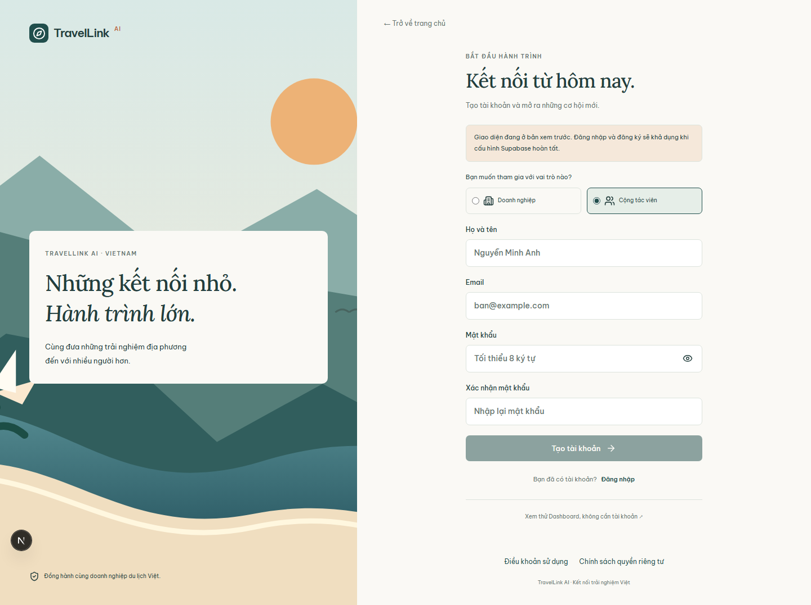
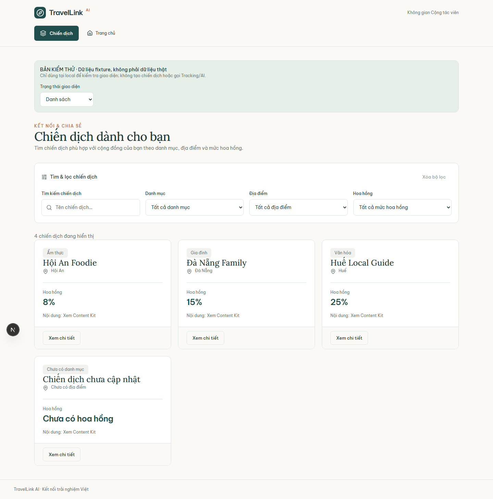
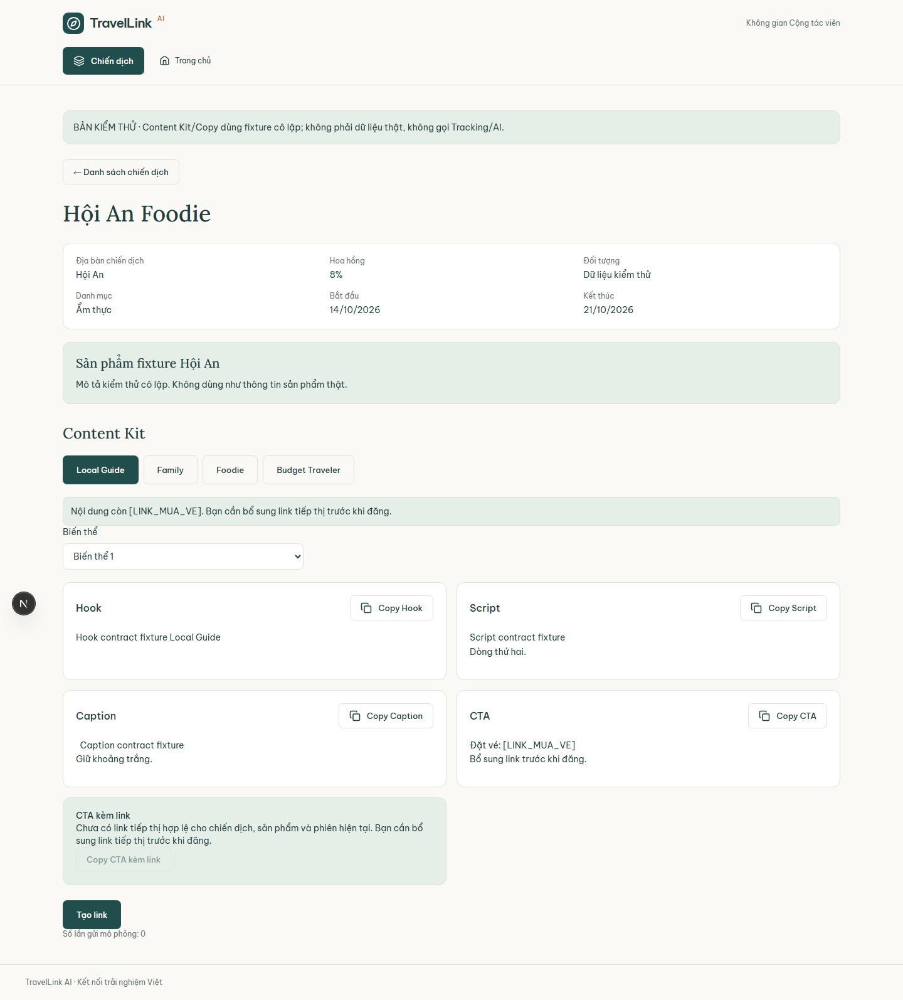
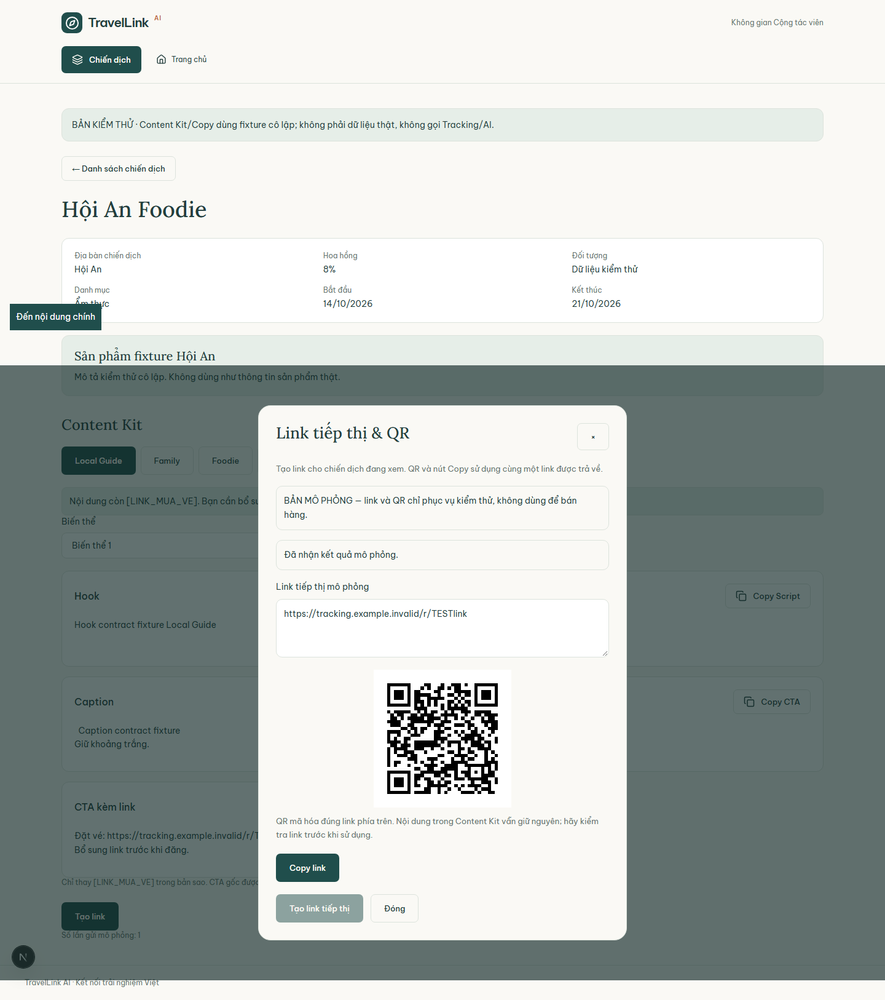
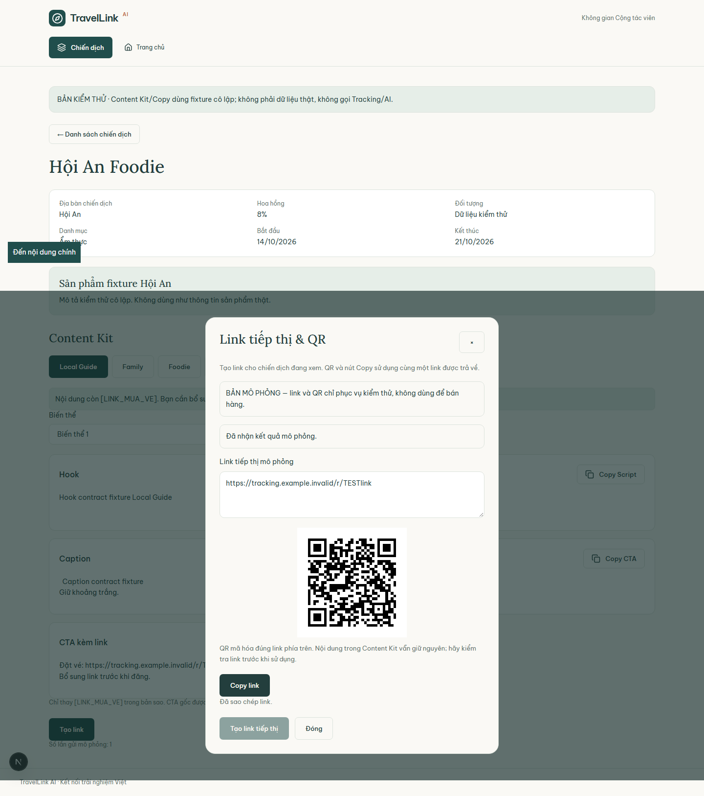
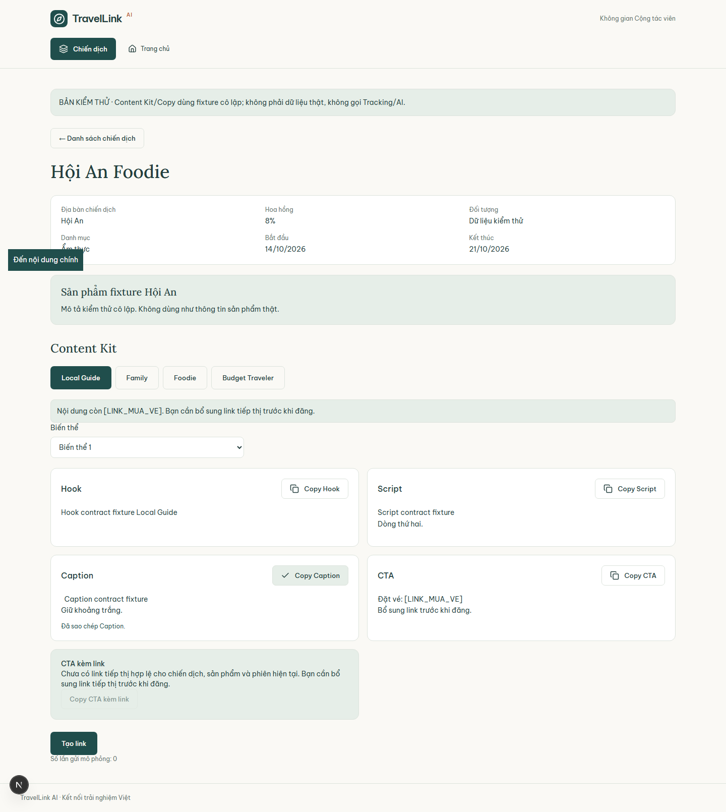

# Báo cáo Regression Test — Reseller

## Thông tin đợt chạy

| Hạng mục | Giá trị |
|---|---|
| Ngày chạy | 2026-10-16 |
| Môi trường | Local Next.js 16.3.8 development server, Chromium (Playwright Chromium v1248) |
| Dữ liệu | Fixture cô lập tại `/preview/reseller`; không phải dữ liệu production và không gọi API tạo tracking thật |
| Branch / revision | `Feature/e2e-test-reseller-merchant` / `81a931d` |
| Bộ regression mới | 6 test cases: 6 PASS, 0 FAIL, 0 SKIPPED |
| Chạy kèm hai bộ test cũ | 33 test cases: 11 PASS, 22 FAIL theo runner; 0 SKIPPED |
| Lỗi hồi quy đã xác nhận | 0 trong phạm vi chức năng được triển khai và kiểm tra bằng bộ mới |

Lệnh được yêu cầu chạy nguyên văn:

```text
npx playwright test tests/reseller.spec.ts tests/clipboard-modal-tracking.spec.ts tests/reseller-regression-evidence.spec.ts
```

Lệnh trên không tìm thấy test vì cấu hình mặc định `playwright.config.ts` chỉ match `frontend.spec.ts`. Để thực thi đúng ba file mà không sửa cấu hình dự án, lần chạy được chọn file qua cấu hình tạm thời:

```text
npx playwright test tests/reseller.spec.ts tests/clipboard-modal-tracking.spec.ts tests/reseller-regression-evidence.spec.ts --config=tests/reseller-regression-temp.config.ts
```

Cấu hình tạm đã được dùng riêng cho lượt chạy và không phải deliverable. Bộ test mới độc lập chạy đạt **6/6 PASS**. Trong lần chạy kết hợp, 22 test cũ thất bại do yêu cầu kiểm tra nhắm tới các chức năng chưa được phát triển hoặc vượt quá hành vi đang có; chúng được phân loại là **ngoài sprint scope**, không ghi nhận thành bug. 5 test cũ còn lại PASS.

## Kết quả chi tiết — phạm vi UI đã triển khai

Fixture được kiểm tra trước khi chụp ảnh bằng các assertion hiển thị tương ứng. Ảnh được chụp toàn trang ở viewport 1440 × 1000.

| TC ID | Mã yêu cầu SRS | Luồng nghiệp vụ | Tiền điều kiện | Các bước chạy | Kết quả mong đợi | Kết quả thực tế | Trạng thái | Link/Tên file Ảnh minh chứng |
|---|---|---|---|---|---|---|---|---|
| TC-REG-01 | FR-RES-01 (phần form đăng ký hiện có) | Điểm vào đăng ký Reseller | Local dev server; Supabase không cấu hình | Mở `/register?role=reseller`; xác nhận lựa chọn Cộng tác viên và các trường họ tên, email, mật khẩu; chụp ảnh | Form đăng ký hiện có render đầy đủ, chọn đúng vai trò Reseller | Form render; các trường cơ bản hiện diện. Chưa có trường hồ sơ mở rộng/trạng thái tài khoản | PASS |  |
| TC-REG-02 | FR-RES-05, FR-CMP-02 | Campaign Feed, tìm kiếm và bộ lọc | Fixture feed local | Mở `/preview/reseller`; xác nhận 4 campaign và bộ lọc; tìm `hoi an`, xác nhận kết quả; xóa lọc; chụp ảnh | Feed và bộ lọc được hiển thị, kết quả lọc đúng | 4 fixture cards; tìm kiếm trả về Hội An Foodie; xóa lọc khôi phục 4 cards | PASS |  |
| TC-REG-03 | FR-RES-07 (phần Content Kit hiện có) | Chi tiết Campaign và thư viện nội dung | Campaign fixture đã duyệt | Mở chi tiết Campaign; xác nhận sản phẩm, Content Kit, persona và hook/script/caption/CTA; chụp ảnh | Nội dung fixture và lựa chọn persona hiển thị đầy đủ | Chi tiết Hội An Foodie và các trường Content Kit render; fixture được đánh dấu là dữ liệu kiểm thử | PASS |  |
| TC-REG-04 | FR-RES-06, FR-TRK-01 | Tạo tracking link | Campaign fixture và tracking response fixture | Mở modal; tạo link; xác nhận link dạng `/r/<code>` và QR; chụp modal | Modal hiển thị tracking link và QR từ response fixture | Link `/r/TESTlink` và QR hiển thị. Modal không có trường/mã voucher | PASS |  |
| TC-REG-05 | FR-RES-06, FR-TRK-01 | Copy tracking link | Clipboard permission được cấp trong context | Tạo fixture link; bấm Copy; xác nhận thông báo và clipboard; chụp feedback | Clipboard khớp link và có thông báo thành công | Clipboard khớp link; UI hiển thị “Đã sao chép link.” | PASS |  |
| TC-REG-06 | FR-RES-08 (copy caption hiện có) | Copy caption trong Content Kit | Content Kit fixture có caption | Đọc caption; bấm Copy Caption; xác nhận success và clipboard (chuẩn hóa CRLF/LF của clipboard Windows); chụp ảnh | Clipboard chứa caption đã chọn, không báo thành công trước khi ghi | Caption khớp nội dung; UI hiển thị “Đã sao chép Caption.” | PASS |  |

Tên ảnh `01` giữ theo danh mục yêu cầu nhưng ảnh ghi lại form đăng ký Cộng tác viên hiện có, **không phải** trang hồ sơ/tổng quan tài khoản. Tương tự, tên ảnh `03` giữ theo yêu cầu nhưng UI chỉ có tracking link và QR, **không có voucher**.

## Tổng hợp hai bộ test cũ

| Bộ test / test case | Kết quả runner | Phân loại theo tiến độ |
|---|---:|---|
| `clipboard-modal-tracking.spec.ts` — TC-CLIP-01, 02, 04, 06 | 4 PASS | Modal tracking, link format, clipboard link và feedback đã triển khai |
| `clipboard-modal-tracking.spec.ts` — TC-CLIP-03, 05 | 2 FAIL | Mã voucher / copy voucher chưa có UI |
| `clipboard-modal-tracking.spec.ts` — TC-CLIP-07 | 1 FAIL | Kỳ vọng tự gắn link cho caption; code hiện có Copy Caption nguyên văn và CTA kèm link riêng |
| `clipboard-modal-tracking.spec.ts` — TC-CLIP-08 | 1 FAIL | Ghi nhận API sự kiện copy chưa được triển khai trong UI fixture |
| `clipboard-modal-tracking.spec.ts` — TC-CLIP-09, 10 | 2 FAIL | Canned responses chưa có UI |
| `reseller.spec.ts` — kiểm thử chặn quyền khi tài khoản chưa duyệt | 1 PASS | Trạng thái access notice qua route preview |
| `reseller.spec.ts` — các kiểm tra FR-RES-01..04 | 4 FAIL | Thiếu trường đăng ký mở rộng, profile, quản lý MXH và điều khoản compliance |
| `reseller.spec.ts` — feed đòi giá/thu nhập tiềm năng và tham gia campaign kèm social/voucher | 2 FAIL | Feed hiện có tên, địa điểm, danh mục, hoa hồng và thông tin Content Kit; các phần bổ sung chưa có UI |
| `reseller.spec.ts` — lọc độ dài/funnel, tải video/hashtag/event tracking, canned responses | 3 FAIL | Các chức năng tương ứng chưa được triển khai |
| `reseller.spec.ts` — khai báo bài đăng và số liệu tự khai | 2 FAIL | Chưa có route/form nộp bài đăng |
| `reseller.spec.ts` — dashboard hiệu suất, attribution, hoa hồng, payout, PII | 5 FAIL | Chưa có các màn hình tương ứng trong phân hệ Reseller |

**Lưu ý:** Các trạng thái FAIL ở bảng trên là kết quả nguyên bản của các assertion trong test cũ. Chúng không được coi là lỗi hồi quy hoặc bug đã xác nhận, vì assertion đang nhắm vào phần chưa có trong codebase hoặc hành vi chưa được triển khai; không sửa hay xóa test cũ trong task này.

## Ghi chú tiến độ — Out of current sprint scope

Các route/component Reseller hiện có gồm campaign feed, campaign detail, Content Kit, tracking link modal/QR, access notice và form đăng ký tài khoản cơ bản. Phạm vi đã xác nhận bằng code và test mới là FR-RES-05; phần tracking link của FR-RES-06; phần persona/variant và copy của FR-RES-07/08; cùng một phần form đăng ký FR-RES-01.

Các phần chưa thấy UI/luồng tương ứng trong code hiện tại:

- **FR-RES-01 (một phần):** hồ sơ tài khoản, trạng thái chờ duyệt/đã duyệt/đình chỉ, các trường điện thoại/địa điểm/sở thích/ngôn ngữ.
- **FR-RES-02..04:** quản lý tài khoản TikTok/Facebook, các bước onboarding/trạng thái và điều khoản compliance.
- **FR-RES-05 (một phần):** giá sản phẩm/thu nhập tiềm năng và thông tin chiến dịch bổ sung mà test cũ yêu cầu; feed hiện có danh sách, tìm kiếm, bộ lọc danh mục/địa điểm/hoa hồng.
- **FR-RES-06 / FR-TRK-01:** chọn tài khoản mạng xã hội và voucher riêng. Modal hiện có tạo/copy tracking link và QR; test mới dùng response fixture, không xác nhận tích hợp API thật.
- **FR-RES-07..09 (một phần):** lọc theo độ dài/funnel, video download, hashtag, ghi nhận sự kiện copy và canned responses. Content Kit hiện có persona, biến thể, hook/script/caption/CTA và CTA kèm tracking link.
- **FR-RES-10..11:** khai báo bài đăng và số liệu tự khai.
- **FR-RES-12..14** cùng **FR-ANA-05..11:** dashboard hiệu suất, phân tích, hoa hồng, thông tin nhận tiền và masking PII.
- **FR-RES-15..17:** không tìm thấy route/component Reseller tương ứng hoặc mô tả yêu cầu trong các tài liệu code đã rà soát; cần đối chiếu SRS trước khi xác định tiêu chí nghiệm thu.

Không tạo ảnh `07`/`08` cho khu vực bài đăng và dashboard vì các màn hình đó chưa được triển khai; không dùng mock UI để thay thế bằng chứng sản phẩm.

## Danh mục ảnh

Ảnh PNG thực tế được tạo tại `./screenshots/`:

1. `01-reseller-overview-or-profile.png` — form đăng ký Cộng tác viên hiện có.
2. `02-reseller-campaign-feed.png` — Campaign Feed sau khi khôi phục bộ lọc.
3. `03-reseller-tracking-modal-voucher.png` — modal fixture, tracking link và QR; không có voucher.
4. `04-reseller-copy-tracking-link-feedback.png` — trạng thái copy link thành công.
5. `05-reseller-content-library.png` — chi tiết campaign và Content Kit.
6. `06-reseller-copy-content-caption.png` — Content Kit sau khi copy caption.
