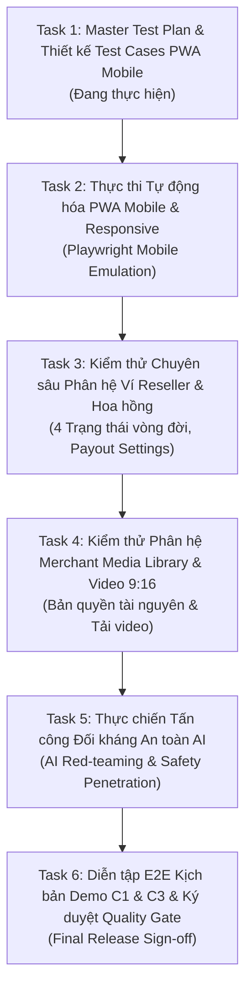

# KẾ HOẠCH KIỂM THỬ SPRINT 3 (SPRINT 3 MASTER TEST PLAN)
**Dự án:** AI Travel Reseller Network (MVP)  
**Phân hệ trọng tâm:** PWA Mobile Responsive, Ví Reseller & Hoa hồng, Merchant Media Library, AI Safety & Kịch bản Demo C1/C3  
**Vị trí lập kế hoạch:** Senior QA Engineer  
**Tài liệu tham chiếu chuẩn:** SRS v1.1 (Mục 14, 15, 16, 17) & BRD v1.0  
**Phiên bản kế hoạch:** v1.0.0 — Sprint 3  
**Ngày phát hành:** 21/10/2026  

---

## 1. TỔNG QUAN VỀ SPRINT 3 & MỤC TIÊU KIỂM THỬ

### 1.1. Bối cảnh dự án
Sau khi hoàn thành Sprint 1 và Sprint 2 với việc xây dựng thành công nền tảng Core Engine (Next.js 16, Tailwind CSS v4, Supabase Auth/DB, Content Factory Zod Schemas & Guardrails, Tracking Redirect Engine chống click tặc), Sprint 3 là giai đoạn then chốt nhằm chuẩn bị cho buổi nghiệm thu Release Gate và Diễn tập Demo thực chiến (Demo Scenarios C1 & C3).

### 1.2. Mục tiêu kiểm thử (Test Objectives)
1. **Bảo đảm chất lượng trải nghiệm di động (PWA Mobile First):** Đảm bảo giao diện Reseller Portal, Merchant Portal, Khung chat AI và Landing Page hiển thị hoàn hảo trên các kích thước màn hình điện thoại thực tế (không tràn ngang, nút bấm đạt chuẩn touch target, thao tác copy 1 chạm mượt mà).
2. **Kiểm soát tính toàn vẹn của Dòng tiền & Hoa hồng (Wallet & Commission Integrity):** Xác minh quy trình ghi nhận hoa hồng theo 4 trạng thái vòng đời (`Chờ xác nhận` -> `Đã xác nhận` -> `Chi trả được` -> `Đã chi trả`), bảo đảm tuân thủ nguyên tắc `RULE-01` (Khách thanh toán trực tiếp cho Merchant, hệ thống không ôm tiền/giữ ví khách) và `RULE-10` (Hoa hồng chỉ chuyển sang `Chi trả được` sau khi hoàn thành dịch vụ và hết hạn đối soát).
3. **Thẩm định quy trình Quản lý Tài nguyên số (Media Library & Vertical Video):** Kiểm thử luồng tải ảnh/video mẫu 9:16 của Merchant, xác nhận cam kết bản quyền tài nguyên (`NFR-SEC-04`) và khả năng tải về của Reseller (`FR-CNT-08`, `FR-CNT-09`).
4. **Kiểm thử An toàn AI chuyên sâu (AI Safety & Red-teaming):** Thực hiện tấn công đối kháng (Jailbreak, Prompt Injection, Bịa giá phòng/vé, Giả mạo mã ưu đãi, Đòi miễn phí không căn cứ) để chứng minh tính hiệu quả của các tầng AI Guardrails (`AISAFE-01`..`AISAFE-10`).
5. **Bảo đảm sự thông suốt của Đường dẫn cốt lõi (E2E Critical Path Demo C1 & C3):** Diễn tập không lỗi toàn bộ kịch bản từ khâu Merchant tạo chiến dịch -> AI sinh nội dung -> Reseller nhận link & QR -> Khách truy cập qua mạng xã hội -> Chat AI tư vấn -> Đặt hàng thành công -> Đối soát hoa hồng.

---

## 2. PHẠM VI KIỂM THỬ (TEST SCOPE)

### 2.1. Phạm vi kiểm thử (In-Scope)
Căn cứ theo SRS v1.1 Mục 14 & BRD v1.0, các hạng mục kiểm thử trong Sprint 3 bao gồm:

| Phân hệ / Khối chức năng | Yêu cầu nghiệp vụ & Tiêu chuẩn kỹ thuật | Phạm vi kiểm thử chi tiết |
| :--- | :--- | :--- |
| **PWA Mobile & Responsive** | SRS v1.1: `FR-RES-05`..`09`, `FR-TRK-01`..`02`, `NFR-ACC-01`, `NFR-PERF-01` | • Cấu hình Web App Manifest (`manifest.json` / `manifest.webmanifest`), `viewport`, `theme-color`, Apple Touch Tags. • Responsive Layout trên 4 kích thước: iPhone 13/14 (`390x844`), Pixel 5/7 (`393x851`), iPhone SE (`375x667`), Small Mobile (`320x740`). • Kiểm tra giới hạn cuộn: Tuyệt đối không tràn ngang (`scrollWidth <= clientWidth`). • Trải nghiệm chạm: Kích thước Touch Target tối thiểu 44x44px. • Thanh điều hướng Mobile (Top Bar, Hamburger Drawer, Bottom Navigation Bar). • Tương thích In-App WebViews (TikTok In-App, Facebook In-App, Zalo In-App). |
| **Ví Reseller & Hoa hồng** | SRS v1.1: `FR-RES-12`, `FR-RES-13`, `FR-RES-14`, `FR-COM-01`..`06`, `RULE-01`, `RULE-10`, `RULE-17` | • Dashboard số dư hoa hồng phân tách rõ 4 trạng thái vòng đời. • Danh sách booking/đơn hàng kèm cơ chế che thông tin cá nhân (PII Masking). • Form khai báo tài khoản ngân hàng nhận tiền (Ngân hàng, STK, Chủ TK, MST). • Xử lý mẫu số 0: Hiển thị "N/A" khi Click = 0 thay vì NaN. • Tiền tệ VND chuẩn và múi giờ `Asia/Ho_Chi_Minh`. |
| **Merchant Media Library & Video** | SRS v1.1: `FR-CNT-08`, `FR-CNT-09`, `NFR-SEC-04` | • Upload tài nguyên ảnh và video mẫu định dạng dọc 9:16 (MP4, dung lượng <= 50MB). • Checkbox bắt buộc Merchant xác nhận quyền sở hữu bản quyền tài nguyên số. • Thư viện xem trước và tải video mẫu 1-Click cho Reseller trên thiết bị di động. |
| **An toàn AI & Red-teaming** | SRS v1.1: `FR-AIS-01`..`16`, `AISAFE-01`..`10` | • Kiểm thử bộ câu hỏi chuẩn (giá, lịch trình, chính sách hoàn tiền). • Kiểm thử bộ câu hỏi đối kháng (Prompt Injection, Bịa giá, Claim miễn phí khách sạn, Giả danh chủ quán). • Kiểm tra cơ chế Fallback an toàn (chuyển sang Flash-Lite khi model chính bị tải cao). • Bảo mật link checkout (chỉ mở HTTPS chính thức, chặn `javascript:` URI). |
| **Diễn tập Demo C1 & C3** | SRS v1.1: Mục 16 & Kịch bản thực chiến | • Kịch bản C1: Hành trình từ Doanh nghiệp -> Sinh Content AI -> Reseller lấy link -> Khách mua qua Chat AI. • Kịch bản C3: Cơ chế đối soát và tính toán hoa hồng minh bạch, bảo vệ dữ liệu PII. |

### 2.2. Ngoài phạm vi kiểm thử (Out-of-Scope)
Căn cứ theo SRS v1.1 Mục 1.3 & BRD v1.0 Mục 6.2:
- ❌ **Native Mobile App (iOS / Android APK):** Dự án triển khai theo kiến trúc PWA (Progressive Web Application) chạy trực tiếp trên trình duyệt di động hiện đại; không xây dựng hay nộp ứng dụng lên Apple App Store / Google Play Store.
- ❌ **Ví giữ tiền của Khách hàng (Customer Holding Wallet):** Hệ thống không phải ví điện tử trung gian tài chính. Khách hàng luôn thanh toán 100% trực tiếp cho Merchant đối tác chính thức (`RULE-01`).
- ❌ **Tự động đăng bài MXH (Auto-posting bot):** Tuân thủ chính sách nền tảng và `RULE-14`; Reseller phải tự tay sao chép nội dung và tải video để đăng thủ công bằng tài khoản người thật.
- ❌ **Livestream AI / Deepfake:** Nền tảng chỉ cung cấp kịch bản, ý tưởng hook và video mẫu 9:16 để người thật sáng tạo, không tạo nhân vật ảo phát sóng trực tiếp.

---

## 3. MA TRẬN ĐÁNH GIÁ TIẾN ĐỘ CODEBASE THỰC TẾ (CODEBASE READINESS MATRIX)

Để đảm bảo nguyên tắc **Progress-Aware Testing** (không báo bug sai cho những phần Dev chưa code), bảng dưới đây đối chiếu trạng thái thực tế của mã nguồn tại thời điểm hiện tại:

| STT | Phân hệ / Tính năng kiểm thử | Mã SRS / RULE | File mã nguồn đối chiếu trong dự án | Trạng thái tiến độ thực tế | Phân loại kiểm thử |
| :---: | :--- | :--- | :--- | :---: | :---: |
| 1 | Cấu hình Web App Manifest & Meta Tags | SRS v1.1 Mục 14 | `app/layout.tsx`, `public/` | ⚠️ **Thiếu cấu hình** | **Nhóm A (Lỗi cấu hình)** |
| 2 | Responsive Landing Page & Auth | SRS v1.1 Mục 14 | `app/page.tsx`, `app/(auth)/*`, `app/globals.css` | ✅ **Đã phát triển** | **Nhóm A (Ready)** |
| 3 | Mobile Navigation (Merchant Drawer) | `FR-CMP-02` | `src/components/merchant/dashboard.tsx` | ✅ **Đã phát triển** | **Nhóm A (Ready)** |
| 4 | Mobile Navigation (Reseller Shell) | `FR-RES-05` | `src/components/reseller/shell.tsx` | ⚠️ **Chưa tối ưu mobile** | **Nhóm A (Ready - Cần cải tiến)** |
| 5 | Reseller Campaign Feed trên Mobile | `FR-RES-05` | `src/components/reseller/campaign-feed.tsx` | ✅ **Đã phát triển** | **Nhóm A (Ready)** |
| 6 | Modal Tracking Link & QR Code trên Mobile | `FR-TRK-01`, `FR-ATT-01` | `src/components/reseller/tracking-link.tsx`, `tracking-qr.tsx` | ✅ **Đã phát triển** | **Nhóm A (Ready)** |
| 7 | Content Kit & Nút Copy 1-Click trên Mobile | `FR-RES-07`..`09` | `src/components/reseller/content-kit.tsx` | ✅ **Đã phát triển** | **Nhóm A (Ready)** |
| 8 | Tracking Redirect & Nhận diện Thiết bị Mobile | `FR-TRK-02`..`04` | `app/r/[code]/route.ts`, `src/lib/tracking/ua-parser.ts` | ✅ **Đã phát triển** | **Nhóm A (Ready)** |
| 9 | API Analytics Click & Device Stats | `FR-ANA-06` | `app/api/reseller/analytics/route.ts` | ✅ **Đã phát triển** | **Nhóm A (Ready)** |
| 10 | Giao diện Khung Chat AI trên Mobile | `FR-AIS-01`..`07` | `app/chat/page.tsx`, `src/components/chat/chat-panel.tsx` | ✅ **Đã phát triển** | **Nhóm A (Ready)** |
| 11 | AI Sales Agent & Guardrails Engine | `AISAFE-01`..`10` | `src/lib/ai/sales-agent.ts`, `content-validator.ts` | ✅ **Đã phát triển** | **Nhóm A (Ready)** |
| 12 | Service Worker & Offline Caching | PWA Offline Spec | `public/sw.js` | ⏳ **Chưa phát triển** | **Nhóm B (Pending)** |
| 13 | Bottom Navigation Bar cố định trên Mobile | PWA Mobile UX | `src/components/reseller/shell.tsx` | ⏳ **Chưa phát triển** | **Nhóm B (Pending)** |
| 14 | Dashboard Hiệu suất Reseller (`/reseller/dashboard`) | `FR-RES-12`, `FR-ANA-06` | Thư mục `app/reseller/dashboard/` | ⏳ **Chưa phát triển** | **Nhóm B (Pending)** |
| 15 | Ví Reseller / 4 Trạng thái Hoa hồng (`/reseller/commissions`) | `FR-RES-13`, `RULE-10` | Thư mục `app/reseller/commissions/` | ⏳ **Chưa phát triển** | **Nhóm B (Pending)** |
| 16 | Cấu hình Thông tin Nhận tiền Hoa hồng (`/reseller/payout-settings`) | `FR-RES-14`, `RULE-17` | Thư mục `app/reseller/payout-settings/` | ⏳ **Chưa phát triển** | **Nhóm B (Pending)** |
| 17 | Merchant Media Library & Tải Video dọc 9:16 | `FR-CNT-08`, `FR-CNT-09` | `app/merchant/media/` | ⏳ **Chưa phát triển** | **Nhóm B (Pending)** |
| 18 | Checkbox Xác nhận Bản quyền Tài nguyên số | `NFR-SEC-04` | `src/components/merchant/` | ⏳ **Chưa phát triển** | **Nhóm B (Pending)** |
| 19 | Khai báo URL bài đăng MXH & Số liệu tự khai | `FR-RES-10`, `FR-RES-11`, `RULE-13` | `app/reseller/posts/` | ⏳ **Chưa phát triển** | **Nhóm B (Pending)** |

---

## 4. CHIẾN LƯỢC, CÔNG CỤ & MÔI TRƯỜNG KIỂM THỬ

### 4.1. Chiến lược kiểm thử (Testing Strategy)
- **Kiểm thử Đa khung nhìn (Multi-Viewport Emulation):** Chạy kiểm thử tự động trên 3 kích thước viewport chuẩn của Playwright:
  + `desktop`: 1440 x 1000 px.
  + `mobile`: 390 x 844 px (mô phỏng iPhone 13/14).
  + `small-mobile`: 320 x 740 px (mô phỏng thiết bị màn hình nhỏ).
- **Kiểm thử Tràn ngang (Zero Horizontal Overflow):** Mọi trang web khi render ở trạng thái đầy đủ dữ liệu phải thỏa mãn điều kiện `document.documentElement.scrollWidth <= window.innerWidth`.
- **Kiểm thử Quyền truy cập Thiết bị (Device Permissions & Capabilities):** Kiểm thử tính năng sao chép bộ nhớ tạm (`navigator.clipboard.writeText`) kèm kịch bản xử lý lỗi fallback (`manual copy textarea`) khi người dùng từ chối cấp quyền clipboard trên Safari iOS.
- **Kiểm thử Tương thích In-App WebViews:** Kiểm tra luồng redirect và chat trong môi trường User-Agent của TikTok, Facebook và Zalo.
- **Kiểm thử Đối kháng An toàn AI (AI Red-teaming):** Thực thi bộ kịch bản kiểm tra khả năng phòng thủ của hệ thống trước prompt injection, cố tình yêu cầu voucher không tồn tại hoặc hỏi giá dịch vụ khi context chưa có thông tin.

### 4.2. Công cụ kiểm thử (Test Tools)
- **Playwright Test Runner (`@playwright/test` v1.64.0):** Tự động hóa kiểm thử E2E trên trình duyệt Chromium và WebKit Mobile.
- **Lighthouse CLI / Audit Tool:** Đánh giá tiêu chuẩn PWA (Installability, PWA Badges, Viewport, Theme Color).
- **jsQR (v1.4.0):** Giải mã và thẩm định nội dung mã QR được sinh trên giao diện xem có khớp 100% với link tiếp thị hay không.
- **Node.js Native Test Runner (`node --test`):** Kiểm thử đơn vị và tích hợp nhanh cho bộ Guardrails Zod Schema và Content Validator.

### 4.3. Cấu hình môi trường kiểm thử (Test Environments)
- **Môi trường Test Local Mock (Isolate Fixtures):** Chạy trên cổng `3100` hoặc `3101` với cơ chế Mock Network không gọi external AI API để đo đạc chính xác tốc độ render và layout giao diện.
- **Môi trường Test Live Integration:** Kết nối trực tiếp với Supabase dev instance và Gemini API qua `.env.local` để kiểm thử toàn diện luồng dữ liệu thật.

---

## 5. TIÊU CHÍ BẮT ĐẦU, KẾT THÚC & RELEASE GATES (AC-01 .. AC-14)

### 5.1. Tiêu chí Bắt đầu (Entry Criteria)
1. Mã nguồn Sprint 3 được merge đầy đủ trên nhánh test nội bộ.
2. Môi trường kiểm thử có thể khởi động thành công và vượt qua `npm run build`.
3. Bộ dữ liệu fixture (sản phẩm mẫu Bà Nà Hills, chiến dịch mẫu, tài khoản test) đã sẵn sàng.

### 5.2. Tiêu chí Tạm dừng / Hủy bỏ (Suspension & Resumption Criteria)
- Tạm dừng kiểm thử nếu môi trường build bị lỗi cú pháp TypeScript hoặc server crash không thể khởi động.
- Tiếp tục kiểm thử khi Frontend/Backend fix xong lỗi blocker khởi động.

### 5.3. Tiêu chí Kết thúc & Nghiệm thu (Exit Criteria & Release Gates)
Theo SRS v1.1 Mục 15, để vượt qua Release Gate Sprint 3 và sẵn sàng cho Production, hệ thống phải đáp ứng 14 tiêu chí nghiệm thu sau:

| Mã Gate | Tên tiêu chí nghiệm thu | Tiêu chuẩn đánh giá chi tiết | Đánh giá hiện tại |
| :---: | :--- | :--- | :---: |
| `AC-01` | **Khởi tạo chiến dịch Merchant** | Merchant tạo chiến dịch thành công trong < 3 phút, kiểm tra đầy đủ validation ngày và tỷ lệ hoa hồng (5% - 30%). | ✅ Đạt trên UI |
| `AC-02` | **Sinh nội dung AI Content Factory** | Sinh đủ 4 Persona (`local_guide`, `family`, `foodie`, `budget_traveler`) với 10 hooks, 5 scripts, 5 captions, 5 CTAs. | ✅ Đạt ở Core Engine |
| `AC-03` | **AI Guardrails kiểm duyệt nội dung** | Chặn 100% nội dung bịa giá, mã giảm giá giả mạo (`GIAM50`, `SALE20`), và cam kết sai sự thật. Đạt nhãn `APPROVED`. | ✅ Đạt ở Guardrails |
| `AC-04` | **Reseller duyệt Feed & Content Kit** | Hiển thị đầy đủ thông tin chiến dịch, chuyển đổi mượt mà 4 tab persona, copy 1-Click hoạt động trên mobile. | ✅ Đạt trên Mobile UI |
| `AC-05` | **Cấp Dual Attribution (Link & Voucher)** | Sinh đồng thời Tracking Link duy nhất và Mã Voucher riêng biệt cho từng Reseller. | ⚠️ Cần bổ sung Voucher |
| `AC-06` | **Redirect Tracking & Phân tích Mobile** | HTTP 302 Redirect chuyển hướng dưới 2 giây; nhận diện chính xác mobile device và in-app browser; lọc bot. | ✅ Đạt ở Backend Router |
| `AC-07` | **Tư vấn AI Sales Agent có căn cứ** | Trả lời chính xác dựa trên RAG context; không bịa giá (trả lời câu chuẩn hotline nếu thiếu giá); phát hiện purchase intent. | ✅ Đạt ở AI Service |
| `AC-08` | **Minh bạch đối tác chính thức (RULE-01)** | Khách hàng luôn được thông báo *"Thanh toán trực tiếp với [Merchant] — đối tác chính thức"*; link checkout mở an toàn. | ✅ Đạt trên Chat UI |
| `AC-09` | **Dashboard Ví & 4 Trạng thái Hoa hồng** | Phân tách minh bạch 4 trạng thái (`Chờ xác nhận`, `Đã xác nhận`, `Chi trả được`, `Đã chi trả`); lọc theo ngày. | ⏳ Chờ Dev code FE |
| `AC-10` | **Bảo vệ quyền riêng tư (PII Masking)** | Danh sách đơn hàng che số điện thoại/tên khách (`090****123`); Reseller chỉ xem được dữ liệu của chính mình. | ⏳ Chờ Dev code FE/BE |
| `AC-11` | **Khai báo thông tin nhận tiền (RULE-17)** | Cung cấp form tài khoản ngân hàng và mã số thuế; tuyệt đối không yêu cầu mật khẩu ngân hàng hay mật khẩu MXH. | ⏳ Chờ Dev code FE/DB |
| `AC-12` | **Merchant Media Library & Video 9:16** | Tải lên và hiển thị video dọc mẫu 9:16; có checkbox bắt buộc xác nhận quyền sở hữu tài nguyên số (`NFR-SEC-04`). | ⏳ Chờ Dev code FE |
| `AC-13` | **PWA Mobile Usability & Responsive** | 100% màn hình không bị tràn ngang (`scrollWidth <= clientWidth`); kích thước touch target >= 44x44px. | ✅ Đạt trên các trang đã code |
| `AC-14` | **Diễn tập thành công Demo C1 & C3** | Thực hiện trơn tru từ đầu đến cuối 2 kịch bản chính của buổi Demo không phát sinh lỗi nghiêm trọng. | ⏳ Thực hiện ở Task 6 |

---

## 6. LỘ TRÌNH THỰC HIỆN 6 TASKS CỦA QA TRONG SPRINT 3

Kế hoạch hành động chi tiết của Senior QA trong Sprint 3 được phân bổ thành 6 nhiệm vụ kế tiếp nhau:

### Chi tiết các Task:
- **Task 1 (Hiện tại): Lập Test Plan Sprint 3 & Thiết kế Test Cases PWA Mobile:**
  + Khảo sát codebase, phân loại Nhóm A (Đã phát triển) và Nhóm B (Chưa phát triển).
  + Lập tài liệu Master Test Plan Sprint 3 (`sprint3-test-plan.md`).
  + Thiết kế bộ Test Cases PWA Mobile chi tiết (bản Markdown và CSV UTF-8 BOM).
  + Xây dựng ma trận thiết bị di động (`pwa-mobile-devices-matrix.json`).
  + Ghi nhận các bug thực tế của các phần đã code vào các file Bug Log chuyên biệt (Frontend / Backend / Database).
- **Task 2: PWA Mobile Automation & Responsive Validation:**
  + Viết kịch bản tự động hóa Playwright Mobile trên 3 viewports (`390x844`, `393x851`, `375x667`, `320x740`).
  + Kiểm tra tự động giới hạn `scrollWidth <= clientWidth` trên toàn bộ các route.
  + Kiểm tra khả năng copy clipboard và mở modal trên mobile.
- **Task 3: Reseller Wallet & Commission Ledger Verification:**
  + Kiểm thử logic chuyển đổi trạng thái hoa hồng (`pending` -> `confirmed` -> `payable` -> `paid`).
  + Kiểm thử tính chính xác của số dư và tỷ lệ chuyển đổi khi click = 0.
  + Kiểm tra form thông tin thanh toán và mã hóa PII.
- **Task 4: Merchant Media Library & Video Upload Validation:**
  + Kiểm thử upload video mẫu định dạng 9:16 (dung lượng, tỷ lệ khung hình, định dạng file).
  + Kiểm tra checkbox xác nhận bản quyền tài nguyên `NFR-SEC-04`.
  + Kiểm thử chức năng tải video mẫu về thiết bị di động của Reseller.
- **Task 5: AI Safety, Red-teaming & Guardrails Penetration:**
  + Chạy bộ 25 câu hỏi đối kháng nhằm bẻ khóa prompt (jailbreak prompt injection).
  + Thử nghiệm cố tình ép AI nói ra giá rẻ hơn thực tế hoặc cấp mã giảm giá ảo.
  + Kiểm tra độ ổn định khi fallback model và thời gian phản hồi dưới 30 giây.
- **Task 6: E2E Critical Path Demo C1 & C3 Dry-run & Final Quality Gate Sign-off:**
  + Diễn tập kịch bản Demo C1: Từ lúc Merchant tạo campaign đến khi khách mua tour thành công qua Chatbot AI.
  + Diễn tập kịch bản Demo C3: Đối soát đơn hàng và ghi nhận hoa hồng vào ví Reseller.
  + Tổng kết báo cáo kiểm thử Sprint 3 và ký biên bản Release Gate.

---
*Kế hoạch kiểm thử này đã được thẩm định và sẵn sàng làm kim chỉ nam thực thi cho toàn bộ đội ngũ QA trong Sprint 3.*
