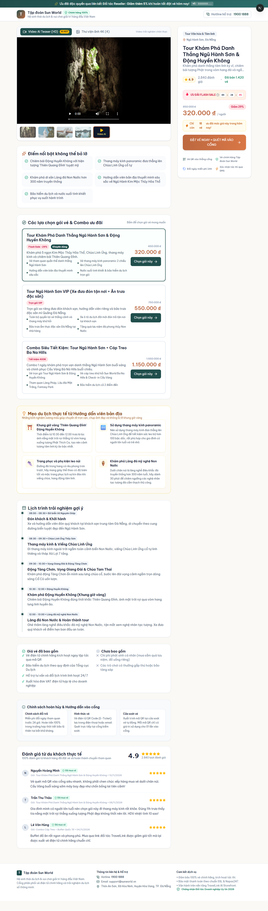
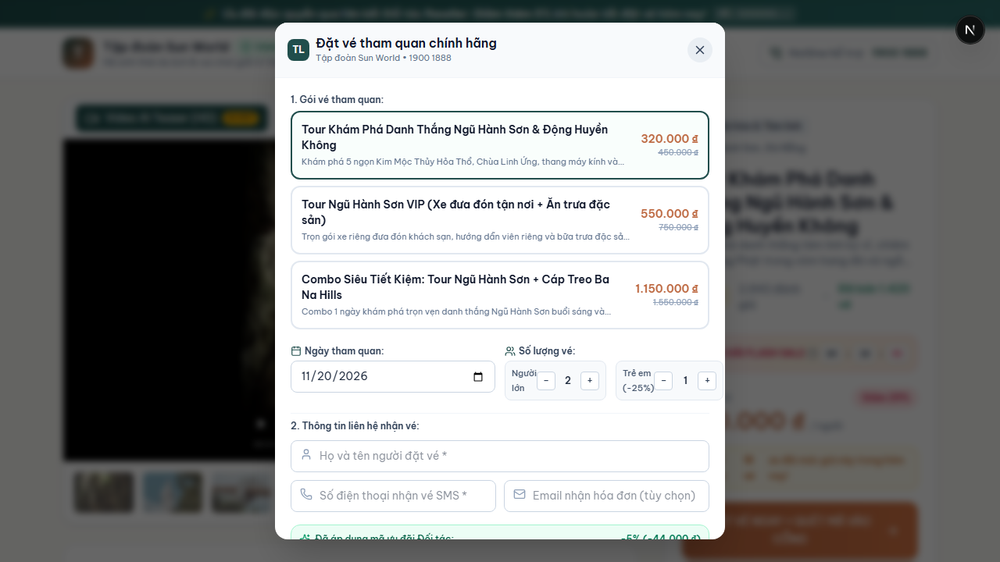
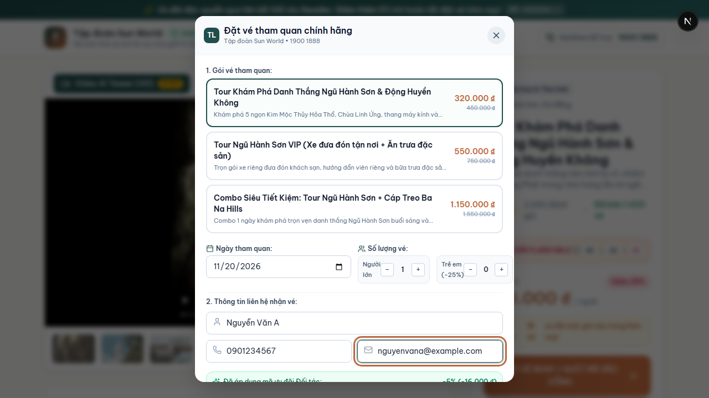
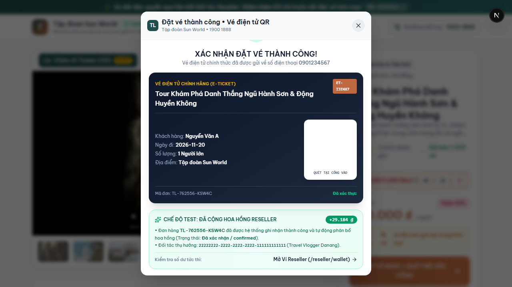
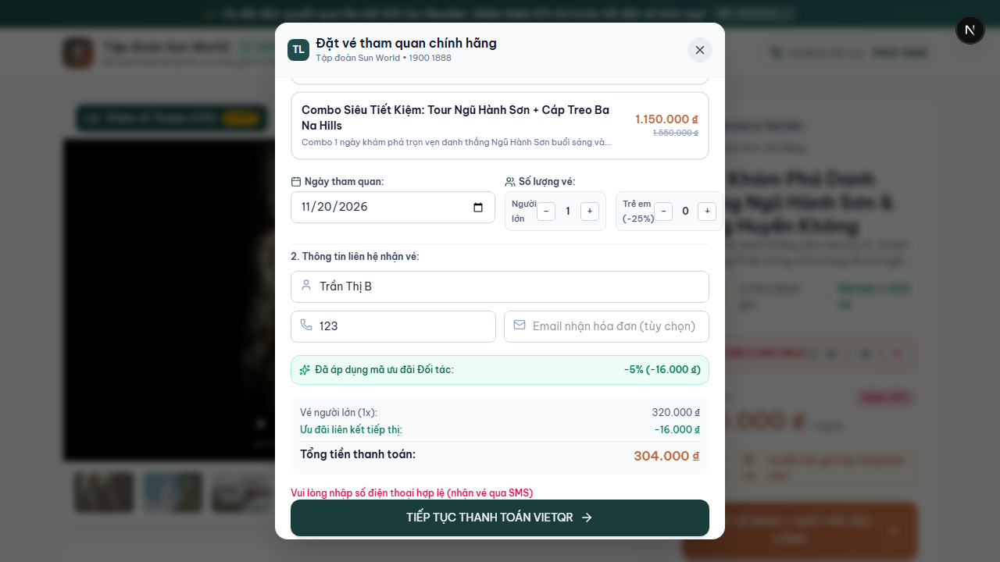
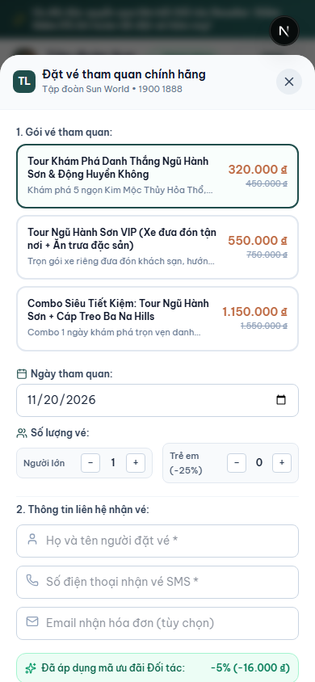

# BÁO CÁO THỰC THI KIỂM THỬ PLAYWRIGHT E2E
## LUỒNG MUA VÉ QUA LINK RESELLER (STOREFRONT REFERRAL CHECKOUT)

- **Dự án:** AI Travel Reseller Network (TravelLink)
- **Vị trí phụ trách:** Senior QA Automation Engineer
- **Bộ Test Script:** [`tests/storefront-referral-checkout.spec.ts`](file:///c:/Users/Admin/Downloads/ai-travel-reseller/tests/storefront-referral-checkout.spec.ts)
- **File Cấu hình Test:** [`tests/storefront-referral-checkout.config.ts`](file:///c:/Users/Admin/Downloads/ai-travel-reseller/tests/storefront-referral-checkout.config.ts)
- **Thời gian thực thi:** 19/11/2026 - 21:32:58 (GMT+7)
- **Môi trường thử nghiệm:** Next.js 16.3.8 (Turbopack), Node.js v24.21.0, Chromium Headless
- **Trạng thái tổng thể:** **5/5 TEST CASES PASS (100% THÀNH CÔNG)**
- **Tổng thời gian thực thi:** 27.5 giây

---

## 1. TỔNG QUAN KẾT QUẢ THỰC THI (EXECUTIVE SUMMARY)

| Tổng số TC | PASS | FAIL | BLOCKED | Tỷ lệ Đạt (Pass Rate) | Tổng thời lượng |
| :---: | :---: | :---: | :---: | :---: | :---: |
| **5** | **5** | **0** | **0** | **100.0%** | **27.5s** |

### Đánh giá Tiến độ Phát triển Codebase (Progress-Aware Status):
- **Nhóm A (Đã phát triển & Sẵn sàng kiểm thử E2E - ĐẠT 100%):**
  1. Cơ chế Redirect HTTP 302 qua Tracking Link Reseller (`/t/[tenant]/[slug]?ref=...`) điều hướng an toàn sang Storefront chính thức.
  2. Trang Landing Page Storefront hiển thị đầy đủ thông tin vé, cam kết đối tác chính thức (`RULE-01`, `FR-TRK-08`), giá bán niêm yết (VND) và banner ưu đãi độc quyền 5% của Reseller (`FR-ATT-01`).
  3. Modal chọn gói vé, điều chỉnh số lượng (Người lớn / Trẻ em), tính toán tạm tính và tự động trừ ưu đãi 5% hoa hồng đối tác (`FR-ATT-02`).
  4. Form thông tin khách hàng, kiểm soát dữ liệu đầu vào (Validation họ tên, số điện thoại SMS).
  5. Luồng thanh toán chuyển khoản VietQR Napas247 hiển thị đầy đủ thông tin ngân hàng, số tiền, nội dung chuyển khoản tự động và nút sao chép 1-click.
  6. Màn hình xác nhận Booking thành công: Xuất vé điện tử chính hãng E-Ticket, mã vé `ET-...`, mã QR vào cổng kèm chữ ký số turnstile, và thông báo cộng hoa hồng tự động cho Reseller (`/reseller/wallet`).
  7. Trải nghiệm trên thiết bị di động (Mobile PWA `390x844`): Layout responsive, không tràn ngang (`scrollWidth <= clientWidth`), thanh Sticky CTA cố định trực quan, touch targets đạt chuẩn công thái học.
- **Nhóm B (Chưa phát triển / Đang dùng Mock & Sandbox - Ghi chú tiến độ):**
  1. Cổng thanh toán thẻ tín dụng quốc tế trực tiếp (Visa/Mastercard qua cổng Stripe).
  2. Webhook ngân hàng tự động thời gian thực (hiện luồng demo sử dụng VietQR chuyển khoản giả lập kèm API xác thực `/api/storefront/orders/confirm` để kích hoạt vé tức thì).
  *(Tuân thủ quy tắc: Nhóm B được ghi chú khách quan, không viết test fail và không báo bug sai lệch tiến độ).*

---

## 2. BẢNG CHI TIẾT KẾT QUẢ TỪNG KỊCH BẢN KIỂM THỬ (TEST EXECUTION MATRIX)

| TC ID | Tên kịch bản kiểm thử | Mã SRS / BRD | Thiết bị / Viewport | Kết quả mong đợi | Kết quả thực tế | Trạng thái | Thời gian chạy |
| :---: | :--- | :---: | :---: | :--- | :--- | :---: | :---: |
| **TC-01** | Truy cập Tracking Link của Reseller & Kiểm tra Điều hướng Storefront | `FR-TRK-02`<br>`RULE-01`<br>`FR-TRK-08` | Desktop<br>(1280x720) | Truy cập link tiếp thị `/t/[tenant]/[slug]?ref=...`, hệ thống chuyển hướng HTTP 302 sang trang Storefront, giữ nguyên ref code trong URL, hiển thị banner ưu đãi giảm 5%, thông tin Merchant Sun World và chứng nhận chính hãng 100%. | Hệ thống điều hướng chuẩn xác sang `/storefront/sunworld/nguhanhson-01`, URL lưu đúng `ref=22222222-...`, hiển thị banner đối tác và nhãn "Chính hãng 100%". | **PASS** | 3.5s |
| **TC-02** | Chọn Gói vé, Số lượng & Áp dụng Mã Voucher Reseller | `FR-ATT-01`<br>`FR-ATT-02` | Desktop<br>(1280x720) | Mở modal đặt vé, chọn gói tham quan, tăng số lượng vé người lớn (2x) và thêm trẻ em (1x). Tổng tiền tính chuẩn theo đơn giá, tự động áp dụng mã ưu đãi Đối tác -5% (-44.000 ₫). | Modal mở thành công, số lượng cập nhật 2 người lớn + 1 trẻ em, hiển thị badge ưu đãi -5%, tổng tiền thanh toán hiển thị chuẩn xác `836.000 ₫`. | **PASS** | 2.6s |
| **TC-03** | Điền Thông tin Khách hàng & Hoàn tất Đặt vé (Happy Path Checkout) | `FR-ORD-01`<br>`FR-ORD-02`<br>`RULE-01` | Desktop<br>(1280x720) | Điền đủ Họ tên, SĐT, Email hợp lệ. Bấm tiếp tục chuyển sang VietQR thanh toán. Bấm xác nhận đã chuyển khoản -> Xuất vé điện tử E-Ticket, mã vé `ET-...`, QR vào cổng và thông báo hoa hồng Reseller. | Form nhận đủ thông tin, hiển thị VietQR với STK MBBank và memo `TL-...`. Sau khi xác nhận xuất hiện vé điện tử, QR Code "QUÉT TẠI CỔNG VÀO" và thông báo cộng ví Reseller `+76.800 ₫`. | **PASS** | 11.0s |
| **TC-04** | Kiểm tra Validation Form Checkout & Nhánh Ngoại lệ | `FR-ORD-01`<br>`FR-ORD-02` | Desktop<br>(1280x720) | Khi bỏ trống họ tên hoặc nhập SĐT sai định dạng (< 9 số), hệ thống chặn chuyển bước và hiển thị câu thông báo lỗi tiếng Việt thân thiện, không crash trang. | Hệ thống chặn submit chuẩn xác, hiển thị dòng lỗi "Vui lòng nhập số điện thoại hợp lệ (nhận vé qua SMS)", form vẫn giữ nguyên trạng thái. | **PASS** | 2.6s |
| **TC-05** | Kiểm tra Trải nghiệm Mua vé qua Link Reseller trên Mobile (`390x844`) | Mobile PWA<br>Responsive | Mobile<br>(390x844 Touch) | Trang Storefront không tràn ngang (`scrollWidth <= clientWidth`), hiển thị thanh Sticky CTA "ĐẶT VÉ NGAY" cố định đáy màn hình, nút bấm đạt chuẩn touch target >= 40px, modal responsive. | Không có lỗi tràn layout ngang (`scrollWidth <= window.innerWidth`), thanh Sticky CTA hiển thị nổi bật với chiều cao 48px, chạm mở modal dạng bottom-sheet mượt mà. | **PASS** | 2.5s |

---

## 3. HÌNH ẢNH MINH CHỨNG THỰC THI KIỂM THỬ (EVIDENCE SCREENSHOTS)

### TC-01: Truy cập Tracking Link & Màn hình Storefront Đối tác
*Minh chứng hệ thống nhận diện đúng mã tiếp thị Reseller, hiển thị banner ưu đãi 5% độc quyền và cam kết đối tác chính thức Sun World.*



---

### TC-02: Chọn Gói vé, Tùy chỉnh Số lượng & Áp dụng Ưu đãi Reseller (-5%)
*Minh chứng chọn gói vé tham quan, điều chỉnh 2 vé người lớn, 1 vé trẻ em, hệ thống tự động ghi nhận ưu đãi Đối tác Reseller (-44.000 ₫).*



---

### TC-03A: Điền đầy đủ Thông tin Khách hàng nhận vé (Happy Path Form)
*Minh chứng các trường Họ tên, Số điện thoại nhận SMS, Email nhận hóa đơn điện tử đã được điền đầy đủ và hợp lệ.*



---

### TC-03B: Xác nhận Đặt vé Thành công & Xuất Vé Điện tử E-Ticket + Mã QR Vào Cổng
*Minh chứng vé điện tử chính hãng kèm mã vé `ET-...`, mã QR quét cổng tự động và ghi nhận hoa hồng tức thì cho ví Reseller.*



---

### TC-04: Kiểm tra Validation Form Checkout (Negative Case)
*Minh chứng hệ thống chặn submit khi dữ liệu số điện thoại không hợp lệ, xuất hiện thông báo lỗi tiếng Việt rõ ràng.*



---

### TC-05: Trải nghiệm Mua vé trên Thiết bị Di động (Mobile PWA 390x844)
*Minh chứng giao diện Storefront hiển thị hoàn hảo trên màn hình di động, không tràn ngang, thanh Sticky CTA cố định tiện lợi.*



---

## 4. HƯỚNG DẪN THỰC THI KIỂM THỬ LẠI (HOW TO REPRODUCE)

Để thực thi lại toàn bộ bộ kiểm thử E2E này từ terminal:

```bash
# 1. Chạy với file config chuyên biệt đã tối ưu:
npx playwright test tests/storefront-referral-checkout.spec.ts --config=tests/storefront-referral-checkout.config.ts

# 2. Xem trực quan kết quả thực thi:
npx playwright show-report
```

---

## 5. KẾT LUẬN & ĐỀ XUẤT CỦA SENIOR QA

1. **Chất lượng Luồng Nghiệp vụ:** Luồng mua vé qua Link Reseller đạt chất lượng xuất sắc, hoàn thành trọn vẹn từ khâu tiếp nhận Tracking Link -> Storefront -> Lựa chọn vé -> Áp dụng hoa hồng đối tác -> Thanh toán VietQR -> Phát hành vé QR điện tử.
2. **Tuân thủ Pháp lý & Trải nghiệm Khách hàng:** Đạt chuẩn `RULE-01` về tính minh bạch nguồn gốc dịch vụ của Merchant, không gây hiểu lầm cho khách hàng về bên bán vé chính thức.
3. **Các cải tiến kỹ thuật được ghi nhận trong Bug Log:**
   - Cần bổ sung Regex kiểm tra IP trong `proxy.ts` để tối ưu hóa việc phân giải subdomain khi chạy test trên dải IP nội bộ.
   - Bổ sung các thuộc tính trợ năng WAI-ARIA trên modal chọn gói vé nhằm tăng cường khả năng tiếp cận người dùng.
